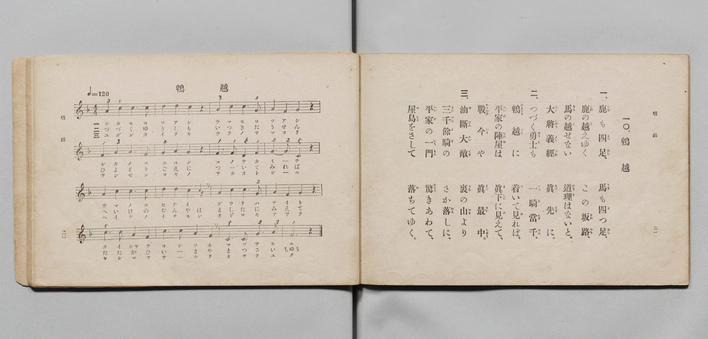

# 鵯越

> Re:Shōka 使用 AI 協助辨識與重建樂譜，可能會有錯誤。歡迎回報。

- **鋼琴伴奏版**：<br><audio controls src="hiyodorigoe.mp3"></audio>

- 文部省唱歌
- 文部省《尋常小學唱歌 第三學年用》（明治四十五年五月，索書號 4079）

## 說明

原書資訊與歌詞全文（對應 P068.jpg，書頁 p. 45，補充教材第 8 首）：
調性與拍號：へ調四拍子（F 大調 4/4 拍），元氣ヨク ♩=120
（原書標題漢字印作「鴨越」，振假名標註「ひよどりごえ」）


## 歌詞

```text
一
鹿も四つ足馬も四つ足
鹿の越えゆくこの坂道
馬の越せない道理はないと
大將義經眞先に

二
つづく勇士も一騎當千
鵯越に着いて見れば
平家の陣屋は眞下に見えて
戰今や眞最中

三
油斷大敵裏の山より
三千餘騎のさか落しに
平家の一門驚きあわて
屋島をさして落てゆく
```

## ABC

<div class="abc-score" data-abc-src="hiyodorigoe.abc" aria-label="五線譜載入中"></div>

[下載 ABC 原始檔](hiyodorigoe.abc)

## TMD 檔案連結

- [主旋律 TMD 檔案](hiyodorigoe.tmd) [[在 TMD Studio 編輯](https://tmdlang.github.io/Tmd-TS/#tmd=s7IKdvYPcrWy4qpTUCpJTLdSSM7PyUlNLsnMz7PKyszLyo8vzshPT8wuBdHZiUpwdWX5OaW5qVbpRYkpqfHG8SYG5pYIyeL80qLkVKvi5Iz8_Jz4ktSKkqT8_GyEfEFRfllqXmIeUE1BUWZeSWoKWBFCQWpZZkoqSDo1JbMkvygzMQfJ5tSiYpDzIJbElxQl5hUnF2UWgNyMUFWSkQp0XkZmMVB7JbpwQU5icipCEGhBemaeVW5-XlIp0JtKXFpaCi-3rn-xrUtBS4tL0VbB0MiAy95WwY3LxkTfxA6k79m09pfNK57PaXw6ZeOztT1gs-Bijxu6nm7ofrpjx9MN_U_X7oAoUXi-Zs2THZ0g_s4tz6eseNzQ_X5Px7MZfc827X46e_bT3sYnu6YApYDkszkd7_f0PN-y6NnsHS9mzlcABe77PZ1KXFz6Wgq21AJcCgoKT_vmg-zY3P5iRdeLjnagM1-snPe0dQXQK0DHPd3Q-6y9UyHAwMxCL6sgHegmoOKXCxoVCvQUTEyB3BeL5zxtbX02deazuROA3lOwUHi5bBrQpe_3zAKZ_mLV_mcNy0HmdvcC_QEUfdy4AygI9C5Q5OnaCUA73BSeLlkOFFMAhqwCUBSsu-dpa_OzDYsfN6943LRe4dHMlbagGACaCHIU2MnPVsx8ubDn2Z5FT9dOf9q74cneOY8bel5uWQGMs8cNQEN6nvWsf9rY_nRCL1DlixW7gbKPGzc9bup43LjycVPX48Ypjxs7wCo7uUAGP9nRAKJe7tz_uKkJ6L7HjUtebNv8ctkaZC5MReM6kDVA_U1tjxv7HzdOBoo8ndv0snEyWAVQE1QFUN-qx40tQInnE4BK10O4jxtXgMN-yfKnG9qf71v5fNvk53OAoQ5022qIY3b1gCigpY8blwJteNrd_nTxaqBLgK58uaLv-dRtT3ubwVaBEylQ2_O5DWCDl71Y1v24CejVDWAbdm5-um4b0DEvZy5-urEb6ACgPU92ABmrQeqAHmhcBlL3rGPDk91dj5tagNLP5jQ82bEWGiadYNlNO59N2w507bOpW18sBnp33dONG0Eh2dQFVQV0zcslM4AuA8o9bpz6uLH7xYS9jxung_yD7AyQ86c1vFwJTAa9jxubHjcBDQM7AOi4p5u3PW6aBNYN1LcMbMAySACDVFCe3KFAQUufi8sjszI_BZTr81OtAjIT8_IdagxqqkH2KNhYaNmBGcCsFlxZXJKaq2CooJGrZ6hromml8Lhp--Om1Y-bF4GSZnPL46ZFQBGg6LLHzfPQRYEWgcypUTBW0FUwhWIQWaNgBqRBGCRiAMToaoygIoZgNlQN2DQfwxqQI4B8oDtAZPMisA6gzUA9QMvBMiAxiKp4sOlAB4LVzCNWB8QuI6B84xKQTONSMNkP0dnUBtLZ2AYWmw4WaULY1Qg2EaqvF6KjcT6SjtlgHZNR7TIGuRIivwAuj9AJMRPsC7CZMLvAOpo6weLroK5rAcvsA7M7wGQXil2ImDUCxayprgVSzPY9btr8uAkYjcDEtx4ouhkstBUsN_9x857HzY2ImAXFDyieQBgUWzXg2ALx4LEGVgOSMwM5AMSBKAIpMQUJ4YvbPqiPNoPjcAVYDBwGQKch4nYzND77gOytcN2guJ0PlgHJNaKGNjhmNyFCqHEl1KYucNhNAYtBZEBmwUIbFKcgsRZ4XOyHuqEHZlPjBlSbQPHaOBVsNihGHzfOgdo0GawPYgcoRiHxB7MJpAMk1g3EoNgDlplQGVB6g8jBXYYWq8agWLXUNTQCRyska0KidffjZmAxtwQYHg1giVWPm_shQo-bO2iZYZGzH2qk7gaLgb0IdBg8AJobwCIQfaugkdgPlkGoBTkaM1p3QKMIRE6EBtU6cNABiyVwHABzCEgQKQ1BcgskLwNzHCx8QTKgGIalBZBz0OMWt3UQsYVgG4GFPTzDw6MUlOgeN8GKiF6wDKggAVYMWKxDRLAJuEA21jU0A8cwsMpeAsq-zUASGKnANgOQ3fK4uRcU5ODyGJh91z5u7kbEMCxmYXGGVQRkNVAoHppfjeGZGQLR4xgUUJCYgTgGHoGgSAOlXhAfWFlASlyg6yAyoEQB4gPzFDj3glStBct0I1mGHsmwOJoPziMgFig3w0IdxN8HjWcQhMUwSBzoPHjugpSUCyHFKBarwIUyzMDp8EJ1EtRImDEgGZBHYVaBYhcS9TBxWJUBqUCQ7anl4tK1U0CqkBWAXGUuAA)]
- [鋼琴伴奏 TMD 檔案](hiyodorigoe_piano.tmd) [[在 TMD Studio 編輯](https://tmdlang.github.io/Tmd-TS/#tmd=s7IKdvYPcrWy4tLSUni5df2LbV3v93S87N7zfMKWJ3u2PF3a_7yz4_2eTgUtLS5FWwVDIwMue1sFNy4bE30TO646BaVn09pfNq94Pqfx6ZSNz9b2KIHEXrTvet64-NnUmS-aNj2b0_y0dc2LVb2PG7qeTdvwdN2sp62Tnq9eClH-uKH76Ybupzt2PF8-8fmaNU92dD5du-Ppzi3Pp6wAOsPIwMhAz8DATM_AwsQcyDAwBrpEiYvLI7MyPyW_KDM9P9UqIDMxLz_Iw6HGoKaaSwEIbCy07MAMfS2F4MriktRcBUMFjVw9Q10TTSuFx03bHzetfty86HHzisfNLY-bFgFFgKLLHjfPQxfV0gebU6NQnVarYKygq2AKxSCyRsEMSIMwSMQAiGvQ1BhBRQzBbKgasIk-hjUghwD5QLeAyOZFYB1A24F6gA4Ay4DEIKriwaYDHQlWM49YHRC7jIDyjUtAMo1LwWQ_RGdTG0hnYxtYbDpYpAlhVyPYRKi-XoiOxvlIOmaDdUxGtcsY5EqI_AK4PEInxEywL8BmwuwC62jqBIuvg7quBSyzD8zuAJNdKHYhYtcIFLumuhZIsdv3uGnz4yZgVC573LQeKLoZLLQVLDf_cfOex82NSLGbC4xeUCSBIguEQVFWA44yEA8edWA1IDkzkCtAHIgikBJTkBC-CO6DemszOCJXgMXAAQF0HyKCN0MjtQ_I3grXDYrg-WAZkFwjapCDo3cTIpgaV0Jt6gIH4BSwGEQGZBYsyEERCxJrgUfIfqgbemA2NW5AtQkUuY1TwWaDovVx4xyoTZPB-iB2gKIVEokwm0A6QGLdQAyKwseNIN-DZECJDiIHdxla1BqDotZS19AIHLeQPAqJ292Pm7seNy0BhkcDWGLV4-Z-iNDj5g5a51zkfIgasbvBYmBvAh0HD4TmBrAIRN8qaET2g2UQakEOx4zaHdBoApETocG1Dhx8wDIKHA_ArAISREpHkGwDydTArAcLY5AMKJZh6QHkHPT4xW0dRGwh2MYmpJwPj1ZQwnvcBCsresEyoBLlcROoxEG3DhHJJuDS2VjX0Awcy_tBcQjMx81AEhixK8DslsfNvaAgBxfOwHy89nFzN3IsA6MZFr2wiKvBJgKyHygUD824xvBcDYHoEQ0KLUj0QFwEj0VQzIGSMYgPrD4g5S_QiRAZUMoA8YGZC5yNQarWgmW6kSxDj2lYRM0HZxYQC5StYUEP4u-DRjYIwqIZJA50HjybQcrNhZBCFYtV4CIaZuB0eBE7CWokzBiQDMijMKtAUQyJf5g4rAKBVCfI9tRiqaF9iKyhEZFqCDLMND5e2zBe2xhc4qIL1CiYxINoIKltBhbHVGWAzSQgGypiDsRGELPAqiDG4FAFNAtX1UOas7HYj80ykGvQ3ITFw8BKCK7MKF7bhEinI4rWoRXkSKUFaQ7HEMIMXVjMQByC28kQGaAusHFAJqTcAKZ7XTsFpKQf7WMYq4AuZIQpZAwWUuYCAA)]

## 分析

```text
================================================================================
📊 TMD Song Profile: [ 鵯越 ]
================================================================================
⏱  Duration:       0:32 (32.0s), 16 measures total
🎼 Key & Tempo:    首調基準 F, != 120.0 BPM, <4/4>
   - 分析範圍：      由實際發聲的音符與和弦推測調性；播放脈絡另行呈現
🎤 人聲音域:    C4 (MIDI 60) – D5 (MIDI 74) [跨度: 14 個半音 / 1.2 個八度, 難度: moderate]
   - 最低音:  C4 in [Hiyodorigoe #1 @ m.8, 0:15]
   - 最高音: D5 in [Hiyodorigoe #1 @ m.2, 0:02]
   - 適合: soprano, mezzo-soprano, contralto, tenor, baritone, bass
🏛  結構:      Hiyodorigoe (32.0s)
⚡ 編曲密度:        Peak 1 軌道同時演奏
🗝  調性診斷：       C 調性不明確（純淨自然大調，未偵測到可信轉調）
   - 風格氣質:    純淨自然大調（陽光明朗、易唱易記，無明顯調外色彩）
   - 轉調歷程:    全曲維持單一推測調性（未偵測到可信轉調）
   - 核心骨幹音:  C, A, F, G, D
   - 調性數值:    C 調性不明確 [相關度: 0.83, 穩定度: Ambiguous, 自然音純度: 100.0%]
   - 候選調性 (K-S): C 大調 (0.83), F 大調 (0.80), A 小調 (0.71)
   - 五度圈歷程:   +0
   - 各段落調性細節:
     • [Hiyodorigoe #1]: C 調性不明確 (r: 0.83, 自然音純度: 100.0%)

  [ 五度圈游移軌跡 ]
              [C ]*
         F            G  
      Bb               D  
      Eb               A  
         Ab           E  
            Db       B  
               F# 
     (* = active key center)

  [ 十二半音累積音高分佈 ]
     C  : ████████████████████████  35.1%
     C# :                            0.0%
     D  : ██████                     8.8%
     D# :                            0.0%
     E  :                            0.0%
     F  : ██████████████            20.2%
     F# :                            0.0%
     G  : ██████████                14.9%
     G# :                            0.0%
     A  : ██████████████            21.1%
     A# :                            0.0%
     B  :                            0.0%
--------------------------------------------------------------------------------
Assignment 軌道音域：
  - Piano         : C4 – D5 (14 個半音 / 1.2 個八度, 55 個音符)
================================================================================
```


## 原書掃描頁




