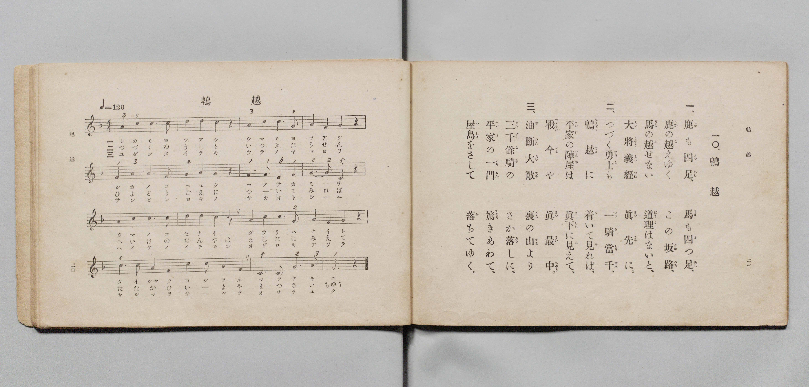

# 鵯越

> Re:Shōka 使用 AI 協助辨識與重建樂譜，可能會有錯誤。歡迎[回報](https://github.com/TMDLang/reshoka/issues)。

- **鋼琴伴奏版**：<br><audio controls src="hiyodorigoe.mp3"></audio>
- **NEUTRINO 歌聲合成版**：<br><audio controls src="hiyodorigoe_neutrino.mp3"></audio>

- 文部省唱歌
- 文部省《尋常小學唱歌 第三學年用》（明治四十五年五月，索書號 4079）

## 說明

原書資訊與歌詞全文（對應 P068.jpg，書頁 p. 45，補充教材第 8 首）：
調性與拍號：へ調四拍子（F 大調 4/4 拍），元氣ヨク ♩=120
（原書標題漢字印作「鴨越」，振假名標註「ひよどりごえ」）


## 歌詞

```text
一
鹿も四つ足馬も四つ足
鹿の越えゆくこの坂道
馬の越せない道理はないと
大將義經眞先に

二
つづく勇士も一騎當千
鵯越に着いて見れば
平家の陣屋は眞下に見えて
戰今や眞最中

三
油斷大敵裏の山より
三千餘騎のさか落しに
平家の一門驚きあわて
屋島をさして落てゆく
```

## ABC

<div class="abc-score" data-abc-src="hiyodorigoe.abc" aria-label="五線譜載入中"></div>

[下載 ABC 原始檔](hiyodorigoe.abc)

## TMD 檔案連結

- [主旋律 TMD 檔案](hiyodorigoe.tmd) [[在 TMD Studio 編輯](https://tmdlang.github.io/Tmd-TS/#tmd=s7IKdvYPcrWy4qpTUCpJTLdSSM7PyUlNLsnMz7PKyszLyo8vzshPT8wuBdHZiUpwdWX5OaW5qVbpRYkpqfHG8SYG5pYIyeL80qLkVKvi5Iz8_Jz4ktSKkqT8_GyEfEFRfllqXmIeUE1BUWZeSWoKWBFCQWpZZkoqSDo1JbMkvygzMQfJ5tSiYpDzIJbElxQl5hUnF2UWgNyMUFWSkQp0XkZmMVB7JbpwQU5icipCEGhBemaeVW5-XlIp0JvIEiVA3xclFmRUQo3KTE7Mic9OzEMKCag7ChLTU60CDAyNlbi0tBRebl3_YluXgpYWl6KtgqGRAZe9rYIbl42JvokdSOOzae0vm1c8n9P4dMrGZ2t7wIbBxR43dD3d0P10x46nG_qfrt0BUaLwfM2aJzs6QfydW55PWfG4ofv9no5nM_qebdr9dPbsp72NT3ZNAUoByWdzOt7v6Xm-ZdGz2TtezJyvAIqb93s6lbi49LUUbKkFuBQUFJ72zQfZsbn9xYquFx3tQGe-WDnvaesKoFeAjnu6ofdZe6dCgIGZhV5WQTrQTUDFLxc0KhToKZiYArkvFs952tr6bOrMZ3MnAL2nYKHwctk0oEvf75kFMv3Fqv3PGpaDzO3uBfoDKPq4cQdQEOhdoMjTtROAdrgpPF2yHCimAAxZBaAoWHfP09bmZxsWP25e8bhpvcKjmSttQTEANBHkKLCTn62Y-XJhz7M9i56unf60d8OTvXMeN_S83LICGGePG4CG9DzrWf-0sf3phF6gyhcrdgNlHzduetzU8bhx5eOmrseNUx43doBVdnKBDH6yowFEvdy5_3FTE9B9jxuXvNi2-eWyNchcmIrGdSBrgPqb2h439j9unAwUeTq36WXjZLAKoCaoCqC-VY8bW4ASzycAla6HcB83rgCH_ZLlTze0P9-38vm2yc_nAEMd6LbVEMfs6gFRQEsfNy4F2vC0u_3p4tVAlwBd-XJF3_Op2572NoOtAidSoLbncxvABi97saz7cRPQqxvANuzc_HTdNqBjXs5c_HRjN9ABQHue7AAyVoPUAT3QuAyk7lnHhie7ux43tQCln81peLJjLTRMOsGym3Y-m7Yd6NpnU7e-WAz07rqnGzeCQrKpC6oK6JqXS2YAXQaUe9w49XFj94sJex83Tgf5B9kZIOdPa3i5EpgMeh83Nj1uAhoGdgDQcU83b3vcNAmsG6hvGdiAZZAABqmgPLlDgYKWPheXR2Zlfgqo0MgH5vjMxLx8hxqDmmqQPQo2Flp2YAYwqwVXFpek5ioYKmjk6hnqmmhaKTxu2v64afXj5kWgpNnc8rhpEVAEKLrscfM8dFGgRSBzahSMFXQVTKEYRNYomAFpEAaJGAAxuhojqIghmA1VAzbNx7AG5AggH-gOENm8CKwDaDNQD9BysAxIDKIqHmw60IFgNfOI1QGxywgo37gEJNO4FEz2Q3Q2tYF0NraBxaaDRZoQdjWCTYTq64XoaJyPpGM2WMdkVLuMQa6EyC-AyyN0QswE-wJsJswusI6mTrD4OqjrWsAy-8DsDjDZhWIXImaNQDFrqmuBFLN9j5s2P24CRiMw8a0Him4GC20Fy81_3LzncXMjImZB8QOKJxAGxVYNOLZAPHisgdWA5MxADgBxIIpASkxBQvjitg_qo83gOFwBFgOHAdBpiLjdDI3PPiB7K1w3KG7ng2VAco2ooQ2O2U2IEGpcCbWpCxx2U8BiEBmQWbDQBsUpSKwFHhf7oW7ogdnUuAHVJlC8Nk4Fmw2K0ceNc6A2TQbrg9gBilFI_MFsAukAiXUDMSj2gGUmVAaU3iBycJehxaoxKFYtdQ2NwNEKyZqQaN39uBlYzC0BhkcDWGLV4-Z-iNDj5g5aZljk7IcaqbvBYmAvAh0GD4DmBrAIRN8qaCT2g2UQakGOxozWHdAoApEToUG1Dhx0wGIJHAfAHAISREpDkNwCycvAHAcLX5AMKIZhaQHkHPS4xW0dRGwh2EZgYQ_P8PAoBSW6x02wIqIXLAMqSIAVAxbrEBFsAi6QjXUNzcAxDKyyl4CybzOQBEYqsM0AZLc8bu4FBTm4PAZm37WPm7sRMQyLWVicYRUBWQ0UiofmV2N4ZoZA9DgGBRQkZiCOgUcgKNJAqRfEB1YWkBIX6DqIDChRgPjAPAXOvSBVa8Ey3UiWoUcyLI7mg_MIiAXKzbBQB_H3QeMZBGExDBIHOg-euyAl5UJIMYrFKnChDDNwOrxQnQQ1EmYMSAbkUZhVoNiFRD1MHFZlQCoQZHtqubh07RSQKmQFIFeZCwA)]
- [鋼琴伴奏 TMD 檔案](hiyodorigoe_piano.tmd) [[在 TMD Studio 編輯](https://tmdlang.github.io/Tmd-TS/#tmd=s7IKdvYPcrWy4qpTUCpJTLdSyC8qychPL0osyKi0ysgsLskvykxOzInPTsxLVIIrKs4vLUpOjS9ITE-1CjAwNFbi0tJSeLl1_YttXe_3dLzs3vN8wpYne7Y8Xdr_vLPj_Z5OBS0tLkVbBUMjAy57WwU3LhsTfRM7kGnPprW_bF7xfE7j0ykbn63tAdvwon3X88bFz6bOfNG06dmc5qeta16s6n3c0PVs2oan62Y9bZ30fPVSiPLHDd1PN3Q_3bHj-fKJz9esebKj8-naHU93bnk-ZQXQGUYGRgZ6BgZmegYWJuZAhoEx0CVKXFwemZX5KUBvpecDHZ-ZmJcf5OFQY1BTzaUABDYWWnZghr6WQnBlcUlqroKhgkaunqGuiaaVwuOm7Y-bVj9uXvS4ecXj5pbHTYuAIkDRZY-b56GLaumDzalRqE6rVTBW0FUwhWIQWaNgBqRBGCRiAMQ1aGqMoCKGYDZUDdhEH8MakEOAfKBbQGTzIrAOoO1APUAHgGVAYhBV8WDTgY4Eq5lHrA6IXUZA-cYlIJnGpWCyH6KzqQ2ks7ENLDYdLNKEsKsRbCJUXy9ER-N8JB2zwTomo9plDHIlRH4BXB6hE2Im2BdgM2F2gXU0dYLF10Fd1wKW2Qdmd4DJLhS7ELFrBIpdU10LpNjte9y0-XETMCqXPW5aDxTdDBbaCpab_7h5z-PmRqTYzQVGLyiSQJEFwqAoqwFHGYgHjzqwGpCcGcgVIA5EEUiJKUgIXwT3Qb21GRyRK8Bi4IAAug8RwZuhkdoHZG-F6wZF8HywDEiuETXIwdG7CRFMjSuhNnWBA3AKWAwiAzILFuSgiAWJtcAjZD_UDT0wmxo3oNoEitzGqWCzQdH6uHEO1KbJYH0QO0DRColEmE0gHSCxbiAGReHjRpDvQTKgRAeRg7sMLWqNQVFrqWtoBI5bSB6FxO3ux81dj5uWAMOjASyx6nFzP0TocXMHrXMucj5EjdjdYDGwN4GOgwdCcwNYBKJvFTQi-8EyCLUgh2NG7Q5oNIHIidDgWgcOPmAZBY4HYFYBCSKlI0i2gWRqYNaDhTFIBhTLsPQAcg56_OK2DiK2EGxjE1LOh0crKOE9boKVFb1gGVCJ8rgJVOKgW4eIZBNw6Wysa2gGjuX9oDgE5uNmIAmM2BVgdsvj5l5QkIMLZ2A-Xvu4uRs5loHRDIteWMTVYBMB2Q8UiodmXGN4roZA9IgGhRYkeiAugsciKOZAyRjEB1YfkPIX6ESIDChlgPjAzAXOxiBVa8Ey3UiWocc0LKLmgzMLiAXK1rCgB_H3QSMbBGHRDBIHOg-ezSDl5kJIoYrFKnARDTNwOryInQQ1EmYMSAbkUZhVoCiGxD9MHFaBQKoTZHtqsdTQPkTW0IhINQQZZhofr20Yr20MLnHRBWoUTOJBNJDUNgOLY6oywGYSkA0VMQdiI4hZYFUQY3CoApqFq-ohzdlY7MdmGcg1aG7C4mFgJQRXZhSvbUKk0xFF69AKcqTSgjSHYwhhhi4sZiAOwe1kiAxQF9g4IBNSbgDTva6dAlLSj_YxjFVAFzLCFDIGCylzAQA)]

## 分析

```text
================================================================================
📊 TMD Song Profile: [ 鵯越 ]
================================================================================
⏱  Duration:       0:32 (32.0s), 16 measures total
🎼 Key & Tempo:    首調基準 F, != 120.0 BPM, <4/4>
   - 分析範圍：      由實際發聲的音符與和弦推測調性；播放脈絡另行呈現
🎤 人聲音域:    C4 (MIDI 60) – D5 (MIDI 74) [跨度: 14 個半音 / 1.2 個八度, 難度: moderate]
   - 最低音:  C4 in [Hiyodorigoe #1 @ m.8, 0:15]
   - 最高音: D5 in [Hiyodorigoe #1 @ m.2, 0:02]
   - 適合: soprano, mezzo-soprano, contralto, tenor, baritone, bass
🏛  結構:      Hiyodorigoe (32.0s)
⚡ 編曲密度:        Peak 1 軌道同時演奏
🗝  調性診斷：       C 調性不明確（純淨自然大調，未偵測到可信轉調）
   - 風格氣質:    純淨自然大調（陽光明朗、易唱易記，無明顯調外色彩）
   - 轉調歷程:    全曲維持單一推測調性（未偵測到可信轉調）
   - 核心骨幹音:  C, A, F, G, D
   - 調性數值:    C 調性不明確 [相關度: 0.83, 穩定度: Ambiguous, 自然音純度: 100.0%]
   - 候選調性 (K-S): C 大調 (0.83), F 大調 (0.80), A 小調 (0.71)
   - 五度圈歷程:   +0
   - 各段落調性細節:
     • [Hiyodorigoe #1]: C 調性不明確 (r: 0.83, 自然音純度: 100.0%)

  [ 五度圈游移軌跡 ]
              [C ]*
         F            G  
      Bb               D  
      Eb               A  
         Ab           E  
            Db       B  
               F# 
     (* = active key center)

  [ 十二半音累積音高分佈 ]
     C  : ████████████████████████  35.1%
     C# :                            0.0%
     D  : ██████                     8.8%
     D# :                            0.0%
     E  :                            0.0%
     F  : ██████████████            20.2%
     F# :                            0.0%
     G  : ██████████                14.9%
     G# :                            0.0%
     A  : ██████████████            21.1%
     A# :                            0.0%
     B  :                            0.0%
--------------------------------------------------------------------------------
Assignment 軌道音域：
  - Piano         : C4 – D5 (14 個半音 / 1.2 個八度, 55 個音符)
================================================================================
```


## 原書掃描頁




