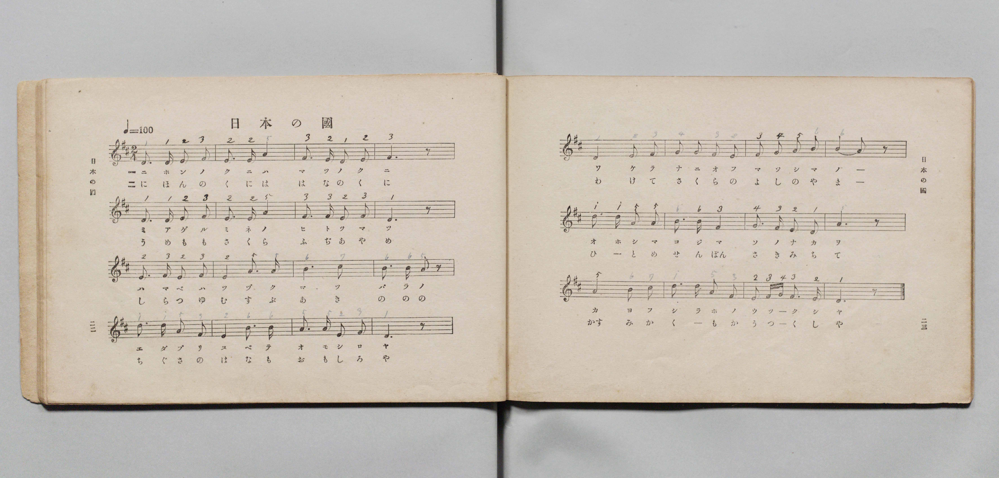
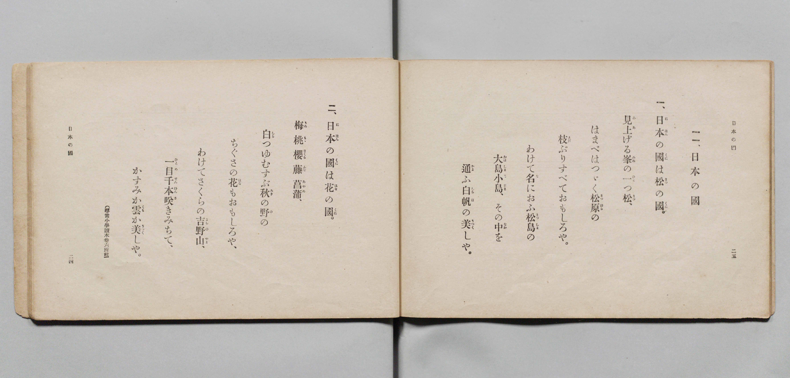

# 日本の國

> Re:Shōka 使用 AI 協助辨識與重建樂譜，可能會有錯誤。歡迎回報。

- **鋼琴伴奏版**：<br><audio controls src="nihon_no_kuni.mp3"></audio>

- 文部省《尋常小學唱歌 第三學年用》（明治四十五年五月，索書號 4079）

## 說明

原書資訊與歌詞全文（對應 P014.jpg–P015.jpg，書頁 pp. 22–25，第 11 首）：
調性與拍號：ニ調二拍子（D 大調 2/4 拍），速度 ♩=100
註記：（尋常小學讀本卷六所載）


## 歌詞

```text
一、
日本（にほん）の國（くに）は松（まつ）の國（くに）。
見上（みあ）げる峯（みね）の一（ひと）つ松（まつ）、
はまべはつゞく松原（まつばら）の
枝（えだ）ぶりすべておもしろや。
わけて名（な）におふ松島（まつしま）の
大島（おほしま）小島（こじま）、その中（なか）を
通（かよ）ふ白帆（しらほ）の美（うつく）しや。

二、
日本（にほん）の國（くに）は花（はな）の國（くに）。
梅（うめ）桃（もも）櫻（さくら）藤（ふぢ）菖蒲（あやめ）、
白（しら）つゆむすぶ秋（あき）の野（の）の
ちぐさの花（はな）もおもしろや、
わけてさくらの吉野山（よしのやま）、
一目（ひとめ）千本（せんぼん）咲（さ）きみちて、
かすみか雲（くも）か美（うつく）しや。
```

## ABC

<div class="abc-score" data-abc-src="nihon_no_kuni.abc" aria-label="五線譜載入中"></div>

[下載 ABC 原始檔](nihon_no_kuni.abc)

## TMD 檔案連結

- [主旋律 TMD 檔案](nihon_no_kuni.tmd) [[在 TMD Studio 編輯](https://tmdlang.github.io/Tmd-TS/#tmd=s7IKdvYPcrWy4qpTUCpJTLdSSM7PyUlNLsnMz7PKyszLyo8vzshPT8wuBdHZiUpwdWX5OaW5qVbpRYkpqfHG8SYG5pYIyeL80qLkVKvi5Iz8_Jz4ktSKkqT8_Gx0-fiCxPRUqwADQxOETEFRfllqXmIeUHdBUWZeSWoKWDtCQWpZZkoqSLostSgzLTM1BclJqUXFIHdDTS8pSswrTi7KLAB5BqEqv6gE6KOixIKMSquMzOKS_KLM5MSc-OzEPCTflWSkAj2Xl1hSWpSKLlqQk5iMJAjUn56ZZ5Wbn5dUCgwjTInUzKxMpDDQ0lJ4Nn3pszlrHjeuezqnW0FLi0vRVsHQwIDL3lbBhcvGSN_EDmTGs2ntL5tXPJ_T-Lih6-mG7qc7djzd0P907Y6nUzY-W9uj8HzNmic7OkH8nVueT1nxuKH7_Z6OZzP6nm3a_XT27Ke9jU92TQFKAclnczre7-l5vmXRs9k7XsycrwCKqvd7OpW4uPS1FGypBbgUFBSe9s0H2bG5_cWKrhcd7UBnvlg572nrCqBXgI57uqH3WXunAii-9bIK0h81TAYyTUFMoPOA-l4uaFQoKNBTMDICShmZgty8Zo2CoaHCy2XTgO59v2cWyI4Xq_Y_a1gOMr27F-gboOjj5m6g4JNdPUCRp2snAG1yUXi6ZDlQTAEYlgpAUbDunpcN85_uWqbwaOZKW1Bog8xasfvFihlAI8CuQwTxi3UNwPh52rv9aevaZ50NL0DaO7lAOp7saHjc0AhiQeIQqPFx4-rHjbsfN00GqoFEKViwHygOFln_bO4-sMi-x41LsKtpaAK7Zln3kx1dYIn9jxubwEonPW7qfrp5PUxwLUQ_0BVgkU2PG1eARZag2wFxI9BysNBOMGPJ46Z5QDuBSoHxBFf9uHHD4yaQ_4Dmgv01by5YDogWgEW3PW7qetw4E2zKsseNXY-bmh43Tn_c1Pu4qQXq8sdNQJ9MBEo_nQAMa6DOVWCdwHAB6twKsnDzNiQLpwMZCAuBUQWTBqreDZcGRQVUfPLjxhlQPQ2NjxvngoMAGBYgmx43AsOy83HTJJBZLxtAUQkUetwETPNAG7Y-n7n36Y42sCDQzUCR3RCbn-_rAwu2gV3UDxYEKgD7CBzRu3pIjugXXRvBIsCwhgQAjoh-tqgVandTI1D02cJmEBcYrE2gSH-2GuhEoOxUkDZwzLyYDoxToMjWx42LQNz-aS8mbQKLALW0QAyBOhboXbhfISnjcRPQmgZwBG57vhziHGAEgvIE0IEv2yHBsA4RH48bFz5unAC2fx26j0BRj5YAIAkNlgDgzgZ5fkIn0PinG8FGNIEd1bgOpAcWk9AM9Xw20HZoaoZ45mlvMyzIZwPD-3HjHkioP4V6eyrYtb3gLAF07DJ4cu8G-xMo2v1yNkQp0C2QnNSNL8aBmikvAaFAQUufi8svMyM_zy_fuzQv0yogMzEv36HGoKYaZI-CjaGZlh2Yha34hZTrDS8W9ihomCgA88Dz9Q068DJTE4sGoHUgw2oUDBV0gdBQwQhIGgNxDZilCyRNwTRIBCQOEgGpBcnCRCDQACQCNs3HsEYBWK6CRR83zwbizWBWH1jP46b1UJluIO6Hm_64eR5UvAWqFqISYRYExiPsMQLKNa6G6GrcDVQ_GcxaB9HVCDEbpAKYCBH2QNnAVAlVC1GJMAvZHvxhvauHtmFtjKQGogt7WM-H-KhpERBvAochyCdIMs290DCFhfUkqHgHOLxBLFDog2RAPFxh3Qa1pxGIm8AsEAmSmQoN036gWCdSWG-FigNd1gjRATIflAoaSQzrHZ3khDUkZJHDESKiCw1rU6CIGZJLzMFqICJmYDXoYQ1NVcDwetw8E8yCph54yD1uboWG03qkdA2Tg_q_eQKUvxIaM-hhPR1qRieQvQTMAoU-KOQaYGY1guwH0dvAYQ0KX7g9jb3QGAClcEiugLCJCGtgG5CsdB0HtgpIgcINNbRhIVoDD3eiUnbTCmgoNQDxNDBrFTQUdsJDFBoKzW1gcZA8iAfKC9vBrLXQEAeFIq6UvRAaShOgaRlRisBKDlB5AYmRJrB4F5wHiStgnQZ1GWYOIlCKTCG_FIGUxJBwNAGSIAziIcpnkAgozEExgEjr2FI23KdNG6HhCQk3kE8hZTAkdB83g0IIlrKh5Qc0rGGlCKyswRLWTbAyH1jrg8ll0JCGhDtIFlKGwOOgqQPMA4cypMSGlSKN-0gLa2CbnPKUDcKIMgJWB0LCH1bWgGIHltaxp2xYOgXWj6hh1wSqLUF-3IFUdoDE90J19MHipAlWyoPKfFwpGyYHbCCB9YDKXZD4bKgtk4FsUBMJYRG8MAdWGo37wSxQ9gDJgKKKlKS9o5mc4IYFGyiIIQUyrqLFGBjosGYJ_oIEVrU_bgYHAywJg4MeVgyDggTRTAH5FZa4oU0GoGpCBQmoFQkPcUjggXIOoj0CqzUR4qB8Bi3j4W2W6ThKklouLl07BaQWogKQq8wFAA)]
- [鋼琴伴奏 TMD 檔案](nihon_no_kuni_piano.tmd) [[在 TMD Studio 編輯](https://tmdlang.github.io/Tmd-TS/#tmd=s7IKdvYPcrWy4qpTUCpJTLdSSM7PyUlNLsnMz7PKyszLyo8vzshPT8wuBdHZiUpwdWX5OaW5qVbpRYkpqfHG8SYG5pYIyeL80qLkVKvi5Iz8_Jz4ktSKkqT8_Gx0-fiCxPRUqwADQxOETEFRfllqXmIeUHdBUWZeSWoKWDtCQWpZZkoqSDoxOTk_tyAxLzM3NQ9Jviy1qBjk-ILMxLz8eByK8otKgL4qSizIqLTKyCwuyS_KTE7Mic9OzEPyYWJRUWJeeipIJ37TSjKAiqzyEktKi1LRRQtyEpORBIEWpWfmWeXm5yWVAgMUUyI1MysTKcC0tBSeTV_6bM6ax43rns7pfr-n42X3nucTtjzZs-Xp0v7nnR3v93QqaGlxKdoqGBoYcNnbKrhw2Rjpm9iBDH42rf1l84rncxofN3Q93dD9dMeOpxv6n67d8XTKxmdrexSer1nzZEcniL9zy_MpKx43gIx_NqPv2abdT2fPftrb-GTXFKAUkHw2B2hPz_Mti57N3vFi5nwFUGQDLVbi4vLLzMjP88v3Ls3LtAoAhVGQh0ONQU01lwIQ2BiaadmBWfpaCrboAGJ_w4uFPQoaJgpAlz1f36CjAEoNelkF6ZpYNGjpgw2rUTBU0AVCQwUjIGkMxDVgli6QNAXTIBGQOEgEpBYkCxOBQAOQCNg0H8MahcfN3WDRx82zgXgzmNUH1vO4aT1UphuI--GmP26eBxVvgaqFqESYBYHxCHuMgHKNqyG6GncD1U8Gs9ZBdDVCzAapeNwIsRMiDrW_cRVULUQlwixke_CH9a4e2oa1MZIaiC7sYT0f4qOmRUC8CRyGIJ8gyTT3QsMUFtaToOId4PAGsUChD5IB8XCFdRvUnkYgbgKzQCRIZio0TPuBYp1IYb0VKg50WSNEB8h8UCpoJDGsd3SSE9aQkEUOR4iILjSsTYEiZkguMQergYiYgdWghzU0VQHD63HzTDALmnrgIfe4uRUaTuuR0jVMDur_5glQ_kpozKCH9XSoGZ1A9hIwCxT6oJBrgJnVCLIfRG8DhzUofOH2NPZCYwCUwiG5AsImIqyBZRVZ6ToObBWQAoUbamjDQrQGHu5EpeymFdBQagDiaWDWKmgo7ISHKDQUmtvA4iB5EA-UF7aDWWuhIQ4KRVwpeyE0lCZA0zKiFIGVHKDyAhIjTWDxLjgPElePm6AhDk7hpKTsXVPIL0UgJTEkHE2AJAiDeIjyGSQCCnNQDCDSOraUDfdp00ZoeELCDeRTSBkMCd3HzaAQgqVsaPkBDWtYKQIra7CEdROszH_cOBFMLoOGNCTcQbKQMgQeB00dYB44lCElNqwUadxHWlg_bV1LecoGYUQZAasDIeEPK2tAsQNL69hTNiydAutH1LBrAtWWID_uQCo7QOJ7oTr6YHHSBCvlQWU-rpQNk3vcCMpLkHIXJD4bastkIHsPpOqEWgQvzIGVRuN-MAuUPUAyoKgiJWnvaCYnuGHBBgpiSIGMq2gxBgY6rFmCvyCBVe2Pm8HBAEvC4KCHFcOgIEE0U0B-hSVuaJMBqJpQQdINK5VBwQYJPFDOQbRHYLUmQhyUz6BlPLzNMh1HSVKLpYHog9xAtIC2D4GhEa8QbRgLo4ChGg9kmcYjiUAZcAm4CAgbQL1FRYPg8kgKMQ0zATJMYsEURAlUAKiACDdBFZPtOYRlSLpg7gMbTIxzkEzBEWRwETCBYRLC93hDH6vHgGlE104BKZlE-wBl0IWMwELKXAA)]

## 分析

```text
================================================================================
📊 TMD Song Profile: [ 日本の國 ]
================================================================================
⏱  Duration:       0:33 (33.6s), 28 measures total
🎼 Key & Tempo:    首調基準 D, != 100.0 BPM, <2/4>
   - 分析範圍：      由實際發聲的音符與和弦推測調性；播放脈絡另行呈現
🎤 人聲音域:    D4 (MIDI 62) – D5 (MIDI 74) [跨度: 12 個半音 / 1.0 個八度, 難度: easy]
   - 最低音:  D4 in [NihonNoKuni #1 @ m.1, 0:00]
   - 最高音: D5 in [NihonNoKuni #1 @ m.13, 0:14]
   - 適合: soprano, mezzo-soprano, contralto, tenor, baritone, bass
🏛  結構:      NihonNoKuni (33.6s)
⚡ 編曲密度:        Peak 1 軌道同時演奏
🗝  調性診斷：       D 大調（純淨自然大調，未偵測到可信轉調）
   - 風格氣質:    純淨自然大調（陽光明朗、易唱易記，無明顯調外色彩）
   - 轉調歷程:    全曲維持單一推測調性（未偵測到可信轉調）
   - 核心骨幹音:  D, F#, E, A, B
   - 調性數值:    D 大調 [相關度: 0.85, 穩定度: Moderate, 自然音純度: 100.0%]
   - 候選調性 (K-S): D 大調 (0.85), A 大調 (0.73), B 小調 (0.64)
   - 五度圈歷程:   +2
   - 各段落調性細節:
     • [NihonNoKuni #1]: D 大調 (r: 0.85, 自然音純度: 100.0%)

  [ 五度圈游移軌跡 ]
               C  
         F            G  
      Bb              [D ]*
      Eb               A  
         Ab           E  
            Db       B  
               F# 
     (* = active key center)

  [ 十二半音累積音高分佈 ]
     C  :                            0.0%
     C# : ██                         1.9%
     D  : ████████████████████████  21.9%
     D# :                            0.0%
     E  : █████████████████████     19.5%
     F  :                            0.0%
     F# : ██████████████████████    20.5%
     G  : █████                      4.8%
     G# :                            0.0%
     A  : █████████████████████     19.0%
     A# :                            0.0%
     B  : ██████████████            12.4%
--------------------------------------------------------------------------------
Assignment 軌道音域：
  - Piano         : D4 – D5 (12 個半音 / 1.0 個八度, 86 個音符)
================================================================================
```


## 原書掃描頁






