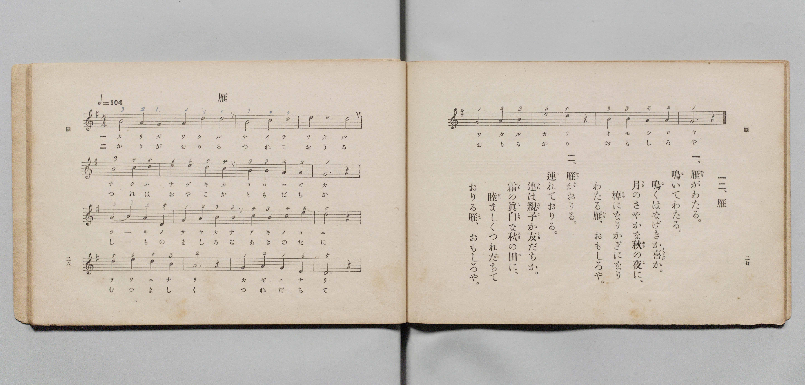

# 雁

> Re:Shōka 使用 AI 協助辨識與重建樂譜，可能會有錯誤。歡迎回報。

- **鋼琴伴奏版**：<br><audio controls src="kari.mp3"></audio>

- 文部省《尋常小學唱歌 第三學年用》（明治四十五年五月，索書號 4079）
- 尋常科第三、四學年用（第 162–163 頁）
- 文部省《尋常小學唱歌》（明治四十四年）

## 說明

原書資訊與歌詞全文（對應 P170.jpg–P171.jpg，原書 p. 162–163，尋常科第三、四學年第 21 首）：
調性與拍號：ト調四拍子（G 大調 4/4 拍），♩=104


## 歌詞

```text
> [!NOTE]
> **原頁歌詞全文（P170.jpg，原書 p. 162）**
>
> 一、雁（かり）が渡（わた）る　鳴（な）いて渡（わた）る
> 泣（な）くはなげきか喜（よろこ）びか
> 月（つき）のさやかな秋（あき）の夜（よ）に
> 棹（さを）になりかぎになり
> わたる雁（かり）　面白（おもしろ）や。
>
> 二、雁（かり）が下（お）りる　連（つ）れて下（お）りる
> 連（つれ）は親子（おやこ）か友達（ともだち）か
> 霜（しも）のましろな秋（あき）の田（た）に
> 睦（むつ）まじくつれだちて
> おりる雁（かり）　面白（おもしろ）や。
```

## ABC

<div class="abc-score" data-abc-src="kari.abc" aria-label="五線譜載入中"></div>

[下載 ABC 原始檔](kari.abc)

## TMD 檔案連結

- [主旋律 TMD 檔案](kari.tmd) [[在 TMD Studio 編輯](https://tmdlang.github.io/Tmd-TS/#tmd=s7IKdvYPcrWy4qpTUCpJTLdSSM7PyUlNLsnMz7PKyszLyo8vzshPT8wuBdHZiUpwdWX5OaW5qVbpRYkpqfHG8SYG5pYIyeL80qLkVKvi5Iz8_Jz4ktSKkqT8_Gx0-fiCxPRUqwBDcwOETEFRfllqXmIeUHdBUWZeSWoKWDtCQWpZZkoqSLo4OTEvviy1KDMtMzUFyV2pRcUgx0OtKClKzCtOLsosAPkIoSq_qAToraLEgoxKq4zM4pL8oszkxJz47MQ8JC-WZKQCfZiYl5mbmIOsNTM9M88qNz8vqRQYJkpcWloKL2c3KmhpcSnaKhgamHDZ2yq4c9mY6JvYgTQ9m9b-snnF8zmNjxu6nm7ofrpjx9MN_U_X7ng6ZeOztT0Kz9esebKjE8TfueX5lBWPG7rf7-l4NqPv2abdT2fPftrb-GTXFKAUkHw2p-P9np7nWxY9m73jxcz5CqAgf7-nE-wyiMHPl0-EGPe4oRGkGWYo0ESguIKhmdGjhsmGZsYKLxc0wnTidx6mc0Dkzi1g3Vz6Wgq21AJcCgoKT_vmg_y2uf3Fiq4XHe1A-1-snPe0dQXQjUBXPN3Q-6y9UwGUXvSyCtKBXgEyDUFMYLBAtCoU6CF8CRLFEyzAADEyVHi5bBrQL-_3zALZ_2LV_mcNy0E2d_cCQxgo-ri5AygI1AQUebp2AtAV7gpPlywHiikA41cBKArW3fNo5kpbUNSDTLFTiFb08w9xjYVwtLSAbgMGOJpvYN5AdzvQPGBKAumEaH-yowHobGACA-p53Nj9uKkLqOJxY8-zHQtBIk39jxuBDu183NT9uKHh5WZgzACVrQKraXncuAxTGcTYZ5sXI6kEyq4Hsh83Tnrc2Au05em0OWBdQATkTgar2QwUh-oFJUSg3iVAxWCpdY8bpz5uAlrXDTTk-XJQknnc2ASXfboEahqYuxpqyOKdYGVAjZMg4iAHNHWBDemDcyGKIe4HOh49HIBenrvo-cy9YMGux01AS6cD3Qz2acvjhibkgNwFTM1YAvLJDoh7wVyg_ZCAbIAEzxKwYA8wIDGVQYyFqwQqAxu4_sWyVZCkAnYRMFQg4df9tL_7ZeMUsPgKsEsXPG4ERg5ICmrUHHA4gXzQBAvXfRAPYQ3X51M2gEXAEQsL1-dzl4EDuwHqeJAJM8AxDHIhxFKgd6DhCnIhyC_khCvleR4KFLT0ubi8E4syrQIyE_PyHWoMaqpBFijYmGiBI08BW0EDKTkbXizsUdAwUQAWWs_XN-iASgdwkaCJRQPQGpBhNQrGCroKRgqGQJaRgikQ6kLFTIDsGgUzIASLgVX7GNYAg6kbyAcGDZDVA1QBTI5A1nwgDRIHya8CyTe2APEyTHmIOUZYzGkEskA8uDlLwPI9MHNQ5cGlC-6w2NVDblgg-9sELGYMDBkjIMsQKKurYIASFhC_gny4Hup3YLkBxL1g_4F83wHEIN5kIN4MVgNyv65CPEpYIPwKMQfkT1AIgnSBzWlcARRpAtILgHghmjkE0kUnOWFhBPa3KdB4oMdBHGMgywRImgCDpgacKNADA-wJsNfXgR04FeqJbnDAgERAHoDIgwIGJLIaS2BMBwcGSC3EnH1gMUgwYpgDTFqo5uANDGDtRU5gmIKTAygEjGD-BoeKoYIZKICAoYQZGiDfg5LCapirgYkX6kZomPRhl0WERFMDOFQhITADrK8fyQygDDjJIJLEMiKTxK4p5IQCKAOAUgIoe-jCiwo82QOY9UEpApL5kbM8JIODEjkoJiFxC1LfgiU1gFTDMj5pZtRycenaKYAKUwUkWpkLAA)]
- [鋼琴伴奏 TMD 檔案](kari_piano.tmd) [[在 TMD Studio 編輯](https://tmdlang.github.io/Tmd-TS/#tmd=s7IKdvYPcrWy4qpTUCpJTLdSSM7PyUlNLsnMz7MqzsjPTozPrsyvSsyML84ojTe0NDJWgqssy88pzU21Si9KTEmNN443QcgU55cWJadaFSdn5OfnxJekVpQk5edno8vHFySmp1oFGJobIGQKivLLUvMS84C6C4oy80pSU8DaEQpSyzJTUkHSxcmJefFlqUWZaZmpKUiOSi0qBrsdYkVJUWJecXJRZgHIQwhV-UUlGflAhxdkVFplZBaX5BdlJifmxGcn5iUiFCUWATWnp-am5pVYFWQm5uXHJyYn5-cWJOZlgsSUuLS0FF7Obny_p-Pl7JnPOrtfdu95PmHLkz1bni7tf7-nU0FLi0vRVsHQwITL3lbBncvGRN_EDmQ4KCysFJ5N2_B8-wqFpxv6n67d8WzBwsfNu5-2roGwFZ5O2fhsbc-zqTOfzZ3wcnYb0IqnG7qf7tjxfPnEJzs6QUpnzwYqfbpzy_MpK4B2gR39ZEfDs0Vzn7X2AZW8bO5TABr_uKGLFHseN3SDrFqy_NnaxU97G5_s6gHaAGE8m9Pxfk_P8y2Lns3e8WLmfAUDcyNTXRNDmN1w5z1fswbkwoZGVBd2AMUVDM2MHjVMNjQzVni5ABhsEJ3PprW_bF7xfE4j0K0QUyBOhTgN4qJnM_qebQL7uRds7s4tYN1c3olFmVYBoKgJ8nCoMaip5lIAAhsTLTswQ19LwRYdKIAd2PBiYY-ChgkoVJ6vb9BRACZCQ72sgnRNLBq09MGG1SgYK-gqGCkYAllGCqZAqAsVMwGyaxTMgBAsBlbtY1ij8LixG8h_3NQFZPUAVTxu6gey5gNpkDhIfhVIvrEFiJdhykPMMcJiTiOQBeLBzVkClu-BmYMqz4U_LHb1kBsWyP42AYsZA0PGCMgyBMrqKhighAXEryAfrof6_XHjJCDuBfsP5PsOIAbxJgPxZrAakPt1FeJRwgLhV4g5IH-CQhCkC2xO4wqgSBOQXgDEC9HMIZAuOskJCyOwv02BxgM9DuIYA1kmQNIEGDQ14ESBHhhgT4C9vg7swKlQT3SDAwYkAvIARB4UMCCR1VgCYzo4MEBqIebsA4tBghHDHGDSQjUHb2AA8xk5gWEKTg6gEDCC-RscKoYKZqAAAoYSZmiAfA9KCqthrgYmXqgboWHSh10WERJNDeBQhYTADLC-fiQzgDLgJINIEsuITBK7ppATCqAMAEoJoOyhCy8q8GQPYNYHpQhI5kfO8pAMDkrkoJiExC1IfQuW1ABSDcv4pJlRi1yW-mArS4GujleINowFxiCEBsUlkGUaHwuTwaLEBMgwQSjAZRKSMiCFqgBkAVwESMGCDcl-rOoQJgMZUAtQTEYYhK4JxWBwAkYzBV0BEf7CCB9s_gJGg66dAigmon2AonC2EZitzAUA)]

## 分析

```text
================================================================================
📊 TMD Song Profile: [ 雁 ]
================================================================================
⏱  Duration:       1:32 (92.3s), 40 measures total
🎼 Key & Tempo:    首調基準 G, != 104.0 BPM, <4/4>
   - 分析範圍：      由實際發聲的音符與和弦推測調性；播放脈絡另行呈現
🎤 人聲音域:    D4 (MIDI 62) – E5 (MIDI 76) [跨度: 14 個半音 / 1.2 個八度, 難度: moderate]
   - 最低音:  D4 in [Kari #1 @ m.9, 0:20]
   - 最高音: E5 in [Kari #1 @ m.4, 0:06]
   - 適合: soprano, mezzo-soprano, contralto, tenor, baritone, bass
🏛  結構:      Kari (46.2s) -> Kari (46.2s)
⚡ 編曲密度:        Peak 1 軌道同時演奏
🗝  調性診斷：       G 大調（純淨自然大調，未偵測到可信轉調）
   - 風格氣質:    純淨自然大調（陽光明朗、易唱易記，無明顯調外色彩）
   - 轉調歷程:    全曲維持單一推測調性（未偵測到可信轉調）
   - 核心骨幹音:  D, B, A, G, E
   - 調性數值:    G 大調 [相關度: 0.80, 穩定度: Moderate, 自然音純度: 100.0%]
   - 候選調性 (K-S): G 大調 (0.80), D 大調 (0.77), B 小調 (0.67)
   - 五度圈歷程:   +1 -> +1
   - 各段落調性細節:
     • [Kari #1]: G 大調 (r: 0.80, 自然音純度: 100.0%)
     • [Kari #2]: G 大調 (r: 0.80, 自然音純度: 100.0%)

  [ 五度圈游移軌跡 ]
               C  
         F           [G ]*
      Bb               D  
      Eb               A  
         Ab           E  
            Db       B  
               F# 
     (* = active key center)

  [ 十二半音累積音高分佈 ]
     C  : ██████                     6.7%
     C# :                            0.0%
     D  : ████████████████████████  25.3%
     D# :                            0.0%
     E  : ███████████               12.0%
     F  :                            0.0%
     F# :                            0.0%
     G  : ███████████████           16.0%
     G# :                            0.0%
     A  : ██████████████████        18.7%
     A# :                            0.0%
     B  : ████████████████████      21.3%
--------------------------------------------------------------------------------
Assignment 軌道音域：
  - Piano         : D4 – E5 (14 個半音 / 1.2 個八度, 114 個音符)
================================================================================
```


## 原書掃描頁




