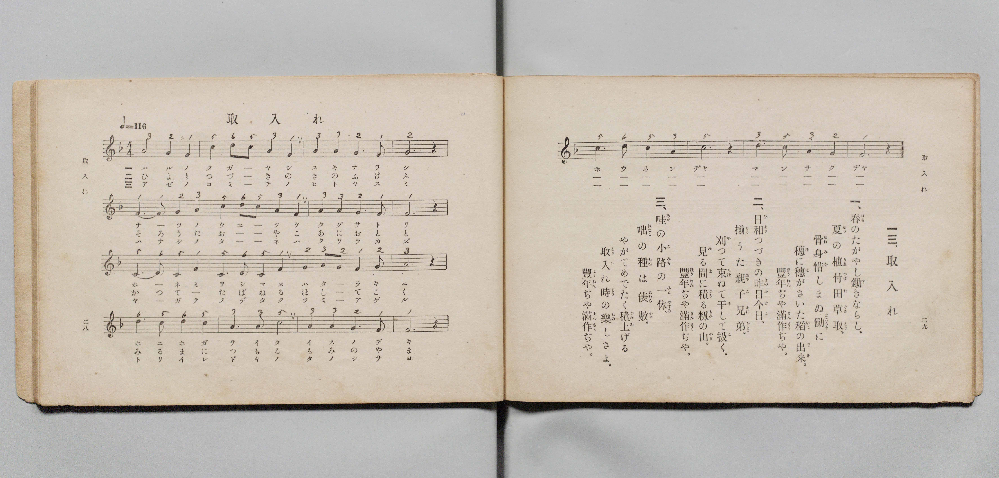

# 取入れ

> Re:Shōka 使用 AI 協助辨識與重建樂譜，可能會有錯誤。歡迎回報。

- **鋼琴伴奏版**：<br><audio controls src="toriire.mp3"></audio>

- book: 新編 小學校・公學校 唱歌教材集（尋常科三・四學年用）
- 一條慎三郎 編《新編 小學校・公學校 唱歌教材集》（大正十二年十二月，索書號 0725-41）
- 文部省《尋常小學唱歌》

## 說明

> [!NOTE]
> **原書資訊與歌詞全文**（對應 `P190.jpg`–`P191.jpg`，原書 p. 182–183，尋常科三・四學年第 31 首）：
> - **出處原曲**：文部省唱歌（1911年《尋常小學唱歌》第二學年）
> - **調性與拍號**：ヘ調四拍子（F 大調 4/4 拍），♩= 116
> - **版面校勘**：本集（`P191.jpg`）五線譜與簡譜均以 4/4 拍記譜（每行 4 小節，共 20 小節）；第 11 小節為 `2 32 1 2`（無附點），第 13 小節五線譜與簡譜均印作 `6. 6 6 5`，第 19 小節五線譜與簡譜均印作 `6. 5 3 2`（異於昭和六年《新定兒童唱歌》之 `6. 5 5 3`）。此外 `P190.jpg` 第三段首句「一休」旁振假名印作「やすみ」，而 `P191.jpg` 譜下歌詞印作「ヒ ト ヤ ス ミ」。
>
> **一、**
> 春（はる）のたがやしすきならし
> 夏（なつ）の植付（うえつけ）田草取（たぐさと）り
> 骨身惜（ほねみを）しまぬ働（はたらき）に
> 穗（ほ）に穗（ほ）が咲（さ）いた稻（いね）の出來（でき）
> 豐年（ほうねん）ぢや　滿作（まんさく）ぢや。
>
> **二、**
> 日和（ひより）つづきの昨日今日（きのふけふ）
> 揃（そろ）ふた親子（おやこ）兄（あに）おとゝ
> 刈（か）つて束（たば）ねる干（ほ）してこく
> 見（み）る間（ま）に積（つも）る籾（もみ）の山（やま）
> 豐年（ほうねん）ぢや　滿作（まんさく）ぢや。
>
> **三、**
> 畦（あぜ）の小路（こみち）の一休（やすみ）
> 咄（はなし）の種（たね）は俵數（たはらかず）
> やがて目出度（めでたく）積上（つみあ）げる
> 取入（とりい）れ時（どき）の樂（たの）しさよ
> 豐年（ほうねん）ぢや　滿作（まんさく）ぢや。


## 歌詞

```text
（TMD 檔案未包含歌詞註解）
```

## ABC

<div class="abc-score" data-abc-src="toriire.abc" aria-label="五線譜載入中"></div>

[下載 ABC 原始檔](toriire.abc)

## TMD 檔案連結

- [主旋律 TMD 檔案](toriire.tmd) [[在 TMD Studio 編輯](https://tmdlang.github.io/Tmd-TS/#tmd=s7IKdvYPcrWy4qpTUCpJTLdSSM7PyUlNLsnMz7PKyszLyo8vzshPT8wuBdHZiUpwdWX5OaW5qVbpRYkpqfHG8SYG5pYIyeL80qLkVKvi5Iz8_Jz4ktSKkqT8_Gx0-fiCxPRUqwBDSwOETEFRfllqXmIeUHdBUWZeSWoKWDtCQWpZZkoqSLo4OTEvviy1KDMtMzUFyV2pRcUgx0OtKClKzCtOLsosAPkIoSq_qAToraLEgoxKq4zM4pL8oszkxJz47MQ8JC-WZKQCfVieX4TkcqDC9Mw8q9z8vKRSYIgocWlpKTztn_a0denjph4FLS0uRVsFQ0MzLntbBTcuGxN9EzuQVpDvrRSeTdvwfPsKhacb-p-u3fFswcLHzbuftq6BsBWeTtn4bG3Ps6kzn82d8HJ22_s9HU83dD_dseP58olPdnSClM6eDVT6dOeW51NWvN_TCXbSkx0NzxbNfdbaB1TysrlPAWj844YuUux53NANsmrJ8mdrFz_tbXyyqwdoA4TxbE7H-z09z7csejZ7x4uZ8xUMzI1MdU0MYXY_m9b-snnF8zmNQBshToVYCLEAaK4SF5e-loIttQCXgoKCnUK0op9_iGsshKOl9bRvPsh1m9tfrOh60dEOtPjFynlPW1cAHaelBQ7D3mftnQoJoESml1WQnvCoYTKIYwjmAL0HMUChQE_B0MIIKGloYQwSxRX0a9YoGBsqvFw2DRgK7_fMgjhDF-SQ9l0vZk4Fm7YJZPMsePBAwgPoFqCthkAzcAUX0GxQ6IPtAZqOMPrFqv3PGpaDfNfdC4wHsOmPm2cAhYHuAoo9XTsBaLqbAjASgWIKwDSnABQFO7Dn0cyVkPQIN-15Z8fLuYuAKeFp9wyIQ-esgaQ35HDpfLJryvPts16snQO09_mGhUDG07ntT3YvhRn_YsUMoBhQ17P1_S8W9iiYgJLb8_UNoMBr3ahgZADnA50xGxRuhoZQoedNuxQSjBSMjRQMFYyAdnU8b1n4cmbLy93zIG4GKzaGKsbqjqe9G57snaOQYKanYAaEpqCIBOuyJFKXqYIx1OqpG55N2_Nsxtqnk4DuXguJHmD-ebpu1tPWSc9XL4VHz5Od3VCtQM2gEHrc0PRs7ZKnS6YhpS4FUCTu6Hy2biswiTztX_q4oQeYRZ_smfi4offZ9MZnPeufNrY_ndALcQpQ9nFTy-PGmY8b9wMVAD3xoqEHbBokGhSA7n6yoxuaqOFamicpPG7uAOIlCo-bdgLp-UDNQNeA4xiWMYDWPm5oBJZHYP6zGUuBnn3cuP5xEzC7dz5uXPe4cf7jRoj108Eu6H3cuOpxE1BqOkTL0yX9YC2rHjcugWh5tqT3ye4ZYMG2x41AcsnjxolAqedTNrzo7QQWgmApoLETHjdOfdwIKqQeN3VBTHu5asWLXaufNYNSzOPG3Y8b14L83DQJbDLQAfseN6552gwMArAjgYaAXAJKw48bV0NMeL5yOkQvRBCV2_N00iYwdyqYC_TU_OcrgFJAESB7LcT9wCz6ZB8ooT9uXA4xHGLyi40TwFkO4jCg19Y-bpoM1rIIFD4NDc927wcGPVjBPqAU2HfAwIErQAv5XcDkggj56UuBSQusd9Pjpg5ggIA1AoNuKTjM1z2bsQKo5snuLiAJVgYSfNy4FRi2QBLuyGf9zWDZuY-bIMECVDD_xbJVkMz_uLELHJUgZz9tbQGLNAFDCayyCxgXj5vmQqO1A1ioA2UhyQDojGXP5s6HRdwGsCDQ-91Pd0LCExK8wAhaBjQc6GtoiC0DVRrAGARHcffLaUB7QYEDixpIPC553NQEUfB8I1AK6Hegk8BagHGxcSNYBOhmkC7aRASw7EZExPOpy2DBAjQB7IYN_S-2rwcLAo3a_7hxIUQckmNhzgNlTrgLn06ChC0wiQLzBTAFgtQ_X7EOFoCQlLb-yf6tz6bugAkCMx1QsPtx4yy4OWCTe4Ch-nw2KFk-3QV2W1MjOGUCtYA8BQzGJzuAqQWS0YDOAwdm4yRgeEIdA252gBUA4xcYy0C3AUO759lMoEqg4EpYDlr3bAVEBGgy0KmQCJ0KTI3UDHbKK3goUNDS5-IKAbazMouAjcPMxLx8hxqDmmqQHQo2Flrg6FXA1rCAFL4NoNpIA1Yd6SjASlNNLBqANoEMqwHWBrpgaATEhkBcAyzkdUE1C1gGIgJigTBIDUisBsqCQAOQGrBpPoY1CsBIh4oDYwtENq4DmwGMAjCvByzTAmZPh8rMBPN6weQqqN5OsAxIBQzGI-wxAsltgtvTASa7oKYtAZuzFMlMmAsQPGAhAtHbOBEsA-Fh2GMMkmuC2dM4B8W0yWDefjC5EEUG5DJgyoT7FMSbCZYBqUa1B3-c7uohJ05BsQaKJ1AsgeKNuDiF6MIep5BYAfkDErown7aB_TgRSQbERsT2BDA5Fap3BUgGHE-44nQuRGVTLzROIOaAZEC6YOkGEvKgeAHJrAbzEKZC7QGHP644haRRkL8gaQw9la4FkyBVCBeAecB0ibCnGyw-C8MeAvm0k5w4NQUZDYzEeAgLmlWxCUJiHdTEhMQuIo9ji9ndcN9A_AxKoaBYmgQVnQ7E-8CsNcjhAAkncGhA8hUsJnDFLKgsQE5By5DCG8TfAHMBuNSAuQwWOyDVkHgHyfRjtwcUs9D8Bi9pYPY0NUJFl8PjGGQKoryA5GNQmgJWNFA9MDcTGbPAPgk5MWsGNh_UmtcF51NYfBmDeSBIam6FxCkoPmChCAoLkAwsJ7bAQx4iDslXkBQAygmQkIKVmbjiFFKagcIJlkZAKQAWpiCZJqRQBIUoJHwhYQ21BxhjIB0g_TjiFJqTQSUH1KXA8QaIPSuhbgWVFxDzkHMxpKSH1CEgv4NcAKorSIhTYHeKCrkVUQijRBk06iHFMiSrEhOtbfCsAssQoMYIur_gYQpSBol5RJrHpgEpYuliEzhqaW1TLReXrp0CtE2lgMpU5gIA)]
- [鋼琴伴奏 TMD 檔案](toriire_piano.tmd) [[在 TMD Studio 編輯](https://tmdlang.github.io/Tmd-TS/#tmd=s7IKdvYPcrWy4qpTUCpJTLdSSM7PyUlNLsnMz7MqzsjPTozPrsyvSsyML84ojTe0NDJWgqssy88pzU21Si9KTEmNN443QcgU55cWJadaFSdn5OfnxJekVpQk5edno8vHFySmp1oFGFoaIGQKivLLUvMS84C6C4oy80pSU8DaEQpSyzJTUkHSxcmJefFlqUWZaZmpKUiOSi0qBrsdYkVJUWJecXJRZgHIQwhV-UUlGflAhxdkVFplZBaX5BdlJifmxGcn5iUqcWlpKTztn_a0denjpp73ezpezp75rLP7Zfee5xO2PNmz5enS_vd7OhW0tLgUbRUMDc247G0V3LhsTPRN7EDGgzxqpfBs2obn21coPN3Q_3TtjmcLFj5u3v20dQ2ErfB0ysZna3ueTZ35bO6El7PbgFY83dD9dMeO58snPtnRCVI6ezZQ6dOdW55PWQG0C-zsJzsani2a-6y1D6jkZXOfAtD4xw1dpNjzuKEbZNWS5c_WLn7a2_hkVw_QBgjj2ZyO93t6nm9Z9Gz2jhcz5ysYmBuZ6poYwux-Nq39ZfOK53MagTZCnAqxEGIB0FwlLi7PvJKifKuAzMS8_CAPhxqDmmouBSCwsdCyAzNqFEzjFXSB0CwewjIGYqAgWAwCDcAiZmC2KVjeCCxiiK6GqxbFPh9k-0zg9hnGK0QbxgItg9BwASBlAOSZAHkmUGnTeAx5kB0hwGSRWQRMojh9pa-lYIsOFJ6vWQOMrRcLexQ0TEBR83x9g44CMJkb6mUVpGti0aClD3UyyM8gCPI3yNeQ8DGDhgZEBMSChQ1IrAbKQg4fkGk-hjUKjxvXQ8UfN3WDyMZ1YDMeN84H83rAMi1g9nSozEwwrxdMroLq7QTLgFTAICgGofYYgeQ2we3pAJNdUNOWgM1ZimQmzAUI3uPGrRC9jRPBMhAehj3GILkmmD2Nc1BMmwzm7QeTC1FkQC573LgC7lMQbyZYBqQa1R78cbqrh5w4haReQ3AsIdI8oTjFTPOIOIXECsgfkNCF-bQN7MeJSDIgNiK2J4DJqVC9K0Ay4HjCFadzISqbeqFxAjEHJAPSBUs3kJAHxQtIZjWYhzAVag84_HHFKSSNgvwFSWPoqXQtmASpQrgAzAOmS4Q93WDxWRj2EMinneTEKVpRBs2q2AQhsW4E5kFKM1gexxazu-G-gfgZlEJBsTQJKjodiPeBWWuQwwESTuDQgOQrWEzgillQWYCcgpYhhTeIvwHmAnCpAXMZLHZAqiHxDpLpx24PKGah-Q1e0sDsaWqEii6HxzHIFER5AcnHoDT1uBHkd5AemJuJjFlgHUpOzEJqHzMwDcqnsPgyhtdUpOZWSJyC4gMWiqCwAMnAcmILPOQh4pB8BUkBoJwACSlYmYkrTiGlGSicYGkElAJgYQqSaUIKRVCIQsIXEtZQe4AxBtIB0o8jTqE5GVRyQF3aBPPPSqhbQeUFxDzkXAwp6SF1CMjvIBeA6goS4vTJrilUyK2UNDwwo7UNnlVgGWIRIt3D_QUPU5AySMwj0jw2DUgRSxebwFFLa5vQm1QkNtwQAtC2G1QcFMPQRhyIAWq8kWgQzkYgfnPMQAJm8bkYTsBjFtRGKEV1JxHfuNW1UwC3oRWADGisRPsAVSBzjVC5xmCuMhcA)]

## 分析

```text
================================================================================
📊 TMD Song Profile: [ 取入れ ]
================================================================================
⏱  Duration:       1:22 (82.8s), 40 measures total
🎼 Key & Tempo:    首調基準 F, != 116.0 BPM, <4/4>
   - 分析範圍：      由實際發聲的音符與和弦推測調性；播放脈絡另行呈現
🎤 人聲音域:    C4 (MIDI 60) – D5 (MIDI 74) [跨度: 14 個半音 / 1.2 個八度, 難度: moderate]
   - 最低音:  C4 in [Toriire #1 @ m.9, 0:16]
   - 最高音: D5 in [Toriire #1 @ m.2, 0:02]
   - 適合: soprano, mezzo-soprano, contralto, tenor, baritone, bass
🏛  結構:      Toriire (41.4s) -> Toriire (41.4s)
⚡ 編曲密度:        Peak 1 軌道同時演奏
🗝  調性診斷：       F 大調（純淨自然大調，未偵測到可信轉調）
   - 風格氣質:    純淨自然大調（陽光明朗、易唱易記，無明顯調外色彩）
   - 轉調歷程:    全曲維持單一推測調性（未偵測到可信轉調）
   - 核心骨幹音:  F, A, C, G, D
   - 調性數值:    F 大調 [相關度: 0.84, 穩定度: Moderate, 自然音純度: 100.0%]
   - 候選調性 (K-S): F 大調 (0.84), C 大調 (0.72), A 小調 (0.70)
   - 五度圈歷程:   -1 -> -1
   - 各段落調性細節:
     • [Toriire #1]: F 大調 (r: 0.84, 自然音純度: 100.0%)
     • [Toriire #2]: F 大調 (r: 0.84, 自然音純度: 100.0%)

  [ 五度圈游移軌跡 ]
               C  
        [F ]*          G  
      Bb               D  
      Eb               A  
         Ab           E  
            Db       B  
               F# 
     (* = active key center)

  [ 十二半音累積音高分佈 ]
     C  : ██████████████████████    23.0%
     C# :                            0.0%
     D  : █████████                  9.5%
     D# :                            0.0%
     E  :                            0.0%
     F  : ████████████████████████  25.0%
     F# :                            0.0%
     G  : █████████████████         17.6%
     G# :                            0.0%
     A  : ████████████████████████  25.0%
     A# :                            0.0%
     B  :                            0.0%
--------------------------------------------------------------------------------
Assignment 軌道音域：
  - Piano         : C4 – D5 (14 個半音 / 1.2 個八度, 126 個音符)
================================================================================
```


## 原書掃描頁




