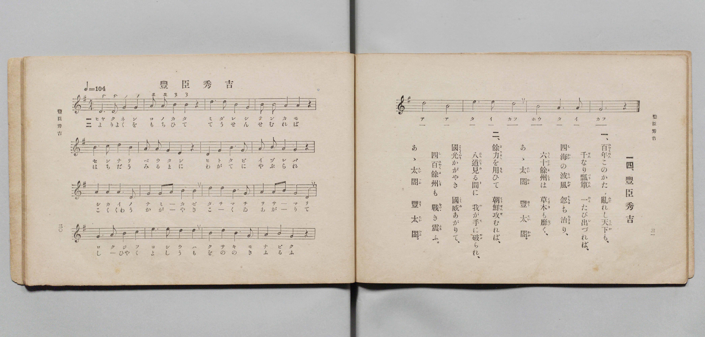

# 豐臣秀吉

> Re:Shōka 使用 AI 協助辨識與重建樂譜，可能會有錯誤。歡迎回報。

- **鋼琴伴奏版**：<br><audio controls src="toyotomi_hideyoshi.mp3"></audio>

- 文部省《尋常小學唱歌 第三學年用》（明治四十五年五月，索書號 4079）

## 說明

原書資訊與歌詞全文（對應 P018.jpg，書頁 pp. 30–31，第 14 首）：
調性與拍號：ト調四拍子（G 大調 4/4 拍），速度 ♩=104


## 歌詞

```text
一、
百年（ひやくねん）このかた亂（みだ）れし天下（てんか）も、
千（せん）なり瓢簞（べうたん）一（ひと）たび出（い）づれば、
四海（しかい）の波風（なみかぜ）忽（たちま）ち治（をさ）まり、
六十餘州（ろくじふよしう）は草木（くさき）も靡（なび）く、
あゝ太閤（たいかふ）　豐太閤（ほうたいかふ）。

二、
餘力（よりよく）を用（もち）ひて朝鮮（てうせん）攻（せ）むれば、
八道（はちだう）見（み）る間（ま）に我（わ）が手（て）に破（やぶ）られ、
國光（こくくわう）かがやき國威（こくゐ）あがりて、
四百餘州（しひやくよしう）も戰（をのゝ）き震（ふる）ふ。
あゝ太閤（たいかふ）　豐太閤（ほうたいかふ）。
```

## ABC

<div class="abc-score" data-abc-src="toyotomi_hideyoshi.abc" aria-label="五線譜載入中"></div>

[下載 ABC 原始檔](toyotomi_hideyoshi.abc)

## TMD 檔案連結

- [主旋律 TMD 檔案](toyotomi_hideyoshi.tmd) [[在 TMD Studio 編輯](https://tmdlang.github.io/Tmd-TS/#tmd=s7IKdvYPcrWy4qpTUCpJTLdSSM7PyUlNLsnMz7PKyszLyo8vzshPT8wuBdHZiUpwdWX5OaW5qVbpRYkpqfHG8SYG5pYIyeL80qLkVKvi5Iz8_Jz4ktSKkqT8_Gx0-fiCxPRUqwADQwuETEFRfllqXmIeUHdBUWZeSWoKWDtCQWpZZkoqSLostSgzLTM1BclJqUXFIHdDTS8pSswrTi7KLAB5BqEqv6gE6KOixIKMSquMzOKS_KLM5MSc-OzEPCTflWSkAj0Hka5EFy4A2oNqYmZ6Zp5Vbn5eUikwlDAlUjOzMpFCQUtL4cXGCS_aFz9f3vB0QqeClhaXoq2CoYEJl72tgjuXjYm-iR3IjGfT2l82r3g-p_FxQ9fTDd1Pd-x4uqH_6dodT6dsfLa2R-H5mjVPdnSC-Du3PJ-y4nFD9_s9Hc9m9D3btPvp7NlPexuf7JoClAKSz-Z0vN_T83zLomezd7yYOV8BFFnv93QqcXHpaynYUgtwKSgoPO2bD7Jjc_uLFV0vOtqBznyxct7T1hVArwAd93RD77P2TgVQjOtlFaQD3QRU_HJBo0JBgZ6CscGjhsnGhiCHrlmjYGii8HLZNKAj3--ZBTL4xar9zxqWg4zs7gV6ASj6uLkDKAj0KVDk6doJQOPdFZ4uWQ4UUwAGoAJQFKy752XD_Ke7lik8mrnSFhTEIMOe7Gh43NAIYj2fuQ8YREC9jxs3PW5qedzY_7hx7eOmyUCtjxsnP25c97ix-3Hj_Ce7msBq9j9uXACSaup53Dj96ZKVT3aAwvxx4zKgFqBKsFQT1Oinvc1gudkw41Y9bup6PnnR8w3zwOI7Hze2AY2GyAJdBHVE4wqw4vmPGzc_bd8FFmwBiywF27oBZjrQ31u3g6Wng90IUbTu2eZFLxcBjQCKrwK7Fyg1Byj1dP9esCDQ3IWPG_eBFS8EphSQYNOkx41TwSL7gE6EWdC6FpiEXi6Z8XQ72L1NveDAmfG4cevjJoitbWA961_0dj6bA7ESqGDq40ZQwAPD4eXchTB3bAar7Ica_bix6XHT3KdLVr2ctgTmKGDQA126FaSuoQGYO5Bkd0MDCkVNEyQid_VAzQQ5tGs22KFA1AV2Yj_YHZOAeQMs3gT0MdgdwEBe9mzO3Jfr1kEjD2Q-NJqeTQEHSSPQKKDeBtQwb139shGoCCi9HhyMCyBh8GIZJBXsB-vpfjkNogYSyKufdUwEWw92TWPPs05okoHIPl8ATn2gpLcNrB2cuKD2zel-2gpMwkDVwNQFDNt-oCmwYAeGRA9YWy9I2YpGhLImYF4AKgB6F6igC-Q_eJIBJndEjIKiEJbokWO0qelZxwZYulgHjCmwcb0v54CyMDj6wQkdyADGAtWiE2gQ5UUQFCho6XNxheRX5pfk52Z6AOuLyvzijEyrgMzEvHyHGoOaapBtCjYWWnZgBrZCEFK6NrxY2KOgYaIALHefr2_QgZdcmlg0AO0EGVajYBqvoAshDKG4RsEICI2BLBA2AIuYAUkQNoWKgtSYgllGMDVg83wMaxQeN0963LwEKPS4aT2IbO4Fk5vB2h43bQay-4D0arCK_UASZDlI23ywugYwuQYsux0q0wbWD9XTvAimB2KlEcjUDrD6LjAJykxgxiSolU3AWF8IxJtAoo3LEFaC2cAYBpOzwXomQ2VmA9kNQNwDltsAtxJ_HOzqIScOYGENCktIDJjFAxlAAho1kEgASYGUgJSCIgKk0RCuCS0SmnbDQ_1xMzhcmldBQ3MmUHYZNOwhKmAxAAowYE0Fj5nHzdDgaFoCZLfC4qV5AmYMNILjGhjMIHIBPFhBMvuB-ruB9D6wKCgOofY1gaOpERLEkKgAyYJkWoDsbUC6E-wWkApign9HJznBDw5nYPqOh7DABCiBg0LaBBzaUCEQUxdVCFkVKIsgxwAo9YJcvxocfqBw64OGMyQ-wOkdmg_2QP0NCnWQXCMQz4OyIHrAibdpK1gMJAOJUeQYAMUVKAz7QRgWuLBI6EYENTBwQWxQtkRog2gEyYIiFyTehKQD5GBIJBGIAmCxTVYpBDYflJxh5QtIBFbawPMEhAkKc1j6R2Qa9EJoLTT01wPxDnBoTYWG5AqwOCh2QPkAJAPyOCj0wWkYEsZNIP2QsgYRY6CggqhCT_3T4YEIqqTgoQkvmsAKoCUNsDyCyICzW-M6JBIWJxAnQOIMxCaq7JlCVuKHOhySgGEhDyvrISLQDAIJa5BSSFkEg-glDyjMIGEPY8FSNjQfQMtxWHwAGzOgaIBogWYAoEKQJoRCEEQv9GlsUS0Xl66dAkbNrAAUVOYCAA)]
- [鋼琴伴奏 TMD 檔案](toyotomi_hideyoshi_piano.tmd) [[在 TMD Studio 編輯](https://tmdlang.github.io/Tmd-TS/#tmd=s7IKdvYPcrWy4qpTUCpJTLdSSM7PyUlNLsnMz7PKyszLyo8vzshPT8wuBdHZiUpwdWX5OaW5qVbpRYkpqfHG8SYG5pYIyeL80qLkVKvi5Iz8_Jz4ktSKkqT8_Gx0-fiCxPRUqwADQwuETEFRfllqXmIeUHdBUWZeSWoKWDtCQWpZZkoqSDoxOTk_tyAxLzM3NQ9Jviy1qBjk-ILMxLz8eByK8otKgL4qSizIqLTKyCwuyS_KTE7Mic9OzEPyYWJRUWJeeipIJ37TSjKAiqDmVKILFwDdk5-HbHVmemaeVW5-XlIpMEgxJVIzszKRgkxLS-HFxgkv2hc_X97wdELn-z0dL7v3PJ-w5cmeLU-X9j_v7Hi_p1NBS4tL0VbB0MCEy95WwZ3LxkTfxA5k8LNp7S-bVzyf0_i4oevphu6nO3Y83dD_dO2Op1M2Plvbo_B8zZonOzpB_J1bnk9Z8bihG2j8sxl9zzbtfjp79tPexie7pgClgOSzOUB7ep5vWfRs9o4XM-crgKIbaLESF1dIfmV-SX5upgcwWirzizMyrQJAYRXk4VBjUFPNpQAENhZadmCGvpaCLTqAOKLhxcIeBQ0TBaDznq9v0FEAJQq9rIJ0TSwatPTBhtUomMYr6EIIQyiuUTACQmMgC4QNwCJmQBKETaGiIDWmYJYRTA3YPB_DGoXHzZMeNy8BCj1uWg8im3vB5GawtsdNm4HsPiC9GqxiP5AEWQ7SNh-srgFMrgHLbofKtIH1Q_U0L4LpgVhpBDK1A6y-C0x2PG7sBzMmQa1sUnjcuBCIN4FEG5chrASzHze2gcnZYD2ToTKzgewGIO4By22AW4k_Dnb1kBMHsLAGhSUkBszigQwgAY0aSCSApEBKQEpBEQHSaAjXhBYJTbvhof64GRwuzaugoTkTKLsMGvYQFbAYAAXY42ZIWEJkocHRtATIboXFS_MEzBhoBMc1MJhB5AJ4sIJk9gP1dwPpfWBRUBxC7WsCR1MjJIghUQGSBcm0ANnbgHQn2C0gFcQE_45OcoIfHM7A9B0PYYEJUAIHhbQJOLShQiCmLqoQsipQFkGOAVDqBbl-NTj8QOHWBw1nSHyA0zs0H-yB-hsU6iC5RiCeB2VB9IATb9NWsBhIBhKjyDEAiitQGPaDMCxwYZHQjQhqYOCC2KBsidAG0QiSBUUuSLwJSQfIwZBIIhAFwCKPrFIIbD4oOcPKF5AIrLSB5wkIExTmsPSPyDTohdBaaOivB-Id4NCaCg3JFWBxUOyA8gFIBuRxUOiD0zAkjJtA-iFlDSLGQEEFUYWe-qfDA3ETLHxhhoKzE1gBtKQBlkcQGXB2a1yHRMLiBOIESJyB2ESVPVPISvxQh0MSMCzkYWU9RASaQSBhDVIKKYtgEL3kAYUZJOxhLFjKhuYDaDkOi4_ZkGiAaIFmAKBCkCaEQhBEL_RpbFEtzorZB7liNoFWzKC6NF4h2jQ-VsEQSBvGwkSALKCAAZBrAuSZYJEG0UB5qDFQaZgkKPyBLLP4XLhCsBIUi5AEEAYh9CFYwCILyDQCsowRQiCmMYoIsiKgDJrTUKxF5oPtgbkd5B6CLkOyE6wJOXhQ_Y1kHjxEQXGka6eAEU3RPkAl2CWMwBLKXAA)]

## 分析

```text
================================================================================
📊 TMD Song Profile: [ 豐臣秀吉 ]
================================================================================
⏱  Duration:       0:46 (46.2s), 20 measures total
🎼 Key & Tempo:    首調基準 G, != 104.0 BPM, <4/4>
   - 分析範圍：      由實際發聲的音符與和弦推測調性；播放脈絡另行呈現
🎤 人聲音域:    D4 (MIDI 62) – E5 (MIDI 76) [跨度: 14 個半音 / 1.2 個八度, 難度: moderate]
   - 最低音:  D4 in [ToyotomiHideyoshi #1 @ m.1, 0:00]
   - 最高音: E5 in [ToyotomiHideyoshi #1 @ m.3, 0:04]
   - 適合: soprano, mezzo-soprano, contralto, tenor, baritone, bass
🏛  結構:      ToyotomiHideyoshi (46.2s)
⚡ 編曲密度:        Peak 1 軌道同時演奏
🗝  調性診斷：       E 小調（純淨自然小調，未偵測到可信轉調）
   - 風格氣質:    純淨自然小調（陰鬱抒情、旋律集中，無明顯調外色彩）
   - 轉調歷程:    全曲維持單一推測調性（未偵測到可信轉調）
   - 核心骨幹音:  B, E, D, G, A
   - 調性數值:    E 小調 [相關度: 0.77, 穩定度: Moderate, 自然音純度: 100.0%]
   - 候選調性 (K-S): E 小調 (0.77), G 大調 (0.73), B 小調 (0.67)
   - 五度圈歷程:   +4
   - 各段落調性細節:
     • [ToyotomiHideyoshi #1]: E 小調 (r: 0.77, 自然音純度: 100.0%)

  [ 五度圈游移軌跡 ]
               C  
         F            G  
      Bb               D  
      Eb               A  
         Ab          [E ]*
            Db       B  
               F# 
     (* = active key center)

  [ 十二半音累積音高分佈 ]
     C  : ██                         2.0%
     C# :                            0.0%
     D  : ████████████████          17.6%
     D# :                            0.0%
     E  : ████████████████████      21.6%
     F  :                            0.0%
     F# :                            0.0%
     G  : ████████████████          17.6%
     G# :                            0.0%
     A  : ██████████████            14.9%
     A# :                            0.0%
     B  : ████████████████████████  26.4%
--------------------------------------------------------------------------------
Assignment 軌道音域：
  - Piano         : D4 – E5 (14 個半音 / 1.2 個八度, 74 個音符)
================================================================================
```


## 原書掃描頁




