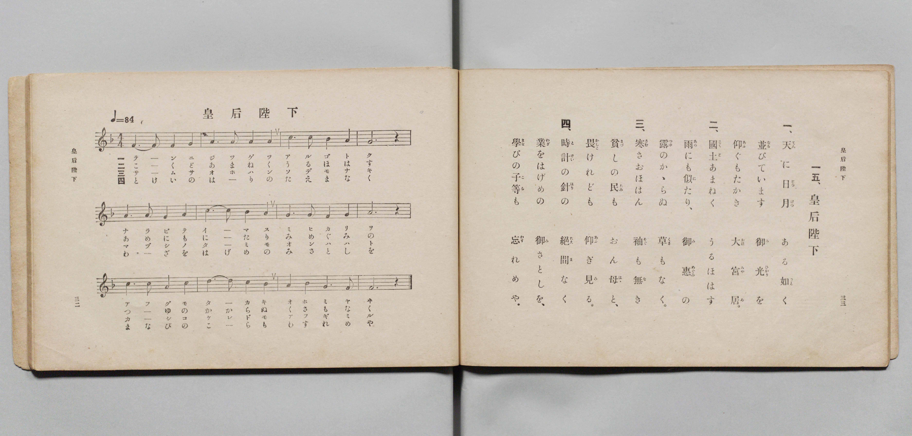

# 皇后陛下

> Re:Shōka 使用 AI 協助辨識與重建樂譜，可能會有錯誤。歡迎回報。

- **鋼琴伴奏版**：<br><audio controls src="kogo_heika.mp3"></audio>

- 文部省《尋常小學唱歌 第三學年用》（明治四十五年五月，索書號 4079）

## 說明

原書資訊與歌詞全文（對應 P019.jpg，書頁 pp. 32–33，第 15 首）：
調性與拍號：ヘ調四拍子（F 大調 4/4 拍），速度 ♩=84


## 歌詞

```text
一、
天（てん）に日月（じつげつ）ある如（ごと）く
並（なら）びています御光（みひかり）を
仰（あふ）ぐもたかき大宮居（おほみやゐ）。

二、
國土（こくど）あまねくうるほはす
雨（あめ）にも似（に）たり、御惠（みめぐみ）の
露（つゆ）のかゝらぬ草（くさ）もなく。

三、
寒（さむ）さおほはん袖（そで）も無（な）き
貧（まづ）しの民（たみ）もおん母（はゝ）と、
畏（かしこ）けれども仰（あふ）ぎ見（み）る。

四、
時計（とけい）の針（はり）の絕間（たえま）なく
業（わざ）をはげめの御（み）さとしを、
學（まな）びの子等（こら）も忘（わす）れめや。
```

## ABC

<div class="abc-score" data-abc-src="kogo_heika.abc" aria-label="五線譜載入中"></div>

[下載 ABC 原始檔](kogo_heika.abc)

## TMD 檔案連結

- [主旋律 TMD 檔案](kogo_heika.tmd) [[在 TMD Studio 編輯](https://tmdlang.github.io/Tmd-TS/#tmd=s7IKdvYPcrWy4qpTUCpJTLdSSM7PyUlNLsnMz7PKyszLyo8vzshPT8wuBdHZiUpwdWX5OaW5qVbpRYkpqfHG8SYG5pYIyeL80qLkVKvi5Iz8_Jz4ktSKkqT8_Gx0-fiCxPRUqwADQySdBUX5Zal5iXlA3QVFmXklqSlg7QgFqWWZKakg6bLUosy0zNQUJCelFhWD3A01vaQoMa84uSizAOQZhKr8ohKgj4oSCzIqrTIyi0vyizKTE3PisxPzkHxXkpEK9FxmbgHQksQcdPHc_KLEnMySSmRDM9Mz84ASeUmlwIDClEjNzMpECggtLYXns9qfTuh7OXP2kx3dClpaXIq2ChYmXPa2Cm5cNib6JnYgI55Na3_ZvOL5nMbHDV1PN3Q_3bHj6Yb-p2t3PJ2y8dnaHoXna9Y82dEJ4u_c8nzKiscN3e_3dDyb0fds0-6ns2c_7W18smsKUApIPpvT8X5Pz_Mti57N3vFi5nwFUHS939OpxMWlr6VgSy3ApaCg8LRvPsiOze0vVnS96GgHOvPFynlPW1cAvQJ03NMNvc_aOxVAca6XVZAOdBNQ8csFjQoFBXoKxkaPGiYbG4McumaNgqGpwstl04COfL9nFsjgF6v2P2tYDjKyuxfoBaDo4-YZQEGgT4EiT9dOABrvpvB0yXKgmAIwABWAomDdPS8b5j_dtUzh0cyVtsAQBpn1ZEfD44ZGsHOXrATqe9y47HHTZKDqx42rn01fCg4toOCMx41LHjdOApJgqabHTd1PlzWBpaY8blwBFuyHmLcMLLrqcRPQQqDoZpCJjS2PG_c9bpz5dN_Cp61AcaCC_Y8bNz1u7H7c1AVS1jQJrHn3BrBc0-PGrWDNEx43AdnzQeoae4Eeerpu3dONrWA1XY8bd4NMaWp53AT0cOfjhiaIh3b1wDw0p_vpHGDoABVPBrrucSPQf2C3g5yyFizSBvQH2Jz1QMeB9LycDfQL2AVNjZBAALrgyZ49YMHVYJH5QCcDbQB65VnzAqhXmhpBbm3cD1awDmzQnE1guSWPm9ogomDPzgUGy-PGNS96IYEAdMJUsPeBjloF4sI8sQPoH4gn1k8Cq5z6uKkBbM5UmNfXA-PpxSJgsgDKzn3cuBxizvOWhZDwByvuBSeXTUA5oBDQ10vBotOBrnm2YSJYEBi2YFeDXNAFNPHZemBSAYoDTZ8LVgzMS2CHPJ_aD5YAhhdQPySFTHzc1AMMVlAQocdc34tloCwIM70b5jNgGoUa-Gxm04sVkNS1AmRUYwsknF62Ay2GuACcNBrXPd869eU0oI0Q54J8AhYHBRjYoKVrQXJNwMAEZRJgWgLH5yRwrKwDxhPCHaDQA1o2HaQGGr5rd8ACBxJkwPS6DpiFnq-FxNBkaDpuanq6fwbMmplgkR6QBcDkB_QZ0CDKywwoUNDS5-Lyzk_P90jNzE60CshMzMt3qDGoqQbZomBjoWUHZmArrSDFYMOLhT0KGiYKwALy-foGHXgRo4lFA9AukGE1CoYKumBsBMTGQFyjYAokdRXMwDRExAxIwnggdTVgFgwagETApvkY1ig8bm4D8h83bwaT3SCyaQdYz-PmFrD6x02b4GyweNMisNrVYLktYHYHVGY9kj3xCHuMgHKNk0EqG_vB5Eow2QTR1bgPYk_jWqg81J5GsMuawG5q3A0mQeaDZGZit8cYJDcVrKsBrB7MbuyC6gKZATEFmIGQ7JkLFl0O1gdyEzCJQWV6sdtjApJbARUH5gkwCQohkPg6JFtANkNEQDLzwTxQWEH8jLAH5muEPfjTzq4ectMOLN2A0ge2lAJSYwZyAiKBgVi4Eg_Yg83g6GwGRzA4OYGSwhJY8DTPAwfsToh4MzgQmieBxcBJqBkaCM2bsAc2OPGAo6WpERxokIQHSzwgHiTAwSaDgxwkvh9JxwQwCRJBRBD2xAOJlqVgcjqYRI48iD0Qk2H2g0MAnJwgyRORSGEJBEviaYJkg2lgveCwgOsC8SDZDuJ2mP1gW6EJGmQyxH0gs2A6iE08OzrJSTywJAJPIJCSBzkFQZIKjAdSDklPOBIPtByB5NcNYDZIBCQD8iwkECCRvRYqDkoqj5tng0lIhDxuXgJOPCD9uBIPKCkCq3d4cAIrR2iggmiIPZ1g8TVQcUj0QFwGimhIXsWeUxGJB1JSQZINJEGASgaQu3tg9kBKPnjigZQ2W8FkH1TFfrAOmMuwlTyIsgNYDcJ9BStjkfwDswea3EClJswtoOQFkoGV6wh7arm4dO0U4BWbApCjzAUA)]
- [鋼琴伴奏 TMD 檔案](kogo_heika_piano.tmd) [[在 TMD Studio 編輯](https://tmdlang.github.io/Tmd-TS/#tmd=s7IKdvYPcrWy4qpTUCpJTLdSSM7PyUlNLsnMz7PKyszLyo8vzshPT8wuBdHZiUpwdWX5OaW5qVbpRYkpqfHG8SYG5pYIyeL80qLkVKvi5Iz8_Jz4ktSKkqT8_Gx0-fiCxPRUqwADQySdBUX5Zal5iXlA3QVFmXklqSlg7QgFqWWZKakg6cTk5PzcgsS8zNzUPCT5stSiYpDjCzIT8_LjcSjKLyoB-qoosSCj0iojs7gkvygzOTEnPjsxD8mHiUVFiXnpqSCd-E0ryQAqssrMLUgtykzMQRfPzS9KzMksqUS2PTM9Mw8okZdUCgxVTInUzKxMpFDT0lJ4Pqv96YS-lzNnP9nR_X5Px8vuPc8nbHmyZ8vTpf3POzve7-lU0NLiUrRVsDDhsrdVcOOyMdE3sQOZ-2xa-8vmFc_nND5u6Hq6ofvpjh1PN_Q_Xbvj6ZSNz9b2KDxfs-bJjk4Qf-eW51NWPG4Amf5sRt-zTbufzp79tLfxya4pQCkg-WwO0Jqe51sWPZu948XM-QqgCAfaq8TF5Z2fnu-RmpmdaBUACqUgD4cag5pqLgUgsLHQsgMz9LUUbNEBxPKGFwt7FDRMFIDOer6-QUcBlBz0sgrSNbFo0NIHG1ajYKigC8ZGQGwMxDUKpkBSV8EMTENEzIAkjAdSVwNmwaABSARsmo9hjcLj5jYg_3HzZjDZDSKbdoD1PG5uAat_3LQJzgaLNy0Cq10NltsCZndAZdYj2ROPsMcIKNc4GaSysR9MrgSTTRBdjfsg9jSuhcpD7WkEu6wJ7KbG3WASZD5IZiZ2e4xBclPBuhrA6sHsxi6oLpAZEFMeN4FcA7NnLlh0OVgfyE2PG1dBZXqx22MCklsBFX_cOBFMgkIIJL4OyRaQzRARkMx8MA8UVhA_I-yB-RphD_60s6uH3LQDSzeg9IEtpYDUmIGcgEhgIBauxAP2YDM4OpvBEQxOTqCksAQWPM3zwAG7EyLeDA6E5klgMXASaoYGQvMm7IENTjzgaGlqBAcaJOHBEg-IBwlwsMngIAeJ70fSMQFMgkQQEYQ98UCiZSmYnA4mkSMPYg_EZJj94BAAJydI8kQkUlgCwZJ4miDZYBpYLzgs4LpAPEi2g7gdZj_YVmiCBpkMcR_ILJgOYhPPjk5yEg8sicATCKTkQU5BkKQC44GUQ9ITjsQDLUcg-XUDmA0SAcmAPAsJBEhkr4WKg5LK4-bZYBISIY-bl4ATD0g_rsQDSoqPm8ClCTg4HzeCyhSQDIiG2NMJFl8DFYdED8RloIiG5FXsORWReCAlFSTZQBIEqGQAubsHZg-k5IMnHkhpsxVM9kFV7AfrgLkMW8mDKDseN4LLbXgigZVqUP_A7IEmN1CpCXMLKHmBZGDlOsKeWox6zQe5XjOB1mvAqI1XiDaMVTCNh9AQAZNYmHiNggmEYQZSYBoPUwEUAVIGUB9BxECyBLSZxefGKhiBxIxALGDqg8mDGJjGgbWDNWE6DK4VphjdZcAw0LVTgAdDtA9QClXACF3AGF0AaCFQQJkLAA)]

## 分析

```text
================================================================================
📊 TMD Song Profile: [ 皇后陛下 ]
================================================================================
⏱  Duration:       0:34 (34.3s), 12 measures total
🎼 Key & Tempo:    首調基準 F, != 84.0 BPM, <4/4>
   - 分析範圍：      由實際發聲的音符與和弦推測調性；播放脈絡另行呈現
🎤 人聲音域:    D4 (MIDI 62) – D5 (MIDI 74) [跨度: 12 個半音 / 1.0 個八度, 難度: easy]
   - 最低音:  D4 in [KogoHeika #1 @ m.7, 0:17]
   - 最高音: D5 in [KogoHeika #1 @ m.2, 0:03]
   - 適合: soprano, mezzo-soprano, contralto, tenor, baritone, bass
🏛  結構:      KogoHeika (34.3s)
⚡ 編曲密度:        Peak 1 軌道同時演奏
🗝  調性診斷：       F 調性不明確（純淨自然大調，未偵測到可信轉調）
   - 風格氣質:    純淨自然大調（陽光明朗、易唱易記，無明顯調外色彩）
   - 轉調歷程:    全曲維持單一推測調性（未偵測到可信轉調）
   - 核心骨幹音:  A, G, C, F, D
   - 調性數值:    F 調性不明確 [相關度: 0.70, 穩定度: Ambiguous, 自然音純度: 100.0%]
   - 候選調性 (K-S): F 大調 (0.70), C 大調 (0.69), A 小調 (0.68)
   - 五度圈歷程:   -1
   - 各段落調性細節:
     • [KogoHeika #1]: F 調性不明確 (r: 0.70, 自然音純度: 100.0%)

  [ 五度圈游移軌跡 ]
               C  
        [F ]*          G  
      Bb               D  
      Eb               A  
         Ab           E  
            Db       B  
               F# 
     (* = active key center)

  [ 十二半音累積音高分佈 ]
     C  : ████████████████          18.9%
     C# :                            0.0%
     D  : ███████████               12.2%
     D# :                            0.0%
     E  :                            0.0%
     F  : ███████████████           17.8%
     F# :                            0.0%
     G  : ████████████████████      23.3%
     G# :                            0.0%
     A  : ████████████████████████  27.8%
     A# :                            0.0%
     B  :                            0.0%
--------------------------------------------------------------------------------
Assignment 軌道音域：
  - Piano         : D4 – D5 (12 個半音 / 1.0 個八度, 39 個音符)
================================================================================
```


## 原書掃描頁




