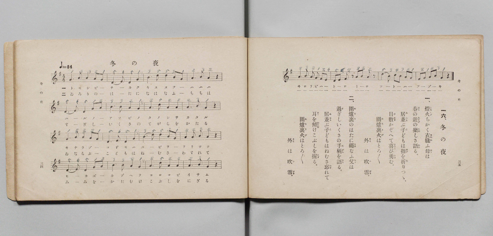

# 冬の夜

> Re:Shōka 使用 AI 協助辨識與重建樂譜，可能會有錯誤。歡迎回報。

- **鋼琴伴奏版**：<br><audio controls src="fuyu_no_yo.mp3"></audio>

- 文部省《尋常小學唱歌 第三學年用》（明治四十五年五月，索書號 4079）

## 說明

原書資訊與歌詞全文（對應 P020.jpg，書頁 pp. 34–35，第 16 首）：
調性與拍號：ト調三拍子（G 大調 3/4 拍），速度 ♩=84


## 歌詞

```text
一、
燈火（ともしび）ちかく衣縫（きぬぬ）ふ母（はゝ）は
春（はる）の遊（あそび）の樂（たの）しさ語（かた）る。
居並（ゐなら）ぶ子どもは指（ゆび）を折（を）りつゝ、
日數（ひかず）かぞへて喜（よろこ）び勇（いさ）む。
圍爐裏（ゐろり）火（び）はとろ〳〵
外（そと）は吹雪（ふぶき）。

二、
圍爐裏（ゐろり）のはたに繩（なは）なふ父（ちゝ）は
過（す）ぎしいくさの手柄（てがら）を語（かた）る。
居並（ゐなら）ぶ子どもはねむさ忘（わす）れて
耳（みゝ）を傾（かたむ）けこぶしを握（にぎ）る。
圍爐裏（ゐろり）火（び）はとろ〳〵
外（そと）は吹雪（ふぶき）。
```

## ABC

<div class="abc-score" data-abc-src="fuyu_no_yo.abc" aria-label="五線譜載入中"></div>

[下載 ABC 原始檔](fuyu_no_yo.abc)

## TMD 檔案連結

- [主旋律 TMD 檔案](fuyu_no_yo.tmd) [[在 TMD Studio 編輯](https://tmdlang.github.io/Tmd-TS/#tmd=s7IKdvYPcrWy4qpTUCpJTLdSSM7PyUlNLsnMz7PKyszLyo8vzshPT8wuBdHZiUpwdWX5OaW5qVbpRYkpqfHG8SYG5pYIyeL80qLkVKvi5Iz8_Jz4ktSKkqT8_Gx0-fiCxPRUqwADIwOETEFRfllqXmIeUHdBUWZeSWoKWDtCQWpZZkoqSLostSgzLTM1BclJqUXFIHdDTS8pSswrTi7KLAB5BqEqv6gE6KOixIKMSquMzOKS_KLM5MSc-OzEPCTflWSkAj1XnJpYnJ9XjC6clpibmVOJbGJmemaeVW5-XlIpMJQwJVIzszKRQkFLS-Fp25rHjeueLpmjoKXFpWirYGHCZW-r4M5lY6xvYgfS_2xa-8vmFc_nND5u6Hq6ofvpjh1PN_Q_Xbvj6ZSNz9b2KDxfs-bJjk4Qf-eW51NWPG7ofr-n49mMvmebdj-dPftpb-OTXVOAUkDy2ZyO93t6nm9Z9Gz2jhcz5yuAIur9nk4lLi59LQVbagEuBQWFp33zQXZsbn-xoutFRzvQmS9WznvaugLoFaDjnm7ofdbeqQCKbb2sgnSgm4CKXy5oVCgo0FMwNnnUMNnYFOTQNWsUDM0UXi6bBnTk-z2zQAa_WLX_WcNykJHdvUAvAEUfN3cABYEhABR5unYC0Hh3hadLlgPFFIABqAAUBevuedkw_-muZQqPZq60BYYwyKwnOxoeNzSCWM_bO543rgZqfdy44nFT0-PG6Y8bNwO1PW5c-Lix-3Fj_4uFi5_vgCjofdwIjK81YNmtz9YDTQcKrn_cNBcssh5k3LMZS2GiwLgAiq572dgFFgEaPRdm9LpnK5rAgvOBbLAI0NapL1bNAwsCbQX6rhNowuOGJnCQbmx9smMZSK5pwuPGVY-bgJ4C6tkG9PPjxpVgV69_1gMK3sdNbVA7miY965oBFpkE5nY9blwCdCnU18-mL302dQfYtk1gC2eBTQQy5j1u3PG4cdnTaXPAmoEI6OvJYNnNT7vBdjS2AB0LNhQYiBAHzul93jHhxeJ-qBuBepqAvu6EhSzE1-vBQdz7uGHz44atYG1LgNELlAaGywqIiqcTdr6cvQosuBXoQWCQg8SBloAjbVcP1Pm47AOGJtgaYLCufr5zJdicVUARsBSQsfV5xzaw4EKUSHvZ2AcWnQkW6gPHBtCP_UBvguKqs_vZ_BawgmWPG3ugod80iaLoety4FhR8jVOf7ofEEtAysPVNPUBrwMm9ARhqQOP3Q53aNOlp0z64hUDNYEMnAiMHHFDTQTHevxCsYDXQE6guonn8AFVTXnxAgYKWPheXW2llqV9-ZL5VQGZiXr5DjUFNNcgSBRtDMy07MAtbwQUpERteLOxR0DBRAJaVz9c36MBLG00sGoB2gQyrUTBU0AVDYyg2AmKQWI2CaTxUygzGAItAJEFKwUJQDOJDZEAGwAwCQQMoXQO20MewRgFYfkHFHjcvApFN28HsyTCVQHYjlA2Dj5tWg8n1EPmmtXATepDIqUgm9MNVwFgwb0BdYgQyZwLc_F4w2QUiG9chzGkE2Yjiksb5YBLkHpD8Krg4SCWED0wmSCYsBItASJhpCLfgj9RdPeREKihGwDEHxCA2KGZA8YGINxiNiG5YfMH0gvgQPbAYhSUVbDGKCG1wPDX3IYUYKJxB8QwJ571wlaD4hqgEqdgPF4fphaaLJlBYglRAUgBIHcQWHHHaOBOmvxFkErCMQHVLYwtcHu7qRlDKgcQ7SMUyuDgoXUHc0gkmJ0FVdINlwSmhCcQmJU53dA6ajIqcWbFF6waY95vBGaN5JZichgjMps1wFaAAgrDAmRqcJEBmwAMTnsEfN29CmABmP24GZ5tmUNRASLyZFZLJIFHSuA1hViPchkaQSyER1wTmQwuOxrVw8Qa4WqRiownkakgSAtZJYDbI_URGLbD1OTSyKygZQ0IBkql2QfmwUIBlr8dN-2Cs5hlgsg2ionkFXBwRoqC0AIllkBlLwGKgzPu4eQFUDbbsCs_4YBYkiyG5BZzVIPKg7IaIO2ArAKoCEeuwtADJ9IjsCvYlpDggObvumkJOnKJnU3OQdeAMCs6wQBZYBBQ5RkCFsAwISQwgjSZoBtRANMDSBnIMo-dYSJzA8hSkmIUVdbDqF6IGZCI6HxR3iEIaUVUjmwDLMYiyAFElI8XtoHBNLReXrp0CrGGlAGQrcwEA)]
- [鋼琴伴奏 TMD 檔案](fuyu_no_yo_piano.tmd) [[在 TMD Studio 編輯](https://tmdlang.github.io/Tmd-TS/#tmd=s7IKdvYPcrWy4qpTUCpJTLdSSM7PyUlNLsnMz7PKyszLyo8vzshPT8wuBdHZiUpwdWX5OaW5qVbpRYkpqfHG8SYG5pYIyeL80qLkVKvi5Iz8_Jz4ktSKkqT8_Gx0-fiCxPRUqwADIwOETEFRfllqXmIeUHdBUWZeSWoKWDtCQWpZZkoqSDoxOTk_tyAxLzM3NQ9Jviy1qBjk-ILMxLz8eByK8otKgL4qSizIqLTKyCwuyS_KTE7Mic9OzEPyYWJRUWJeeipIJ37TSjKAiqyKUxOL8_OK0YXTEnMzcyqRrc5Mz8yzys3PSyoFBimmRGpmViZSkGlpKTxtW_O4cd3TJXPe7-l42b3n-YQtT_Zsebq0_3lnx_s9nQpaWlyKtgoWJlz2tgruXDbG-iZ2IEOfTWt_2bzi-ZzGxw1dTzd0P92x4-mG_qdrdzydsvHZ2h6F52vWPNnRCeLv3PJ8yorHDd1A05_N6Hu2affT2bOf9jY-2TUFKAUkn80BWtPzfMuiZ7N3vJg5XwEU1UB7lbi43EorS_3yI_OtAkDBE-ThUGNQU82lAAQ2hmZadmCWvpaCLTqAWN7wYmGPgoaJAtBZz9c36CiAEoJeVkG6JhYNWvpgw2oUDBV0wdAYio2AGCRWo2AaD5UygzHAIhBJkFKwEBSD-BAZkAEwg0DQAErXgC30MaxReNzcARV73LwIRDZtB7Mnw1QC2Y1QNgw-bloNJtdD5JvWwk3oQSKnIpnQD1cBY8G8AXWJEcicCXDze8FkF4hsXIcwpxFkI4pLGueDSZB7QPKr4OIglRD-48atSCYsBItASJhpCLfgj9RdPeREKihGwDEHxCA2KGZA8YGINxiNiG5YfMH0gvgQPbAYhSUVbDGKCG1wPDX3IYUYKJxB8QwJ571wlaD4hqgEqdgPF4fphaaLJlBYglRAUgBIHcQWHHHaOBOmvxFk0uPG6ahuaWyBy8Nd3QhKOZB4B6lYBhcHpSuIWzrB5CSoim6wLDglNIHYpMTpjs5Bk1GRMyu2aN0A834zOGM0rwST0xCB2bQZrgIUQBAWOFODkwTIDHhgwjP44-ZNCBPA7MfN4GzTDIoaCIk3s0IyGSRKGrchzGqE29AIcikk4prAfGjB0bgWLt4AV4tUbDSBXA1JQo-bwIUKODEQGbXAgn5oZFdQMoaEAiRT7YLyYaEAy16Pm_bBWM0zwGQbREXzCrg4IkRBaQESyyAzloDFQJn3cfMCqBps2RWe8cEsSBZDcgs4q0HkQdkNEXePGydCVSBiHZYWIJkekV3BvoQUByRn111TyIlT9GxqDrIOnEHBGRbIAouAIscIqBCWASGJAaTRBM2AGogGWNpAjmH0HAuJE1ieghSzsKIOVv1C1IBMROeD4g5RSCOqamQTYDkGURYgqmSkuB0UrqlFb1f5ILerTKDNKmABG68QbRgLxhCOCTIHLmMaD-SZxscCowviU6IUgwkIH6gAVeuAWQrUDpE1AJNoZsKNAYqCQ1HXTgEWkNE-QCUofCMwX5kLAA)]

## 分析

```text
================================================================================
📊 TMD Song Profile: [ 冬の夜 ]
================================================================================
⏱  Duration:       0:42 (42.9s), 20 measures total
🎼 Key & Tempo:    首調基準 G, != 84.0 BPM, <3/4>
   - 分析範圍：      由實際發聲的音符與和弦推測調性；播放脈絡另行呈現
🎤 人聲音域:    D4 (MIDI 62) – E5 (MIDI 76) [跨度: 14 個半音 / 1.2 個八度, 難度: moderate]
   - 最低音:  D4 in [FuyuNoYo #1 @ m.2, 0:02]
   - 最高音: E5 in [FuyuNoYo #1 @ m.5, 0:09]
   - 適合: soprano, mezzo-soprano, contralto, tenor, baritone, bass
🏛  結構:      FuyuNoYo (42.9s)
⚡ 編曲密度:        Peak 1 軌道同時演奏
🗝  調性診斷：       G 調性不明確（純淨自然大調，未偵測到可信轉調）
   - 風格氣質:    純淨自然大調（陽光明朗、易唱易記，無明顯調外色彩）
   - 轉調歷程:    全曲維持單一推測調性（未偵測到可信轉調）
   - 核心骨幹音:  B, A, G, D, E
   - 調性數值:    G 調性不明確 [相關度: 0.75, 穩定度: Ambiguous, 自然音純度: 100.0%]
   - 候選調性 (K-S): G 大調 (0.75), D 大調 (0.75), B 小調 (0.68)
   - 五度圈歷程:   +1
   - 各段落調性細節:
     • [FuyuNoYo #1]: G 調性不明確 (r: 0.75, 自然音純度: 100.0%)

  [ 五度圈游移軌跡 ]
               C  
         F           [G ]*
      Bb               D  
      Eb               A  
         Ab           E  
            Db       B  
               F# 
     (* = active key center)

  [ 十二半音累積音高分佈 ]
     C  : █                          0.9%
     C# :                            0.0%
     D  : ███████████████████       19.5%
     D# :                            0.0%
     E  : ███████                    6.8%
     F  :                            0.0%
     F# : ███                        2.7%
     G  : ████████████████████      20.9%
     G# :                            0.0%
     A  : ███████████████████████   24.1%
     A# :                            0.0%
     B  : ████████████████████████  25.0%
--------------------------------------------------------------------------------
Assignment 軌道音域：
  - Piano         : D4 – E5 (14 個半音 / 1.2 個八度, 90 個音符)
================================================================================
```


## 原書掃描頁




