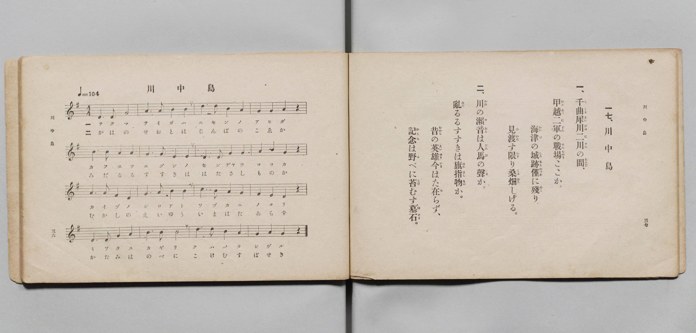

# 川中島

> Re:Shōka 使用 AI 協助辨識與重建樂譜，可能會有錯誤。歡迎回報。

- **鋼琴伴奏版**：<br><audio controls src="kawanakajima.mp3"></audio>

- 文部省《尋常小學唱歌 第三學年用》（明治四十五年五月，索書號 4079）

## 說明

原書資訊與歌詞全文（對應 P021.jpg，書頁 pp. 36–37，第 17 首）：
調性與拍號：ト調四拍子（G 大調 4/4 拍），速度 ♩=104


## 歌詞

```text
一、
千曲（ちくま）犀川（さいがは）二川（にせん）の間（あひだ）、
甲越（かふえつ）二軍（にぐん）の戰場（せんぢやう）ここか。
海津（かいづ）の城跡（しろあと）僅（わづか）に殘（のこ）り、
見渡（みわた）す限（かぎ）り桑畑（くはばた）しげる。

二、
川（かは）の瀨音（せおと）は人馬（じんば）の聲（こゑ）か。
亂（みだ）るるすすきは旗指物（はたさしもの）か。
昔（むかし）の英雄（えいゆう）今（いま）はた在（あ）らず、
記念（かたみ）は野（の）べに苔（こけ）むす墓石（ぼせき）。
```

## ABC

<div class="abc-score" data-abc-src="kawanakajima.abc" aria-label="五線譜載入中"></div>

[下載 ABC 原始檔](kawanakajima.abc)

## TMD 檔案連結

- [主旋律 TMD 檔案](kawanakajima.tmd) [[在 TMD Studio 編輯](https://tmdlang.github.io/Tmd-TS/#tmd=s7IKdvYPcrWy4qpTUCpJTLdSSM7PyUlNLsnMz7PKyszLyo8vzshPT8wuBdHZiUpwdWX5OaW5qVbpRYkpqfHG8SYG5pYIyeL80qLkVKvi5Iz8_Jz4ktSKkqT8_Gx0-fiCxPRUqwADI0OETEFRfllqXmIeUHdBUWZeSWoKWDtCQWpZZkoqSLostSgzLTM1BclJqUXFIHdDTS8pSswrTi7KLAB5BqEqv6gE6KOixIKMSquMzOKS_KLM5MSc-OzEPCTflWSkAj0Hka5EFy7ISUxORTYwMz0zzyo3Py-pFBhImBKpmVmZSIGgpaXwdPvcJzvWPt28TUFLi0vRVsHQwITL3lbBncvGRN_EDmTAs2ntL5tXPJ_T-Lih6-mG7qc7djzd0P907Y6nUzY-W9uj8HzNmic7OkH8nVueT1nxuKH7_Z6OZzP6nm3a_XT27Ke9jU92TQFKAclnczre7-l5vmXRs9k7XsycrwCKqPd7OpW4uPS1FGypBbgUFBSe9s0H2bG5_cWKrhcd7UBnvlg572nrCqBXgI57uqH3WXunAii29bIK0oFuAip-uaBRoaBAT8HY7FHDZGNzkEPXrFEwNFd4uWwa0JHv98wCGfxi1f5nDctBRnb3Ar0AFH3c3AEUBPoUKPJ07QSg8e4KT5csB4opAANQASgK1t3zsmH-013LFB7NXGkLCmKQYU92NDxuaAS7t7f52exNQL2PGxc-bux_3LgPqOl5VwMwcsCCUx83tjxu7HncuB4o_mRXD0x89ePG2Y-bJgMFHzeuezkNyAAKNj1u3PS4cQFIEGL68ymbXmzrAst1P27c-rgRyFgCMejFbqDzIAZNgBv0rGPD0wVbwOIg0x83LnrcBLS-DSwL5AJR9-OGJpDRz7Zuf7ZlKcxooCIgG2TE0_l9L7YvBItPf9zUC3bUCqDU0-ZWkGAT0ItLgVrAilc_WzcDrHId0GiQSFMX1OEvlnU_2wExZT9YDzDAgRpmvpwJCmewlX0QDc8WTnw-dSJYEKhs_ePGDTDF0x83TnrcBHYvOMx39cDCHBqGQENAoQq0_nnDipfzN0P93dgFcTFQ9smuXS-XrQGLzwCHxwaI-heNkCib_LgJaDVQBBYqT3Y1QR0NiQag9UDUOBOMgIGx_tn06c962p93rgQrAzp3PjiOgUEFDKd1KGY9mzEFHGINYJdOh9rcvfHl7BawZiBqedzUBomeJ7sh0QyMCFAKghj9dA7QH6B0AXYKUHAWLHhXzHi6fyssEIBO2A_R87IdGKqg-ABzdwJj6EU32BGgmAf7FOSamU8XTX4ODa494BADpXSoqynPxlCgoKXPxeWdWA4sErMTszJzE60CMhPz8h1qDGqqQRYp2Fho2YEZ2MoQSOHU8GJhj4KGiQKw2Hq-vkEHnvE1sWgAWgcyrEbBNF5BFwjN4hUMwQxdoJgRkATxQLQxWMQUoghMI0RALJAaA5AI2DwfwxqFx82NYNWPm9YD2fPgpj5u2goWXQIm14DI5n6ITHM3VMduIHszWKYPqmcRmDcJTDYASZBzoXYZAeUboTobgXY1rkPY1TgbLNoFJldAVUBkZkDtmgxkbwDLgPSBZCaDxSeCxUDmQuzCH-rAsoWMUAeFHCjsQKEMDHpwgIIoEB8kBwrdGmB4g1SZIonAYgSkDi3Um1ZD_NU8FcgG-7i5BSl0HzeB_YoWuruhejYDcdPjZkjULINKgpVCSZDh6EG_Hxr0C4DyECtAJEhmJlgcQvaiBD6IBvHnA_FUMGs61LYmeFQQH_g7OskJfHCAYwt9MBtJEJIjjOAhjgh_UGzgCH9g-n7c3IoSytvBvLVgWUh67oDGDDQ4gOoh-iFxBZIB6YUGfvMqzMBvAuUFSFBBghCRikFmA4tGsP42MBtEgmRAYiD-PmhEgKIBIgMO_KZOsNgs4gIf2BQgK_DBboCkadQwhcggShtj5KgAKYIVS-jFDcgToGACFgFNoDT5uGknNODBQdoETlPgQIQVRLBg7wfiCWA1IH3wqGraBJbFluZhxQ0o_YLtgqdsSMoF2QysSBB2gQsVkNhEaKRB8gVIZg-YBymoQLkEYlctF5eunQJyVaAA5CtzAQA)]
- [鋼琴伴奏 TMD 檔案](kawanakajima_piano.tmd) [[在 TMD Studio 編輯](https://tmdlang.github.io/Tmd-TS/#tmd=s7IKdvYPcrWy4qpTUCpJTLdSSM7PyUlNLsnMz7PKyszLyo8vzshPT8wuBdHZiUpwdWX5OaW5qVbpRYkpqfHG8SYG5pYIyeL80qLkVKvi5Iz8_Jz4ktSKkqT8_Gx0-fiCxPRUqwADI0OETEFRfllqXmIeUHdBUWZeSWoKWDtCQWpZZkoqSDoxOTk_tyAxLzM3NQ9Jviy1qBjk-ILMxLz8eByK8otKgL4qSizIqLTKyCwuyS_KTE7Mic9OzEPyYWJRUWJeeipIJ37TSjKAiqDmVKILF-QkJqci25yZnplnlZufl1QKDFFMidTMrEykENPSUni6fe6THWufbt72fk_Hy-49zydsebJny9Ol_c87O97v6VTQ0uJStFUwNDDhsrdVcOeyMdE3sQOZ-mxa-8vmFc_nND5u6Hq6ofvpjh1PN_Q_Xbvj6ZSNz9b2KDxfs-bJjk4Qf-eW51NWPG7oBhr_bEbfs027n86e_bS38cmuKUApIPlsDtCenudbFj2bvePFzPkKoKgGWqzExeWdWA4MsezErMzcRKsAUBAFeTjUGNRUcykAgY2Flh2Yoa-lYIsOIPY3vFjYo6BhogB02fP1DToKoLSgl1WQrolFg5Y-2LAaBdN4BV0gNItXMAQzdIFiRkASxAPRxmARU4giMI0QAbFAagxAImDzfAxrFB43N4JVP25aD2TPg5v6uGkrWHQJmFwDIpv7ITLN3VAdu4HszWCZPqieRWDeJDDZACRBzoXaZQSUb4TqbATa1bgOYVfjbLBoF5hcAVUBkZkBtWsykL0BLAPSB5KZDBafCBYDmQuxC3-o7-ohJ9RBIQcKO1AoA4MeHKAgCsQHyYFCtwYY3iBVpkgisBgBqUML9abVEH81TwWywT5ubkEK3cdNYL-ihe5uqJ7NQNz0uBkSNcugkmClUBJkOHrQ74cG_QKgPMQKEAmSmQkWh5C9KIEPokH8-UA8FcyaDrWtCR4VxAf-jk5yAh8c4NhCH8xGEoTkCCN4iCPCHxQbOMIfmL4fN7eihPJ2MG8tWBaSnjugMQMNDqB6iH5IXIFkQHqhgd-8CjPwm0B5ARJUkCBEpGKQ2Y8bQXH_uKkNzAaRIBmQGIi_DxoRoGiAyIADv6kTLDaLuMAHlmtkBT7YDZA0jRqmEBlEaWOMHBUgRbBiCb24AXkCFEzAIqAJlCYfN-2EBjw4SJvAaQociLCCCBbs_UA8AawGpA8eVU2bwLLY0jysuAGlX7Bd8JQNSbkgmx83QpIColABiU2ERhokX4Bk9oB5kIIKlEsgdtViqwl8kGsCE2hNAEyg8QrRhrEwCpSKISwYjakCygApMIB6DEWRWXwuskFwfSZAhgm6TabxYBGEQWYgUbARCBZULZiNZAM-pyMMxGotkIVsPA7XIzkOGKS6dgrIoRrtA9SBIWYEFlPmAgA)]

## 分析

```text
================================================================================
📊 TMD Song Profile: [ 川中島 ]
================================================================================
⏱  Duration:       0:36 (36.9s), 16 measures total
🎼 Key & Tempo:    首調基準 G, != 104.0 BPM, <4/4>
   - 分析範圍：      由實際發聲的音符與和弦推測調性；播放脈絡另行呈現
🎤 人聲音域:    D4 (MIDI 62) – E5 (MIDI 76) [跨度: 14 個半音 / 1.2 個八度, 難度: moderate]
   - 最低音:  D4 in [Kawanakajima #1 @ m.1, 0:00]
   - 最高音: E5 in [Kawanakajima #1 @ m.3, 0:05]
   - 適合: soprano, mezzo-soprano, contralto, tenor, baritone, bass
🏛  結構:      Kawanakajima (36.9s)
⚡ 編曲密度:        Peak 1 軌道同時演奏
🗝  調性診斷：       G 大調（純淨自然大調，未偵測到可信轉調）
   - 風格氣質:    純淨自然大調（陽光明朗、易唱易記，無明顯調外色彩）
   - 轉調歷程:    全曲維持單一推測調性（未偵測到可信轉調）
   - 核心骨幹音:  G, D, E, B, A
   - 調性數值:    G 大調 [相關度: 0.81, 穩定度: Moderate, 自然音純度: 100.0%]
   - 候選調性 (K-S): G 大調 (0.81), E 小調 (0.74), D 大調 (0.69)
   - 五度圈歷程:   +1
   - 各段落調性細節:
     • [Kawanakajima #1]: G 大調 (r: 0.81, 自然音純度: 100.0%)

  [ 五度圈游移軌跡 ]
               C  
         F           [G ]*
      Bb               D  
      Eb               A  
         Ab           E  
            Db       B  
               F# 
     (* = active key center)

  [ 十二半音累積音高分佈 ]
     C  :                            0.0%
     C# :                            0.0%
     D  : ██████████████████████    20.8%
     D# :                            0.0%
     E  : ██████████████████████    20.8%
     F  :                            0.0%
     F# :                            0.0%
     G  : ████████████████████████  22.5%
     G# :                            0.0%
     A  : █████████████████         15.8%
     A# :                            0.0%
     B  : █████████████████████     20.0%
--------------------------------------------------------------------------------
Assignment 軌道音域：
  - Piano         : D4 – E5 (14 個半音 / 1.2 個八度, 58 個音符)
================================================================================
```


## 原書掃描頁




