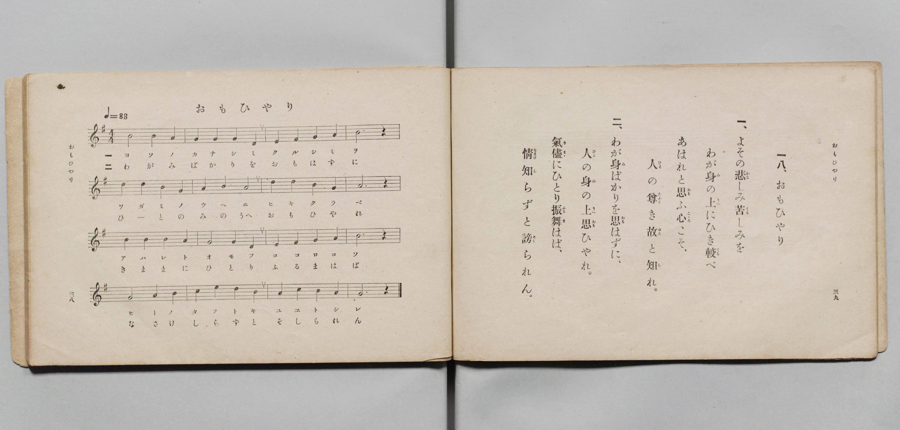

# おもひやり

> Re:Shōka 使用 AI 協助辨識與重建樂譜，可能會有錯誤。歡迎回報。

- **鋼琴伴奏版**：<br><audio controls src="omoiyari.mp3"></audio>

- 文部省《尋常小學唱歌 第三學年用》（明治四十五年五月，索書號 4079）

## 說明

原書資訊與歌詞全文（對應 P022.jpg，書頁 pp. 38–39，第 18 首）：
調性與拍號：ト調四拍子（G 大調 4/4 拍），速度 ♩=88


## 歌詞

```text
一、
よその悲（かな）しみ苦（くる）しみを
わが身（み）の上（うへ）にひき較（くら）べ
あはれと思（おも）ふ心（こゝろ）こそ、
人（ひと）の尊（たふと）き故（ゆゑ）と知（し）れ。

二、
わが身（み）ばかりを思（おも）はずに、
人（ひと）の身（み）の上（うへ）思（おも）ひやれ。
氣儘（きまゝ）にひとり振舞（ふるま）はば、
情（なさけ）知（し）らずと謗（そし）られん。
```

## ABC

<div class="abc-score" data-abc-src="omoiyari.abc" aria-label="五線譜載入中"></div>

[下載 ABC 原始檔](omoiyari.abc)

## TMD 檔案連結

- [主旋律 TMD 檔案](omoiyari.tmd) [[在 TMD Studio 編輯](https://tmdlang.github.io/Tmd-TS/#tmd=s7IKdvYPcrWy4qpTUCpJTLdSSM7PyUlNLsnMz7PKyszLyo8vzshPT8wuBdHZiUpwdWX5OaW5qVbpRYkpqfHG8SYG5pYIyeL80qLkVKvi5Iz8_Jz4ktSKkqT8_Gx0-fiCxPRUqwADIyOETEFRfllqXmIeUHdBUWZeSWoKWDtCQWpZZkoqSLostSgzLTM1BclJqUXFIHdDTS8pSswrTi7KLAB5BqEqv6gE6KOixIKMSquMzOKS_KLM5MSc-OzEPCTflWSkAj2Xm1-UmJNZUomsOTM9Mw8okZdUCgwQTInUzKxMJA9raSk8bux63NT0uHHT46aWx01dClpaXIq2ChYWXPa2Cu5cNib6JnYgU55Na3_ZvOL5nMbHDV1PN3Q_3bHj6Yb-p2t3PJ2y8dnaHoXna9Y82dEJ4u_c8nzKiscN3e_3dDyb0fds0-6ns2c_7W18smsKUApIPpvT8X5Pz_Mti57N3vFi5nwFUMy839OpxMWlr6VgSy3ApaCg8LRvPsiOze0vVnS96GgHOvPFynlPW1cAvQJ03NMNvc_aOxVA0auXVZAOdBNQ8csFjQoFBXoKxhaPGiYbA93VA_SYgqGFwstl04COfL9nFsjgF6v2P2tYDjKyuxfoBaDo4-YOoCDQp0CRp2snAI13V3i6ZDlQTAEYgApAUbDunpcN85_uWqbwaOZKW2AIg8x6sqPhcUMjiPW4qeNx49zHjeueNW0CGvC4sftx4yqgtseN0x837n_RvQws2P-4CRi0UMHHTZMgOvsfN_a82LUarGI_WHrdkx1dYG7b48YdYJHVoDhu7H2xpxlmENBFQPGdYCMagUlg_eOmnseNK541zAWrAKULsIqtT_dD9Ex-3DT3cRPILyA20LEQlz_ZtQssDTR-BcTypxsgls8HaoYJ9j6b2goSbGp73DQRLLLi-fylYGXTQVyg3Q1NkDDZBWRCwwTTZxtAIdMEdNwkDIeuf9w4C-RRXM7CH0QYxkGyBNhZQOOebVj8tGUGWEXv48Z9wKBACtYVQBc961n_omMeWMFWYCwB1cActQHqomfN4BBoXPW4cerjRlAgoIYAUDXQ_SterAFyIYkBJg50RdNkqEMozx1QoKClz8Xln5ufWZlYlGkVkJmYl-9QY1BTDbJEwcZEyw7MwJYtIfm94cXCHgUNEwVgSfB8fYMOPC9pYtEAtApkWI2CsYIuEBsBWYZgaBoPZJrFK5jHAzkgYZACXQUDhRqwBh_DGoXHzSuAIo-b9gJZfUAVj5tWA1ldQHo7kJ4PFlkPZAFFESLNm8DmAE2HmGMEUtUPMqexB4j3g9Q0bgDibqA4yKxJYBEQqwlIA81rnAUWWQ03B39w7OohJzhMgdAY6PMaoN9BwaKLJoYZFkCXNa0B-xIWGsuArBlA3A3W_bh5ElBsLTRMVoJFZmKGRSMofICJDYjXgf25H8yC5AaIQfDA2ASkW8BW9RAZGDs6yUsbIAhJG7pEpo2mRUD_9QMxKEw6wI5cBfJZM0h8Kpi_GYKbQWGyGSyyF0t49ALxPiheDfY-PISA6QPE3wpkAVMLWMV6aPohKjiAFQM5wQEKBFCqqFEwUTADpwlQijBBCiL0tDEJ7PMOeMoAxikwDMAiwBQBUgFKKxuhItvBImuwhAU4BBuBOhsngv05Hai6E5wjQOEBEpmLEAUmCpBdk-Hm1HJx6dopwAoWBSBbmQsA)]
- [鋼琴伴奏 TMD 檔案](omoiyari_piano.tmd) [[在 TMD Studio 編輯](https://tmdlang.github.io/Tmd-TS/#tmd=s7IKdvYPcrWy4qpTUCpJTLdSSM7PyUlNLsnMz7PKyszLyo8vzshPT8wuBdHZiUpwdWX5OaW5qVbpRYkpqfHG8SYG5pYIyeL80qLkVKvi5Iz8_Jz4ktSKkqT8_Gx0-fiCxPRUqwADIyOETEFRfllqXmIeUHdBUWZeSWoKWDtCQWpZZkoqSDoxOTk_tyAxLzM3NQ9Jviy1qBjk-ILMxLz8eByK8otKgL4qSizIqLTKyCwuyS_KTE7Mic9OzEPyYWJRUWJeeipIJ37TSjKAiqxy84sSczJLKpFtyUzPzANK5CWVAkMPUyI1MysTKXS0tBQeN3Y9bmp63LjpcVPL46au93s6XnbveT5hy5M9W54u7X_e2fF-T6eClhaXoq2ChQWXva2CO5eNib6JHcjoZ9PaXzaveD6n8XFD19MN3U937Hi6of_p2h1Pp2x8trZH4fmaNU92dIL4O7c8n7LicUM30PRnM_qebdr9dPbsp72NT3ZNAUoByWdzgNb0PN-y6NnsHS9mzlcAxS3QXiUuLv_c_MzKxKJMqwBQeAR5ONQY1FRzKQCBjYmWHZihr6Vgiw4gdje8WNijoGGiAHTV8_UNOgqgiNfLKkjXxKJBSx9sWI2CsYIuEBsBWYZgaBoPZJrFK5jHAzkgYZACXQUDhRqwBh_DGoXHzSuAIo-b9gJZfUAVj5tWA1ldQHo7kJ4PFlkPZAFFESLNm8DmAE2HmGMEUtUPMqexB4j3g9Q0bgDibqA4yKxJYBEQqwlIA81rnAUWWQ03B39w7OohJzhMgdAY6PMaoN9BwaKLJoYZFkCXNa0B-xIWGsuArBlA3A3W_bh5ElBsLTRMVoJFZmKGRSMofB43rgDidWB_7gezHje2PW7cATEIHhibgHQL2KoeIgNjRyd5aQMEIWlDl8i00bQI6L9-IAaFSQfYkatAPmsGiU8F8zdDcDMoTDaDRfZiCY9eIN4HxavB3oeHEDB9gPhbgSxgagGrWA9NP0QFBzA7khMcoEAApYoaBRMFM3CaAKUIE6QgQk8bk8A-74CnDGCcAsMALAJMESAVoLSyESqyHSyyBktYgEOwEaizcSLYn9OBqjvBOQIUHiCRuQhRYKIA2TUZbk4ternig61cAfogXiHaMBZEwSI62iw3VsEEGNsgPpCONokFyUWbxiKUgzDM18hmgCiEITBDoRIwYWDmghgHwrhNASqCssGGkOISkCKwGVBNyGaCdOMyBBhounYKsHCL9gEKo_CNwHxlLgA)]

## 分析

```text
================================================================================
📊 TMD Song Profile: [ おもひやり ]
================================================================================
⏱  Duration:       0:43 (43.6s), 16 measures total
🎼 Key & Tempo:    首調基準 G, != 88.0 BPM, <4/4>
   - 分析範圍：      由實際發聲的音符與和弦推測調性；播放脈絡另行呈現
🎤 人聲音域:    D4 (MIDI 62) – E5 (MIDI 76) [跨度: 14 個半音 / 1.2 個八度, 難度: moderate]
   - 最低音:  D4 in [Omoiyari #1 @ m.2, 0:04]
   - 最高音: E5 in [Omoiyari #1 @ m.14, 0:36]
   - 適合: soprano, mezzo-soprano, contralto, tenor, baritone, bass
🏛  結構:      Omoiyari (43.6s)
⚡ 編曲密度:        Peak 1 軌道同時演奏
🗝  調性診斷：       G 大調（純淨自然大調，未偵測到可信轉調）
   - 風格氣質:    純淨自然大調（陽光明朗、易唱易記，無明顯調外色彩）
   - 轉調歷程:    全曲維持單一推測調性（未偵測到可信轉調）
   - 核心骨幹音:  B, G, A, D, E
   - 調性數值:    G 大調 [相關度: 0.74, 穩定度: Moderate, 自然音純度: 100.0%]
   - 候選調性 (K-S): G 大調 (0.74), B 小調 (0.65), D 大調 (0.56)
   - 五度圈歷程:   +1
   - 各段落調性細節:
     • [Omoiyari #1]: G 大調 (r: 0.74, 自然音純度: 100.0%)

  [ 五度圈游移軌跡 ]
               C  
         F           [G ]*
      Bb               D  
      Eb               A  
         Ab           E  
            Db       B  
               F# 
     (* = active key center)

  [ 十二半音累積音高分佈 ]
     C  : ███                        3.3%
     C# :                            0.0%
     D  : █████████                 11.7%
     D# :                            0.0%
     E  : ████                       5.0%
     F  :                            0.0%
     F# : ███                        3.3%
     G  : ████████████████████      25.0%
     G# :                            0.0%
     A  : █████████████████         21.7%
     A# :                            0.0%
     B  : ████████████████████████  30.0%
--------------------------------------------------------------------------------
Assignment 軌道音域：
  - Piano         : D4 – E5 (14 個半音 / 1.2 個八度, 48 個音符)
================================================================================
```


## 原書掃描頁




