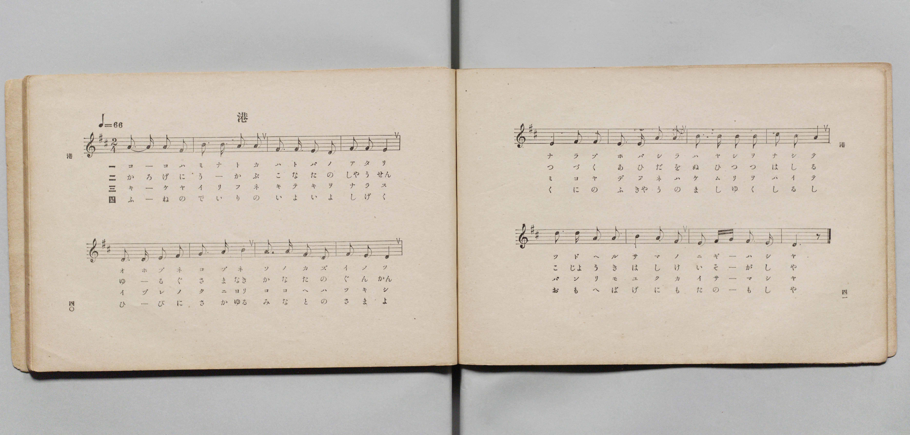
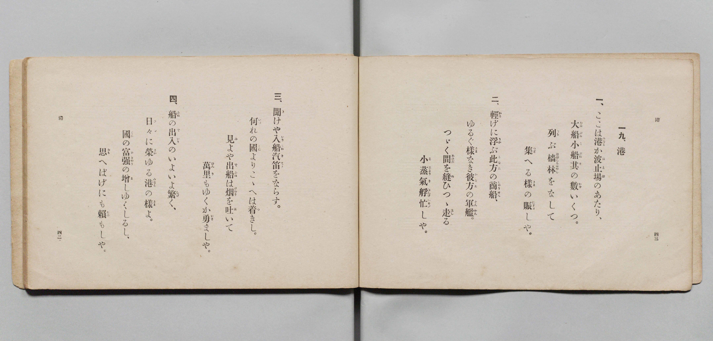

# 港

> Re:Shōka 使用 AI 協助辨識與重建樂譜，可能會有錯誤。歡迎回報。

- **鋼琴伴奏版**：<br><audio controls src="minato.mp3"></audio>

- 文部省《尋常小學唱歌》
- 文部省《尋常小學唱歌 第三學年用》（明治四十五年五月，索書號 4079）

## 說明

原書資訊與歌詞全文（對應 P100.jpg–P101.jpg，第六學年 pp. 94–95）：
調性與拍號：ニ調（D 大調）2/4 拍，速度 ♩=66


## 歌詞

```text
一、こゝは港（みなと）か波（は）止（と）場（ば）のあたり、
大（おほ）船（ぶね）・小（こ）船（ぶね）其（そ）の數（かず）いくつ。
列（なら）ぶ檣（ほばしら）林（はやし）をなして
集（つど）へる樣（さま）の賑（にぎは）しや。

二、輕（かろ）げに浮（うか）ぶ此（こ）方（なた）の商（しゃう）船（せん）、
ゆるぐ樣（さま）なき彼（か）方（なた）の軍（ぐん）艦（かん）。
つゞく間（あひだ）を縫（ぬ）ひつゝ走（はし）る
小（こ）蒸（じょう）氣（き）・艀（はしけ）忙（いそが）しや。

三、聞（き）けや入（いり）船（ふね）汽（き）笛（てき）をならす、
何（いづ）れの國（くに）よりこゝへは著（つ）きし。
見（み）よや出（で）船（ふね）は煙（けむり）を吐（は）いて
萬（ばん）里（り）もゆくか勇（いさ）ましや。

四、船（ふね）の出（で）入（いり）のいよ〳〵繁（しげ）く、
日（ひ）々（び）に榮（さか）ゆる港（みなと）の樣（さま）よ。
國（くに）の富（ふ）強（きゃう）の增（ま）しゆくしるし、
思（おも）へばげにも賴（たの）もしや。
```

## ABC

<div class="abc-score" data-abc-src="minato.abc" aria-label="五線譜載入中"></div>

[下載 ABC 原始檔](minato.abc)

## TMD 檔案連結

- [主旋律 TMD 檔案](minato.tmd) [[在 TMD Studio 編輯](https://tmdlang.github.io/Tmd-TS/#tmd=s7IKdvYPcrWy4qpTUCpJTLdSSM7PyUlNLsnMz7PKyszLyo8vzshPT8wuBdHZiUpwdWX5OaW5qVbpRYkpqfHG8SYG5pYIyeL80qLkVKvi5Iz8_Jz4ktSKkqT8_Gx0-fiCxPRUqwBDAwOETEFRfllqXmIeUHdBUWZeSWoKWDtCQWpZZkoqSLo4OTEvviy1KDMtMzUFyV2pRcUgx0OtKClKzCtOLsosAPkIoSq_qAToraLEgoxKq4zM4pL8oszkxJz47MQ8JC-WZKQCfViQk5icii5YlpqRmZyDJAw0ID0zzyo3Py-pFBhSSlxaWgrPdqxX0NLiUrRVMDPjsrdVcOGyMdI3sQPpeTat_WXziudzGh83dD3d0P10x46nG_qfrt3xdMrGZ2t7Hjd0g03Gr0rh-Zo1T3Z0gvg7tzyfsgKo6_2ejmcz-p5t2v109uynvY1Pdk0BSgHJZ3M63u_peb5l0bPZO17MnK8Aiq33ezqVuLj0tRRsqQW4FBQUnvbNB9mxuf3Fiq4XHe1AZ75YOe9p6wqgV4COe7qh91l7pwIoyvWyCtIfNUwGMg1BTJDz1qx52roW4h2FggI9BUsToAJLU6BD3--ZBTL8xar9zxqWg4zt7gV6Ayj6uLkbKAg02UXh6ZLlYGYnMIwVgAqAJr5smP901zKFRzNX2gJjAGTCkx0NjxsaHzdOftw093HjemAMAfU-btz_uHHV48YVQM2PG7ufbV4EFgRKdT5bC2GDpJ4u2AJmbwArW_e4selx4_zHTV1AA8E-X7IcLN31uHE3UMWLjp1g7rbHjWtBGpp3A-MOLDIZU_Zp6zYwdy7E6GdTd4C53Y8bZ4FFWh439j9uXPK4oQlsU8d0sPSqx03AkAFKb3u2ajFYZDfQdY8bp0PEn82DKFv_uAmoH8jufNw0CezR6Y8bl4EMejm7DaxiyePGlWCDdjxu6n62AmLW1MeN-yDOebF5Ilhk9ePGPkiwgO1oATkHHKi7gCm28cWeqVBHNwHDHqgEaNfqZ1vXgQXbgOJQp65dAg-FZ9MgoQB0EjAyQVY9nQpxEdD4ZqAupJCa_bgJpAUa2I-b2oBOfdw4AcO1QLN6n-7dA3EKVjte7Aa6DygyAWLii85lMHdDLACHMShQmuYBg_3lNKAoUBoY2ZseNy6AhOLzHavBgmvAJgLFgYrnvtgKTBng8IYGdjc4spBjfRIkXmc8bmqH-O7ZBojzwSHWvPtFZwPciMeNwFDvfLp_JlgEGIPABNuDGfY7QEHyonEewpjGiUD5p61LofqaupBCcSskvT3buBeu_vma2WD2Mqh2SBppApozExrYT_ZCYhboBqChQBU9oJiaAyptwOkSGBZAwQ5QVoBmrB1AL7yYCEl-wOgGmtULcjYkaF8sg-gE5VWwtpan7bvAIsAMhO5SoEHPWyFBAPRWA8Q3QDc-nTABnknBLgMn6BcTgDECyqKQuHzZDgwwkLvAeppAiQbk3u6n3aDCCKwN6DOg_n2ogQosPUGBiu6SdcjuRAtgcIEAZHc8btj8uGHr852N0HTcOAks2w8Ny2fTIdo2gZNaK5i9Gaxi9bNlkLwCTMrgvAJO4thKqHXoiR5kK6RkQIsUoJPXg4OgcSvIyXu2Q2IdnrlAChZBkg4k9wBDARJGQAYwewGjDOLqBmDJBC7bmpqgBQWooAHlcKDIi82QgnE-0DhoSMODE6iZ8ooFChS09Lm4fDPzEkvyrQIyE_PyHWoMaqpBVijYGJpp2YFZ2Co0SE3Z8GJhj4KGCShHPl_foAOvhTSxaADaBDKsRsFUQRcITcG0MRDXKJiBRczAIiBcAxYHyRoBSUO4CAiDRECwBmyaj2ENsFyZDBWDsIApGKwDGMNQ0VVAvALM6obKgFSA-CuAeAOYtQ4q0wTmzQeRTV2odhmB5EEmgOR6gexJYLWroTrboGZ2A_E2uGtAMqugMvOh9gDjEiIDTjRggdlgQ2EegVpoDNLcC_fcRLCaFqihIBriSGBSBMuvhcpAdADzL5QNzNtIDgGWQ2DZmah2mYDkQeZA9ILMQgTKcqhoCzRQEDIwV3RA2SAWRAbkRVgQ9cPtwp-gdvWQk6BACQSUTEBJA5KgTMAiptCEBRKBJTqQPCJBwZIXeoKCRDyw8odHJSxsITEEEoWIQUwH1iRQ8XXQJAJsZiCFECQEgAU3ql2gBNUESTagkIPomwDVNxVq4j5YvIHjEikJgpM1OKHCYwOkF5KKIJUvqnXg5ASNsMalQIU9KJohkQRKz5BIhEQ1sqcnA_EOMAuWw0AegiYycISjJ6hNMM81boaajeo5YF4BBwDE89jzLMx9ID2g4IAlMmIS1I5OchIUrIyBlTkwESOkEgpWZoFoEK5RMIeyIEkNNUFBSgBE5gMlKpD4bqhvN8AyDFgeqYQCZneYDEomhmavZah2gUsoWCIDxTEs6cFKNhB_ExAvQDFxDZIMJEZBJMwVMPshyQ41NUFiCxYjiMIJVmBsBWJIUQJLMaBCDKSyAVaUwF0BsQuSXdD8BU5LsEIEkooQ6QJSaMHrYCgPJgtKLxA_QFMaPDwQvkJOu3jTE7AVQ1YBFQc2HEihpx8ID5HGjIFFF6TuM4IXbBBogAgNcIqCxDKwlwHLk_AcBMlb8LwCDwlIqPXBYwPib1ARBCkTIDAeYQ84NcHyPrSBDQtrqJkQcxDpERS7iEIPVCgCW9jE2AVOTaCaGFKAwdIGKM2iFJLQghTmV4g9iJKBoD3glAQt3oGmw8ozkM0gGVBaREpjMPuRilmIGD57arm4dO0UII0qBSBLmQsA)]
- [鋼琴伴奏 TMD 檔案](minato_piano.tmd) [[在 TMD Studio 編輯](https://tmdlang.github.io/Tmd-TS/#tmd=s7IKdvYPcrWy4tLSUni2Y_37PR0vu_c8n7DlyZ4tT5f2P-_seL-nU0FLi0vRVsHMjMveVsGFy8ZI38SOq05B6dm09pfNK57PaXzc0PV0Q_fTHTuebuh_unbH0ykbn63tedzQrQRS9aJ91_PGxc937H0-d_HTXXNAalvXAFU9W7AQovDl7DagWqDNT5csf7Z28dPZs5_u3PJkR-ezOUDLe55vWfRs9o4XM-crGJgbmSoYmQEdpMTF5ZuZl1iSbxWQmZiXH-ThUGNQU82lAAQ2hmZadmCWvpaCLTpQeL5mzZMdDS8W9ihomCgAXft8fYOOQoChgYFeVkG6JhYNWvpgw2oUTBV0gdAUTBsDcY2CGVjEDCwCwjVgcZCsEZA0hIuAMEgEBGvApvkY1ig8bpwMFYOwHjeuB-t43LgfKroKiFeAWd1QGZAKEH8FEG8As9ZBZZrAvPkgsqkL1S4jkDzIBJBcL5A9Cax2NVRnG9TMbiDeBncNSGYVVGY-1J7HjdMhMk3NEG2PG2eDDYV5BGqhMUhzL9xzE8FqWqCGgmiIIx83bgXLr4XKQHQ8blwGZT9uAjkU5pDHTZ1g2ZmodpmA5EHmQPSCzEIEynKoaAs0UBAyMFd0QNkgFkQG5EVYEPXD7cKfoHb1kJOgQAkElExASQOSoEzAIqbQhAUSgSU6kDwiQcGSF3qCgkT848bd8KiEhS0khkCiEDGI6Y8b50LF10GTyOPGWUghBAmBx41LUO0CJagmSLIBhRxE3wSovqlQE_fB4g0cl0hJEJyswQkVHhsgvZBUBFSFPTlBI6xxKVBhD4pmSCSB0jMkEiFRjezpyUC8A8yC5TCQh6CJDBzh6AlqE8xzjZuhZqN6DphXwAEA8Tz2PAtzH0gPKDhgiYyYBLWjk5wEBStjYGUOTMQIqYSClVkgGoRrFMyhLEhSQ01QkBIAkflAiQokvhvq2w2wDAOWRyqhgNkdJoOSiaHZaxmqXeASCpbIQHEMS3qwkg3E3wTEC1BMXIMkA4lREAlzBcx-SLJDTU2Q2ILFCKJwghUYW4EYUpTAUgyoEAOpbIAVJXBXQOyCZBc0f4HTEqwQgaQiRLqAFFrAVAgvTpFlQekF4gdoSoOHB8JXyGkXb3oC1qhkFVBxYMOBFHr6gfAQacwYWHRB6j4jeMEGgQaI0ACnKEgsP25cCcuT8BwEyVvwvAIPCUio9cFjA-JvUBEEKRMgMB5hDzg1wfL-jMdN7YjQBeV4RCpFpEdQ7CIKPVCh-LgRVMoQtAucmkA1MaQAg6UNUJpFKSShBSnMrxB7ECUDQXvAKQlavANNh5VnIJtBMqC0iJTGYPYjFbMQMXz21KK2qXyQ21QmiCbV0_Vrnu5eDGwpAtt0z6bOeLKr--WiFU-3L3vW2Q1pMiKln3iFaMNYUL0GYwBFTOPjoVKm8UAhbEpNoEohIiANYBasHQbjQ1hgUxTMQEyz-FxUYZzuQNIJlDSA-F7XTgESANE-hrFgrUgiRhgixhgiJnARZS4A)]

## 分析

```text
================================================================================
📊 TMD Song Profile: [ 港 ]
================================================================================
⏱  Duration:       0:29 (29.1s), 16 measures total
🎼 Key & Tempo:    首調基準 D, != 66.0 BPM, <2/4>
   - 分析範圍：      由實際發聲的音符與和弦推測調性；播放脈絡另行呈現
🎤 人聲音域:    D4 (MIDI 62) – D5 (MIDI 74) [跨度: 12 個半音 / 1.0 個八度, 難度: easy]
   - 最低音:  D4 in [Minato #1 @ m.3, 0:05]
   - 最高音: D5 in [Minato #1 @ m.13, 0:21]
   - 適合: soprano, mezzo-soprano, contralto, tenor, baritone, bass
🏛  結構:      Minato (29.1s)
⚡ 編曲密度:        Peak 1 軌道同時演奏
🗝  調性診斷：       D 大調（純淨自然大調，未偵測到可信轉調）
   - 風格氣質:    純淨自然大調（陽光明朗、易唱易記，無明顯調外色彩）
   - 轉調歷程:    全曲維持單一推測調性（未偵測到可信轉調）
   - 核心骨幹音:  A, F#, D, B, E
   - 調性數值:    D 大調 [相關度: 0.80, 穩定度: Moderate, 自然音純度: 100.0%]
   - 候選調性 (K-S): D 大調 (0.80), A 大調 (0.76), F# 小調 (0.68)
   - 五度圈歷程:   +2
   - 各段落調性細節:
     • [Minato #1]: D 大調 (r: 0.80, 自然音純度: 100.0%)

  [ 五度圈游移軌跡 ]
               C  
         F            G  
      Bb              [D ]*
      Eb               A  
         Ab           E  
            Db       B  
               F# 
     (* = active key center)

  [ 十二半音累積音高分佈 ]
     C  :                            0.0%
     C# : ██                         1.6%
     D  : ██████████████████        17.5%
     D# :                            0.0%
     E  : █████████████████         16.7%
     F  :                            0.0%
     F# : ██████████████████████    20.6%
     G  : ███                        3.2%
     G# :                            0.0%
     A  : ████████████████████████  23.0%
     A# :                            0.0%
     B  : ██████████████████        17.5%
--------------------------------------------------------------------------------
Assignment 軌道音域：
  - Piano         : D4 – D5 (12 個半音 / 1.0 個八度, 56 個音符)
================================================================================
```


## 原書掃描頁






