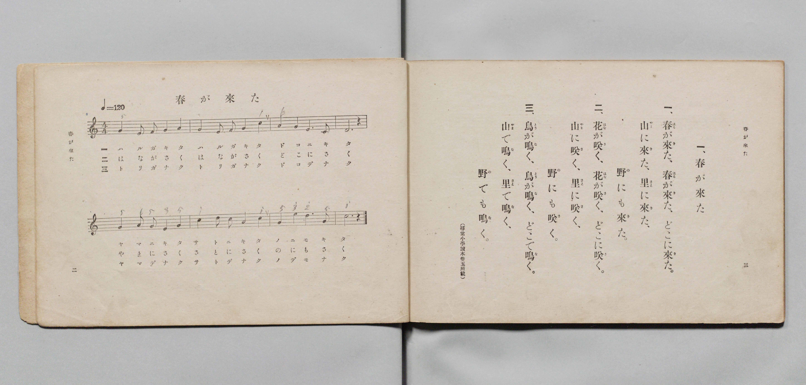

# はる が きた（春が來た）

> Re:Shōka 使用 AI 協助辨識與重建樂譜，可能會有錯誤。歡迎[回報](https://github.com/TMDLang/reshoka/issues)。

- **鋼琴伴奏版**：<br><audio controls src="haru_ga_kita.mp3"></audio>
- **NEUTRINO 歌聲合成版**：<br><audio controls src="haru_ga_kita_neutrino.mp3"></audio>

- 作詞：高野辰之（文部省尋常小學唱歌）
- 作曲：岡野貞一（文部省尋常小學唱歌）
- 文部省《尋常小學唱歌 第三學年用》（明治四十五年五月，索書號 4079）
- 國立臺灣圖書館典藏

## 說明


- 出處：臺灣總督府編《公學校唱歌》第二學年用，第十五課〈はる が きた〉（春が來た），原書第 34–35 頁（P036–P037）。
- 調性與拍號：ハ調（C 大調），4/4 拍，速度 != 120。
- 背景與曲風：高野辰之作詞、岡野貞一作曲之日本近代最具代表性春之唱歌（原載於 1910 年《尋常小學讀本唱歌》
及 1911 年《尋常小學唱歌（二）》第四課，亦收錄於《新定公學校唱歌集》第二學年用第十三課 `2_13_haru_ga_kita`）。
描寫春天降臨山林、村里與原野，百花齊放、鳥兒啼鳴的明朗喜悅。
- 版本說明：本檔案為原書單聲部五線譜之忠實數位化版本。

### 編曲說明（鋼琴伴奏版）：

1. 前奏 (Intro, 4 小節)：以後半句「山にきた、さとにきた、のにもきた」明朗昂揚的旋律作為前奏。
2. 主歌伴奏 (HaruGaKita, 8 小節 × 3 段)：右手演奏原曲歌唱旋律；左手以輕快四拍子和聲伴奏。


## 歌詞

```text
一
はる が きた、はる が きた、
どこ に きた。
山 に きた、さと に きた、
の にも きた。

二
はな が さく、はな が さく、
どこ に さく。
山 に さく、さと に さく、
の にも さく。

三
とり が なく、とり が なく、
どこ で なく。
山 で なく、さと で なく、
の でも なく。
```

## ABC

<div class="abc-score" data-abc-src="haru_ga_kita.abc" aria-label="五線譜載入中"></div>

[下載 ABC 原始檔](haru_ga_kita.abc)

## TMD 檔案連結

- [主旋律 TMD 檔案](haru_ga_kita.tmd) [[在 TMD Studio 編輯](https://tmdlang.github.io/Tmd-TS/#tmd=s7IKdvYPcrWy4qpTUCpJTLdSSM7PyUlNLsnMz7PKyszLyo8vzshPT8wuBdHZiUpwdWX5OaW5qVbpRYkpqfHG8SYG5pYIyeL80qLkVKvi5Iz8_Jz4ktSKkqT8_GyEfEFRfllqXmIeUE1BUWZeSWoKWBFCQWpZZkoqSDo1JbMkvygzMQfJ5tSiYpDzIJbElxQl5hUnF2UWgNyMUAXUlJ6ZZ5Wbn5dUCnQ6pkRqZlYmFqflF5UAPVyUWJBRaZWRWQyyPDkxJz47MQ_J81CrCxLTU60CDAxMEDIlGanAUMlLLCktSlXi0tJSeNy4_nFTN5DqAeLex43z3-_peDZjKZD_ZF8bmNupoKXFpWirYGhkwGVvq-DMZWOib2IHMvHZtPaXzSuez2l83ND1dEP30x07nm7of7p2x9MpG5-t7VF4vmbNkx2dIP7OLc-nrHjc0A02u-_Zpt1PZ89-2tv4ZNcUoBSQfDan4_2enudbFj2bvePFzPkKoNgCWgx29pO9c16snPd-z6yXq2e8bO97sW_Dk51gg2CWY9qMpPXZ7E1ArU83LQRp3TTvyY4G4rQ-ndP9fHX3i_ZdzxsXP50zDeiul0tWPG3d8WJ6vxIXl76Wgi21AJeCgsLjhglAhz6fve7FqlXAAHrcMBEs2rz7afuuFzOnAn0AccnzHXufz138dNec59uBwdn1tHUN0OHPFiyEuB0YwKAg39UDD3JQoK5ZAwnpF6s2PW7owIjuxw2dmDEO1Pe0bz7Q00DdCsYmjxomG5sqvFzQCFQZYGBsBuQDKXOgwscNTVCXvli1_1nD8hcd7c-6e4FRCHTy4-Z-oCBQi7PC0yXLwUyQwcDEowBUA2S9bJj_dNcyBUjSQjKpuefZzPUgk2ZverkI6AeUmIckh8cNjchxColooOyz6UufzVnzYv_EJ7sXP5vT8LR1O5DxYuEKoNOAXgQqgMVyB9B_L_Z0Ppu2R8HQ0tBAARheaIn4xboGoFHwkAU5TkHhaX8XSL0hFvVwk4ERAA4ZUGQA0zkw3IF-fbJr2bMp2172tABtBGp8Nm3D03Wz0OLv5ew2zCiExt-OTqA5CglG8YbG8RmJRaXx6Ynx2ZkliQmISFBQeNbf_3T9aqBHny5Z-XJm74v2FU83bnw2bzowtJ7NnfiyvQcYqEB_A4MNlDBm7nvRtfHl3q5nU_YBFbzcvPRp66SnU_e83Lzl-awWUDadM_3ptDnPmloRUfO8swMUvOBECowXIPvZqinPFnY8b9oFSS9Pp6170bgJmLmACe759lkv1s4Bhfn-BU_XL3s2dceTvb1Pe6ZBDAEZCk36EK3AAABG7NPWFcDcCXTnkx1rQYxV816sXQ_MD6AY29D7rL1TAZTy9LIK0oEeBxsAjH6wOZgJuxGbGETtyseNk4HUarg42IfA0EIRBBow9XHjClQxiAHrQIKPm5pQDQC6EuJiUOCAowGYpZ7sagMGNxoXyHjaseHp5FUvFi8EijyduOj9nvlQwY0bn-zoQlYGjLwXfV0QlSDBnTCV4LiEKAa6AB4iu3pgIdK4Cup7oD_6oSGCLoYRIhBxtBCBG4AUIigGIIUIkgHIIQJMbsAk9nJaN8QbaFwg4-mcFWghAhVEChGICGaIQFXiCJEdnRBHrnjc1AX1_SqYhzDFUEJkOVwcKUQQgogQQRJDhMhySIggGYAcItBM178a6jdULjw4gCIvJk6HhAg8OCCCEGXw4IALAkMEOTgg4tAQATqC8moLChS09Lm4PIAFknuiN7A4sgrITMzLd6gxqKkGF0k2Flp2YEaNgqmCroKxggmYNgNiVBHDOLAQSAIirAsSBIoYgVkQaABSAzbOx7AGWB71A_mPm4EpsWkNEK8F8Zr2g83BL9cJ5m0Gq-gGmwxSAZQBq8BimxFQrnE9SB0i84B5IFsIya0E8yaDydUQ24AqQDIgFVhsMwa5sQPsOqCJIPc3d4HdCLKFkByy39ohtgFVgPwGUoFqG1LMmAFJUKCD2DWQ2DCKA9GgGIFGDjhioDIgQ0xhKnHFzxKw7fPAoYwWB01bwXId2OSa--Ax87h5EbHx09QCDtl9sLIJJQ4gPHi5hSK3Dh4zoLxKbPwg_NaOHgdIfsOQg_oNFDNwv-GMn1ouLl07BUTuUgDylLkA)]
- [鋼琴伴奏 TMD 檔案](haru_ga_kita_piano.tmd) [[在 TMD Studio 編輯](https://tmdlang.github.io/Tmd-TS/#tmd=s7IKdvYPcrWy4qpTUCpJTLdSyC8qychPL0osyKi0ysgsLskvykxOzInPTsxLVIIrKs4vLUpOjS9ITE-1CjAwMEHIlGSk5qZa5SWWlBalKnFpaSk8blz_uKkbSPUAce_jxvnv93Q8m7EUyH-yrw3Ifdy8-2X3nucTtjzZs-Xp0v7nnR3v93QqaGlxKdoqGBoZcNnbKjhz2Zjom9iB7Hg2femzTbufzWx6Nmf-09Y1T9fueLZg4dMpG5-t7QGa-3zNmie7eoCCT3duAZoL5D7tbXyya8qLVZuAhoId-WTvnBcr573fM-vl6hkv2_te7NvwZGc3yEnT2l82r3g-p_Hphu6nO3Y83dAPMgZqMFzrs9lAg2Y93bQQpHXTvCc7GojT-nRO9_PV3S_adz1vXPx0zrRns3e8XLLiaeuOF9P7lbi49LUUbKkFuBQUFB43TAA69PnsdS9WrXo2o-9xw0SwaPPup-27XsycCvQBxCXPd-x9Pnfx011znm9f8bihCy08Hzd0I4fn8ykr3u_pQQ7Sxw0dGJH7uKETLX6BQQDU97RvPtDTQN0KxiaPGiYbmyq8XNAIVBlgYGwG5AMpc6DCxw1NUJe-WLX_WcPyFx3tz7p7X8wEGjLrcXM_UBCoxVnh6ZLlYCbIYGDCUACqAbJeNsx_umuZAiTZIEwC-g0YGJCQAOrGTGtAs0FKFRQM9RSedvYCxRU0PPNKivJ1FEwUgJH5fH2DJlDNk91Ln-7redrb9bR_6eOGnqcbNz5uXA3zdOPjxqmPG1egiqwDcZuaYCK9QAc8mzP92YymZ_2zns9qeTa9--m-bmCiet60C2Iv1NEKCkZ6Ck927AbGAcSdChoeiUWl7onemSWJOgoWUEcpHJ6uYKzwbN1WkOue9m9-1tn9bM8UoHJwWG8C6gbFI9iS93tmP92-DKgA6IkXe6Y-3b_66ezZwFB7unbC00k9Lxo3QeyB2k95IoQCBS19Li5wUFoFZCbm5Qd5ONQY1FSD_WhjoWUHZtQomCroKpgBSWMgDWLXKBjGASmjOBBtBmSBuRB1xlAZXbBaqEoYNAAp46pFsdMH2U4TuJ2G8QrRhrEwqkbBBMgwiYVRQLsgEiDKFMSHKgRhA4gdiCgh6DljYEKCeBLuDagI1GcgCYgwyBuGQBEjDG-BjPMxrAEm6X4g_3HzaoXHTWuAeC2I17QfbA5-uU4wbzNYRTfYZJAKoAxYBRbbjIByjetB6hpXQfP4VDAPZAshuZVg3mQwuRpiG1AFSAakAottxiA3doBdBzQR5P7mLrAbQbYQkkP2WzvENqAKkN9AKlBto02yQ8TPErDt88ChjBYHTVvBch3Y5Jr74DHzuHkRsfHT1AIO2X3gUEaPAwhvBVa5dfCYAZZRRMcPwm_t6HGA5DcMOajfQDED9xvO-MGSuQjnYnCuxZarkfnQ7AykQJmYWiWBrp0CuMABGwjkIBwf7WMYi03UCKuoMVxUmQsA)]

## 分析

```text
================================================================================
📊 TMD Song Profile: [ はる が きた（春が來た） ]
================================================================================
⏱  Duration:       0:16 (16.0s), 8 measures total
🎼 Key & Tempo:    首調基準 C, != 120.0 BPM, <4/4>
   - 分析範圍：      由實際發聲的音符與和弦推測調性；播放脈絡另行呈現
🎤 人聲音域:    C4 (MIDI 60) – E5 (MIDI 76) [跨度: 16 個半音 / 1.3 個八度, 難度: moderate]
   - 最低音:  C4 in [HaruGaKita #1 @ m.3, 0:05]
   - 最高音: E5 in [HaruGaKita #1 @ m.7, 0:12]
   - 適合: soprano, mezzo-soprano, contralto, tenor, baritone, bass
🏛  結構:      HaruGaKita (16.0s)
⚡ 編曲密度:        Peak 1 軌道同時演奏
🗝  調性診斷：       C 大調（純淨自然大調，未偵測到可信轉調）
   - 風格氣質:    純淨自然大調（陽光明朗、易唱易記，無明顯調外色彩）
   - 轉調歷程:    全曲維持單一推測調性（未偵測到可信轉調）
   - 核心骨幹音:  G, C, D, E, A
   - 調性數值:    C 大調 [相關度: 0.87, 穩定度: Moderate, 自然音純度: 100.0%]
   - 候選調性 (K-S): C 大調 (0.87), G 大調 (0.82), E 小調 (0.59)
   - 五度圈歷程:   +0
   - 各段落調性細節:
     • [HaruGaKita #1]: C 大調 (r: 0.87, 自然音純度: 100.0%)

  [ 五度圈游移軌跡 ]
              [C ]*
         F            G  
      Bb               D  
      Eb               A  
         Ab           E  
            Db       B  
               F# 
     (* = active key center)

  [ 十二半音累積音高分佈 ]
     C  : ███████████████████       23.3%
     C# :                            0.0%
     D  : █████████████             16.7%
     D# :                            0.0%
     E  : ████████████              15.0%
     F  : ███                        3.3%
     F# :                            0.0%
     G  : ████████████████████████  30.0%
     G# :                            0.0%
     A  : █████████                 11.7%
     A# :                            0.0%
     B  :                            0.0%
--------------------------------------------------------------------------------
Assignment 軌道音域：
  - Piano         : C4 – E5 (16 個半音 / 1.3 個八度, 30 個音符)
================================================================================
```


## 原書掃描頁




