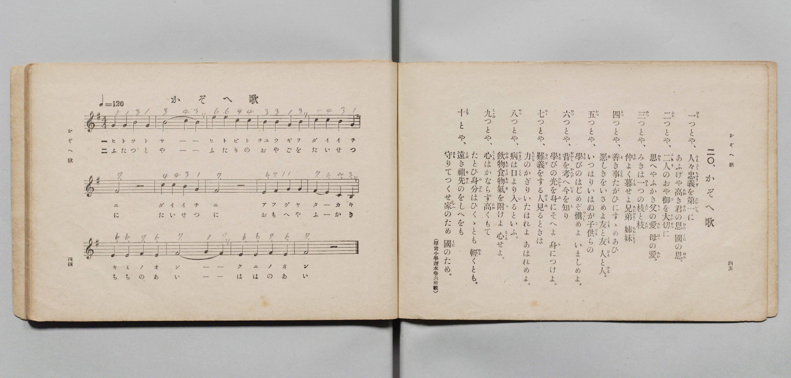

# かぞへ歌

> Re:Shōka 使用 AI 協助辨識與重建樂譜，可能會有錯誤。歡迎回報。

- **鋼琴伴奏版**：<br><audio controls src="kazoeuta.mp3"></audio>
- **NEUTRINO 歌聲合成版**：<br><audio controls src="kazoeuta_neutrino.mp3"></audio>

- 文部省《尋常小學唱歌 第三學年用》（明治四十五年五月，索書號 4079）

## 說明

原書資訊與歌詞全文（對應 P025.jpg，書頁 pp. 44–45，第 20 首）：
調性與拍號：ト調四拍子（G 調 4/4 拍），速度 ♩=120
註記：（尋常小學讀本卷六所載）


## 歌詞

```text
一（ひと）つとや、人々忠義（ひと〳〵ちゆうぎ）を第一（だいいち）に、あふげや高（たか）き君（きみ）の恩（おん）、國（くに）の恩（おん）。
二（ふた）つとや、二人（ふたり）のおや御（ご）を大切（たいせつ）に、思（おも）へやふかき父（ちゝ）の愛（あい）、母（はゝ）の愛（あい）。
三（み）つとや、みきは一（ひと）つの枝（えだ）と枝（えだ）、仲（なか）よく暮（くら）せよ兄（あに）おとゝ、姉（あね）いもと。
四（よ）つとや、善（よ）き事（こと）たがひにすゝめあひ、惡（あ）しきをいさめよ友（とも）と友（とも）、人（ひと）と人（ひと）。
五（いつ）つとや、いつはりいはぬが子供（こども）らの、學（まな）びのはじめぞ愼（つゝし）めよ、いましめよ。
六（む）つとや、昔（むかし）を考（かんが）へ今（いま）を知（し）り、學（まな）びの光（ひかり）を身（み）にそへよ、身（み）につけよ。
七（なゝ）つとや、難義（なんぎ）をする人（ひと）見（み）るときは、力（ちから）のかぎりいたはれよ、あはれめよ。
八（や）つとや、病（やまひ）は口（くち）より入（い）るといふ、飲物（のみもの）食物（くひもの）氣（き）を附（つ）けよ、心（こゝろ）せよ。
九（こゝの）つとや、心（こゝろ）はかならず高（たか）くもて、たとひ身分（みぶん）はひくゝとも、輕（かる）くとも。
十（とを）とや、遠（とほ）き祖先（そせん）のをしへをも、守（まも）りてつくせ家（いへ）のため、國（くに）のため。
```

## ABC

<div class="abc-score" data-abc-src="kazoeuta.abc" aria-label="五線譜載入中"></div>

[下載 ABC 原始檔](kazoeuta.abc)

## TMD 檔案連結

- [主旋律 TMD 檔案](kazoeuta.tmd) [[在 TMD Studio 編輯](https://tmdlang.github.io/Tmd-TS/#tmd=s7IKdvYPcrWy4qpTUCpJTLdSSM7PyUlNLsnMz7PKyszLyo8vzshPT8wuBdHZiUpwdWX5OaW5qVbpRYkpqfHG8SYG5pYIyeL80qLkVKvi5Iz8_Jz4ktSKkqT8_Gx0-fiCxPRUqwADI1OETEFRfllqXmIeUHdBUWZeSWoKWDtCQWpZZkoqSLo4OTEvviy1KDMtMzUFyV2pRcUgx0OtKClKzCtOLsosAPkIoSq_qAToraLEgoxKq4zM4pL8oszkxJz47MQ8JC-WZKQCfZibX5SYk1lSiaw5Mz0zDyiRl1QKDBUlLi0thceN3Y8b5z1u3PFsbY-ClhaXoq2CoZEBl72tgjuXjYm-iR1I97Np7S-bVzyf0_i4oevphu6nO3Y83dD_dO2Op1M2grQ9X7PmyY5OEH_nludTVjxu6H6_p-PZjL5nm3Y_nT37aW_jk11TgFJA8tmcjvd7ep5vWfRs9o4XM-crgEL__Z5OJS4ufS0FW2oBLgUFhad980F2bG5_saLrRUc70JkvVs572roC6BWg455u6H3W3qkAikK9rIJ0oJuAil8uaFQoKNBTMDF51DDZxBTk0DVrFIwMFF4umwZ05Ps9s0AGv1i1_1nDcpCR3b1ALwBFHzd3AAWBPgWKPF07AWi8O0iVAjD0FIBCYK09LxvmP921TOHRzJW2oPAFGbRi94sVM4D6we5BBOqLdQ3P5qx52rv9aevaZ50NL0DaO7lAOp7saACqfdy46XHjCqDY48YlQMbjppbHDcAQ3vW4ofXp_gXP962Eq3ncsPlxw9bHjQsfN7U9bgSiPpCupkng-IIYteBxYwsYLQQbuBpo1OPGpseNQF2TgCa_XA10IFDZfGAyASvofTphNlik93HjfrDIumeNEBu7HjdNBok0ND6dA0oAjxv7gQbiUNME9s-uHrAo0DJgOKL5pwfoJbjs46YuiEFgI1qe7gM6Fyg1BeKfp0uWP-0ARSvYoUDPzAYaBffPs4a5MLubwII7QFaAjAWm_N7nHdvAssAwAioDu7UF4kNgKLRA_PNsPTASgSLrcauB-GcHMKqAopCAQXgGKAIOsPXYInDds3kQ94FiAyy4Al0EGBy7N4FFVkHjoQkUus9mrYMGcxMoiYC83dTxtBXoIIjLIGHfBXbGXFC0LIc4Dyi1FizVAgwRcDIBux6YgEHSTcAciuL6p9PAJkLFe5_sgkTuZJgfgEHeA_bS6seNM0E2NUGS0CZQyDVDIgoS8NNBodA0CRxFU0HKgM7th5gGtAuiZgW6CDhto4baCnQRWHICpgegKNB0SOwjxwBIEByDwPAAstc_blwDdDcwuz7ZB4lKoH9WQq1sAqc0oM_X7gBL7QMGPNjAzeAUCNQ7A-zJec9a9oAVLAF5u3E6WC_IVzAbgRqnw0QgYdwKDHlgWAKTAYr7ns0AO72pAZwoIQZNetHQDDa9G5hpgG6FpN0nu4E5AeLJfdDcPH8pWASiqwuXu5-2QmIfGGZAA8HZCWjFLmAigadYYAQCvQHMHiAPYEgBXTsR4ZMnOyCOWwXLEwjPvJy9GFYKAWWBTocWO-Dk0Y0Wdy-WQaIbbE0T0PMrIFkF5I0uSMwsBLsYksSBwQ9U0weLRmDaA0ZpDyzIgakOwkUJcrA_msD5FMmVz6e3QsTB4QTMXkDZ9U_7F8NKLnCBCDSlqetpKySAwSZAnQguQIBeXbzpeSfEq0CX7QfnJ2Cm7Hy5eD5MHGjUJrj4sw0Q80GVAjBEXs6EZFZIcoWEbuPT_ZCQnQzOS2CV4JwNC_idkMIBLA02FCWzYtEMTK9ARwOjAsiehVGiA0sPoOOWgcMPKAj02yZg1D_taINEy-PGbdAyG2QOMNKA6oH2gnInKJHsmQpLojDToFKQsO9thOXlSZCcC00hoHINLN64G1KqPF867WkrsIQBCgJNB3oXYuU6cLIBlhvARAmsj0BWPl0HUbYPllmBKWEZOAiAds9-ug5SnAPjB5gHIAkGWHsAGy5YaiWYFNitlDc7oEBBS5-LyzuxKj-1tCTRKiAzMS_focagphpkiYKNiZYdmIGtvQNpSDW8WNijoGGqAGwNPF_foANvpGhi0QC0CmRYjYIhEBoDcQ2Q1FUwAZI1CmZAaAKEIDGQHEgMxAerA-vzMaxReNw8CYg7gLgFTINElgDNAEFk2clw2cbHzcsUHjeB8DogdxNYsAHIWwLBzY0w442AMo1bgXg-EANlGleA1Da1IIyHyTZ1Ael1YBEgC6gCWLkD6UlgEZBukMhssClQs41BMvuBeDFOs0GyvUC8HojBrgSqgahdB1UB9FjjAqg40HMQk01A5oBkcJoMlgWZDAwUiCzYjT1ge4DJCywyE4KbGoF0E8xsU5AMyC8gc7G7GiYLdDUwVGAiID-sAdsBEgHZuxIo3wTEnTCzzUAmAeMBj7tBst1APB0etkBeE8g0kNt3wG3bB5YHqYOabQ6SWQXF2N0NlAGb1Ac3G-R7kG2gMIGEEjBGwCKg8O6FmW0BMQmfu6FuApu0HmxSPxAvhMQEIpTgZrfAzLaEhRYIAzM8dqdDFTRBEgs0WMAe6gTSs-ARDBIFWgwMdlj-MYCkKl1oeGEaDXLNbrBvgSUbWASYisHhBE2D0HAGhT443MAtfdzFw64ecooH83igZQZgC-ElALKgWTyIBypEwMJArkm8gnE8SjHRDVQJ0oElt6PKNi0C8qcCaWBsAYsSkMh-cAitBuK1KGXDaoQu9FyOJgsqFYCpHRxKwNgFsraCzARHCTwlgcuEBUi60PI3miwoLYPSP0hVPyxVgaMcFEco5QEw5SH0oeVsNFmQK0HxCYxxaD4A-QoUHkD1CFPBJQEoDcD0oeVpNFlQ6ge5dzNYHCQCKhFmQF0xD6UM6ELSh5ab0WQxTQXlMFCYgMIblBoRuX89kj60fIwmC8yXYDNAIQkxFaQWVC6A7EbK9eA4RHIpcv5FkwXWNGBbQaELMRNUAgBdCxNByu_L0FIVUrbFIguyD-Tr_WCRbdDcCfIPciYHakYkcLQsiyoLDm5QJIKqtGVgEVCpA3LubLChBOr_TnAGNyEtgwNzLCQPA0lozjYEUVhlwHkekbOBefJxMzAkmkExtAqcmzcjlb3AdAbM3eiyYM8i5WRQnIMwKJ4g4YxcCoLSKgijyiKZAc65oJgElhGgvA6tL0AlK8wMkCzQpeB0AjEDJItkBjifAmMTnCJAsQopjUFRAzMDUhPB4hyLGeBcCaubQbUkuHQD5lrU-hmUb1BlkcwA5UFw2wPkl7ngZIJuBkwWZMtEbGaAcxzIJlAKBbUEwPU-ihkgX0JkcLgDnMMgpRC6TdgqvtnYzADnJ1CogZIvCGOGKSinQ3MYkiySGZBKEuQZYH4BJ4H5YGWNSIaANIMCBFUWYkgtF5eunQKsRa0AZCtzAQA)]
- [鋼琴伴奏 TMD 檔案](kazoeuta_piano.tmd) [[在 TMD Studio 編輯](https://tmdlang.github.io/Tmd-TS/#tmd=s7IKdvYPcrWy4qpTUCpJTLdSSM7PyUlNLsnMz7PKyszLyo8vzshPT8wuBdHZiUpwdWX5OaW5qVbpRYkpqfHG8SYG5pYIyeL80qLkVKvi5Iz8_Jz4ktSKkqT8_Gx0-fiCxPRUqwADI1OETEFRfllqXmIeUHdBUWZeSWoKWDtCQWpZZkoqSDoxOTk_tyAxLzM3NQ9Jviy1qBjk-ILMxLz8eByK8otKgL4qSizIqLTKyCwuyS_KTE7Mic9OzEPyYWJRUWJeeipIJ37TSjKAiqxy84sSczJLKpFtyUzPzANK5CWVAkMPUyI1MysTKXS0tBQeN3Y_bpz3uHHHs7U97_d0vOze83zClid7tjxd2v-8s-P9nk4FLS0uRVsFQyMDLntbBXcuGxN9EzuQwc-mtb9sXvF8TuPjhq6nG7qf7tjxdEP_07U7nk7ZCDRL4fmaNU92dIL4O7c8n7LicUM30PhnM_qebdr9dPbsp72NT3ZNAUoByWdzgPb0PN-y6NnsHS9mzlcAxSzQYiUuLu_EqvzU0pJEqwBQaAR5ONQY1FRzKQCBjYmWHZihr6Vgiw4gdje8WNijoGGqAHTV8_UNOgqgaNfLKkjXxKJBSx9sWI2CIRAaA3ENkNRVMAGSNQpmQGgChCAxkBxIDMQHqwPr8zGsUXjcPAmIO4C4BUyDRJYAzQBBZNnJcNnGx83LFB43gfA6IHcTWLAByFsCwc2NMOONgDKNW4F4PhADZRpXgNQ2tSCMh8k2dQHpdWARIAuo4nHjFCA9CSwC0g0SmQ02BWq2MUhmPxAvxmk2SLYXiNcDMdiVQDUQteugKoAea1wAFQd6DmKyCcgckAxOk8GyIJOBgQKRBbuxB2zP48bVYJGZENzUCKSbYGabgmRAfgGZi93VMFmgq4GhAhMB-WEN2A6QCMjelUD5JiDuhJltBjIJGA943A2S7Qbi6fCwBfKaQKaB3L4Dbts-sDxIHdRsc5DMKijG7m6gDNikPrjZIN-DbAOFCSSUgDECFgGFdy_MbAuISfjcDXUT2KT1YJP6gXghJCYQoQQ3uwVmtiUstEB4HS6nQxU0QRILNFjAHuoE0rPgEQwSBVoMDHZY_jGApCpdaHhhGg1yzW6wbx83zgWLAFMxOJygaRAazqDQB4cbF_7iYVcPOcWDeTzQMgOwhfASAFnQLB7EAxUiYGEg1yRewTgepZjoBqoE6cCS21FlmxYB-VOBNDC2gEUJSGQ_OIRWA_FalLJhNUIXei5HkwWVCsDUDg4lYOwCWVtBZoKjBJ6SwGXCAiRdaPkbTRaUlkHpH6SqH5aqwFEOiiOU8gCY8hD60HI2mizIlaD4BMY4NB-AfAUKD6B6hKngkgCUBmD60PI0miwo9YPcuxksDhIBlQgzoK6Yh1IGdCHpQ8vNaLKYpoJyGChMQOENSo2I3L8eSR9aPkaTBeZLsBmgkISYClILKhdAdiPlenAcIrkUOf-iyQJrGrCtoNCFmAkqAYCuhYkg5fdlaKkKKdtikQXZB_L1frDINmjuBPkHOZMDNSMSOFqWRZUFBzcoEkFV2jKwCKjUATl3NthQAvV_JziDm5CWwYE5FpKHgSQ0ZxuCKKwy4DyPyNnAPPm4GRgSzaAYWgXOzZuRyl5gOgPmbnRZsGeRcjIozkEYFE-QcEYuBUFpFYRRZZHMAOdcUEwCywhQXofWF6CSFWYGSBboUnA6gZgBkkUyA5xPgbEJThGgWIWUxqCogZkBqYlgcY7FDHCuhNXNoFoSXLoBcy1q_QzKN6iySGaA8iC47QHyy1xwMkE3AyYLsmUiNjPAOQ5kEyiFgloC4HofxQyQLyEyONwBzmGQUgjdJmwV32xsZoDzEyjUQMkXhDHDFJTToTkMSRbJDEglCfIMML-Ak8B8sLJGJENAmkEBgioLMaQWvUHtg6NB_bR_ycvZrS-b9wLzDbB9_qJx0_OVu0DN9V3LID0DpPZyvIIpuIYDMoDtY1AGgdd5wJwCZgC5MFkgDURgSYgoVCe8egWLQCtYZAWoUiCDQQIQ4yCSIDETsCKEeVAHwKThpgA1gVg4FWgDszckcwPDTNdOARZs0T6GsQoofCM0vjEa3wSNb4rGN0Pjm6PxLdD4lmh8QwOwgDIXAA)]

## 分析

```text
================================================================================
📊 TMD Song Profile: [ かぞへ歌 ]
================================================================================
⏱  Duration:       0:28 (28.0s), 14 measures total
🎼 Key & Tempo:    首調基準 G, != 120.0 BPM, <4/4>
   - 分析範圍：      由實際發聲的音符與和弦推測調性；播放脈絡另行呈現
🎤 人聲音域:    B3 (MIDI 59) – E5 (MIDI 76) [跨度: 17 個半音 / 1.4 個八度, 難度: challenging]
   - 最低音:  B3 in [Kazoeuta #1 @ m.10, 0:19]
   - 最高音: E5 in [Kazoeuta #1 @ m.3, 0:04]
   - 適合: soprano, mezzo-soprano, contralto, tenor, baritone, bass
🏛  結構:      Kazoeuta (28.0s)
⚡ 編曲密度:        Peak 1 軌道同時演奏
🗝  調性診斷：       E 小調（純淨自然小調，未偵測到可信轉調）
   - 風格氣質:    純淨自然小調（陰鬱抒情、旋律集中，無明顯調外色彩）
   - 轉調歷程:    全曲維持單一推測調性（未偵測到可信轉調）
   - 核心骨幹音:  F#, E, B, G, C
   - 調性數值:    E 小調 [相關度: 0.73, 穩定度: High, 自然音純度: 100.0%]
   - 候選調性 (K-S): E 小調 (0.73), B 大調 (0.48), B 小調 (0.46)
   - 五度圈歷程:   +4
   - 各段落調性細節:
     • [Kazoeuta #1]: E 小調 (r: 0.73, 自然音純度: 100.0%)

  [ 五度圈游移軌跡 ]
               C  
         F            G  
      Bb               D  
      Eb               A  
         Ab          [E ]*
            Db       B  
               F# 
     (* = active key center)

  [ 十二半音累積音高分佈 ]
     C  : ███████████████           16.0%
     C# :                            0.0%
     D  :                            0.0%
     D# :                            0.0%
     E  : ██████████████████        20.0%
     F  :                            0.0%
     F# : ████████████████████████  26.0%
     G  : █████████████████         18.0%
     G# :                            0.0%
     A  :                            0.0%
     A# :                            0.0%
     B  : ██████████████████        20.0%
--------------------------------------------------------------------------------
Assignment 軌道音域：
  - Piano         : B3 – E5 (17 個半音 / 1.4 個八度, 45 個音符)
================================================================================
```


## 原書掃描頁




