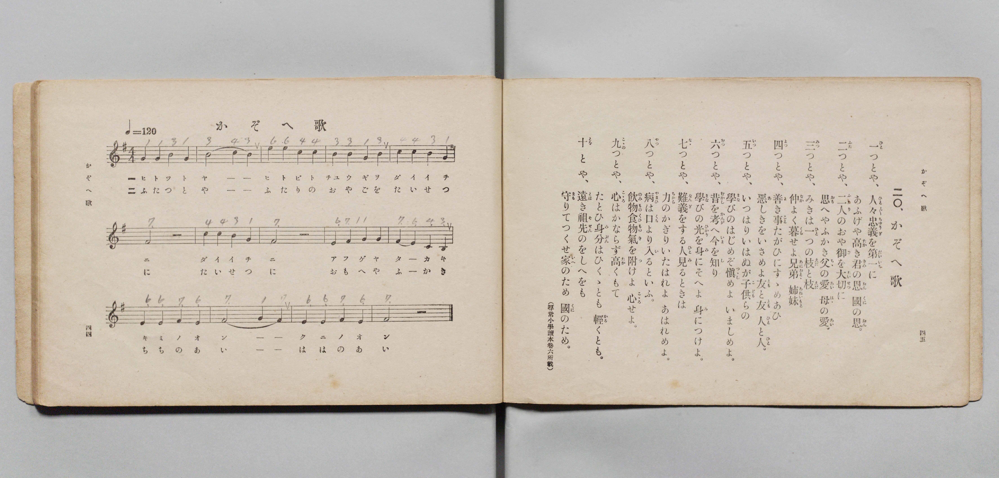

# かぞへ歌

> Re:Shōka 使用 AI 協助辨識與重建樂譜，可能會有錯誤。歡迎回報。

- **鋼琴伴奏版**：<br><audio controls src="kazoeuta.mp3"></audio>

- 文部省《尋常小學唱歌 第三學年用》（明治四十五年五月，索書號 4079）

## 說明

原書資訊與歌詞全文（對應 P025.jpg，書頁 pp. 44–45，第 20 首）：
調性與拍號：ト調四拍子（G 調 4/4 拍），速度 ♩=120
註記：（尋常小學讀本卷六所載）


## 歌詞

```text
一（ひと）つとや、人々忠義（ひと〳〵ちゆうぎ）を第一（だいいち）に、あふげや高（たか）き君（きみ）の恩（おん）、國（くに）の恩（おん）。
二（ふた）つとや、二人（ふたり）のおや御（ご）を大切（たいせつ）に、思（おも）へやふかき父（ちゝ）の愛（あい）、母（はゝ）の愛（あい）。
三（み）つとや、みきは一（ひと）つの枝（えだ）と枝（えだ）、仲（なか）よく暮（くら）せよ兄（あに）おとゝ、姉（あね）いもと。
四（よ）つとや、善（よ）き事（こと）たがひにすゝめあひ、惡（あ）しきをいさめよ友（とも）と友（とも）、人（ひと）と人（ひと）。
五（いつ）つとや、いつはりいはぬが子供（こども）らの、學（まな）びのはじめぞ愼（つゝし）めよ、いましめよ。
六（む）つとや、昔（むかし）を考（かんが）へ今（いま）を知（し）り、學（まな）びの光（ひかり）を身（み）にそへよ、身（み）につけよ。
七（なゝ）つとや、難義（なんぎ）をする人（ひと）見（み）るときは、力（ちから）のかぎりいたはれよ、あはれめよ。
八（や）つとや、病（やまひ）は口（くち）より入（い）るといふ、飲物（のみもの）食物（くひもの）氣（き）を附（つ）けよ、心（こゝろ）せよ。
九（こゝの）つとや、心（こゝろ）はかならず高（たか）くもて、たとひ身分（みぶん）はひくゝとも、輕（かる）くとも。
十（とを）とや、遠（とほ）き祖先（そせん）のをしへをも、守（まも）りてつくせ家（いへ）のため、國（くに）のため。
```

## ABC

<div class="abc-score" data-abc-src="kazoeuta.abc" aria-label="五線譜載入中"></div>

[下載 ABC 原始檔](kazoeuta.abc)

## TMD 檔案連結

- [主旋律 TMD 檔案](kazoeuta.tmd) [[在 TMD Studio 編輯](https://tmdlang.github.io/Tmd-TS/#tmd=s7IKdvYPcrWy4qpTUCpJTLdSSM7PyUlNLsnMz7PKyszLyo8vzshPT8wuBdHZiUpwdWX5OaW5qVbpRYkpqfHG8SYG5pYIyeL80qLkVKvi5Iz8_Jz4ktSKkqT8_Gx0-fiCxPRUqwADI1OETEFRfllqXmIeUHdBUWZeSWoKWDtCQWpZZkoqSLostSgzLTM1BclJqUXFIHdDTS8pSswrTi7KLAB5BqEqv6gE6KOixIKMSquMzOKS_KLM5MSc-OzEPCTflWSkAj2Xm1-UmJNZUomsOTM9Mw8okZdUCgwQTInUzKxMJA9raSk8bux-3DjvceOOZ2t7FLS0uBRtFQyNDLjsbRXcuWxM9E3sQGY8m9b-snnF8zmNjxu6nm7ofrpjx9MN_U_X7ng6ZSNI2_M1a57s6ATxd255PmXF44bu93s6ns3oe7Zp99PZs5_2Nj7ZNQUoBSSfzel4v6fn-ZZFz2bveDFzvgIoXt7v6VTi4tLXUrClFuBSUFB42jcfZMfm9hcrul50tAOd-WLlvKetK4BeATru6YbeZ-2dCqDI1csqSAe6Caj45YJGhYICPQUTk0cNk01MQQ5ds0bByEDh5bJpQEe-3zMLZPCLVfufNSwHGdndC_QCUPRxcwdQEOhToMjTtROAxruDVCkAQ08BKATW2vOyYf7TXcsUHs1caQsKX5BBK3a_WDEDqB_sHkSgvljX8GzOmqe925-2rn3W2fACpL2TC6TjyY4GoNrHjZseN64Aij1uXAJkPG5qedwADOFdjxtan-5f8HzfSriaxw2bHzdsfdy48HFT2-NGIOoD6WqaBI4viFELHje2gNFCsIGrgUY9bmx63AjUNQlo8svVQAcClc0HJhOwgt6nE2aDRXofN-4Hi6x71gixsetx02SQSEPj0zmgBPC4sR9oIA41TWD_7OoBiwItA4Yjmn96gF6Cyz5u6oIYBDai5ek-oHOBUlMg_nm6ZPnTDlC0gh0K9MxsoFFw_zxrmAuzuwksuANkBchYYMrvfd6xDSwLDCOgMrBbWyA-BIZCC8Q_z9YDIxEosh63Goh_dgCjCigKCRiEZ4Ai4ABbjy0C1z2bB3EfKDbAgivQRYDBsXsTWGQVNB6aQKH7bNY6aDA3gZIIyNtNHU9bgQ6CuAwS9l1gZ8wFRctyiPOAUmvBUi3AEAEnE7DrgQkYJN0EzKEorn86DWwiVLz3yS5I5E6G-QEY5D1gL61-3DgTZFMTJAltAoVcMySiIAE_HRQKTZPAUTQVpAzo3H6IaUC7IGpWoIuA0zZqqK1AF4ElJ2B6AIoCTYfEPnIMgATBMQgMDyB7_ePGNUB3A7Prk32QqAT6ZyXUyiZwSgP6fO0OsNQ-YMCDDdwMToFAvTPAnpz3rGUPWMESkLcbp4P1gnwFsxGocTpMBBLGrcCQB4YlMBmguO_ZDLDTmxrAiRJi0KQXDc1g07uBmQboVkjafbIbmBMgntwHzc3zl4JFILq6cLn7aSsk9oFhBjQQnJ2AVuwCJhJ4igVGINAbwOwB8gCGFNC1ExE-ebID4rhVsDyB8MzL2YthpRBQFuh0aLEDTh7daHH3YhkkusHWNAE9vwKSVUDe6ILEzEKwiyFJHBj8QDV9sGgEpj1glPbAghyY6iBclCAH-6MJnE-RXPl8eitEHBxOwOwFlF3_tH8xrOQCF4hAU5q6nrZCAhhsAtSJ4AIE6NXFm553QrwKdNl-cH4CZsrOl4vnw8SBRm2Ciz_bADEfVCkAQ-TlTEhmhSRXSOg2Pt0PCdnJ4LwEVgnO2bCA3wkpHMDSYENRMisWzcD0CnQ0MCqA7FkYJTqw9AA6bhk4_ICCQL9tAkb90442SLQ8btwGLbNB5gAjDageaC8od4ISyZ6psCQKMw0qBQn73kZYXp4EybnQFAIq18DijbshpcrzpdOetgJLGKAg0HSgdyFWrgMnG2C5AUyUwPoIZOXTdRBl-2CZFZgSloGDAGj37KfrIMU5MH6AeQCSYIC1B7DhgqVWgkmB3Up5swMKFLT0ubi8E6vyU0tLEq0CMhPz8h1qDGqqQZYo2Jho2YEZ2No7kIZUw4uFPQoapgrA1sDz9Q068EaKJhYNQKtAhtUomMWDkBGIqAFSugrGQLJGwRQIjYEQJAaWBAmCBIwUzIEqwZp9DGsUHjdPAuIOIG4B0yCRJUBTQBBZdjJctvFx8zKFx00gvA7I3QQWbADylkBwcyPMeCOgTONWIJ4PxECZxhUgtU0tCONhsk1dQHodWATIAqoA1vBAehJYBKQbJDIbbArUbGOQzH4gXozTbJBsLxCvB2KwK4FqIGrXQVUAPda4ACoO9BzEZBOQOSAZnCaDZUEmAwMFIgt2Yw_YHmAaA4vMhOCmRiDdBDPbFCQD8gvIXOyuhskCXQ0MFZgIyA9rwHaARED2rgTKNwFxJ8xsM5BJwHjA426QbDcQT4eHLZDXBDIN5PYdcNv2geVB6qBmm4NkVkExdncDZcAm9cHNBvkeZBsoTCChBIwRsAgovHthZltATMLnbqibwCatB5vUD8QLITGBCCW42S0wsy1hoQXCwFyP3elQBU2QxAINFrCHOoH0LHgEg0SBFgODHZZ_DCCpShcaXphGg1yzG-xbYPEGFgGmYnA4QdMgNJxBoQ8ON3BzH3cZsauHzDJCV8EAbCGiCEAWNQUXIkBRmARQwBhYZqCWFN1AtSA9WDI8qmzTIiB_KpAGRhiwNAGJ7AcH0mogXotSPKxG6ELP6GiyoIIBmODBAQWMYCBrK8hMcKzAExO4WFiApAsti6PJgpIzKAuAVPXDEhY41kHRhFIkABMfQh9a5kaTBbkSFKXASIdmBZCvQOEBVI8wFVwYgJIBTB9atkaTBWUAkHs3g8VBIqBCYQbUFfNQioEuJH1oGRpNFtNUUCYDhQkovEEJElEArEfSh5aV0WSBWRNsBigkIaaC1IKKBpDdSBkfHIdILkXOwmiywMoGbCsodCFmggoBoGthIkhZfhlaqkLKuVhkQfaBfL0fLLINmkFB_kHO50DNiASOlmtRZcHBDYpEUK22DCwCKnhAzp0NNpRAO6ATnMdNSMvjwBwLycVAEpq3gZkZ3CrAIgXO9oisDcyUj5uBQdEMiqJV4Oy8Gan8BSY0YPZGlwX7FikrgyIdhEERBQlo5JIQlFhBGFUWyQxw1gVFJbCQAGV2aJ0BKl1hZoBkgS4FJxSIGSBZJDPAGRUYneAkAYpWSIkMihuYGZDaCBbpWMwAZ0tY_QyqKcHFGzDbotbRoIyDKotkBigTgtsfIL_MBacTdDNgsiBbJmIzA5zlQDaBkiioNQCu-1HMAPkSIoPDHeAsBimG0G3CVvnNxmYGOEOBQg2UfkEYM0xBWR2axZBkkcyAVJQgzwAzDDgJzAcra0QyBKQZFCCoshBDarm4dO0UYE1rBSBbmQsA)]
- [鋼琴伴奏 TMD 檔案](kazoeuta_piano.tmd) [[在 TMD Studio 編輯](https://tmdlang.github.io/Tmd-TS/#tmd=s7IKdvYPcrWy4qpTUCpJTLdSSM7PyUlNLsnMz7PKyszLyo8vzshPT8wuBdHZiUpwdWX5OaW5qVbpRYkpqfHG8SYG5pYIyeL80qLkVKvi5Iz8_Jz4ktSKkqT8_Gx0-fiCxPRUqwADI1OETEFRfllqXmIeUHdBUWZeSWoKWDtCQWpZZkoqSDoxOTk_tyAxLzM3NQ9Jviy1qBjk-ILMxLz8eByK8otKgL4qSizIqLTKyCwuyS_KTE7Mic9OzEPyYWJRUWJeeipIJ37TSjKAiqxy84sSczJLKpFtyUzPzANK5CWVAkMPUyI1MysTKXS0tBQeN3Y_bpz3uHHHs7U97_d0vOze83zClid7tjxd2v-8s-P9nk4FLS0uRVsFQyMDLntbBXcuGxN9EzuQwc-mtb9sXvF8TuPjhq6nG7qf7tjxdEP_07U7nk7ZCDRL4fmaNU92dIL4O7c8n7LicUM30PhnM_qebdr9dPbsp72NT3ZNAUoByWdzgPb0PN-y6NnsHS9mzlcAxSzQYiUuLu_EqvzU0pJEqwBQaAR5ONQY1FRzKQCBjYmWHZihr6Vgiw4gdje8WNijoGGqAHTV8_UNOgqgaNfLKkjXxKJBSx9sWI2CWTwIGYGIGiClq2AMJGsUTIHQGAhBYmBJkCBIwEjBHKgSrNnHsEbhcfMkIO4A4hYwDRJZAjQFBJFlJ8NlGx83L1N43ATC64DcTWDBBiBvCQQ3N8KMNwLKNG4F4vlADJRpXAFS29SCMB4m29QFpNeBRYAsoIrHjVOA9CSwCEg3SGQ22BSo2cYgmf1AvBin2SDZXiBeD8RgVwLVQNSug6oAeqxxAVQc6DmIySYgc0AyOE0Gy4JMBgYKRBbsxh6wPY8bV4NFZkJwUyOQboKZbQqSAfkFZC52V8Nkga4GhgpMBOSHNWA7QCIge1cC5ZuAuBNmthnIJGA84HE3SLYbiKfDwxbIawKZBnL7Drht-8DyIHVQs81BMqugGLu7gTJgk_rgZoN8D7INFCaQUALGCFgEFN69MLMtICbhczfUTWCT1oNN6gfihZCYQIQS3OwWmNmWsNAC4XW4nA5V0ARJLNBgAXuoE0jPgkcwSBRoMTDYYfnHAJKqdKHhhWk0yDW7wb593DgXLAJMxeBwgqZBaDiDQh8cblz4y4hdPWSWEboKBmALEUUAsqgpuBABisIkgALGwDIDtaToBqoF6cGS4VFlmxYB-VOBNDDCgKUJSGQ_OJBWA_FalOJhNUIXekZHkwUVDMAEDw4oYAQDWVtBZoJjBZ6YwMXCAiRdaFkcTRaUnEFZAKSqH5awwLEOiiaUIgGY-BD60DI3mizIlaAoBUY6NCuAfAUKD6B6hKngwgCUDGD60LI1miwoA4DcuxksDhIBFQozoK6Yh1IMdCHpQ8vQaLKYpoIyGShMQOENSpCIAmA9kj60rIwmC8yaYDNAIQkxFaQWVDSA7EbK-OA4RHIpchZGkwVWNmBbQaELMRNUCABdCxNByvLL0FIVUs7FIguyD-Tr_WCRbdAMCvIPcj4HakYkcLRciyoLDm5QJIJqtWVgEVDBA3LubLChBNoBneA8bkJaHgfmWEguBpLQvA3MzOBWARYpcLZHZG1gpnzcDAyKZlAUrQJn581I5S8woQGzN7os2LdIWRkU6SAMiihIQCOXhKDECsKoskhmgLMuKCqBhQQos0PrDFDpCjMDJAt0KTihQMwAySKZAc6owOgEJwlQtEJKZFDcwMyA1EawSMdiBjhbwupnUE0JLt6A2Ra1jgZlHFRZJDNAmRDc_gD5ZS44naCbAZMF2TIRmxngLAeyCZREQa0BcN2PYgbIlxAZHO4AZzFIMYRuE7bKbzY2M8AZChRqoPQLwphhCsrq0CyGJItkBqSiBHkGmGHASWA-WFkjkiEgzaAAQZWFGFKL3rL2wdGyftq_5OXsVmAT_UXjpqf7up9N736-cheo3b5r2YuO9hftq563bANmqxer9kN6DMh1JKzKA7GAzWYIA1oLArMOmAHkokiDMFgeKgFRAvE13ExozYuiAlUOYbo52HSQJEjMGCyOMBCqDiYNNwWkC-IuHCq0gbkekueBQalrpwALzWgfw1gFFL4RGt8YjW-CxjdF45uh8c3R-BZofEs0vqEBWECZCwA)]

## 分析

```text
================================================================================
📊 TMD Song Profile: [ かぞへ歌 ]
================================================================================
⏱  Duration:       0:28 (28.0s), 14 measures total
🎼 Key & Tempo:    首調基準 G, != 120.0 BPM, <4/4>
   - 分析範圍：      由實際發聲的音符與和弦推測調性；播放脈絡另行呈現
🎤 人聲音域:    A3 (MIDI 57) – D5 (MIDI 74) [跨度: 17 個半音 / 1.4 個八度, 難度: challenging]
   - 最低音:  A3 in [Kazoeuta #1 @ m.10, 0:19]
   - 最高音: D5 in [Kazoeuta #1 @ m.3, 0:04]
   - 適合: soprano, mezzo-soprano, contralto, tenor, baritone, bass
🏛  結構:      Kazoeuta (28.0s)
⚡ 編曲密度:        Peak 1 軌道同時演奏
🗝  調性診斷：       A 大調（純淨自然大調，未偵測到可信轉調）
   - 風格氣質:    純淨自然大調（陽光明朗、易唱易記，無明顯調外色彩）
   - 轉調歷程:    全曲維持單一推測調性（未偵測到可信轉調）
   - 核心骨幹音:  E, D, A, B, F#
   - 調性數值:    A 大調 [相關度: 0.77, 穩定度: Moderate, 自然音純度: 100.0%]
   - 候選調性 (K-S): A 大調 (0.77), E 大調 (0.67), D 大調 (0.61)
   - 五度圈歷程:   +3
   - 各段落調性細節:
     • [Kazoeuta #1]: A 大調 (r: 0.77, 自然音純度: 100.0%)

  [ 五度圈游移軌跡 ]
               C  
         F            G  
      Bb               D  
      Eb              [A ]*
         Ab           E  
            Db       B  
               F# 
     (* = active key center)

  [ 十二半音累積音高分佈 ]
     C  :                            0.0%
     C# :                            0.0%
     D  : ██████████████            20.0%
     D# :                            0.0%
     E  : ████████████████████████  34.0%
     F  :                            0.0%
     F# : ███████                   10.0%
     G  :                            0.0%
     G# :                            0.0%
     A  : ██████████████            20.0%
     A# :                            0.0%
     B  : ███████████               16.0%
--------------------------------------------------------------------------------
Assignment 軌道音域：
  - Piano         : A3 – D5 (17 個半音 / 1.4 個八度, 45 個音符)
================================================================================
```


## 原書掃描頁




