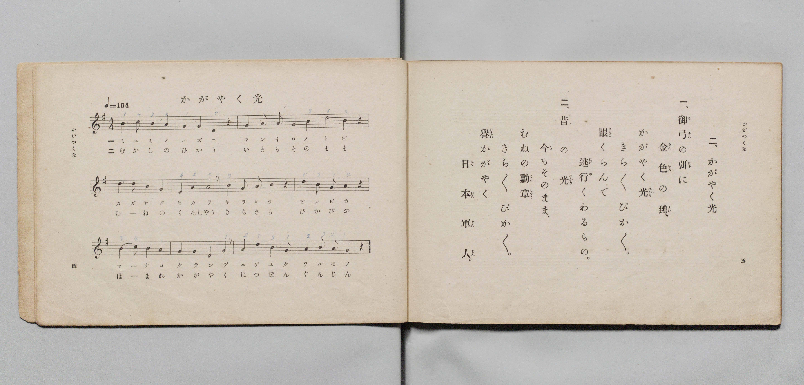

# かがやく光

> Re:Shōka 使用 AI 協助辨識與重建樂譜，可能會有錯誤。歡迎回報。

- **鋼琴伴奏版**：<br><audio controls src="kagayaku_hikari.mp3"></audio>

- 文部省《尋常小學唱歌 第三學年用》（明治四十五年五月，索書號 4079）

## 說明

原書資訊與歌詞全文（對應 P005.jpg，書頁 pp. 4–5，第 2 首）：
調性與拍號：ト調四拍子（G 大調 4/4 拍），速度 ♩=104


## 歌詞

```text
一、
御弓（みゆみ）の弭（はず）に金色（きんいろ）の鵄（とび）、
かがやく光（ひかり）きら〳〵ぴか〳〵。
眼（まなこ）くらんで逃行（にげゆ）くわるもの。

二、
昔（むかし）の光（ひかり）今（いま）もそのまゝ、
むねの勳章（くんしやう）きら〳〵ぴか〳〵。
譽（ほまれ）かがやく日本（につぽん）軍人（ぐんじん）。
```

## ABC

<div class="abc-score" data-abc-src="kagayaku_hikari.abc" aria-label="五線譜載入中"></div>

[下載 ABC 原始檔](kagayaku_hikari.abc)

## TMD 檔案連結

- [主旋律 TMD 檔案](kagayaku_hikari.tmd) [[在 TMD Studio 編輯](https://tmdlang.github.io/Tmd-TS/#tmd=s7IKdvYPcrWy4qpTUCpJTLdSSM7PyUlNLsnMz7PKyszLyo8vzshPT8wuBdHZiUpwdWX5OaW5qVbpRYkpqfHG8SYG5pYIyeL80qLkVKvi5Iz8_Jz4ktSKkqT8_Gx0-fiCxPRUqwADA1OETEFRfllqXmIeUHdBUWZeSWoKWDtCQWpZZkoqSLostSgzLTM1BclJqUXFIHdDTS8pSswrTi7KLAB5BqEqv6gE6KOixIKMSquMzOKS_KLM5MSc-OzEPCTflWSkAj0Hka5E1puZnplnlZufl1QKDA9MidTMrEwk_2ppKTxu7H7c2PO4qeVxY__T1k4FLS0uRVsFQwMTLntbBXcuGxN9EzuQMc-mtb9sXvF8TuPjhq6nG7qf7tjxdEP_07U7nk7Z-Gxtj8LzNWue7OgE8XdueT5lxeOG7vd7Op7N6Hu2affT2bOf9jY-2TUFKAUkn83peL-n5_mWRc9m73gxc74CKGbe7-lU4uLS11KwpRbgUlBQeNo3H2TH5vYXK7pedLQDnfli5bynrSuAXgE67umG3mftnQqg6NXLKkgHugmo-OWCRoWCAj0Fk0cNk01BzlyzRsFI4eWyaUAXvt8zC2Tqi1X7nzUsB5nX3Qt0P1D0cXMHUBDoTaDI07UTgGa7KzxdshwopgAMPQWgKFh3z8uG-U93LVN4NHOlLSh8QYY92dHwuKER7Nh9C5_umQzU-7hx_-OmNiAJ1PS4cd3TPWvBgusfN84Ci6x-2T7xRecmsGDv46bJjxtbHjeBbAAqfrm1BSy-4nHjZpAIxGi0KAar2AQSbOoCawOaAlS6-XHD1seNW0DiEHZDE0jz8zl7wBr2PW5c9bgR6ECghn6QBpDNy182NL9Y2ANWsPpx4ySgw2EKgAhoQRPQUSCDwH7d1QN10LMZU0BamhrALpsO9SiGy57sBpJAEaC794HUgEybCzIQ6JimuTDPgUxZC9Lfvfn56gVgDUC7gY6bDvYxxEF4vfhi7V6wtt1gg4G-AWpAhNiz6UufzVkD8-KSx417gaYD1bzY3ftk1y6w-ASwfTMg4lBDKU_CUKCgpc_F5Z2YnlgJLOU8MrMTizKtAjIT8_IdagxqqkFWKdhYaNmBGdhyECRrNgCjSUHDRAGYaZ-vb9CBJ3tNLBqAFoIMq1EwVtAFQhMwbQTENQqGQBKETeOBhAFcyAgIQTRIYY2CKVgbhAdWAzbOx7BG4XHzfLDM4-ZlUPbj5j6wnsfN_SBe0y6wWDeQBNkAFG9aCxbZDGQtAdIQHkxPB9Smx82TYTogdhmBdDZA5Bq7gXg6mLUOoq9xE1QcZGMXwq7GFrD4PqBoE5Cei6JnH8wuMAtiF_5A39VDTqBDQs8UHHqgMK1RMANZBgp_EAZBSMwYAvnwIAZrMwaLYQR602qIw5vWAANqCZi1HhqAk8A8kPzj5lVw02GBvhLMAtHwIGqeAtUBYkF04gp2oE5w4EHNbIREMCii4HkTSbYXLNsJZoFoRKRsgUfiFmikERP4OzppkOIh8QGSgAQ3SLEhVMQYmgfQU_w8qCcfN4NS2uOmzdAgBkUBJGhBqRtEtkODGJIuwWkUmE8gUbceLAPRAwr8RdBcgBb4jbthtoFTKbA0gwYi2MxGEA8Y8mA2KDpAMuDIbwQni8a9UNsmg2UmQNnAog0acRDbarm4dO0UUIskBaCIMhcA)]
- [鋼琴伴奏 TMD 檔案](kagayaku_hikari_piano.tmd) [[在 TMD Studio 編輯](https://tmdlang.github.io/Tmd-TS/#tmd=s7IKdvYPcrWy4qpTUCpJTLdSSM7PyUlNLsnMz7PKyszLyo8vzshPT8wuBdHZiUpwdWX5OaW5qVbpRYkpqfHG8SYG5pYIyeL80qLkVKvi5Iz8_Jz4ktSKkqT8_Gx0-fiCxPRUqwADA1OETEFRfllqXmIeUHdBUWZeSWoKWDtCQWpZZkoqSDoxOTk_tyAxLzM3NQ9Jviy1qBjk-ILMxLz8eByK8otKgL4qSizIqLTKyCwuyS_KTE7Mic9OzEPyYWJRUWJeeipIJ37TSjKAiqDmVCJbkpmemWeVm5-XVAoMPEyJ1MysTKTA0dJSeNzY_bix53FTy-PG_qetne_3dLzs3vN8wpYne7Y8Xdr_vLPj_Z5OBS0tLkVbBUMDEy57WwV3LhsTfRM7kNnPprW_bF7xfE7j44aupxu6n-7Y8XRD_9O1O55O2fhsbY_C8zVrnuzoBPF3bnk-ZcXjhm6g8c9m9D3btPvp7NlPexuf7JoClAKSz-YA7el5vmXRs9k7XsycrwCKW6DFSlxc3onpiZXAxOCRmZ1YlGkVAAqVIA-HGoOaai4FILCx0LIDM_S1FGzRAcQFDS8W9ihomCgA3fZ8fYOOAij69bIK0jWxaNDSBxtWo2CsoAuEJmDaCIhrFAyBJAibxgMJA7iQERCCaJDCGgVTsDYID6wGbJyPYY3C4-b5YJnHzcug7MfNfWA9j5v7QbymXWCxbiAJsgEo3rQWLLIZyFoCpCE8mJ4OqE2PmyfDdEDsMgLpbIDINXYD8XQwax1EX-MmqDjIxi6EXY0tYPF9QNEmID0XRc8-mF1gFsQu_IG-q4ecQIeEnik49EBhWqNgBrIMFP4gDIKQmDEE8uFBDNZmDBbDCPSm1RCHN60BBtQSMGs9NAAngXkg-cfNq-CmwwJ9JZgFouFB1DwFqgPEgujEFexAneDAg5rZCIlgUEQBowOc2dqQZHvBsp1gFohGRMoWeCRugUYaMYG_o5MGKR4SHyAJSHCDFBtCRYyheQA9xc-DevJxMyilPW7aDA1iUBRAghaUukFkOzSIIekSnEaB-QQSdevBMhA9oMBfBM0FaIHfuBtmGziVPm7qgQYi2MxGEA8Y8mA2KDpAMuDIbwQni8a9UNsmg2UmQNmPG2dAIw5iWy32EskHuUQygZZIwACMV4g2jFUwAVKm8bEIAdP4eGBYQbggCagwMCUDJWAiQAWoxsBVgcwzis-FmINkMkIjmkVEOAfTfuwuAgaArp0CahhE-wCVYhE1AosqcwEA)]

## 分析

```text
================================================================================
📊 TMD Song Profile: [ かがやく光 ]
================================================================================
⏱  Duration:       0:27 (27.7s), 12 measures total
🎼 Key & Tempo:    首調基準 G, != 104.0 BPM, <4/4>
   - 分析範圍：      由實際發聲的音符與和弦推測調性；播放脈絡另行呈現
🎤 人聲音域:    D4 (MIDI 62) – D5 (MIDI 74) [跨度: 12 個半音 / 1.0 個八度, 難度: easy]
   - 最低音:  D4 in [KagayakuHikari #1 @ m.2, 0:03]
   - 最高音: D5 in [KagayakuHikari #1 @ m.4, 0:06]
   - 適合: soprano, mezzo-soprano, contralto, tenor, baritone, bass
🏛  結構:      KagayakuHikari (27.7s)
⚡ 編曲密度:        Peak 1 軌道同時演奏
🗝  調性診斷：       G 大調（純淨自然大調，未偵測到可信轉調）
   - 風格氣質:    純淨自然大調（陽光明朗、易唱易記，無明顯調外色彩）
   - 轉調歷程:    全曲維持單一推測調性（未偵測到可信轉調）
   - 核心骨幹音:  B, G, A, D, C
   - 調性數值:    G 大調 [相關度: 0.76, 穩定度: Moderate, 自然音純度: 100.0%]
   - 候選調性 (K-S): G 大調 (0.76), B 小調 (0.66), D 大調 (0.65)
   - 五度圈歷程:   +1
   - 各段落調性細節:
     • [KagayakuHikari #1]: G 大調 (r: 0.76, 自然音純度: 100.0%)

  [ 五度圈游移軌跡 ]
               C  
         F           [G ]*
      Bb               D  
      Eb               A  
         Ab           E  
            Db       B  
               F# 
     (* = active key center)

  [ 十二半音累積音高分佈 ]
     C  : ██                         2.3%
     C# :                            0.0%
     D  : ███████████████           18.6%
     D# :                            0.0%
     E  : ██                         2.3%
     F  :                            0.0%
     F# :                            0.0%
     G  : ████████████████████      24.4%
     G# :                            0.0%
     A  : ███████████████████       23.3%
     A# :                            0.0%
     B  : ████████████████████████  29.1%
--------------------------------------------------------------------------------
Assignment 軌道音域：
  - Piano         : D4 – D5 (12 個半音 / 1.0 個八度, 45 個音符)
================================================================================
```


## 原書掃描頁




