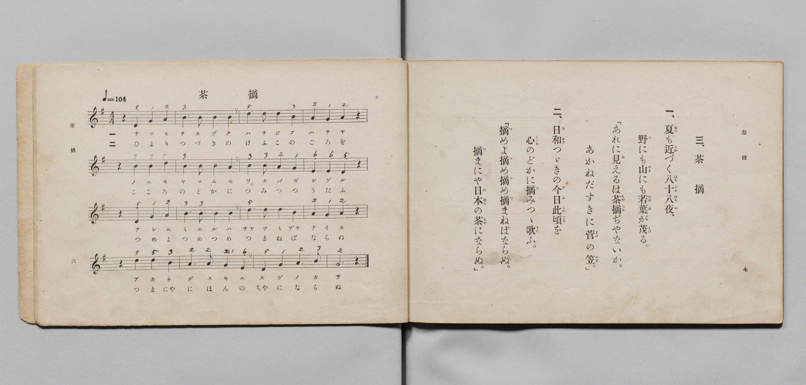

# 茶摘

> Re:Shōka 使用 AI 協助辨識與重建樂譜，可能會有錯誤。歡迎回報。

- **鋼琴伴奏版**：<br><audio controls src="chatsumi.mp3"></audio>

- 文部省《尋常小學唱歌 第三學年用》（明治四十五年五月，索書號 4079）

## 說明

原書資訊與歌詞全文（對應 P006.jpg，書頁 pp. 6–7，第 3 首）：
調性與拍號：ト調四拍子（G 大調 4/4 拍），速度 ♩=104


## 歌詞

```text
一、
夏（なつ）も近（ちか）づく八十八夜（はちじふはちや）、
野（の）にも山（やま）にも若葉（わかば）が茂（しげ）る。
「あれに見（み）えるは茶摘（ちやつみ）ぢやないか。
あかねだすきに菅（すげ）の笠（かさ）。」

二、
日和（ひより）つゞきの今日此頃（けふこのごろ）を
心（こゝろ）のどかに摘（つ）みつゝ歌（うた）ふ。
「摘（つ）めよ摘（つ）め摘（つ）め摘（つ）まねばならぬ。
摘（つ）まにや日本（にほん）の茶（ちや）にならぬ。」
```

## ABC

<div class="abc-score" data-abc-src="chatsumi.abc" aria-label="五線譜載入中"></div>

[下載 ABC 原始檔](chatsumi.abc)

## TMD 檔案連結

- [主旋律 TMD 檔案](chatsumi.tmd) [[在 TMD Studio 編輯](https://tmdlang.github.io/Tmd-TS/#tmd=s7IKdvYPcrWy4qpTUCpJTLdSSM7PyUlNLsnMz7PKyszLyo8vzshPT8wuBdHZiUpwdWX5OaW5qVbpRYkpqfHG8SYG5pYIyeL80qLkVKvi5Iz8_Jz4ktSKkqT8_Gx0-fiCxPRUqwADAzOETEFRfllqXmIeUHdBUWZeSWoKWDtCQWpZZkoqSLostSgzLTM1BclJqUXFIHdDTS8pSswrTi7KLAB5BqEqv6gE6KOixIKMSquMzOKS_KLM5MSc-OzEPCTflWSkAj1Xnl-E5GiIWHFqYnF-XjGyeZnpmXlWufl5SaXAMMKUSM3MykQKAy0thRc9255NnKGgpcWlaKtgaGDCZW-r4M5lY6JvYgfS_Wxa-8vmFc_nND5u6Hq6ofvpjh1PN_Q_Xbvj6ZSNz9b2KDxfs-bJjk4Qf-eW51NWPG7ofr-n49mMvmebdj-dPftpb-OTXVOAUkDy2ZyO93t6nm9Z9Gz2jhcz5yuAIun9nk4lLi59LQVbagEuBQWFp33zQXZsbn-xoutFRzvQmS9WznvaugLoFaDjnm7ofdbeqQCKab2sgnSgm4CKXy5oVCgo0FMwe9Qw2RzkzDVrFIwVXi6bBnTh-z2zQKa-WLX_WcNykHndvUD3A0UfN3cABYHeBIo8XTsBaLa7wtMly4FiCsDQUwCKgnX3vGyY_3TXMoVHM1fagsIXZNiTHQ2PGxrBjl3SD9T4uHHV48YlQOWPm5pe7J8IFln4uBEYmJ2PG5c-bux_2roaGJggcskcsOx6sIIZjxu3QtlNLSDFEENftveBFa0D618NNPTpxo0gkaaWx4374IIvupe-mAh0IVC8H2jZ48YNYKmeFz1NYO3THzdOArup-3FDE8jcxw09jxubHjcBydUvloGi-nHjfrAeoBFA_eshiQnqfJBlS2AKFoG5QF8CSbhxQLNA1q593LjgcePMx429IHP7W8H6gVyw5Y3rnq9ZABYBqpwK9mPT44ZeSDDu6oH6-Nn0pU8n9YCVbXrcBHRNF1jvksdN88DGrnuyuwuo5tnaJS8XNIOVTQQH3WSg1OPGKY-bQHH1uGkSOEr2Q1RMftw0FyoBUrQS7ILVMP-BY6txP9iOucA0BhZse9wITBlA8a2IEEPR0NQIdB2aCD5u4z5w8GwABV0TkLsGai6GImB8toA8OGcNWHz148bdj5smQ9wOjBV4lEAjH8k4UGACTaQ870GBgpY-F5dzRmJJcWluplVAZmJevkONQU01yBIFGwstOzADW6aHlCYNLxb2KGiYKADLmefrG3TgOVUTiwagVSDDahQMFHQVTOOBhCEQGwFxDTD_6oIxiAcSrVEwBSmCYpBMDVwORIOMqAEb52NYowAy63FzF5hsAZOLwDoeNzeCeE2rwWKtYPZ6qEw_WAwivwPMnoop07wESIJMh9plBLWrcRNYXweYBNkL1NcIUgssAMBkL5hcB5WZCOZtBZOTUWSmgE0Aq26aBLcLf6Dv6iE30GGhDApTSJiDwhIR5pixYAZyEJgARxi2YO8Dk90owQ4OiuZ5WGRAwQ-LkAlg9hqITNN2MA8csM0geWzBDgk8MAkONFAQgoISmOHBJNiuRpBuRITsB5MQNogEybSBefPh0UJMsO_oHDxpvQkUnI-bQUEHCWBQ0IK907QCHoCQlAzOBbAYgWQOsMLmJoggSB6cc5rASsBRgy3oIbKQ_AJK9_AAhoghsRFBvw9MrgWTG6Ayq8DqOsFiIPcTEfTAWpvsoMcIVQg2hCRqYNAjxw1EFYgHgzjDHpqEoYmwuQEsthNMgv0LixWoGCRZg7MKWCdIBpTwYBBniEPDEFRjQAMQbHHjbrBRqIUJqMqAqAaTiJAGSYLCGtW2Wi4uXTsFWOGvAGQrcwEA)]
- [鋼琴伴奏 TMD 檔案](chatsumi_piano.tmd) [[在 TMD Studio 編輯](https://tmdlang.github.io/Tmd-TS/#tmd=s7IKdvYPcrWy4qpTUCpJTLdSSM7PyUlNLsnMz7PKyszLyo8vzshPT8wuBdHZiUpwdWX5OaW5qVbpRYkpqfHG8SYG5pYIyeL80qLkVKvi5Iz8_Jz4ktSKkqT8_Gx0-fiCxPRUqwADAzOETEFRfllqXmIeUHdBUWZeSWoKWDtCQWpZZkoqSDoxOTk_tyAxLzM3NQ9Jviy1qBjk-ILMxLz8eByK8otKgL4qSizIqLTKyCwuyS_KTE7Mic9OzEPyYWJRUWJeeipIJ37TSjKAiqzK84uQfAgRK05NLM7PK0a2ODM9M88qNz8vqRQYoJgSqZlZmUgBpqWl8KJn27OJM97v6XjZvef5hC1P9mx5urT_eWfH-z2dClpaXIq2CoYGJlz2tgruXDYm-iZ2ICOfTWt_2bzi-ZzGxw1dTzd0P92x4-mG_qdrdzydsvHZ2h6F52vWPNnRCeLv3PJ8yorHDd1A45_N6Hu2affT2bOf9jY-2TUFKAUkn80B2tPzfMuiZ7N3vJg5XwEUzUCLlbi4nDMSS4pLczOtAkBBE-ThUGNQU82lAAQ2Flp2YIa-loItOoDY3fBiYY-ChokC0FXP1zfoKIDSgF5WQbomFg1a-mDDahQMFHQVTOOBhCEQGwFxjYIxkARhEA8kWqNgClIExSCZGrgciAYZUQM2zsewRgFk1uPmLjDZAiYXgXU8bm4E8ZpWg8Vawez1UJl-sBhEfgeYPRVTpnkJkASZDrXLCGpX4yawvg4wCbIXqK8RpPZx41Iw2Qsm10FlJoJ5W8HkZBSZKWATwKqbJsHtwh_ou3rIDXRYKIPCFBLmoLBEhDlmLJiBHAQmwBGGLdj7wGQ3SrCDg6J5HhYZUPDDImQCmL0GItO0HcwDB2wzSB5bsEMCD0yCAw0UhKCgfNy4EkyC7WoE6UZEyH4wCWGDSJBMG5g3Hx4txAT7js7Bk9abQMH5uBkUdJAABgUt2DtNK-ABCEnJ4FwAixFI5gArbG6CCILkwTmnCawEHDXYgh4iC8kvoHQPD2CIGBIbEfT7wORaMLkBKrMKrK4TLAZyPxFBDyzKyA56jFCFYENIogYGPXLcQFSBeDCIM-yhSRiaCJsbwGI7wSTYv7BYgYpBkjU4q4B1gmRACQ8GcYY4NAxXP24CxR0oAMEWN-4GG4VamCyEKIIpQYQ0SBIU1qi21aKX_T7IZb8JtOwHhaNpfLyCYbxCtGl8LCh8gCzDWLAgiIYLQClQmELVghgGUH-BzAGqgCuCmYdhDELADMQyi8_FNIgWDoIrQlgLFYSZjWIbkAKZBAxEXTsFWDhG-wBlUPhGYL4yFwA)]

## 分析

```text
================================================================================
📊 TMD Song Profile: [ 茶摘 ]
================================================================================
⏱  Duration:       0:36 (36.9s), 16 measures total
🎼 Key & Tempo:    首調基準 G, != 104.0 BPM, <4/4>
   - 分析範圍：      由實際發聲的音符與和弦推測調性；播放脈絡另行呈現
🎤 人聲音域:    D4 (MIDI 62) – D5 (MIDI 74) [跨度: 12 個半音 / 1.0 個八度, 難度: easy]
   - 最低音:  D4 in [Chatsumi #1 @ m.1, 0:00]
   - 最高音: D5 in [Chatsumi #1 @ m.3, 0:04]
   - 適合: soprano, mezzo-soprano, contralto, tenor, baritone, bass
🏛  結構:      Chatsumi (36.9s)
⚡ 編曲密度:        Peak 1 軌道同時演奏
🗝  調性診斷：       D 調性不明確（純淨自然大調，未偵測到可信轉調）
   - 風格氣質:    純淨自然大調（陽光明朗、易唱易記，無明顯調外色彩）
   - 轉調歷程:    全曲維持單一推測調性（未偵測到可信轉調）
   - 核心骨幹音:  A, D, B, G, E
   - 調性數值:    D 調性不明確 [相關度: 0.77, 穩定度: Ambiguous, 自然音純度: 100.0%]
   - 候選調性 (K-S): D 大調 (0.77), G 大調 (0.75), B 小調 (0.63)
   - 五度圈歷程:   +2
   - 各段落調性細節:
     • [Chatsumi #1]: D 調性不明確 (r: 0.77, 自然音純度: 100.0%)

  [ 五度圈游移軌跡 ]
               C  
         F            G  
      Bb              [D ]*
      Eb               A  
         Ab           E  
            Db       B  
               F# 
     (* = active key center)

  [ 十二半音累積音高分佈 ]
     C  :                            0.0%
     C# :                            0.0%
     D  : ██████████████████████    23.2%
     D# :                            0.0%
     E  : █████                      5.4%
     F  :                            0.0%
     F# :                            0.0%
     G  : █████████████████████     22.3%
     G# :                            0.0%
     A  : ████████████████████████  25.9%
     A# :                            0.0%
     B  : ██████████████████████    23.2%
--------------------------------------------------------------------------------
Assignment 軌道音域：
  - Piano         : D4 – D5 (12 個半音 / 1.0 個八度, 55 個音符)
================================================================================
```


## 原書掃描頁




