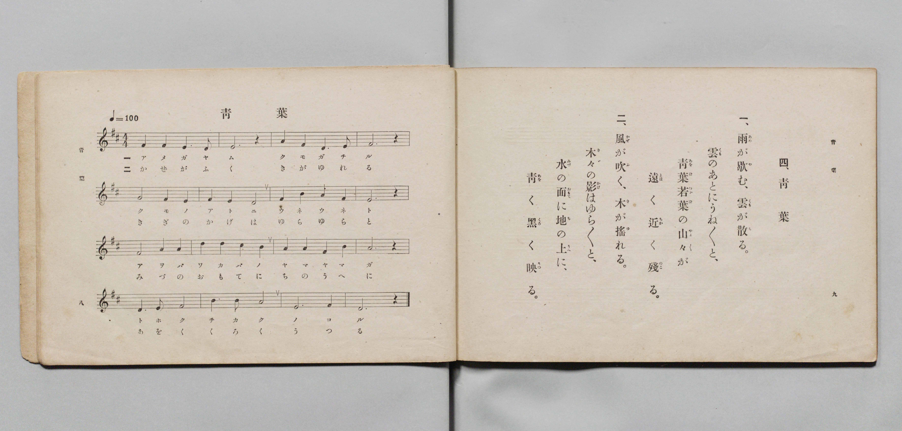

# 青葉

> Re:Shōka 使用 AI 協助辨識與重建樂譜，可能會有錯誤。歡迎回報。

- **鋼琴伴奏版**：<br><audio controls src="aoba.mp3"></audio>

- 文部省《尋常小學唱歌 第三學年用》（明治四十五年五月，索書號 4079）

## 說明

原書資訊與歌詞全文（對應 P007.jpg，書頁 pp. 8–9，第 4 首）：
調性與拍號：ニ調四拍子（D 大調 4/4 拍），速度 ♩=100


## 歌詞

```text
一、
雨（あめ）が歇（や）む、雲（くも）が散（ち）る。
雲（くも）のあとにうね〳〵と、
青葉（あをば）若葉（わかば）の山々（やま〳〵）が
遠（とほ）く近（ちか）く殘（のこ）る。

二、
風（かぜ）が吹（ふ）く、木（き）が搖（ゆ）れる。
木々（きゞ）の影（かげ）はゆら〳〵と、
水（みづ）の面（おもて）に地（ち）の上（うへ）に、
青（あを）く黑（くろ）く映（うつ）る。
```

## ABC

<div class="abc-score" data-abc-src="aoba.abc" aria-label="五線譜載入中"></div>

[下載 ABC 原始檔](aoba.abc)

## TMD 檔案連結

- [主旋律 TMD 檔案](aoba.tmd) [[在 TMD Studio 編輯](https://tmdlang.github.io/Tmd-TS/#tmd=s7IKdvYPcrWy4qpTUCpJTLdSSM7PyUlNLsnMz7PKyszLyo8vzshPT8wuBdHZiUpwdWX5OaW5qVbpRYkpqfHG8SYG5pYIyeL80qLkVKvi5Iz8_Jz4ktSKkqT8_Gx0-fiCxPRUqwADA3OETEFRfllqXmIeUHdBUWZeSWoKWDtCQWpZZkoqSLostSgzLTM1BclJqUXFIHdDTS8pSswrTi7KLAB5BqEqv6gE6KOixIKMSquMzOKS_KLM5MSc-OzEPCTflWSkAj2Xl1hSWpSKLlqcmlicn1eMbGJmemaeVW5-XlIpMJQwJVIzszKRQkFLS-Hl3EkvJnYqaGlxKdoqGBoYcNnbKrhw2Zjom9iBdD-b1v6yecXzOY2PG7qebuh-umPH0w39T9fueDpl47O1PQrP16x5sqMTxN-55fmUFY8but_v6Xg2o-_Zpt1PZ89-2tv4ZNcUoBSQfDan4_2enudbFj2bvePFzPkKoGh6v6dTiYtLX0vBllqAS0FB4WnffJAdm9tfrOh60dEOdOaLlfOetq4AegXouKcbep-1dyqA4lovqyAd6Cag4pcLGhUKCvQULB41TAa6qgfoLQUThZfLpgFd-H7PLJCpL1btf9awHGRedy_Q_UDRx83dQEGgN4EiT9dOAJrtovB0yXKgmAIw9BSAomDdPS8b5j_dtUzh0cyVtqDwBRn2ZEfD44ZGEOvl7BVAjY8bmx43NQKVP27sebYW5MzHTS0gbhNI3cvZm8Bq-h83NUHVTF0MFlkIVtP9uKEJYhaaunUgcxtXPG5c_bix7XHj2scNmx83bAWJQC0Hxz3M_kmPGzcAtb3oXgoVbOp_3NgNEQSa9XTjxscNrRCnPW7cBzEL4hywWY0LwAYBbdsNFu1_sX8ixJFAUyAiz9bNAIsA3TUZ4XJwgOzqgblpESRAgBbPgZj-dMJOsAjEsn6gumdzIGpAAQwKjQnAeAI6qw1sZg8iQIDqoE5u7H3cNA_qj70bYRZMAousB-p83NSJHjjPNmwBq9v_uHEpROfLuYvAIl3A8H3cuAwsuPrpHGD4wKKicd2THV1gLjC4d0AUIMIaHtAQj7zcDQkfYHRBPNL_bAYkDIGal6DELOUZAwoUtPS5uBzzkxKtAjIT8_IdagxqqkEWKNiYaNmBGdhyIySbN7xY2KOgYaIALACer2_QgWchTSwagNaADKtRMAZCDSMFXSA01FTV0NXVBApC-AZAlilI2hDMNYJLG8OkwWb4GNYoPG5apPC4eaGCxuOmNWDJx81LQCofNy-AG_W4aT2QvwhZTSNEzWpU84yAYo3dQDwHqLaxB6K2cStYbWM_wrzGXiAG-hiYPCBqmnrAapq64ebhD7FdPeSEmAkoLBQMweEAonXBLDNwUCEFHVLYrAd7FhRCfWD3gVgdQAxyJ4i_DMgG-gVKg0KkA0uI9IKDoQ-I14F9DwqhSUAMMh1kShsQd8JpkIoVRIbDjk7yUo4u0M-mQJZhHAiZA8MAlGBA4QBhYUsloJDYBMQTwP4Epoim1WAeNGyalwDxPDgN0gNJLKhhsR8cFkvhYdEFVNcEpIEh2LgaLLIQLAfMqkC8AyyCSGV4QwNYX5ATGmiZBBQ4QEEzsKAZVBAUIrAUAkorEC3IIaQBi_rHzbM1oSkHLNoITeGrEaKgEIMIbsaRi4C5pwmqZBJQHzjvgEUhmQhYrCFEQSEFyWhL0PJQLReXrp0CqExSANLKXAA)]
- [鋼琴伴奏 TMD 檔案](aoba_piano.tmd) [[在 TMD Studio 編輯](https://tmdlang.github.io/Tmd-TS/#tmd=s7IKdvYPcrWy4qpTUCpJTLdSSM7PyUlNLsnMz7PKyszLyo8vzshPT8wuBdHZiUpwdWX5OaW5qVbpRYkpqfHG8SYG5pYIyeL80qLkVKvi5Iz8_Jz4ktSKkqT8_Gx0-fiCxPRUqwADA3OETEFRfllqXmIeUHdBUWZeSWoKWDtCQWpZZkoqSDoxOTk_tyAxLzM3NQ9Jviy1qBjk-ILMxLz8eByK8otKgL4qSizIqLTKyCwuyS_KTE7Mic9OzEPyYWJRUWJeeipIJ37TSjKAiqzyEktKi1LRRYtTE4vz84qRrc5Mz8yzys3PSyoFBimmRGpmViZSkGlpKbycO-nFxM73ezpedu95PmHLkz1bni7tf97Z8X5Pp4KWFpeirYKhgQGXva2CC5eNib6JHcjIZ9PaXzaveD6n8XFD19MN3U937Hi6of_p2h1Pp2x8trZH4fmaNU92dIL4O7c8n7LicUM30PhnM_qebdr9dPbsp72NT3ZNAUoByWdzgPb0PN-y6NnsHS9mzlcARTTQYiUuLsf8pESrAFDABHk41BjUVHMpAIGNiZYdmKGvpWCLDiD2NrxY2KOgYaIAdNHz9Q06CqAUoJdVkK6JRYOWPtiwGgVjINQwUtAFQkNNVQ1dXU2gIIRvAGSZgqQNwVwjuLQxTBpsho9hjcLjpkUKj5sXKmg8bloDlnzcvASk8nHzArhRj5vWA_mLkNU0QtSsRjXPCCjW2A3Ec4BqG3sgahu3gtU29iPMa-wFYqCPHze1QdQ09YDVNHXDzcMfYrt6yAkxE1BYKBiCwwFE64JZZuCgQgo6pLBZD_YsKIT6wO4DsTqAGOROEH8ZkA30C5QGhUgHlhDpBQdDHxCvA_seFEKTgBhkOsiUNiDuhNMgFSuIDIcdneSlHF2gn02BLMM4EDIHhgEowYDCAcLClkpAIbEJiCeA_QlMEU2rwTxo2DQvAeJ5cBqkB5JYUMNiPzgslsLDoguorglIA0OwcTVYZCFY7nEjMDQad4BFEKkMb2gA8yk5oYGWSUCBAxQ0AwuaQQVBIQJLIaC0AtGCHEIasKh_3DxbE5pywKKN0BS-GiEKCjGI4GYcuQiYe5qgSiYB9YHzDlgUkokeN_UiREEhBcloS9DyUC1ykeSDrUgC-iReIdowVsEUQgHjHsgwjVUwglCY8mh8WM4Cck1iwZJAClOXGZBhlgtRgM0aHI6BGgvTDVeAECDJHHTboRRcPQhDw03XTgEUdNE-QCE42wjMVuYCAA)]

## 分析

```text
================================================================================
📊 TMD Song Profile: [ 青葉 ]
================================================================================
⏱  Duration:       0:38 (38.4s), 16 measures total
🎼 Key & Tempo:    首調基準 D, != 100.0 BPM, <4/4>
   - 分析範圍：      由實際發聲的音符與和弦推測調性；播放脈絡另行呈現
🎤 人聲音域:    D4 (MIDI 62) – D5 (MIDI 74) [跨度: 12 個半音 / 1.0 個八度, 難度: easy]
   - 最低音:  D4 in [Aoba #1 @ m.1, 0:02]
   - 最高音: D5 in [Aoba #1 @ m.10, 0:21]
   - 適合: soprano, mezzo-soprano, contralto, tenor, baritone, bass
🏛  結構:      Aoba (38.4s)
⚡ 編曲密度:        Peak 1 軌道同時演奏
🗝  調性診斷：       D 大調（純淨自然大調，未偵測到可信轉調）
   - 風格氣質:    純淨自然大調（陽光明朗、易唱易記，無明顯調外色彩）
   - 轉調歷程:    全曲維持單一推測調性（未偵測到可信轉調）
   - 核心骨幹音:  F#, E, D, A, B
   - 調性數值:    D 大調 [相關度: 0.76, 穩定度: Moderate, 自然音純度: 100.0%]
   - 候選調性 (K-S): D 大調 (0.76), A 大調 (0.72), F# 小調 (0.67)
   - 五度圈歷程:   +2
   - 各段落調性細節:
     • [Aoba #1]: D 大調 (r: 0.76, 自然音純度: 100.0%)

  [ 五度圈游移軌跡 ]
               C  
         F            G  
      Bb              [D ]*
      Eb               A  
         Ab           E  
            Db       B  
               F# 
     (* = active key center)

  [ 十二半音累積音高分佈 ]
     C  :                            0.0%
     C# : ██                         1.7%
     D  : ██████████████████        19.5%
     D# :                            0.0%
     E  : ██████████████████████    22.9%
     F  :                            0.0%
     F# : ████████████████████████  25.4%
     G  : ███                        3.4%
     G# :                            0.0%
     A  : ██████████████████        18.6%
     A# :                            0.0%
     B  : ████████                   8.5%
--------------------------------------------------------------------------------
Assignment 軌道音域：
  - Piano         : D4 – D5 (12 個半音 / 1.0 個八度, 42 個音符)
================================================================================
```


## 原書掃描頁




