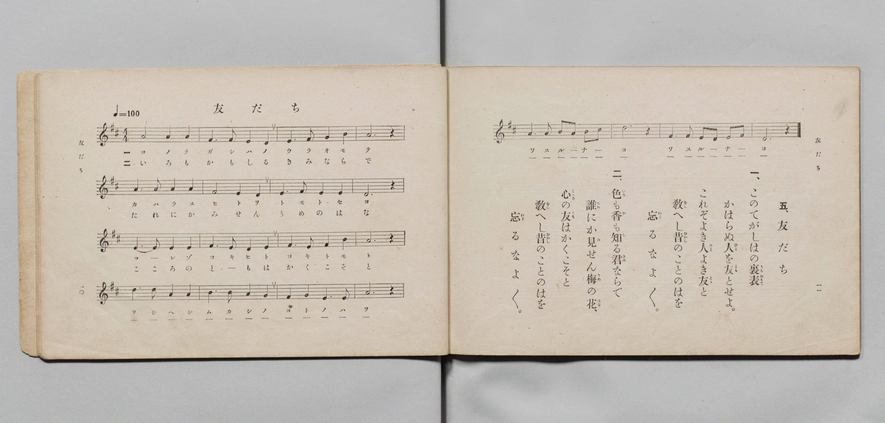

# 友だち

> Re:Shōka 使用 AI 協助辨識與重建樂譜，可能會有錯誤。歡迎回報。

- **鋼琴伴奏版**：<br><audio controls src="tomodachi.mp3"></audio>

- 文部省《尋常小學唱歌 第三學年用》（明治四十五年五月，索書號 4079）

## 說明

原書資訊與歌詞全文（對應 P008.jpg，書頁 pp. 10–11，第 5 首）：
調性與拍號：ニ調四拍子（D 大調 4/4 拍），速度 ♩=100


## 歌詞

```text
一、
このてがしはの裏表（うらおもて）
かはらぬ人（ひと）を友（とも）とせよ。
これぞよき人（ひと）よき友（とも）と
教（をし）へし昔（むかし）のことのはを
忘（わす）るなよ〳〵。

二、
色（いろ）も香（か）も知（し）る君（きみ）ならで
誰（たれ）にか見（み）せん梅（うめ）の花（はな）、
心（こゝろ）の友（とも）はかくこそと
教（をし）へし昔（むかし）のことのはを
忘（わす）るなよ〳〵。
```

## ABC

<div class="abc-score" data-abc-src="tomodachi.abc" aria-label="五線譜載入中"></div>

[下載 ABC 原始檔](tomodachi.abc)

## TMD 檔案連結

- [主旋律 TMD 檔案](tomodachi.tmd) [[在 TMD Studio 編輯](https://tmdlang.github.io/Tmd-TS/#tmd=s7IKdvYPcrWy4qpTUCpJTLdSSM7PyUlNLsnMz7PKyszLyo8vzshPT8wuBdHZiUpwdWX5OaW5qVbpRYkpqfHG8SYG5pYIyeL80qLkVKvi5Iz8_Jz4ktSKkqT8_Gx0-fiCxPRUqwADAwuETEFRfllqXmIeUHdBUWZeSWoKWDtCQWpZZkoqSLostSgzLTM1BclJqUXFIHdDTS8pSswrTi7KLAB5BqEqv6gE6KOixIKMSquMzOKS_KLM5MSc-OzEPCTflWSkAj2Xm1-UmJNZUokunpyfm1uahyIBNCU9Mw-oIy-pFBhSmBKpmVmZSCGhpaXwtL_7ceOCx40LFbS0uBRtFQwNDLjsbRVcuGxM9E3sQAY8m9b-snnF8zmNjxu6nm7ofrpjx9MN_U_X7ng6ZeOztT0Kz9esebKjE8TfueX5lBWPG7rf7-l4NqPv2abdT2fPftrb-GTXFKAUkHw2p-P9np7nWxY9m73jxcz5CqDYer-nU4mLS19LwZZagEtBQeFp33yQHZvbX6zoetHRDnTmi5XznrauAHoF6LinG3qftXcqgKJcL6sgHegmoOKXCxoVCgr0gP5_1DDZ0BDk0DVrFEwVXi6bBnTj-z2zQOa-WLX_WcNykIndvUAfAEUfN3cDBYEeBYo8XTsBaLqLwtMly4FiCsDwUwCKgnX3vGyY_3TXMoVHM1fagkIYZNiTHQ2PGxpBrMeNkx83rnvcuOxxY8_jxumPG9cDuS8W979YuAJo4OPGtsdNnY8bux43NQHVAM2D6AHG23qwxJonu3aB1W163AjU0Pm4aRIwVsEiK4B6QCJARuPsx00djxuaYBY2Aa2aBxJq7MXQDxLENAKk89nUmSDRpklAd4JFdwAZz2ZMAQs2gB0FEQd6B-gpoLVABtCZk8DRsn8GWF3_40agKUB7gKpXgV21-XHDVpDbwOGyqwcaLi86N4Gd0PK4CRSMQIe8XAa2vhHoNBD3-fylYC7YyqbupxNmg7m9jxv3gx0BNBxILodE3Qaw3Hygx8Fyq4GmvFgG8SNENTCAJj9b1AoL8kaIP150bQSLAONkFUgE4rSn-5vBosBwnAt1XeM6jCAD6gF6EehdYFDMpU8IAhVRnoegQEFLn4srJD83PyUxOSPTKiAzMS_focagphpki4KNhZYdmIEt90KKhYYXC3sUNEwUgAXG8_UNOvAsp4lFA9AukGE1wDynC8ZmULpGwRhIGgGxIRCDYA2YB8IgGYgaEAmDBiARsGk-hjUKj5s2A_mPm_vAZBuIbFoD1vO4aTtYrB8uDzH9cdMysMhKsNpVYPYiiAxYPwzGI-wxAso1toDV94LJJhDZ2A01D8KbDpYBiUHtaQSrbdwPJsH2NHVCZZZj2IM_rHf1kBPWoDA2jMMIbBALRCMCGxYFILoGHhHYAns1UpCCA7C5Bxp0k8C8DjC5CREIUBFQAEPZTbuhMivwBPZ8sEqQ2cC8jBzY0OCcDZafjBTYkKhvBMuuA5ProTKgoCclsHd0khPY4IAGBTUseBFBC0vziLSOSNmwiMCVskHwcTMoRT9u2ocUcI-b1oJlEMGOLoMIeFg04ApsSDCCaGj6BgcgSAYWRbA0DgtSUGQAiz6oLhA5F00HkYENrFvJDmy0pA1jwcIYkpBhPFD5gje0wYkWVmbMgLNBMgvAPHAyhMqDShNE2QMJaUgJA8ocMNNwhDfNbSJQlkwht9wGhS8ofRsDMTzBIwUmNHiNgdAICI3xlyXNoMQE8uhOIBtSrnRBgwEjEZGmGimoaWdHLReXrp0CvP5UAHKUuQA)]
- [鋼琴伴奏 TMD 檔案](tomodachi_piano.tmd) [[在 TMD Studio 編輯](https://tmdlang.github.io/Tmd-TS/#tmd=s7IKdvYPcrWy4qpTUCpJTLdSSM7PyUlNLsnMz7PKyszLyo8vzshPT8wuBdHZiUpwdWX5OaW5qVbpRYkpqfHG8SYG5pYIyeL80qLkVKvi5Iz8_Jz4ktSKkqT8_Gx0-fiCxPRUqwADAwuETEFRfllqXmIeUHdBUWZeSWoKWDtCQWpZZkoqSDoxOTk_tyAxLzM3NQ9Jviy1qBjk-ILMxLz8eByK8otKgL4qSizIqLTKyCwuyS_KTE7Mic9OzEPyYWJRUWJeeipIJ37TSjKAiqxy84sSczJLKtHFgVpyS_NQJIDWpWfmAXXkJZUCgxVTIjUzKxMp2LS0FJ72dz9uXPC4ceH7PR0vu_c8n7DlyZ4tT5f2P-_seL-nU0FLi0vRVsHQwIDL3lbBhcvGRN_EDmTqs2ntL5tXPJ_T-Lih6-mG7qc7djzd0P907Y6nUzY-W9uj8HzNmic7OkH8nVueT1nxuKEbaPyzGX3PNu1-Onv2097GJ7umAKWA5LM5QHt6nm9Z9Gz2jhcz5yuA4htosRIXV0h-bn5KYnJGplUAKJCCPBxqDGqquRSAwMZCyw7M0NdSsEUHEMsbXizsUdAwUQA66_n6Bh0FUGrQyypI18SiQUsfbFiNgqmCLhibQekaBWMgaQTEhkAMgjVgHgiDZCBqQCQMGoBEwKb5GNYoPG7aDOQ_bu4Dk20gsmkNWM_jpu1gsX64PMT0x03LwCIrwWpXgdmLIDJg_TAYj7DHCCjX2AJW3wsmm0BkYzfUPAhvOlgGJAa1pxGstnE_mATb09QJlVmOYQ_-sN7VQ05Yg8LYMA4jsEEsEI0IbFgUgOgaeERgC-zVSEEKDsDmHmjQTQLzOsDkJkQgQEVAAQxlN-2GyqzAE9jzwSpBZj9uBNsJC2xocM4Gy09GCmxI1DeCZdeByfVQGVDQkxLYOzrJCWxwQIOCGha8iKCFpXlEWkekbFhE4ErZIPi4GZSiHzftQwq4x01rwTKIYEeXQQQ8LBpwBTYkGEE0NH2DAxAkA4siWBqHBSkoMh43gpMBWPfjxrloOogMbGBRRXZgoyVtGAsWxpCEDOOByhe8oQ1OtLAyYwacDZJZAOaBkyFUHlSaIMoeSEhDShhQ5oCZhiO8aW4TgbJkCrnlNih8QenbGIjhCR4pMKHBawyERkBojL8saQYlJpBHdwLZkHKlCxoMGImINNVIQU07O2oxqk8f5OrTBFp9AoMgXiHaMFbBBEJB-KbxsTBxYNDGo4tAGUDKAOqbGrB-EzRjIGrQTIEzsJuDUx-K7QSdg-4rKAOmF66AONdg8RVQDUEzgHGga6cAj4ZoH6AUqoARWECZCwA)]

## 分析

```text
================================================================================
📊 TMD Song Profile: [ 友だち ]
================================================================================
⏱  Duration:       0:48 (48.0s), 20 measures total
🎼 Key & Tempo:    首調基準 D, != 100.0 BPM, <4/4>
   - 分析範圍：      由實際發聲的音符與和弦推測調性；播放脈絡另行呈現
🎤 人聲音域:    D4 (MIDI 62) – D5 (MIDI 74) [跨度: 12 個半音 / 1.0 個八度, 難度: easy]
   - 最低音:  D4 in [Tomodachi #1 @ m.2, 0:03]
   - 最高音: D5 in [Tomodachi #1 @ m.5, 0:10]
   - 適合: soprano, mezzo-soprano, contralto, tenor, baritone, bass
🏛  結構:      Tomodachi (48.0s)
⚡ 編曲密度:        Peak 1 軌道同時演奏
🗝  調性診斷：       D 調性不明確（純淨自然大調，未偵測到可信轉調）
   - 風格氣質:    純淨自然大調（陽光明朗、易唱易記，無明顯調外色彩）
   - 轉調歷程:    全曲維持單一推測調性（未偵測到可信轉調）
   - 核心骨幹音:  F#, A, D, E, B
   - 調性數值:    D 調性不明確 [相關度: 0.81, 穩定度: Ambiguous, 自然音純度: 100.0%]
   - 候選調性 (K-S): D 大調 (0.81), F# 小調 (0.78), A 大調 (0.67)
   - 五度圈歷程:   +2
   - 各段落調性細節:
     • [Tomodachi #1]: D 調性不明確 (r: 0.81, 自然音純度: 100.0%)

  [ 五度圈游移軌跡 ]
               C  
         F            G  
      Bb              [D ]*
      Eb               A  
         Ab           E  
            Db       B  
               F# 
     (* = active key center)

  [ 十二半音累積音高分佈 ]
     C  :                            0.0%
     C# :                            0.0%
     D  : ██████████████████        23.0%
     D# :                            0.0%
     E  : ███████████               14.2%
     F  :                            0.0%
     F# : ████████████████████████  30.4%
     G  :                            0.0%
     G# :                            0.0%
     A  : ███████████████████       24.3%
     A# :                            0.0%
     B  : ██████                     8.1%
--------------------------------------------------------------------------------
Assignment 軌道音域：
  - Piano         : D4 – D5 (12 個半音 / 1.0 個八度, 64 個音符)
================================================================================
```


## 原書掃描頁




