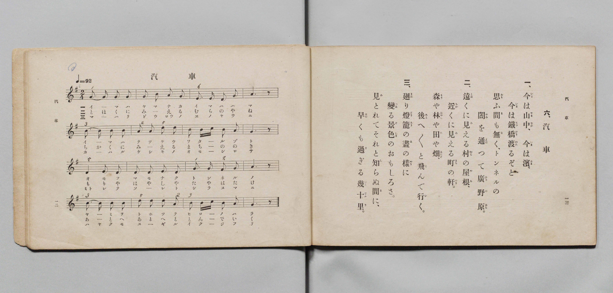

# きしゃ（火車）

> Re:Shōka 使用 AI 協助辨識與重建樂譜，可能會有錯誤。歡迎回報。

- **鋼琴伴奏版**：<br><audio controls src="kisha.mp3"></audio>

- 文部省《尋常小學唱歌 第三學年用》（明治四十五年五月，索書號 4079）
- 國立臺灣歷史博物館典藏

## 說明


- 出處：臺灣總督府編《公學校唱歌》第三學年用，第十一課〈きしゃ〉（火車／汽車），原書第 26–27 頁。
原曲出自 1912 年（大正元年）日本文部省《尋常小學唱歌》第三學年（大和田愛羅作曲）。
- 調性與拍號：ト調（G 大調），2/4 拍，速度 != 92。
- 背景與曲風：日本與臺灣日治時期最廣為人知的鐵道唱歌經典。歌詞描寫搭乘蒸汽火車飛馳，
窗外景物瞬息萬變：才剛在深山中、轉眼來到海濱，正想著要過鐵橋（てつけう）便已穿過漆黑隧道
（トンネル）駛向廣闊平原；遠村屋頂、近鎮屋簷、森林田野有如走馬燈（まはりどうろう）般向後飛逝。
- 版本說明：本檔案為原書單聲部簡譜（數字譜）之忠實數位化版本。

### 編曲說明（鋼琴伴奏版）：

1. 前奏 (Intro, 4 小節)：引用第四行衝出隧道、馳騁原野的明亮樂句，有如火車鳴笛啟程。
2. 主歌伴奏 (Kisha, 16 小節 × 3 段)：右手 (PianoRH) 演奏節奏鮮明的主旋律；
左手 (PianoLH) 以持續不斷的八分音符交替音型（`1_ [1] 5_ [1]`），模擬蒸汽火車車輪在鐵軌上奔馳的推進力。


## 歌詞

```text
一　今は山中、今ははま、
今はてつけうわたるぞと、
思ふまもなく、トンネルの
やみをとほつてひろのはら。

二　とほくに見える村のやね、
ちかくに見えるまちののき。
森や林や田やはたけ、
あとへあとへととんでいく。

三　まはりどうろうのゑのやうに
かはるけしきのおもしろさ。
見とれてそれと知らぬまに
早くもすぎるいく十り。
```

## ABC

<div class="abc-score" data-abc-src="kisha.abc" aria-label="五線譜載入中"></div>

[下載 ABC 原始檔](kisha.abc)

## TMD 檔案連結

- [主旋律 TMD 檔案](kisha.tmd) [[在 TMD Studio 編輯](https://tmdlang.github.io/Tmd-TS/#tmd=s7IKdvYPcrWy4qpTUCpJTLdSSM7PyUlNLsnMz7PKyszLyo8vzshPT8wuBdHZiUpwdWX5OaW5qVbpRYkpqfHG8SYG5pYIyeL80qLkVKvi5Iz8_Jz4ktSKkqT8_GyEfEFRfllqXmIeUE1BUWZeSWoKWBFCQWpZZkoqSDo1JbMkvygzMQfJ5tSiYpDzIJbElxQl5hUnF2UWgNyMUFWSkQp0HliyIL8IyWigaemZeVa5-XlJpUA_YUqkZmZlIrlZS0vhcWPv48bpj5ua3-_peN64-sXurvd7OhW0tLgUbRUsjbjsbRXcuWyM9E3sQGY9m9b-snnF8zmNjxu6nm7ofrpjx9MN_U_X7ng6ZeOztT0Kz9esebKjE8TfueX5lBWPG7qBhj6b0fds0-6ns2c_7W18smsKUApIPpvT8X5Pz_Mti57N3vFi5nwFUBAD7QU7-Omc7ueru1-073reuPjZ2u1P-zc97Z31vHPlyyUrnrbueDG9X4mLS19LwZZagEtBQeFxw4Rnszc9n73uxapVQAc_bpgIFm3e_bR914uZU9_vmQVxz_Mde5_PXfx015zn24He63raugbo22cLFkICAOhhtCAAeXLNGpDPdzS8WLXpcUMHPLwfN3QiBXn_s417IWEP1PK0bz4wXIAaFYzMHjVMNjJXeLkAGORNIDcpKIBlN4Ec1r5KwdDS0EgBaBfQqKdLlj9bu_hpazOY2_ls-tJnc9bgjzE0B0MMeTqp5_mUDc9aZj_f1_pk7xygXUDToLYDQ-TFqv3PGpa_6Gh_1t0LjDpg0Dxu7gAKAjW7KwC1g5kgXwATjQJQDZD1smH-013LFMApCsmg5p5nM9eDDJq96eUiYFDNgjgZKAKNfCB30-5nM5uezZn_bE7D092LnzfterJr1_P5S5_Pank5YevLxskQfzzfNhmYNIBGA9kvVs571t__dP3qZxPWPtk548WkHcCghQTzy8WzXy7bDHQQJCCfr5r-dMk0oBuAiev5vDXPGte_mLDmxTpgJMx61tn7tHP20zkrnm3f-HTjxic71j5uaHyxt_P5nD1P9rU97djwbOv2Z_s3Ao0CBvmz5s0vJk5_sazxZWMf0FXPVoKS_ePGZY8blzxunPi4sQ0YHk_27X-6fdPzlfuBap7taXu5e-LLWcuB7oe4BKS-GYg2P27ufdy8Gqj-5fLZTydMBHr55fSupzs3A-P8_Z7ZLxsXPJs78enG7pcLmkDu2T_xZd86IPf5hu1A7rPF657Nmw6Mupftfc_mdD5d1vRi64aXy9Y8bwfmNaB79j1uXP-4qetx40qgkx43AZMhyGEvOtaALNrXAwqchrmI6Hne2QGKDHB-AIUIMC2tmvJsYQcwDiDp8-m0dS8aN4FS14aFL9bOAWX1qTuerp0OZnc-2dn9dP-Cp-uXAQWf7O192jMNYiDIAmiOgxgDibKnrSuASRUY9cCgBjFWzXuxdj0wG4KS5IbeZ-2dCpm5iempRnpZBanpCvoKAQbGhkBbwEYB89bjhoYnu4FeWw-PLAgXjPYBuWB1UCFExDxu6n_cOP9xU_fjxnmPG4E5GqzuGTAYGreC9DU1PW5c9bixHyiBHD-PG9eBvdDU8rhx_-OmSSCtjbvBpgLN3gQO23Xg0IblG6A3IF4ChiQwYQGT18umFmDygjgXmIwgaQuYRCBp62UTMBWClIEUg5PX8_59QPXIiezJLmD8gTXOW_Ny2mTkFAZJW6BMsnvis1nTgcogqRaSnoDiwKAHphKg4-BhuAtYGDTAPAIMldUvlgFDpQMYNsAkB_IOyLOggAX7vHHh40agNIo6cAoDigN9DkS9UJ8DUyVQKzBhAklg2gQbA4yD-aAIgBkGDGWgvTuQGEByxeOmyY8blz9uBGoARgBGMAIzA7Bkfj6n--k-YN4DufJFH9hr4OwBCpn9E5EVvFg4HZhbIAqAGQYUvOAMA8o5K3ZCGRuAhfYGUJE0fSOQASqKW1e8bN4LTGFPd04FoX0NkKzydOmUFw3Agno3chjuAEY3MAyxZDRwAMKDEchdDfE5MNCASoEkUG46uGoABl0XON0BAwzInQr1OTiUgUHSA05ic8GMFcCCEJTEGteA7QQb-Ww60NJ-sAEzHzf2gc0GBSCwCgI5CUtq3LDxaXM_vKR4sgMchnOmPZ-6GujrZysWgxLPjt5n07YDS8Zn_bOBsqBSu3PT0yWzXu7aAyxoXmwDqpkNLAchQf20denzpfNAOXBHL9CBQPLFsl3A0gCYREHF5fSVwFQKCsD9q5_O2QAs5oDJFZiSQUVHb-PL9p4X24HZHhykQIdSXrlDgYKWPheXd2ZxRqJVQGZiXr5DjUFNNbjstbHQsgMzsDUpIC2ahhcLexQ0TBSANefz9Q06kJIIqSAy0MSiE2ghyNQaBQ1DBV0gNNRU1dDV1VQwBMIaIDZWMAKzNMziwfJm8VAFQD5I3AgsaqBQAzbGxxCo8nHTErAgUNHj5nlA3A9U97h5CZTXBSyQVoNMhKkDCoNU9sNVzkM10wiktnEFRG3jbqDaRqDaRpAZwHINiDtAEk3dEDMbIOqaOkHq1oEKP7C6tahmGoPUQi0CuxNk-yqw7Z1APcuA9FoI1Qc2tnkj1Kl9IMVArwDlQIq74cbij5xdPZRFjjHYHmNo2BsDISjojRRMgbAGyAMqMAFJguSMwBFHbLS0AXEL0D8b4X5aD1K7H6JuNVB0H1gUFMgYkbIQGind-CIFmOuhaqFRAsQg0V4sUQJMGShRAjYP7LbtQLwWGh-Pm1aB4mQRWB1IpnktWHQrkbGxo5Oi2DCNByFgBgCS6Dy0bGSOK5eAvABKT4uAeCo01UN4oPyxHpLoIGEOrM9BwdELCw5gEKBHBbAgBQc3SC8kva8Hs4DFM1QEGAHzoTmjBRQNQHmgAEjlRIxoeNw8Hxzhj5vXgBMIyPy9YIeA-B2QfLYd6raVILf1gN1PQoYA9rOonyFAmQGS_InLEMB8DE9sIB9vgib0x82zIZkC4vfmSSC1wAIEpK4PnnFWYssQoGiAmAgssIBNBHAIN8F5IBoksgIUgpMh6pYDMSTO-rGVURBBoFtBSR0Ya8A0AoqPnUC8DiwBySJLQCauh2QIoD3QNAVKYxATa7m4dO0UwFUL2HQgR5kLAA)]
- [鋼琴伴奏 TMD 檔案](kisha_piano.tmd) [[在 TMD Studio 編輯](https://tmdlang.github.io/Tmd-TS/#tmd=s7IKdvYPcrWy4tLSUnjc2Pu4cfrjpub3ezqeN65-sbvrcfPul917nk_Y8mTPlqdL-593drzf06mgpcWlaKtgacRlb6vgzmVjpG9ix1WnoPRs-tJnm3Y_m9n0bM78p61rnq7d8WzBwqdTNj5b2wMycM2aJzs6gYJPd24BGgvkPu1tfLKj4cWqTe_39D_tm_9sNpAxy9DS0AikoqHv6Ybupzt2PN3Q_3TtMogpjxv6gdYrgex6Oqf7-eruF-27njcufrZ2-9P-TU97Zz3vXPlyyYqnrTteTO9X4uLS11KwpRbgUlBQeNwwAejG57PXvVi16tmMvscNE8Gizbuftu96MXMq0PEQ9zzfsff53MVPd815vn3F44YutKB43NCNHBTPp6x4v6cHOTQeN3TAI-JxQyc8LoCh9GzjXjADKNgDDrEdQI0KRmaPGiYbmSu8XND4uKEJ5CYFBUh4ghzWvkoBFKYKQLtAETRnzbNp7S-bVzyfA1TchRTGO7A6D2j70yXLn07qeT5lw7OW2c_3tT7ZOwccU51Qu4D-f7Fq_7OG5S862p91976YOR8YEI-bO4CCQM3uCkDtYCbIzcCUogBUA2S9bJj_dNcyBXAyQjKouefZzPUgg2ZverkIGDCznvX3P12_-sWkHUCvQ4Lh5eLZL5dtftnY93Tjxmfzpj9uaHy2dfuz_RuBjJcTtj5b2Q1izFr-snEy0Jynuxe_nN4FDIyX7X2gYF41_emSaSAr2rc8Xdb0YuuGl8vWPG_veNGx5sW6rmf9s5_Panm-bTIwBQGNApoADA-gSxDuA0YokA-JfqDnMLMG0MWQ8DfUU3ja2QsUV9DwzCspytdRMFEABvPz9Q2aQDVP90wFxjso0mfPfrGw58XCucCYgjga5Hqg91Y0QhwNdBDQrie71j1b0fS0fynQD8_mdAKdDg2LzVuer5n9dOr85yuA3oZGvZGewpMdu4FOhzhMQcM7szgjUUfB0AzqAoXD0xWMFZ6t2wp2Sv_mZ53dChoBmYl5-UEemgrP9kwBeWd9A5B8uW4d0HagG0AGTu9-uq_7_Z7ZEFtAaWz7MoRWH6DWJ7uXPutpfL6r58mO3mfTtgP1PW1d_bSj7eX8zc_XLHuya8mz2fuB7KfzgMZ0JBjGK0QbxiqYgqkESAJ5tmLhs8lrkKMbhPasejpnBTBGXuwGmtz1dOkUYAiBAqZvxcuGTU-7ZoO8Ds2gkFwB9PyLlfOetq4ApnVgKniyYy2IsWrei7XrgbkWlKY39D5r71TIzE1MTzXSyypITVfQVwgwMDYEOgNsFDArPm5oeAIsARvXAxMa0ARgxEC4YLQPyAWrgwote9y45HHjxMeNbY-b-h83zn_c1P24cd7jRmABAFb3rGHu48atIH1NTY8bVz1u7AdKAHPJ4-bNj5t7Hzevfty4DuyFppbHjfsfN00CaW3cDTYVaPamx03AEmEdyKomWMYDegPiJVAsds5-1tn7sqkFGFAQ5wID88Xezudz9jzdvulpxwZgHnnZBCw5QMpAips3v5g4_Xn_PqD6F8sagbkJknee7GqDapy35uW0yU_27Qdqf75yP0gBOHkCg_3l7onPZk0HKnuyrw1oMiSLgeIanGCBjoOH4S5gadIA8wgwVFa_WAYMlQ5g2DybCwyqdWDPggIW7PPGhY8bgdIo6kABBhIH-hyIeqE-f7YYpBWU-ZtagOUS2BhgHMwHRQDMMGAoA-3dgcQAkiseN01-3Lj8cSNQAzACMILxZeMCYEH-fA4wpU8HugHoyhd9YK9t7H65AOivnhf7JyIreLFw-su-dRAFzzdsBwXv4nXQQmnFTihjA7CM3wAq06ZvBDJAJXfripfNe4Ep7OnOqSC0r-Hpvh5gsQZM2C8agOX6buQw3AGMbmAYAoMBGPXAtLYSnMSAiaENHIDwYARyV0N8Dgw0oFIgCZSbDq5JgEHXBU53wAADcqdCfQ4OZWCQ9ICT2FwwY8Xz-UtBSaxxDdhOsJHPpgMt7QcbMPNxYx_YbFAAAmsskJOwpMYNG58298NLV2CeBQXRnGnPp64G-vrZisWgxAMuIuClLqhM7tz0dMmsl7v2AEu4F9uAamY_W7sYEtRPW5c-XzoPlAN39AIdCCRfLNv1ZGc3MImCCo3pK4GpFBSA-1c_nbPh5fLZwOQKTMnPpu4AOvFle8-L7cBsDw5SoEMpbwtAgYKWPoVtDJBzUGoJTSt4NaGgAa0sNSHFzFLk4vD5tH1AX4LSFLCYXANkrAEG4Ys9U0EB0D312cr5TzdOfTmtmzLvgv0HdpYVtHJwqDGoqQYX_zYWWnZgRo2ChrGCLhAaa6pq6OpqAisWY6CgKRAaKxgBWcYgBSYgSZAcSMQQrN5AoYarFsV8H-zmo1QTIKOBDFMIH0ihyCPzQRhqB8VxBKlOgRUmtC4FRhOiMkWJJ0ht-rxpF6QxhVRt9kBqS6AUJCLRajFIfQupsakQbWBn4ok2bEGiAG73NQDbIwoasFSoA6kikWpIA00sOoFWQhMDJHINoYnBEAhBEQ6KeBBLwyweLG8WD1UA5IPEjeBJAmSMjyFQ5eOmJWBBoKLHzfOAuB-o7nHzEiivC1hTrgaZCFMHFAap7IernIdqphFIbeMKiNrG3UC1jUC1jSAzgBUuEHeAJJq6IWY2QNQ1dYLUrQPVymB1a1HNNAaphVoEdifI9lVg2zuBepYB6bUQqg9sbPNGqFP7QIqBXgHKgRR3w43FHzm7gC1FSiIHW041AkJQbsWfUwlFSxsQtwD9sxHup_Ugtfsh6lYDRfeBRUGBjBEpC6GR0o0vUoDVEVQtNEqAGCTaiyVKgCkDJUrA5oHdth2I10Lj43HTKlCcLAKrA8k0rwWLbiUyNnZ0UhQbwAILiIAZAEii89CykTmuXALyAig9LQLiqdBUD-GB8sd6SKKDhDmwoQkKjl5YcACDAD0qgDU8OLhBeiHpfT2YBWw3QEWAETAfmjNaQNEAlAcKgFROxIiGx83zwRH-uHkNOIGAzN8LdgiI3wHJZ9uhblsJclsP2P0kZAhI74nKGYK4qguRIYD5GJ7YQD7eBE3oj5tnQzIFxO_Nk0BqgQUISF0fPOOsxJYhQNEAMRFYYAHbruAQboLzQDRIZAUoBCdD1C0HYkic9WMroyCCQLeCkjow1oBpBBQfO4F4HVgCkkWWgExcD8kQQHugaQqUxuAVNlLNgrXCJrZmwRsx6HU-Oh-YT6LNcmPhNHKrgORilCSXENn6AFIkFyCESguQBUYwe9D5uN1Jci6iRXggtcZ07RTAjT6wgUAOOEFF-xjGogkYoQsYwwWUuQA)]

## 分析

```text
================================================================================
📊 TMD Song Profile: [ きしゃ（火車） ]
================================================================================
⏱  Duration:       0:20 (20.9s), 16 measures total
🎼 Key & Tempo:    首調基準 G, != 92.0 BPM, <2/4>
   - 分析範圍：      由實際發聲的音符與和弦推測調性；播放脈絡另行呈現
🎤 人聲音域:    D4 (MIDI 62) – D5 (MIDI 74) [跨度: 12 個半音 / 1.0 個八度, 難度: easy]
   - 最低音:  D4 in [Kisha #1 @ m.9, 0:10]
   - 最高音: D5 in [Kisha #1 @ m.6, 0:07]
   - 適合: soprano, mezzo-soprano, contralto, tenor, baritone, bass
🏛  結構:      Kisha (20.9s)
⚡ 編曲密度:        Peak 1 軌道同時演奏
🗝  調性診斷：       G 大調（純淨自然大調，未偵測到可信轉調）
   - 風格氣質:    純淨自然大調（陽光明朗、易唱易記，無明顯調外色彩）
   - 轉調歷程:    全曲維持單一推測調性（未偵測到可信轉調）
   - 核心骨幹音:  G, B, A, D, E
   - 調性數值:    G 大調 [相關度: 0.83, 穩定度: High, 自然音純度: 100.0%]
   - 候選調性 (K-S): G 大調 (0.83), D 大調 (0.66), B 小調 (0.65)
   - 五度圈歷程:   +1
   - 各段落調性細節:
     • [Kisha #1]: G 大調 (r: 0.83, 自然音純度: 100.0%)

  [ 五度圈游移軌跡 ]
               C  
         F           [G ]*
      Bb               D  
      Eb               A  
         Ab           E  
            Db       B  
               F# 
     (* = active key center)

  [ 十二半音累積音高分佈 ]
     C  : ██                         1.7%
     C# :                            0.0%
     D  : ███████████████           16.7%
     D# :                            0.0%
     E  : ████████                   8.3%
     F  :                            0.0%
     F# : ██                         1.7%
     G  : ████████████████████████  26.7%
     G# :                            0.0%
     A  : ██████████████████        20.0%
     A# :                            0.0%
     B  : ███████████████████████   25.0%
--------------------------------------------------------------------------------
Assignment 軌道音域：
  - Piano         : D4 – D5 (12 個半音 / 1.0 個八度, 54 個音符)
================================================================================
```


## 原書掃描頁




