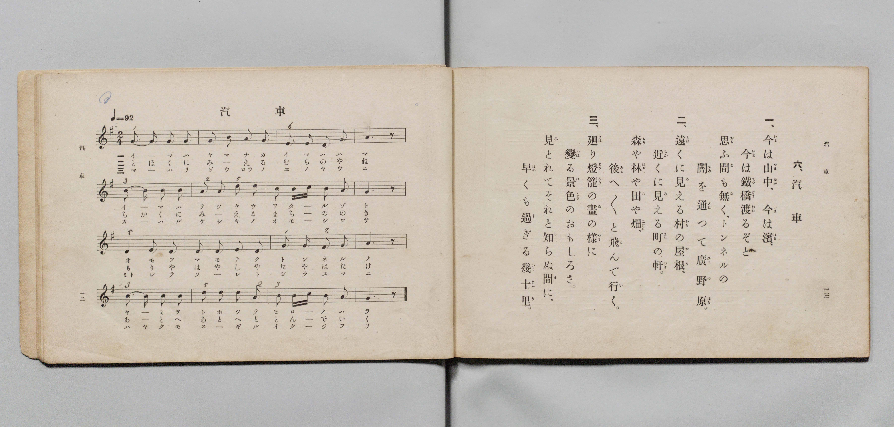

# きしゃ（火車）

> Re:Shōka 使用 AI 協助辨識與重建樂譜，可能會有錯誤。歡迎回報。

- **鋼琴伴奏版**：<br><audio controls src="kisha.mp3"></audio>
- **NEUTRINO 歌聲合成版**：<br><audio controls src="kisha_neutrino.mp3"></audio>

- 文部省《尋常小學唱歌 第三學年用》（明治四十五年五月，索書號 4079）
- 國立臺灣歷史博物館典藏

## 說明


- 出處：臺灣總督府編《公學校唱歌》第三學年用，第十一課〈きしゃ〉（火車／汽車），原書第 26–27 頁。
原曲出自 1912 年（大正元年）日本文部省《尋常小學唱歌》第三學年（大和田愛羅作曲）。
- 調性與拍號：ト調（G 大調），2/4 拍，速度 != 92。
- 背景與曲風：日本與臺灣日治時期最廣為人知的鐵道唱歌經典。歌詞描寫搭乘蒸汽火車飛馳，
窗外景物瞬息萬變：才剛在深山中、轉眼來到海濱，正想著要過鐵橋（てつけう）便已穿過漆黑隧道
（トンネル）駛向廣闊平原；遠村屋頂、近鎮屋簷、森林田野有如走馬燈（まはりどうろう）般向後飛逝。
- 版本說明：本檔案為原書單聲部簡譜（數字譜）之忠實數位化版本。

### 編曲說明（鋼琴伴奏版）：

1. 前奏 (Intro, 4 小節)：引用第四行衝出隧道、馳騁原野的明亮樂句，有如火車鳴笛啟程。
2. 主歌伴奏 (Kisha, 16 小節 × 3 段)：右手 (PianoRH) 演奏節奏鮮明的主旋律；
左手 (PianoLH) 以持續不斷的八分音符交替音型（`1_ [1] 5_ [1]`），模擬蒸汽火車車輪在鐵軌上奔馳的推進力。


## 歌詞

```text
一　今は山中、今ははま、
今はてつけうわたるぞと、
思ふまもなく、トンネルの
やみをとほつてひろのはら。

二　とほくに見える村のやね、
ちかくに見えるまちののき。
森や林や田やはたけ、
あとへあとへととんでいく。

三　まはりどうろうのゑのやうに
かはるけしきのおもしろさ。
見とれてそれと知らぬまに
早くもすぎるいく十り。
```

## ABC

<div class="abc-score" data-abc-src="kisha.abc" aria-label="五線譜載入中"></div>

[下載 ABC 原始檔](kisha.abc)

## TMD 檔案連結

- [主旋律 TMD 檔案](kisha.tmd) [[在 TMD Studio 編輯](https://tmdlang.github.io/Tmd-TS/#tmd=s7IKdvYPcrWy4qpTUCpJTLdSSM7PyUlNLsnMz7PKyszLyo8vzshPT8wuBdHZiUpwdWX5OaW5qVbpRYkpqfHG8SYG5pYIyeL80qLkVKvi5Iz8_Jz4ktSKkqT8_GyEfEFRfllqXmIeUE1BUWZeSWoKWBFCQWpZZkoqSDo1JbMkvygzMQfJ5tSiYpDzIJbElxQl5hUnF2UWgNyMUFWSkQp0HliyIL8IyWigaemZeVa5-XlJpUA_YUqkZmZlYnEz0BBgSBQlFmRUWmVkFoNclZyYE5-dmIcUKlA3FSSmp1oFGBgAg0RLS-FxY-_jxumPm5rf7-l43rj6xe6u93s6FbS0uBRtFSyNuOxtFdy5bIz0TexAxjyb1v6yecXzOY2PG7qebuh-umPH0w39T9fueDpl47O1PQrP16x5sqMTxN-55fmUFY8buoGGPpvR92zT7qezZz_tbXyyawpQCkg-m9Pxfk_P8y2Lns3e8WLmfAVQDAHtBbv16Zzu56u7X7Tvet64-Nna7U_7Nz3tnfW8c-XLJSuetu54Mb1fiYtLX0vBllqAS0FB4XHDhGezNz2fve7FqlVABz9umAgWbd79tH3Xi5lT3--ZBXHP8x17n89d_HTXnOfbgd7retq6BujbZwsWQgIA6GG0IAB5cs0akM93NLxYtelxQwc8vB83dCIFef-zjXshYQ_U8rRvPjBcgBoVjMweNUw2Mld4uQAY5E0gNykogGU3gRzWvkrB0NLQSAFoF9Cop0uWP1u7-GlrM5jb-Wz60mdz1uCPMTQHQwx5Oqnn-ZQNz1pmP9_X-mTvHKBdQNOgtgND5MWq_c8alr_oaH_W3QuMOmDQPG7uAAoCNbsrALWDmSBfABONAlANkPWyYf7TXcsUwCkKyaDmnmcz14MMmr3p5SJgUM2COBkoAo18IHfT7mczm57Nmf9sTsPT3YufN-16smvX8_lLn89qeTlh68vGyRB_PN82GZg0gEYD2S9WznvW3_90_epnE9Y-2TnjxaQdwKCFBPPLxbNfLtsMdBAkIJ-vmv50yTSgG4CJ6_m8Nc8a17-YsObFOmAkzHrW2fu0c_bTOSuebd_4dOPGJzvWPm5ofLG38_mcPU_2tT3t2PBs6_Zn-zcCjQIG-bPmzS8mTn-xrPFlYx_QVc9WgpL948ZljxuXPG6c-LixDRgeT_btf7p90_OV-4Fqnu1pe7l74stZy4Huh7gEpL4ZiDY_bu593LwaqP7l8tlPJ0wEevnl9K6nOzcD4_z9ntkvGxc8mzvx6cbulwuaQO7ZP_Fl3zog9_mG7UDus8Xrns2bDoy6l-19z-Z0Pl3W9GLrhpfL1jxvB-Y1oHv2PW5c_7ip63HjSqCTHjcBkyHIYS861oAs2tcDCpyGuYjoed7ZAYoMcH4AhQgwLa2a8mxhBzAOIOnz6bR1Lxo3gVLXhoUv1s4BZfWpO56unQ5mdz7Z2f10_4Kn65cBBZ_s7X3aMw1iIMgCaI6DGAOJsqetK4BJFRj1wKAGMVbNe7F2PTAbgpLkht5n7Z0KmbnAcstIL6sgNV1BXyHAwNgQaAvYKGDeetzQ8GQ30Gvr4ZEF4YLRPiAXrA4qhIiYx039jxvnP27qftw473EjMEeD1T0DBkPjVpC-pqbHjaseN_YDJZDj53HjOrAXmloeN-5_3DQJpLVxN9hUoNmbwGG7DhzasHwD9AbES8CQBCYsYPJ62dQCTF4Q5wKTESRtAZMIJG29bAKmQpAykGJw8nrevw-oHjmRPdkFjD-wxnlrXk6bjJzCIGkLlEl2T3w2azpQGSTVQtITUBwY9MBUAnQcPAx3AQuDBphHgKGy-sUyYKh0AMMGmORA3gF5FhSwYJ83LnzcCJRGUQdOYUBxoM-BqBfqc2CqBGoFJkwgCUybYGOAcTAfFAEww4ChDLR3BxIDSK543DT5cePyx41ADcAIwAhGYGYAlszP53Q_3QfMeyBXvugDew2cPUAhs38isoIXC6cDcwtEATDDgIIXnGFAOWfFTihjA7DQ3gAqkqZvBDJARXHripfNe4Ep7OnOqSC0rwGSVZ4unfKiAVhQ70YOwx3A6AaGIZaMBg5AeDACuashPgcGGlApkATKTQdXDcCg6wKnO2CAAblToT4HhzIwSHrASWwumLECWBCCkljjGrCdYCOfTQda2g82YObjxj6w2aAABFZBICdhSY0bNj5t7oeXFE92gMNwzrTnU1cDff1sxWJQ4tnR-2zadmDJ-Kx_NlAWVGp3bnq6ZNbLXXuABc2LbUA1s4HlICSon7Yufb50HigH7ugFOhBIvli2C1gaAJMoqLicvhKYSkEBuH_10zkbgMUcMLkCUzKo6OhtfNne82I7MNuDgxToUMordyhQ0NLn4vLOLM5ItArITMzLd6gxqKkGl702Flp2YAa2JgWkRdPwYmGPgoaJArDmfL6-QQdSEiEVRAaaWHQCLQSZWqOgYaigC4SGmqoaurqaCoZAWAPExgpGYJaGWTxY3iweqgDIB4kbgUUNFGrAxvgYAlU-bloCFgQqetw8D4j7geoeNy-B8rqABdJqkIkwdUBhkMp-uMp5qGYagdQ2roCobdwNVNsIVNsIMgNYrgFxB0iiqRtiZgNEXVMnSN06UOEHVrcW1UxjkFqoRWB3gmxfBba9E6hnGZBeC6H6wMY2b4Q6tQ-kGOgVoBxIcTfcWPyRs6uHssgxBttjDA17YyAEBb2RgikQ1gB5QAUmIEmQnBE44oiNljYgbgH6ZyPcT-tBavdD1K0Giu4Di4ICGSNSFkIjpRtfpABzPVQtNEqAGCTaiyVKgCkDJUrA5oHdth2I10Lj43HTKlCcLAKrA8k0rwWLbiUyNnZ0UhQbpvEgBMwAQBKdh5aNzHHlEpAXQOlpERBPhaZ6CA-UP9ZDEh0kzIH1OSg4emHBAQwC9KgAFqTg4AbphaT39WAWsHiGigAjYD40Z7SAogEoDxQAqZyIEQ2Pm-eDI_xx8xpwAgGZvxfsEBC_A5LPtkPdthLkth6w-0nIEMB-FvUzBCgzQJI_cRkCmI_hiQ3k403QhP64eTYkU0D83jwJpBZYgIDU9cEzzkpsGQIUDRATgQUWsIkADuEmOA9Eg0RWgEJwMkTdciCGxFk_tjIKIgh0KyipA2MNmEZA8bETiNeBJSBZZAnIxPWQDAG0B5qmQGkMYmItF5eunQK4agGbDuQocwEA)]
- [鋼琴伴奏 TMD 檔案](kisha_piano.tmd) [[在 TMD Studio 編輯](https://tmdlang.github.io/Tmd-TS/#tmd=s7IKdvYPcrWy4qpTUCpJTLdSyC8qychPL0osyKi0ysgsLskvykxOzInPTsxLVIIrKs4vLUpOjS9ITE-1CjAwsFTi0tJSeNzY-7hx-uOm5vd7Op43rn6xu-tx8-6X3XueT9jyZM-Wp0v7n3d2vN_TqaClxaVoq2BpxGVvq-DOZWOkb2IHMvjZ9KXPNu1-NrPp2Zz5T1vXPF2749mChU-nbHy2tgdk4Jo1T3Z0AgWf7twCNBbIfdrb-GRHw4tVm97v6X_aN__ZbCBjlqGloRFIRUPf0w3dT3fseLqh_-naZRBTHjf0A60He-LpnO7nq7tftO963rj42drtT_s3Pe2d9bxz5cslK5627ngxvV-Ji0tfS8GWWoBLQUHhccMEoBufz173YtWqZzP6HjdMBIs2737avuvFzKlAx0Pc83zH3udzFz_dNef59hWPG7rQguJxQzdyUDyfsuL9nh7k0Hjc0AGPiMcNnfC4AIbSs417wQygYA84xHYANSoYmT1qmGxkrvByQePjhiaQmxQUIOEJclj7KgVQmCoA7QJF0Jw1z6a1v2xe8XwOUHEXUhjvwOo8oO1Plyx_Oqnn-ZQNz1pmP9_X-mTvHHBMdULtAvr_xar9zxqWv-hof9bd-2LmfGBAPG7uAAoCNbsrALWDmSA3A1OKAlANkPWyYf7TXcsUwMkIyaDmnmcz14MMmr3p5SJgwMx61t__dP3qF5N2AL0OCYaXi2e_XLb5ZWPf040bn82b_rih8dnW7c_2bwQyXk7Y-mxlN4gxa_nLxslAc57uXvxyehcwMF6294GCedX0p0umgaxo3_J0WdOLrRteLlvzvL3jRceaF-u6nvXPfj6r5fm2ycAUBDQKaAIwPIAuQbgPGKFAPiT6gZ7DzBpAF0PC31BP4WlnL1BcQcMzr6QoX0fBRAEYzM_XN2gC1TzdMxUY76BInz37xcKeFwvnAmMK4miQ64HeW9EIcTTQQUC7nuxa92xF09P-pUA_PJvTCXQ6NCw2b3m-ZvbTqfOfrwB6Gxr1RnoKT3bsBjod4jAFDe_M4oxEHQVDM6gLFA5PVzBWeLZuK9gp_ZufdXYraARkJublB3loKjzbMwXknfUNQPLlunVA24FuABk4vfvpvu73e2ZDbAGlse3LEFp9gFqf7F76rKfx-a6eJzt6n03bDtT3tHX10462l_M3P1-z7MmuJc9m7weyn84DGtORYBivEG0Yq2AKphIgCeTZioXPJq9Bjm4Q2rPq6ZwVwBh5sRtoctfTpVOAIQQKmL4VLxs2Pe2aDfI6NINCcgXQ8y9WznvaugKY1oGp4MmOtSDGqnkv1q4H5lpQmt7Q-6y9UyEzF1j-GellFaSmK-grBBgYGwKdATYKmBUfNzQ8AZaAjeuBCQ1oAjBiIFww2gfkgtVBhZY9blzyuHHi48a2x039jxvnP27qftw473EjsAAAq3vWMPdx41aQvqamx42rHjf2AyWAueRx8-bHzb2Pm1c_blwH9kJTy-PG_Y-bJoG0Nu4Gmwo0e9PjJmCJsA5kVRMs4wG9AfESKBY7Zz_r7H3Z1AIMKIhzgYH5Ym_n8zl7nm7f9LRjAzCPvGwClhwgZSDFzZtfTJz-vH8fUP2LZY3A3ATJO092tUE1zlvzctrkJ_v2A7U_X7kfpACcPIHB_nL3xGezpgOVPdnXBjQZksVAcQ1OsEDHwcNwF7A0aYB5BBgqq18sA4ZKBzBsns0FBtU6sGdBAQv2eePCx41AaRR1oAADiQN9DkS9UJ8_WwzSCsr8TS3AcglsDDAO5oMiAGYYMJSB9u5AYgDJFY-bJj9uXP64EagBGAEYwfiycQGwIH8-B5jSpwPdAHTliz6w1zZ2v1wA9FfPi_0TkRW8WDj9Zd86iILnG7aDgnfxOmihtGInlLEBWMZvAJVp0zcCGaCSu3XFy-a9wBT2dOdUENrX8HRfD7BYAybsFw3Acn03chjuAEY3MAyBwQCMemBaWwlOYsDE0AYOQHgwArmrIT4HBhpQKZAEyk0H1yTAoOsCpztggAG5U6E-B4cyMEh6wElsLpix4vn8paAk1rgGbCfYyGfTgZb2gw2Y-bixD2w2KACBNRbISVhS44aNT5v74aUrMM-CgmjOtOdTVwN9_WzFYlDiARcR8FIXVCZ3bnq6ZNbLXXuAJdyLbUA1s5-tXQwJ6qetS58vnQfKgTt6gQ4Eki-W7XqysxuYREGFxvSVwFQKCsD9q5_O2fBy-WxgcgWm5GdTdwCd-LK958V2YLYHBynQoZS3BaBAQUufwjYGyDkotYSmFbyaUNCAVpaakGJmKXJx-HzaPqAvQWkKWEyuATLWAIPwxZ6poADonvps5fynG6e-nNZNmXfB_gM7ywpaOTjUGNRUg4t_GwstOzCjRkHDWEEXCI01VTV0dTWBFYsxUNAUCI0VjIAsY5ACE5AkSA4kYghWb6BQw1WLYr4PdvNRqgmQ0UCGKYQPpFDkkfkgDLWD4jiCVKfAChNalwKjCVGZosQTpDZ93rQL0phCqjZ7ILUlUAoSkWi1GKS-hdTYVIg2sDPxRBu2IFEAt_sagO0RBQ1YKtSBVJFINaSBJhadQCuhiQESuYbQxGAIhKAIB0U8iKVhFg-WN4uHKgDyQeJG8CQBMsbHEKjycdMSsCBQ0ePmeUDcD1T3uHkJlNcFrClXg0yEqQMKg1T2w1XOQzXTCKS2cQVEbeNuoNpGoNpGkBnACheIO0ASTd0QMxsg6po6QerWgWplsLq1qGYag9RCLQK7E2T7KrDtnUA9y4D0WgjVBza2eSPUqX0gxUCvAOVAirvhxuKPnF3AliIlkYMtpxoBISi34s-phKKlDYhbgP7ZCPfTepDa_RB1q4Gi-8CioEDGiJSF0EjpxhcpwOoIqhYaJUAMEu3FEiXAlIESJWDzwG7bDsRrofHxuGkVKE4WgdWBZJrXgkW3EhkbOzopig1ggQVEwAwAJNF5aNnIHFcuAXkBlJ4WAfFUaKqH8ED5Yz0k0UHCHNjQBAVHLyw4gEGAHhXAGh4c3CC9kPS-HswCthugIsAImA_NGS2gaADKAwVAKidiRMPj5vngCH_cvAacQEDm7wU7BMTvgOSz7VC3rQS5rQfsfhIyBKT3ROUMQVzVhcgQwHwMT2wgH2-CJvTHzbMhmQLi9-ZJILXAAgSkrg-ecVZiyxCgaICYCCywgG1XcAg3wXkgGiSyAhSCkyHqlgMxJM76sZVREEGgW0FJHRhrwDQCio-dQLwOLAHJIktAJq6HZAigPdA0BUpj8AobqWbBWmETW7PgjRj0Oh-dD8wn0Wa5sXAauVVAcjFKkkuIbH0AKZILEEKlBcgCI5g96Hzc7iQ5F9EiPJBaY7p2CuBGH9hAIAecoKJ9DGPRBIzQBYzhAspcAA)]

## 分析

```text
================================================================================
📊 TMD Song Profile: [ きしゃ（火車） ]
================================================================================
⏱  Duration:       0:20 (20.9s), 16 measures total
🎼 Key & Tempo:    首調基準 G, != 92.0 BPM, <2/4>
   - 分析範圍：      由實際發聲的音符與和弦推測調性；播放脈絡另行呈現
🎤 人聲音域:    D4 (MIDI 62) – D5 (MIDI 74) [跨度: 12 個半音 / 1.0 個八度, 難度: easy]
   - 最低音:  D4 in [Kisha #1 @ m.9, 0:10]
   - 最高音: D5 in [Kisha #1 @ m.6, 0:07]
   - 適合: soprano, mezzo-soprano, contralto, tenor, baritone, bass
🏛  結構:      Kisha (20.9s)
⚡ 編曲密度:        Peak 1 軌道同時演奏
🗝  調性診斷：       G 大調（純淨自然大調，未偵測到可信轉調）
   - 風格氣質:    純淨自然大調（陽光明朗、易唱易記，無明顯調外色彩）
   - 轉調歷程:    全曲維持單一推測調性（未偵測到可信轉調）
   - 核心骨幹音:  G, B, A, D, E
   - 調性數值:    G 大調 [相關度: 0.83, 穩定度: High, 自然音純度: 100.0%]
   - 候選調性 (K-S): G 大調 (0.83), D 大調 (0.66), B 小調 (0.65)
   - 五度圈歷程:   +1
   - 各段落調性細節:
     • [Kisha #1]: G 大調 (r: 0.83, 自然音純度: 100.0%)

  [ 五度圈游移軌跡 ]
               C  
         F           [G ]*
      Bb               D  
      Eb               A  
         Ab           E  
            Db       B  
               F# 
     (* = active key center)

  [ 十二半音累積音高分佈 ]
     C  : ██                         1.7%
     C# :                            0.0%
     D  : ███████████████           16.7%
     D# :                            0.0%
     E  : ████████                   8.3%
     F  :                            0.0%
     F# : ██                         1.7%
     G  : ████████████████████████  26.7%
     G# :                            0.0%
     A  : ██████████████████        20.0%
     A# :                            0.0%
     B  : ███████████████████████   25.0%
--------------------------------------------------------------------------------
Assignment 軌道音域：
  - Piano         : D4 – D5 (12 個半音 / 1.0 個八度, 54 個音符)
================================================================================
```


## 原書掃描頁




