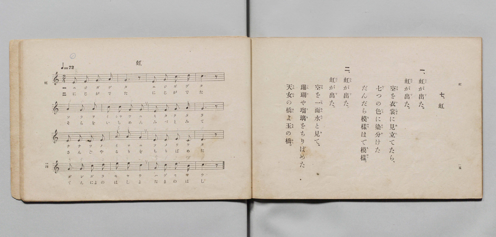

# 虹

> Re:Shōka 使用 AI 協助辨識與重建樂譜，可能會有錯誤。歡迎回報。

- **鋼琴伴奏版**：<br><audio controls src="niji.mp3"></audio>

- 文部省《尋常小學唱歌 第三學年用》（明治四十五年五月，索書號 4079）

## 說明

原書資訊與歌詞全文（對應 P010.jpg，書頁 pp. 14–15，第 7 首）：
調性與拍號：ハ調二拍子（C 大調 2/4 拍），速度 ♩=72


## 歌詞

```text
一、
虹（にじ）が出（で）た、虹（にじ）が出（で）た。
空（そら）を衣裳（いしやう）に見立（みた）てたら、
七（なゝ）つの色（いろ）に染分（そめわ）けた
だんだら模樣（もやう）はで模樣（もやう）。

二、
虹（にじ）が出（で）た、虹（にじ）が出（で）た。
空（そら）を一面（いちめん）水（みづ）と見（み）て、
珊瑚（さんご）や瑠璃（るり）をちりばめた
天女（てんによ）の橋（はし）よ玉（たま）の橋（はし）。
```

## ABC

<div class="abc-score" data-abc-src="niji.abc" aria-label="五線譜載入中"></div>

[下載 ABC 原始檔](niji.abc)

## TMD 檔案連結

- [主旋律 TMD 檔案](niji.tmd) [[在 TMD Studio 編輯](https://tmdlang.github.io/Tmd-TS/#tmd=s7IKdvYPcrWy4qpTUCpJTLdSSM7PyUlNLsnMz7PKyszLyo8vzshPT8wuBdHZiUpwdWX5OaW5qVbpRYkpqfHG8SYG5pYIyeL80qLkVKvi5Iz8_Jz4ktSKkqT8_Gx0-fiCxPRUqwADQwOETEFRfllqXmIeUHdBUWZeSWoKWDtCQWpZZkoqSLostSgzLTM1BclJqUXFIHdDTS8pSswrTi7KLAB5BqEqv6gE6KOixIKMSquMzOKS_KLM5MSc-OzEPCTflWSkAj2Xl1hSWpSKrDUzPTPPKjc_L6kUGByYEqmZWZlI3tXSUngxc6eClhaXoq2CuRGXva2CM5eNkb6JHUjns2ntL5tXPJ_T-Lih6-mG7qc7djzd0P907Y6nUzY-W9uj8HzNmic7OkH8nVueT1nxuKH7_Z6OZzP6nm3a_XT27Ke9jU92TQFKAclnczre7-l5vmXRs9k7XsycrwCKi_d7OpW4uPS1FGypBbgUFBSe9s0H2bG5_cWKrhcd7UBnvlg572nrCqBXgI57uqH3WXunAihC9bIK0oFuAip-uaBRoaBAT8HQ5FHDZENTkEPXrFEwV3i5bBrQje_3zAKZ-2LV_mcNy0EmdvcCfQAUfdzcDxR8sqsHKPJ07QSg6c4KT5csB4opAMNPASgK1t3zsmH-013LFB7NXGkLDGCQWU92NDxuaASbOnMnUN_jxtWPG2cAVT9u7HnavgssshzMnQ9UR4SaJpBZz1dCROc-bgJa2_m4adKLhYtfLN4MFmx53Dj9cROQbAPrWf1iWffz1aDoety4H2gEWHAZyKymTqjTnuxoBkuvetw0Fyy95HHjuhedm6DGNYF8BzTo2fzJTzuAhkIsbnzc1A8Wnwg0C2TK48YFj5smg8nOZysWPluxGKS0qQnJLeuBHsEuBfQX2CW7eugSXMBoeTl3ESy4FoJ9Mxko9WzDFlhALQUbsQIYehARaLhBXPe8v-v5xFlgialgT08Bm9vyfOKC55PAgdnU_bipC2IZ2IKux40bQNZAwurpkpVPl0KiaxlY_-rHTcBsA7Rh3bOVEAuBYTUdrL_jeR_Q1UCR-Y8b92FXA_Em5bkKChS09Lm4_IClh1VAZmJevkONQU01yAIFGwstOzADW1aGlBENLxb2KGiYKABLj-frG3Tg-U8TiwagNSDDahSMFUwUNEwVdIHQTFNVQ1dXEygI4RuApU0VNAzjwHyjOLgCqAhQBdgYH8MahcfN3QqPm3YoaDxuWgOWfNzcDlL6uGk_mBsPYhNWAzHPCCjWuBqIZwDVNvZA1DYuB6ttnI8wj7AacNrGHWi7esgJNDOg2aZAEhwQQGQKhISCEhFQTXvBPl8JxJvAnl8CxNsfN4OoZeAwAoXUfHCoaDxuboP4rGk_2GdAbZghNResoBOIJ4F93wLEC4G8RiCeDBbZD8RLQeG0AhpOENMalxEZTjs6yUtcxgpGQAwKMTNwUNQA-SARQzALMw11QTHQB819sMBpXgsOFZBuUOA9bgb6rXk9kL0RZ9qZCvY5sHAA0i1gVaCUBzQZGEJgc8DhA-Q3bgCHEwlpBljpkhMWGsZg442hKQOYaoziQEEUB0Lg_ARKLECGBlAcpNIcX24DposGaA7arAkkGsApAxSCi4AYkpLA_mzuB2UykPpFUPVLIDkOEfOwUAOmDoggMOiAZoILRiC1Dhw4wOBunA6U6YAGHzB5Nu4DaVkHTVDrIQlqOtzYWi4uXTsFUFmmAKSVuQA)]
- [鋼琴伴奏 TMD 檔案](niji_piano.tmd) [[在 TMD Studio 編輯](https://tmdlang.github.io/Tmd-TS/#tmd=s7IKdvYPcrWy4qpTUCpJTLdSSM7PyUlNLsnMz7PKyszLyo8vzshPT8wuBdHZiUpwdWX5OaW5qVbpRYkpqfHG8SYG5pYIyeL80qLkVKvi5Iz8_Jz4ktSKkqT8_Gx0-fiCxPRUqwADQwOETEFRfllqXmIeUHdBUWZeSWoKWDtCQWpZZkoqSDoxOTk_tyAxLzM3NQ9Jviy1qBjk-ILMxLz8eByK8otKgL4qSizIqLTKyCwuyS_KTE7Mic9OzEPyYWJRUWJeeipIJ37TSjKAiqzyEktKi1KR7chMz8yzys3PSyoFhh2mRGpmViZS2GhpKbyYufP9no6X3XueT9jyZM-Wp0v7n3d2vN_TqaClxaVoq2BuxGVvq-DMZWOkb2IHMu7ZtPaXzSuez2l83ND1dEP30x07nm7of7p2x9MpG5-t7VF4vmbNkx2dIP7OLc-nrHjc0A00_dmMvmebdj-dPftpb-OTXVOAUkDy2RygNT3Ptyx6NnvHi5nzFUCxCbRXiYvLD-hIqwCQ74M8HGoMaqq5FIDAxkLLDszQ11KwRQcQexteLOxR0DBRALro-foGHQVQNOtlFaRrYtGgpQ82rEbBWMFEQcNUQRcIzTRVNXR1NYGCEL4BWNpUQcMwDsw3ioMrgIoAVYCN8TGsUXjc3K3wuGmHgsbjpjVgycfN7SClj5v2g7nxIDZhNRDzjIBijauBeAZQbWMPRG3jcrDaxvkI8wir4cIfaLt6yAk0M6DZpkASHBBAZAqEhIISEVBNe8E-XwnEm8CeXwLE2x83g6hl4DAChdR8cKhoPG5ug_isaT_YZ0BtmCE1F6ygE4gngX3fAsQLgbxGIJ4MFtkPxEtB4bQCGk4Q0xqXERlOOzrJS1zGCkZADAoxM3BQ1AD5IBFDMAszDXVBMdAHzX2wwGleCw4VkG5Q4D1uBvqteT2QvRFn2pkK9vnjxilAugWsCpTygCYDQwhsDjh8gPzGDeBwIiHNADMyOWGhYQw23hiaMoCpxigOFERxIATOT6DEAmRoAMVBKs3x5TZgumiA5qDNmkCiAZwyQCG4CIghKQnsz-Z-UCYDqV8EVb8EkuMQMQ8LNWDqgAgCgw5oZuPqx00dQGodOHCAwd04HSjTAQ0-YPJs3AfSsg6aoNZDEtR0uLG1yEWZD7aiDOizeIVow1gFEyBlEovgm0IoFL4pFnmoKVDthEyBy0ONA1KwIMXUA1UMFQYmViDDKDdWwQxImwFp4kyBqcZiNYqHQBhkCjDMdO0UQMEW7QMUgrONwGxlLgA)]

## 分析

```text
================================================================================
📊 TMD Song Profile: [ 虹 ]
================================================================================
⏱  Duration:       0:26 (26.7s), 16 measures total
🎼 Key & Tempo:    首調基準 C, != 72.0 BPM, <2/4>
   - 分析範圍：      由實際發聲的音符與和弦推測調性；播放脈絡另行呈現
🎤 人聲音域:    C4 (MIDI 60) – E5 (MIDI 76) [跨度: 16 個半音 / 1.3 個八度, 難度: moderate]
   - 最低音:  C4 in [Niji #1 @ m.11, 0:17]
   - 最高音: E5 in [Niji #1 @ m.14, 0:21]
   - 適合: soprano, mezzo-soprano, contralto, tenor, baritone, bass
🏛  結構:      Niji (26.7s)
⚡ 編曲密度:        Peak 1 軌道同時演奏
🗝  調性診斷：       C 大調（純淨自然大調，未偵測到可信轉調）
   - 風格氣質:    純淨自然大調（陽光明朗、易唱易記，無明顯調外色彩）
   - 轉調歷程:    全曲維持單一推測調性（未偵測到可信轉調）
   - 核心骨幹音:  G, C, E, D, A
   - 調性數值:    C 大調 [相關度: 0.90, 穩定度: High, 自然音純度: 100.0%]
   - 候選調性 (K-S): C 大調 (0.90), G 大調 (0.78), E 小調 (0.65)
   - 五度圈歷程:   +0
   - 各段落調性細節:
     • [Niji #1]: C 大調 (r: 0.90, 自然音純度: 100.0%)

  [ 五度圈游移軌跡 ]
              [C ]*
         F            G  
      Bb               D  
      Eb               A  
         Ab           E  
            Db       B  
               F# 
     (* = active key center)

  [ 十二半音累積音高分佈 ]
     C  : ██████████████████████    24.6%
     C# :                            0.0%
     D  : ██████████████            15.3%
     D# :                            0.0%
     E  : █████████████████         18.6%
     F  : ███                        3.4%
     F# :                            0.0%
     G  : ████████████████████████  27.1%
     G# :                            0.0%
     A  : █████████                 10.2%
     A# :                            0.0%
     B  : █                          0.8%
--------------------------------------------------------------------------------
Assignment 軌道音域：
  - Piano         : C4 – E5 (16 個半音 / 1.3 個八度, 46 個音符)
================================================================================
```


## 原書掃描頁




