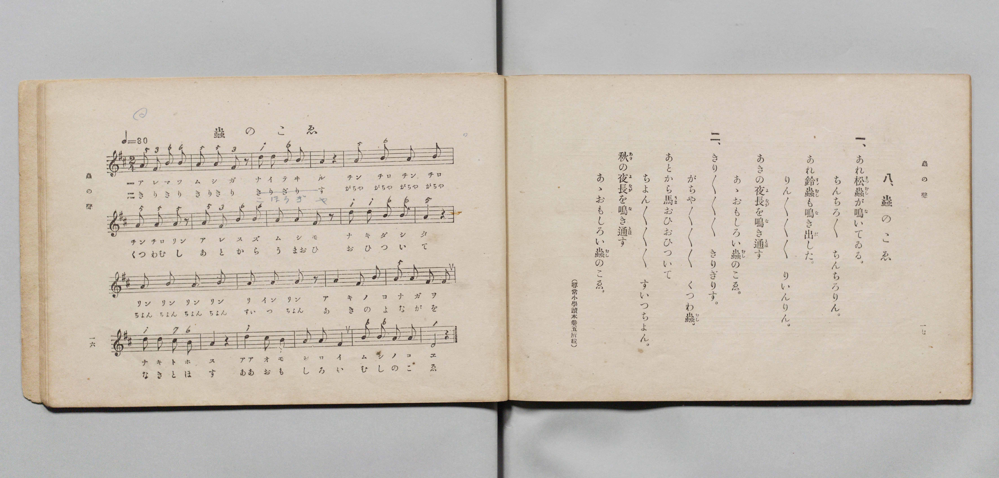

# 蟲のこゑ

> Re:Shōka 使用 AI 協助辨識與重建樂譜，可能會有錯誤。歡迎回報。

- **鋼琴伴奏版**：<br><audio controls src="mushi_no_koe.mp3"></audio>

- 文部省《尋常小學唱歌 第三學年用》（明治四十五年五月，索書號 4079）

## 說明

原書資訊與歌詞全文（對應 P011.jpg，書頁 pp. 16–17，第 8 首）：
調性與拍號：ニ調二拍子（D 大調 2/4 拍），速度 ♩=80
註記：（尋常小學讀本卷五所載）


## 歌詞

```text
一、
あれ松蟲（まつむし）が鳴（な）いてゐる。
ちんちろ〳〵ちんちろりん。
あれ鈴蟲（すゞむし）も鳴（な）き出（だ）した。
りん〳〵〳〵〳〵りいんりん。
あきの夜長（よなが）を鳴（な）き通（とほ）す
あゝおもしろい蟲（むし）のこゑ。

二、
きり〳〵〳〵〳〵きりぎりす。
がちや〳〵〳〵〳〵くつわ蟲（むし）。
あとから馬（うま）おひおひついて
ちよん〳〵〳〵〳〵すいつちよん。
秋（あき）の夜長（よなが）を鳴（な）き通（とほ）す
あゝおもしろい蟲（むし）のこゑ。
```

## ABC

<div class="abc-score" data-abc-src="mushi_no_koe.abc" aria-label="五線譜載入中"></div>

[下載 ABC 原始檔](mushi_no_koe.abc)

## TMD 檔案連結

- [主旋律 TMD 檔案](mushi_no_koe.tmd) [[在 TMD Studio 編輯](https://tmdlang.github.io/Tmd-TS/#tmd=s7IKdvYPcrWy4qpTUCpJTLdSSM7PyUlNLsnMz7PKyszLyo8vzshPT8wuBdHZiUpwdWX5OaW5qVbpRYkpqfHG8SYG5pYIyeL80qLkVKvi5Iz8_Jz4ktSKkqT8_Gx0-fiCxPRUqwADQ0OETEFRfllqXmIeUHdBUWZeSWoKWDtCQWpZZkoqSLostSgzLTM1BclJqUXFIHdDTS8pSswrTi7KLAB5BqEqv6gE6KOixIKMSquMzOKS_KLM5MSc-OzEPCTflWSkAj2XmJeZm5iDLlqcmlicn1eMbGJmemaeVW5-XlIpMJQwJVIzszKRQkFLS-HF_E2PG9c9bpz8uGmigpYWl6KtgoUBl72tgguXjZG-iR3IiGfT2l82r3g-p_FxQ9fTDd1Pd-x4uqH_6dodT6dsfLa2R-H5mjVPdnSC-Du3PJ-y4nFD9_s9Hc9m9D3btPvp7NlPexuf7JoClAKSz-Z0vN_T83zLomezd7yYOV8BFFfv93QqcXHpaynYUgtwKSgoPO2bD7Jjc_uLFV0vOtqBznyxct7T1hVArwAd93RD77P2TgVQhOtlFaQD3QRU_HJBo0JBgZ6CodmjhsmG5iCHrlmjYKHwctk0oBvf75kFMvfFqv3PGpaDTOzuBfoAKPq4uRso-GRXD1Dk6doJQNNdFJ4uWQ4UUwCGnwJQFKy752XD_Ke7lik8mrnSFhjAIKNW7H6xYgbQBLCDEKH6Yl3DszlrnvZuBwVYZ8MLkO5OLpCOJzsaHjc0gliPG5seN_U8m7sPGH1A7Y8b9z1uXPK4qeFx43Sg4seNPS83bwGLrwJzWx43LnvcNOFxU_fjhiaI_oWPmyaDyd7HDZsfN2xFEWnqArFhSkFWvezYArNq5uOmeQirmppQrep92r4LzF0A5k5_3DgfZhDUVLBtyCRQHOhCoBS6tY29wKT5dMmcl1O3g4xsAlkC9BvY2klo1r5sAIXj48YVjxt3g0Vmwh0_93Ej0GCgcdNBfmtsgXoEEVrQ5A-yGRzMu3rgwQwOC0wnQ8Qb-8DkTLiTe8Dh14JNQz84gvrR7UbyLNDl3Y-bOl8uWwP2SBswUsGuA9oAzKIQcgkkLuFRCDQJW4gCnQRSB1QNVwO25_lyUNaEBC3E5_QNXaAeyrM3FCho6XNx-QKLuUy_fO98YOmdmZiX71BjUFMNskbBxkLLDszAVrJAiqyGFwt7FDRMFYDZ7vn6Bh14caCJRQPQMpBhNQqmCsYKZkAIYoHYBkCWYRwIwUR1gRAkagrkg3ANWKePYQ0wByxSeNy8BojnAXELUM3j5gVA0e1AvEYhHszvArKXAOk2IN4AFlkNNhEi2_i4eTOEWovGg9piBFTV2AvKa3Aav0gfXGQmwh5YQibAqgFnF9whvKuHvBAGQUgIEhnWiBBGC6FVIB7YS7Cgb9oJxLuQg755EVLQgzQ1gMVBevbDggQpcEEZGSjVD8RAhY3TweHVBMQrgLgbKNoJFgHGX-M-IAaF8SawCIQF1t0IjvvGZXDjCaTUTnA4mpAajtD0hxKiuuAwhYWoMUrYgUMLKwWWBaVMJDFYsOpCg60PrAoYCuCABKVyoL-RAg5aFBFgQVIiKIQgIYUs3gSyC5RyG9eB7e4AsoCuauwBsicRCkVgUwQcimakhSL2vA0U0lUwRwpIXSALpAjEA0pjSZiw1AV0dPNssPN3IjJc0yJYSAL9A0yQICFQ0gRqAJYGIMMRyRWUYyExshFL8gSFByiEQKlxN0a-BhbTkEAEuaYJLDQdyAJpaIFYA03UoCAGlttgkYlwa2q5uHTtFBCFrgKQp8wFAA)]
- [鋼琴伴奏 TMD 檔案](mushi_no_koe_piano.tmd) [[在 TMD Studio 編輯](https://tmdlang.github.io/Tmd-TS/#tmd=s7IKdvYPcrWy4qpTUCpJTLdSSM7PyUlNLsnMz7PKyszLyo8vzshPT8wuBdHZiUpwdWX5OaW5qVbpRYkpqfHG8SYG5pYIyeL80qLkVKvi5Iz8_Jz4ktSKkqT8_Gx0-fiCxPRUqwADQ0OETEFRfllqXmIeUHdBUWZeSWoKWDtCQWpZZkoqSDoxOTk_tyAxLzM3NQ9Jviy1qBjk-ILMxLz8eByK8otKgL4qSizIqLTKyCwuyS_KTE7Mic9OzEPyYWJRUWJeeipIJ37TSjKAiqxAwok56KLFqYnF-XnFyFZnpmfmWeXm5yWVAoMUUyI1MysTKci0tBRezN_0uHHd48bJj5smvt_T8bJ7z_MJW57s2fJ0af_zzo73ezoVtLS4FG0VLAy47G0VXLhsjPRN7EDmPpvW_rJ5xfM5jY8bup5u6H66Y8fTDf1P1-54OmXjs7U9Cs_XrHmyoxPE37nl-ZQVjxu6gaY_m9H3bNPup7NnP-1tfLJrClAKSD6bA7Sm5_mWRc9m73gxc74CKLaB9ipxcfkCPZHpl--dD4xIUBgFeTjUGNRUcykAgY2Flh2Yoa-lYIsOILY3vFjYo6BhqgB01_P1DToKoMSgl1WQrolFg5Y-2LAaBVMFYwUzIASxQGwDIMswDoRgorpACBI1BfJBuAas08ewRuFx0yKFx81rgHgeELcA1TxuXgAU3Q7EaxTiwfwuIHsJkG4D4g1gkdVgEyGyjY-bN0OotWg8qC1GQFWNvUAzgOZAafwifXCRmQh7GnseNy583NRCgFXDhT-Ed_WQF8IgCAlBIsMaEcJoIbQKxAN7CRb0TTuBeBdy0DcvQgp6kKYGsDhIz35YkCAFbv_jRmD8NPUDMVBh43RweDUB8Qog7gaKdoJFgPHXuA-IQWG8CSwCYYF1N4LjvnEZ3HgCKbUTHI4mpIYjNP2hhKguOExhIWqMEnbg0MJKgWVBKRNJDBasutBg6wOrAoYCOCBBqRzob6SAAyaZjsdNkwmwICkRFEKQkEIWbwLZBUq5jevAdncAWUBXNfYA2ZMIhSKwVAGHohlpoYg9bwOFdBXMkQJSF8gCKQLxgNJYEiYsdQEd3Twb7PydiAzXtAgWkkD_ABMkSAiUNIEagKUByHBEcgXlWEiMbMSSPEHhAQohUGrcjZGvm2CBCHJNE1hoOpAF0tACsQaaqEFBDCz0wSIT4dbUYpa5Pshlrgm0zAWGQLxCtEkslGEIYpggiYCDEMpHaEAWxakPi_lY9RGrDmy-aTySBUBP6topIPwZ7QNUhyZiBBZR5gIA)]

## 分析

```text
================================================================================
📊 TMD Song Profile: [ 蟲のこゑ ]
================================================================================
⏱  Duration:       0:30 (30.0s), 20 measures total
🎼 Key & Tempo:    首調基準 D, != 80.0 BPM, <2/4>
   - 分析範圍：      由實際發聲的音符與和弦推測調性；播放脈絡另行呈現
🎤 人聲音域:    D4 (MIDI 62) – D5 (MIDI 74) [跨度: 12 個半音 / 1.0 個八度, 難度: easy]
   - 最低音:  D4 in [MushiNoKoe #1 @ m.20, 0:28]
   - 最高音: D5 in [MushiNoKoe #1 @ m.3, 0:03]
   - 適合: soprano, mezzo-soprano, contralto, tenor, baritone, bass
🏛  結構:      MushiNoKoe (30.0s)
⚡ 編曲密度:        Peak 1 軌道同時演奏
🗝  調性診斷：       A 調性不明確（純淨自然大調，未偵測到可信轉調）
   - 風格氣質:    純淨自然大調（陽光明朗、易唱易記，無明顯調外色彩）
   - 轉調歷程:    全曲維持單一推測調性（未偵測到可信轉調）
   - 核心骨幹音:  A, B, D, F#, C#
   - 調性數值:    A 調性不明確 [相關度: 0.69, 穩定度: Ambiguous, 自然音純度: 100.0%]
   - 候選調性 (K-S): A 大調 (0.69), D 大調 (0.65), F# 小調 (0.58)
   - 五度圈歷程:   +3
   - 各段落調性細節:
     • [MushiNoKoe #1]: A 調性不明確 (r: 0.69, 自然音純度: 100.0%)

  [ 五度圈游移軌跡 ]
               C  
         F            G  
      Bb               D  
      Eb              [A ]*
         Ab           E  
            Db       B  
               F# 
     (* = active key center)

  [ 十二半音累積音高分佈 ]
     C  :                            0.0%
     C# : █                          1.4%
     D  : ████████                  15.3%
     D# :                            0.0%
     E  :                            0.0%
     F  :                            0.0%
     F# : ███████                   12.5%
     G  :                            0.0%
     G# :                            0.0%
     A  : ████████████████████████  45.8%
     A# :                            0.0%
     B  : █████████████             25.0%
--------------------------------------------------------------------------------
Assignment 軌道音域：
  - Piano         : D4 – D5 (12 個半音 / 1.0 個八度, 61 個音符)
================================================================================
```


## 原書掃描頁




