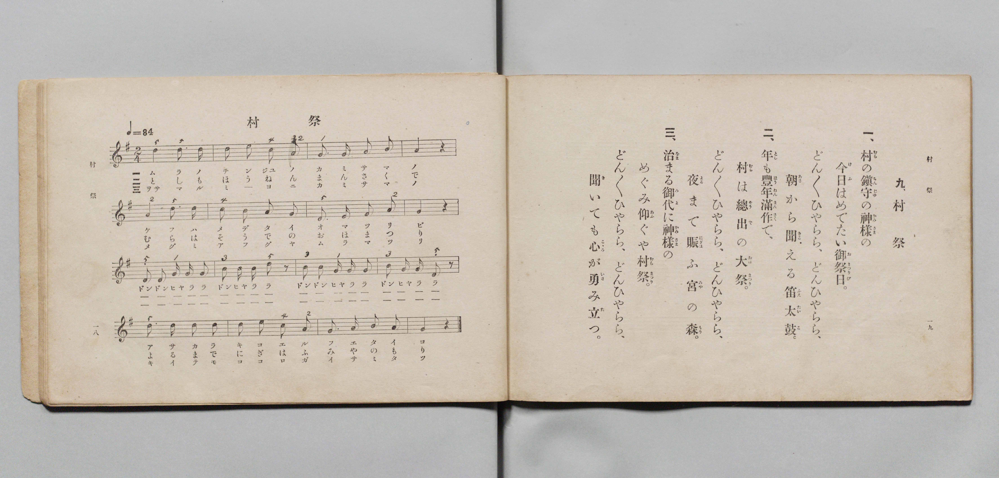

# 村祭

> Re:Shōka 使用 AI 協助辨識與重建樂譜，可能會有錯誤。歡迎回報。

- **鋼琴伴奏版**：<br><audio controls src="muramatsuri.mp3"></audio>

- 文部省《尋常小學唱歌 第三學年用》（明治四十五年五月，索書號 4079）

## 說明

原書資訊與歌詞全文（對應 P012.jpg，書頁 pp. 18–19，第 9 首）：
調性與拍號：ト調二拍子（G 大調 2/4 拍），速度 ♩=84


## 歌詞

```text
一、
村（むら）の鎭守（ちんじゆ）の神樣（かみさま）の
今日（けふ）はめでたい御祭日（おまつりび）。
どん〳〵ひやらら、どんひやらら、
どん〳〵ひやらら、どんひやらら、
朝（あさ）から聞（きこ）える笛太鼓（ふえたいこ）。

二、
年（とし）も豐年（ほうねん）滿作（まんさく）で、
村（むら）は總出（そうで）の大祭（おほまつり）。
どん〳〵ひやらら、どんひやらら、
どん〳〵ひやらら、どんひやらら、
夜（よる）まで賑（にぎは）ふ宮（みや）の森（もり）。

三、
治（をさ）まる御代（みよ）に神樣（かみさま）の
めぐみ仰（あふ）ぐや村祭（むらまつり）。
どん〳〵ひやらら、どんひやらら、
どん〳〵ひやらら、どんひやらら、
聞（き）いても心（こゝろ）が勇（いさ）み立（た）つ。
```

## ABC

<div class="abc-score" data-abc-src="muramatsuri.abc" aria-label="五線譜載入中"></div>

[下載 ABC 原始檔](muramatsuri.abc)

## TMD 檔案連結

- [主旋律 TMD 檔案](muramatsuri.tmd) [[在 TMD Studio 編輯](https://tmdlang.github.io/Tmd-TS/#tmd=s7IKdvYPcrWy4qpTUCpJTLdSSM7PyUlNLsnMz7PKyszLyo8vzshPT8wuBdHZiUpwdWX5OaW5qVbpRYkpqfHG8SYG5pYIyeL80qLkVKvi5Iz8_Jz4ktSKkqT8_Gx0-fiCxPRUqwADQyOETEFRfllqXmIeUHdBUWZeSWoKWDtCQWpZZkoqSLostSgzLTM1BclJqUXFIHdDTS8pSswrTi7KLAB5BqEqv6gE6KOixIKMSquMzOKS_KLM5MSc-OzEPCTflWSkAj2XllpcklmWmIMunpyfm1ual1lSiWxqZnpmnlVufl5SKTCkMCVSM7MykUJCS0vh2dyJz5euVdDS4lK0VbAw4bK3VXDnsjHSN7EDaX42rf1l84rncxofN3Q93dD9dMeOpxv6n67d8XTKxmdrexSer1nzZEcniL9zy_MpKx43dL_f0_FsRt-zTbufzp79tLfxya4pQCkg-WxOx_s9Pc-3LHo2e8eLmfMVQDH1fk-nEheXvpaCLbUAl4KCwtO--SA7Nre_WNH1oqMd6MwXK-c9bV0B9ArQcU839D5r71QARbdeVkE60E1AxS8XNCoUFOgpGFo8aphsCHRXD9BjCpYKL5dNA7rx_Z5ZIHNfrNr_rGE5yMTuXqAPgKKPmzuAgk929QBFnq6dADTdXeHpkuVAMQVg-CkARcG6e142zH-6a5nCo5krbYEBDDLryY6Gxw2NIBYw-IH6Hjc1PG4CKu183LjuZd_ap-uAgdXxuHHh46bJjxtnPG5qg0g9Xzrv2YrFYKnux437HzdOfdy4DyIFNnV317PpS8HSEx83bgVLrH_c1Pi4cfnjxvmPG1ue7lsIjGuYmi6g5seNSx43ARmbQYobmkCmPG5cCbK2YfPjhq2PGzc9bmoBOg2EGoAGgaVQBcnV82zOXLAzmoDeADu1Gyj3onEeWLD3ceNksCAwaLqfr5n9dMmql3uAIkApoAVAEuQdqBqgs8G-39UDNRmY4sAqVzxunA5S0NT0YuMEmODux41tjxvXAt0ElHq2e_-TvXPA4vvArgQGaD_Y3uW44mf98x17n7bvAuuZCzZrOSQGgDEPDFxYyAKtgQYu_UP26RKwl5pAYQd2G9Aly19sBnukcfXjxj6gL8DiW5-uWwcW3A80AuKLZ4vBIk1NCJdDEiw82jbtBiuYBIs2YMB1AxPWk92QhAk0Cph4geKrCaRWcMKcAJR4snsDLCFA0uwEoGsgxRI86AcwNOFJEuw2YKJbBgydp_ubwYKTHzfNfdwEkep52g0qYcBqIEGz__lqUIEITK1g7hKoyykv56BAQUufi8u3tCgxN7GkuLQo0yogMzEv36HGoKYaZI-CjaGZlh2Yha2QhZTeDS8W9ihomCgAy_Xn6xt04CWjJhYNQOtAhtUomMYr6EIIQyiuUTACkiBsDBcBkWZwlWAWRBAEDaB0DdhIH8MahcfNC4D8x80rwWQfTB7IbgSLbAaRTTseNy-DKwBKNq0G8-aDJbeC2fOg2mBGgCxGssoIKNe4AqSycTpYVxPCqsbdYPE2MLkWLDsZKrMPzgNGL5jsh8osx26PMcgNm9Dc9bgZ5F6QDNjFzWB3NHcjXECSf_DH7a4ecuIWFIcEo9YUpAiKQTI1YDkc8dq0EewNcKA1gwINFq8LwSLtYK_uB5NLoIGwCinAWsAkSASkBxQBOCK1qQFsRieIbFyPsKdxLlgEEqmgyAKWQFCZLjAPEungCG6EuQAkgytSwe5u2gB2FyiiYFG3COFPqCzUNJSUjfAVSAbkL1IidUcnmRkWjgyhEBRnMGgKjjeECFY18RBFSBm2E5wtEfQksJdBHgVhZBWoMpCigEL9iIgfDO4AJ4yBdQfehANsj5OVcIAmI-MaBTMoywSIEVkfhGFFBN5CHpJJICUbtKwDZQuQDKS8hRTzkHIRVlZCshRYDK2gAKnGVRx0gFWCylZY5gZlflC2B9vbCCpPIQUFsOUBlYGYDi5ywIUEpHYgUCBAXQ5y0-NmcDHTDPIlzH1Qshmiag1UBqwaWsJDSnuQ3SDfgmxHtamWi0vXTgGpplcAcpW5AA)]
- [鋼琴伴奏 TMD 檔案](muramatsuri_piano.tmd) [[在 TMD Studio 編輯](https://tmdlang.github.io/Tmd-TS/#tmd=s7IKdvYPcrWy4qpTUCpJTLdSSM7PyUlNLsnMz7PKyszLyo8vzshPT8wuBdHZiUpwdWX5OaW5qVbpRYkpqfHG8SYG5pYIyeL80qLkVKvi5Iz8_Jz4ktSKkqT8_Gx0-fiCxPRUqwADQyOETEFRfllqXmIeUHdBUWZeSWoKWDtCQWpZZkoqSDoxOTk_tyAxLzM3NQ9Jviy1qBjk-ILMxLz8eByK8otKgL4qSizIqLTKyCwuyS_KTE7Mic9OzEPyYWJRUWJeeipIJ37TSjKAiqzSUotLMssSc9DFgVpyS_MySyqRrc9Mz8yzys3PSyoFBiumRGpmViZSsGlpKTybO_H50rXv93S87N7zfMKWJ3u2PF3a_7yz4_2eTgUtLS5FWwULEy57WwV3LhsjfRM7kInPprW_bF7xfE7j44aupxu6n-7Y8XRD_9O1O55O2fhsbY_C8zVrnuzoBPF3bnk-ZcXjhm6g6c9m9D3btPvp7NlPexuf7JoClAKSz-YArel5vmXRs9k7XsycrwCKa6C9SlxcvqVFibmJJcWlRZlWAaAgCvJwqDGoqeZSAAIbQzMtOzBLX0vBFh1A7G94sbBHQcNEAeiy5-sbdBRAiUEvqyBdE4sGLX2wYTUKpvEKuhDCEIprFIyAJAgbw0VApBlcJZgFEQRBAyhdAzbSx7BG4XHzAiD_cfNKMNkHkweyG8Eim0Fk047HzcvgCoCSTavBvPlgya1g9jyoNpgRIIuRrDICyjWuAKlsnA7W1YSwqnE3WLwNTK4Fy06GyuyD8x43TgWT_VCZ5djtMQa5YROaux43g9wLkgG7uBnsjuZuhAtI8g_-uN3VQ07cguKQYNSaghRBMUimBiyHI16bNoK9AQ60ZlCgweJ1IVikHezV_WByCTQQViEFWAuYBImA9IAiAEekNjWAzegEkY3rEfY0zgWLQCIVFFmPG9dBZbrAPEikgyO4EeYCkAyuSAW7u2kD2F2giIJF3SKEP6GyUNNQUjbCVyAZkL9IidQdnWRmWDgyhEJQnMGgKTjeECJY1cRDFCFl2E5wtkTQk8BeBnkUhJFVoMpAigIK9SMifjC4A5wwBtYdeBMOsEYhK-EATUbGNQpmUJYJECOyPgjDigi8hTwkk0BKNmhZB8oWIBlIeQsp5iHlIqyshGQpsBhaQQFSjas46ACrBJWtsMwNyvygbA-2txFUnkIKiseNIPeAZCCmg4sccCEBqR0IFAhQl4Pc9LgZXMw0g3wJcx-UbIaoWgOVAauGlvCQ0h5kN8i3INtRbarFUtH7IFf0JtB6HpTTgTk8HplhBmSAOMBoAeVgiLuxKQQxok3jY3GqhIiCqGhDDFVwURMk61DsBfpC104BySPRPkAN6EJGmELGYCFlLgA)]

## 分析

```text
================================================================================
📊 TMD Song Profile: [ 村祭 ]
================================================================================
⏱  Duration:       0:22 (22.9s), 16 measures total
🎼 Key & Tempo:    首調基準 G, != 84.0 BPM, <2/4>
   - 分析範圍：      由實際發聲的音符與和弦推測調性；播放脈絡另行呈現
🎤 人聲音域:    D4 (MIDI 62) – E5 (MIDI 76) [跨度: 14 個半音 / 1.2 個八度, 難度: moderate]
   - 最低音:  D4 in [Muramatsuri #1 @ m.1, 0:00]
   - 最高音: E5 in [Muramatsuri #1 @ m.14, 0:18]
   - 適合: soprano, mezzo-soprano, contralto, tenor, baritone, bass
🏛  結構:      Muramatsuri (22.9s)
⚡ 編曲密度:        Peak 1 軌道同時演奏
🗝  調性診斷：       G 大調（純淨自然大調，未偵測到可信轉調）
   - 風格氣質:    純淨自然大調（陽光明朗、易唱易記，無明顯調外色彩）
   - 轉調歷程:    全曲維持單一推測調性（未偵測到可信轉調）
   - 核心骨幹音:  D, G, B, A, E
   - 調性數值:    G 大調 [相關度: 0.88, 穩定度: High, 自然音純度: 100.0%]
   - 候選調性 (K-S): G 大調 (0.88), D 大調 (0.72), B 小調 (0.72)
   - 五度圈歷程:   +1
   - 各段落調性細節:
     • [Muramatsuri #1]: G 大調 (r: 0.88, 自然音純度: 100.0%)

  [ 五度圈游移軌跡 ]
               C  
         F           [G ]*
      Bb               D  
      Eb               A  
         Ab           E  
            Db       B  
               F# 
     (* = active key center)

  [ 十二半音累積音高分佈 ]
     C  : ██                         1.8%
     C# :                            0.0%
     D  : ████████████████████████  26.8%
     D# :                            0.0%
     E  : █████                      5.4%
     F  :                            0.0%
     F# :                            0.0%
     G  : ████████████████████████  26.8%
     G# :                            0.0%
     A  : █████████████             14.3%
     A# :                            0.0%
     B  : ██████████████████████    25.0%
--------------------------------------------------------------------------------
Assignment 軌道音域：
  - Piano         : D4 – E5 (14 個半音 / 1.2 個八度, 67 個音符)
================================================================================
```


## 原書掃描頁




