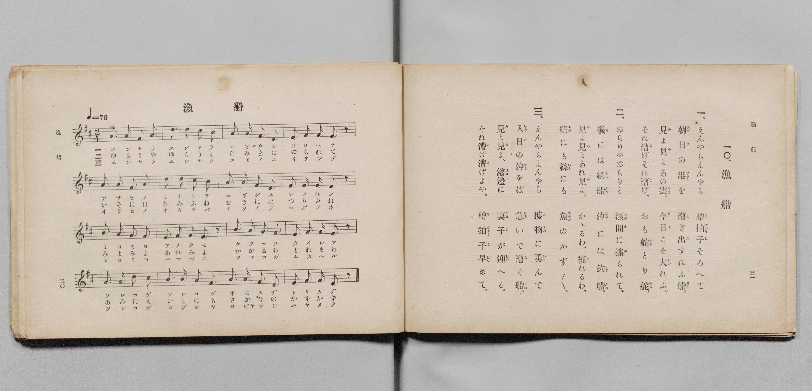

# 漁船

> Re:Shōka 使用 AI 協助辨識與重建樂譜，可能會有錯誤。歡迎回報。

- **鋼琴伴奏版**：<br><audio controls src="gyosen.mp3"></audio>

- 詞：文部省（尋常小學唱歌）
- 曲：文部省（尋常小學唱歌）
- 文部省《尋常小學唱歌 第四學年用》（明治四十五年五月，4080）

## 說明

原書資訊與歌詞全文（對應 P025.jpg–P026.jpg，原書 pp. 20–21）：
調性與拍號：ニ長調（D 大調）2/4 拍，速度 ♩=76


## 歌詞

```text
一
えんやらえんやら、櫓拍子（ろびゃうし）そろへて、
朝日の港（みなと）をこぎ出す漁船（れふせん）。
見よ見よ、あの雲、今日こそ大漁（たいれう）、
それこげ、それこげ、おもかぢ・とりかぢ。

二
ゆらりやゆらりと、波間（なみま）にゆられて、
いそには網船（あみぶね）、沖には釣船（つりぶね）。
見よ見よ、あれ見よ、かかるは、とれるは。
網にも絲（いと）にも、魚（さかな）のかずかず。

三
えんやらえんやら、獲物（えもの）にいさんで、
入日の沖をば急いでこぐ船。
見よ見よ、はまべに妻子（つまこ）がむかへる、
それこげ、こげよや、櫓拍子早めて。
```

## ABC

<div class="abc-score" data-abc-src="gyosen.abc" aria-label="五線譜載入中"></div>

[下載 ABC 原始檔](gyosen.abc)

## TMD 檔案連結

- [主旋律 TMD 檔案](gyosen.tmd) [[在 TMD Studio 編輯](https://tmdlang.github.io/Tmd-TS/#tmd=s7IKdvYPcrWy4qpTUCpJTLdSSM7PyUlNLsnMz7PKyszLyo8vzshPT8wuBdHZiUpwdWX5OaW5qVbpRYkpqfEm8SYGFgYIyeL80qLkVKvi5Iz8_Jz4ktSKkqT8_Gx0-fiCxPRUqwADI1OETEFRfllqXmIeUHdBUWZeSWoKWDtCQWpZZkoqSLo4OTEvviy1KDMtMzUFyV2pRcUgx0OtKClKzCtOLsosAPkIoSq_qAToraLEgoxKq4zM4pL8oszkxJz47MQ8JC-WZKQCfViciiEENrQAaAaygZnpmXlWufl5SaXAkFLi0tJSeLan8UXHTgUtLS5FWwVzMy57WwUXLhsjfRM7kLYXK-e93zPr2bT2l80rns9pfL-n4-mG7qc7djzd0P907Y6nUzY-W9vzfk8n2IpnszcRrxam6nFDF6Yqhedr1jydPRvE37nl-ZQVjxu6gaY9m9H3bNNukHhv45NdU4BSQPLZnI73e3pAEQs2mktfS8GWWoBLQUHhad_8Z7N3vNjc_mJF14uOdqDjgEHytHUF0ANgD_Y-a-9UAKUOvayC9EcNk4FMMxAT6CiIVoWCAj0FIwOglJEh0InAEAIZ-2LV_mcNy0EGdve-mDkfKPq4ufvl1O1AcaCxLgpPlywHMzuBEaEAVAM07mXD_Ke7lik8mrnSFhhNIEOe7GgAUY8bOx43TX7c1PK4qROF3dD4bPVkoOanaycADX3c1Pu4cfPjpubHjW2PG6cDzX7cOBcsuONx4zKgYpBZz-bMfTZ96ePGdc92rAfpadz_uHHV48YVINVNkx43Tn7c2Pe0fdfjxpmQdAM2t-dx49bHjbOBFoOUNTSBPbis-3FTB4QEmv24sQlo6MvZm4DsJ7u7wHYAzZoL9CfQILBN8x83Al0NNKsNbArYOWAXAoWASieBTUHjdj1uAprb_bhx0ePm3UBnPm7qgnKBrgAH0a4esDlNbaAAAcqCQgbGBqoHBtHmRS-nAR0OdAHQo0Dv7gOHzGqYMqB1sMABORDoAqBc4_rn2zZBvQ_yGVDbtseNayEOf7ZpGkTNy_bFMDVLwPbB1eAKoqYeJC7QH0A2kFwP5gI91wPjgvUDnQB2Z9PzrcCMB7QE6DpwRIEFgXperp0FFp8KNmsVWGodmD0LSsJCaUcngYT0vHfT886VYNOA4qC4hFoEsnQqSGXjcmgoPW1dCk1CwHAApZkNzxqAXKC65eCYmwAME1whsB4Y_I8bdwINfrpsNzTZAsMOJAhOW43AEGgAu30HKChwJBIwA2gi0PFIWeDZ9JWPm4CywNgEW055-QAFClr6XFzulfnFqXlWAZmJefkONQY11SArFGwMzbTswCxs5RKomAPm4RcLexQ0TBSABeDz9Q068MJEE4sGoE0gw2oUqnPTahVMFXSB0FTBGEzqgoSBooZxYGEgZQ6kzCDi6MoNwcJGQNIYCEG0AUgEbLqPYQ0ww6wAq37cvBmIl4BZK8F68Mg0r4XKTH7cvBiocBmI07Qdqm0vWGotEM8A4jYgLx5hpRFIBUgMpKMTiLvArBaoXgyZRpAjgDKNqyAyjfuBeB-YtRpJD0RHD1AU5BYk-4zJ9CJcZhEQ94FZ3VAZsLqmrVBd7XD78Ef_rh5yop8qMW8EhCAeeswvggY2yCuTwF4EeRQUv_Ohnu8C4g4waxPU85uhetYBxRrArJ1QPWvA6qYCRXaDgwYj2htBkQyKuLnQyAMWA9DIbUKK3G1gFiiFgWRAiQDE78XQA4kGoAuBOiDq0aMdpALkplXo_muCJqYmUCIF-exx8wSkyAXJ7IVFNDiCYT5_3LQB4sfmXiKjfUcnebm-oBYcr6DINAGSoAjFko2JUYOIcHi0roCyQSyI50BJARQ8j5vWg9M81HNA_kaoHlDEQoIAlL9BMvvBvCXgqAfJY0Y4SAVITQeUDWIhIhySX4FRDhaF2tcIymWgaO4GioPYiAgHuRWsBygOEUWLcNz-a-4H8-YB8UxoToba1wxNlCA5qP9ACRkkswDMWw0tx0CJj4gIB7ZayYpwpMwLzt2gjA2LXjOwFCR6CRTw2LI5KL5APgTGEtSHsMyMWwaaQUClHzAEQCxQjIFCBVIcALMUOGRAouixjpyZwXqboHrhBQAwftBkQKkHGuvgkh7YqkBKD8AWDFRuFmas4_EFrLDaBE0JkDKeUAUGTSyghL0QiBEVWC0Xl66dAqQBoABkKXMBAA)]
- [鋼琴伴奏 TMD 檔案](gyosen_piano.tmd) [[在 TMD Studio 編輯](https://tmdlang.github.io/Tmd-TS/#tmd=s7IKdvYPcrWy4tLSUni2p_FFx873ezpedu95PmHLkz1bni7tf97Z8X5Pp4KWFpeirYK5GZe9rYILl42RvokdV52C0ouV897vmfVsWvvL5hXP5zQC9T7d0P10x46nG_qfrt3xdMrGZ2t7gNqVQGqfzd5EtNoX7bueNy5-vmPv87mLn-6a87ih62nrGqCqZwsWQhQ-buh-vmbN09mzQVp3bnk-ZQXQvGcz1j6d1PO0t_HJjgag4Ps9Pc-3LHo2e8eLmfMVDMyNLBXMjcEWcLlX5hen5lkFZCbm5Qd5ONQY1FRzKQCBjaGZlh2YVaNQnZtWq2CqoAuEpgrGYFIXJAwUNYwDCwMpcyBlBhFHV24IFjYCksZACKINQCJg030MaxQeN60Aq37cvBmIl4BZK8F68Mg0r4XKTH7cvBiocBmI07Qdqm0vWGotEM8A4jYgLx5hpRFIBUgMpKMTiLvArBaoXgyZRpAjgDKNqyAyjfuBeB-YtRpJD0RHD1AU5BYk-4zJ9CJcZhEQ94FZ3VAZsLqmrVBd7XD7oDFGlcgyAkIQDz2yFkHDB2T7JLCrQG4DRcl8qHu7gLgDzNoEde9mqJ51QLEGMGsnVM8asLqpQJHdYN9gxFQjKF5AYT0XGt6PG9dD46MJKT62gVmgRAGSAcUbiN-LoQcSckAXAnVA1KPHFEgFyE2r0P3XBI3_JlC6AvnscfMEpPgAyeyFxQ04TmA-f9y0AeLH5l70mKrOLagFRwUo_E2AJCgOsGQWYtQg4ggeEyugbBAL4h5Q7IF89LhpPThlQd0D5G-E6gHFBcTVoFwEktkP5i0BxxZIHjOOQCpAajqgbBALEUeQXAGMJbAo1L5GUFoGxUw3UBzERsQRyK1gPUBxiChaHOH2X3M_mDcPiGdC8wvUvmZoOgLJQf0HSnsgmQVg3mpoaQFKL6hxhJRFwHkIlH1gMWIGloLECIGSD1tmAgUxyFHAgIU6CpZlcMtAkyGoWAA6GsQCBTLII5BMB0y4YM-ARNEjCjnLgPU2QfXCsxkwSNFkQBEOjShwEfi4cR1SFD5unAWVm4UZUXh8ASsSNkEjD1L4ESrZofELSosLgRhRstei1mU-yHWZBbwqM4xXiDaMhVFwvgmQMkHiw-VN44Es0_hYMMMA6jMKjAGKIEyBKsdpGUEFmK4BSWLqI-QcYNjp2ilAgi_aB6gEiWeEwjMG85S5AA)]

## 分析

```text
================================================================================
📊 TMD Song Profile: [ 漁船 ]
================================================================================
⏱  Duration:       0:25 (25.3s), 16 measures total
🎼 Key & Tempo:    首調基準 D, != 76.0 BPM, <2/4>
   - 分析範圍：      由實際發聲的音符與和弦推測調性；播放脈絡另行呈現
🎤 人聲音域:    D4 (MIDI 62) – D5 (MIDI 74) [跨度: 12 個半音 / 1.0 個八度, 難度: easy]
   - 最低音:  D4 in [Gyosen #1 @ m.3, 0:04]
   - 最高音: D5 in [Gyosen #1 @ m.2, 0:01]
   - 適合: soprano, mezzo-soprano, contralto, tenor, baritone, bass
🏛  結構:      Gyosen (25.3s)
⚡ 編曲密度:        Peak 1 軌道同時演奏
🗝  調性診斷：       A 調性不明確（純淨自然大調，未偵測到可信轉調）
   - 風格氣質:    純淨自然大調（陽光明朗、易唱易記，無明顯調外色彩）
   - 轉調歷程:    全曲維持單一推測調性（未偵測到可信轉調）
   - 核心骨幹音:  A, F#, D, E, B
   - 調性數值:    A 調性不明確 [相關度: 0.85, 穩定度: Ambiguous, 自然音純度: 96.6%]
   - 候選調性 (K-S): A 大調 (0.85), D 大調 (0.82), F# 小調 (0.76)
   - 五度圈歷程:   +3
   - 各段落調性細節:
     • [Gyosen #1]: A 調性不明確 (r: 0.85, 自然音純度: 96.6%, 調外音: G)

  [ 五度圈游移軌跡 ]
               C  
         F            G  
      Bb               D  
      Eb              [A ]*
         Ab           E  
            Db       B  
               F# 
     (* = active key center)

  [ 十二半音累積音高分佈 ]
     C  :                            0.0%
     C# : █████                      5.1%
     D  : ███████████████           16.9%
     D# :                            0.0%
     E  : ██████████████            15.3%
     F  :                            0.0%
     F# : ██████████████████        20.3%
     G  : ███                        3.4%
     G# :                            0.0%
     A  : ████████████████████████  27.1%
     A# :                            0.0%
     B  : ███████████               11.9%
--------------------------------------------------------------------------------
Assignment 軌道音域：
  - Piano         : D4 – D5 (12 個半音 / 1.0 個八度, 64 個音符)
================================================================================
```


## 原書掃描頁




