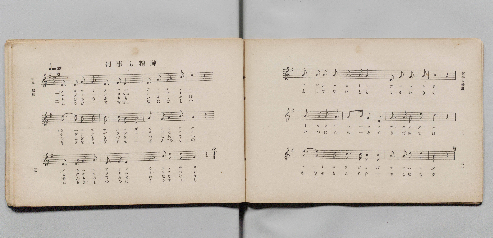
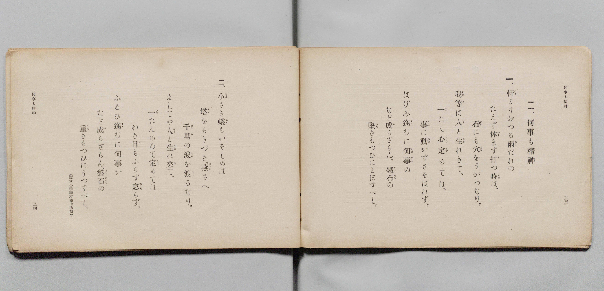

# 何事も精神

> Re:Shōka 使用 AI 協助辨識與重建樂譜，可能會有錯誤。歡迎回報。

- **鋼琴伴奏版**：<br><audio controls src="nanigoto_mo_seishin.mp3"></audio>

- 詞：文部省（尋常小學讀本卷七所載）
- 曲：文部省
- 文部省《尋常小學唱歌 第四學年用》（明治四十五年五月，4080）

## 說明

原書資訊與歌詞全文（對應 P019.jpg–P020.jpg，原書 pp. 32–35，第 11 首）：
調性與拍號：ト長調（G 大調）2/4 拍，速度 ♩=92
曲式結構：三段體 Dal Segno（第 1–12 小節為 A 段，句尾附延長記號 Fine；
第 13–24 小節為 B 段，句尾附 𝄋 記號返始重唱第 1–12 小節，全長 36 小節）


## 歌詞

```text
一、
軒（のき）よりおつる雨（あま）だれの
たえず休（やす）まず打（う）つ時（とき）は、
石（いし）にも穴（あな）をうがつなり。
我等（われら）は人（ひと）と生（うま）れきて、
一（いっ）たん心（こゝろ）定（さだ）めては、
事（こと）に動（うご）かずさそはれず、
はげみ進（すゝ）むに何事（なにごと）の
など成（な）らざらん、鐵石（てっせき）の
堅（かた）きもつひにとほすべし。

二、
小（ちひ）さき蟻（あり）もいそしめば
塔（たふ）をもきづき、燕（つばめ）さへ
千里（せんり）の波（なみ）を渡（わた）るなり。
ましてや人（ひと）と生（うま）れ來（き）て、
一（いっ）たんめあて定（さだ）めては
わき目（め）もふらず怠（おこた）らず、
ふるひ進（すゝ）むに何事（なにごと）か
など成（な）らざらん、磐石（ばんじゃく）の
重（おも）きもつひにうつすべし。
（尋常小學讀本卷七所載）
```

## ABC

<div class="abc-score" data-abc-src="nanigoto_mo_seishin.abc" aria-label="五線譜載入中"></div>

[下載 ABC 原始檔](nanigoto_mo_seishin.abc)

## TMD 檔案連結

- [主旋律 TMD 檔案](nanigoto_mo_seishin.tmd) [[在 TMD Studio 編輯](https://tmdlang.github.io/Tmd-TS/#tmd=s7IKdvYPcrWy4qpTUCpJTLdSSM7PyUlNLsnMz7PKyszLyo8vzshPT8wuBdHZiUpwdWX5OaW5qVbpRYkpqfEm8SYGFgYIyeL80qLkVKvi5Iz8_Jz4ktSKkqT8_Gx0-fiCxPRUqwADQ0uETEFRfllqXmIeUHdBUWZeSWoKWDtCQWpZZkoqSLostSgzLTM1BclJqUXFIHdDTS8pSswrTi7KLAB5BqEqv6gE6KOixIKMSquMzOKS_KLM5MSc-OzEPCTflWSkAj2Xm1-UmIMumJKZk5kOcgGykZnpmXlA5XlJpcBgUuLS0lJ4snfqk13dj5uanm_a93zpPAUtLS5FWwVLIy57WwV3LhsjfRM7kP4XK-e93zPr2bT2l80rns9pfL-n4-mG7qc7djzd0P907Y4X6xqezVnztHf7kx3NzzobXuzpfL-nE2zvs9mbkPVBxGC8xw1dyKY8nbLx2doehedr1jydPRvE37nl-ZQVjxu6gbY9m9H3bNNukHhv45NdU4BSQPLZnI73e3pAUQq2jktfS8GWWoBLQUHhad_8Z7N3vNjc_mJF14uOdqDjgMHwtHUF0APgAOh91t6pAEoXelkF6Y8aJgcYGBmAmEBHQbQqFBToKRgbAaWMTYGCQJ8pGBoqvFw2DeheYLCA7Hixav-zhuUg07t7X8ycDxR93Nzxcup2oDjQDneFp0uWg5mdwJhQAKoBGvOyYf7TXcsUHs1caQuMJ6AZwEB-uqf_-dYJz5YDw2rWkx2dz9Ztfbl6ioJLYo5CcGp6Xj7QKLDlQJcYGikAg_v5-obnTbsUHBWAKkHO7V_6dMO-lzNbnu7eBrJ8xQygWxTcMvNS3--ZDbICAcDmGAMNMjJBMsgJ3SCFD3NbuhUgBr3YP-Xp8u6X7b3AGMZwBkhT6wqgpQrGZnChTi6QpU92NDxuaASH0u5JQC88blz3uBEYAp2PmzoeN3U9bgSiJY-bul_OXgGWbXrcuA8k27jgcVMPUDFI5-PG-Y8bgXKznuyZCFLU1PK4cSZY0T6g4LPOyWCdbWCRJc9mNoG5K6DWNK6H2v98_mawBFDzdLDEalCOWbkFZu0qsKMmAQ163Ai0eQlQBOTAhiZw9HRMfL4WGN9Ay_tBDmsC5Q6g2U927QLr3wS0ECyy4vkUYAIAOQfqEZAveh83LoO6AhgeMFcsBmuY_7hp8tP9zWDByY-b5j5uAjn76bpZYJGpwIAAm9IIMgLuF2B2h2qAWrv6afdUmLVTwCLdwKAB658L0gZyxSyoZhC_EejP_S8bgBkbqGcm0FqwJQ1AgyCFCVh8FSiMGqfA7IDGBVB05bOOCRAVYG1AuWkgsmky0IaXE7bCQhro4MWPG2fDIgKs_-mCVrAc0HnAcAKK9gJjARzawCAE2gaMtt0gFzXuBEYTKPAh3u2Buh2YuMDaFwLVg7UDPdj7Yv5uaCQ2dYEdBDQQGL5Aj08HB9wGsM6FwHABKgImJWAiB8c0SB0wapaCyIbG5-2QEAQ6ZQNQG8z0HWDNvc0v23vA0rNB3oTY07ju2eZFsJAC5W-goc92LISmEoj_moAeRUpH4CQ7HRQ0TS3EpJ0n-4DJGigCCUG8iQjsVaCPluFKO2D7QQ7rfT57HdiRYE-CQmErOBJnPWsAagDqBOZJYMqCuB8kDk84QHVA_2wiMeF0E5Vwni-eAEs4wPAH2j_jcVPz40ZgfMPSDrD0gTqvCZjHMdMOMNiAbKS0A9RDTC0HUkd5bQMFClr6XFx-iXmZ6fkl-b75wamZxRnACjsgMzEv36HGoKYaXBTbGJpp2YFZ2Co8UAENjOMXC3sUNMDFO6zEhRXXOvAqSxOLbqALQCbXKJjGK-gCIZAyBFIgDBczi4ewwARUFKZIV8EYJARm6SoYQOkasKE-hjUKj5v7wCKPm9YC2StArOZVYGMeN4FoEL8FiFfDdALFF4FF54HJBqiaNSAZqFm6ChB3we0xAso1LoSobNwExFPBrF6IeY1NUBd0ATGEDRFvAauaCyanQ9U0gmU2YNiDP_x39aCGvykw_C1IC38zSFCDgxKEaxRMwCImwAAGBTJIxAgsYgimkUWwBnzTfqjY4yZwsANrbbC3m5dARXfCAhkm07QMKUI6wDJroXr68QT8fGjAbwWqnwTWBQpkkAwoAkAyS-FsiDjUBcBgBgU4iAWKMJDMDhIDfkcnasBbIjc1qJfyIQ6HpXdEFEFEsAc_LJi3A4OvGxysoHQNS98gPjA9Nm9CBAss-JvWgKMAogIS_JCcgj34Z0N1TQancFBgroMGJjR_Ne6HRgzMHkhkgiIOWESDWbAcCdJPQvAD2-fg4Ae3BuENRUNYu47I8IekYSMwDcIwEWN46sYoc4yAQqAMgCPsm9dDQxgUkivBLJCfQTKQcAAlb0gSRw57WJmzBhqia8E62vCE_T5oSE4HYrAJTaB4A8lA4hVYq4ExIumDTIPoA9bYUDW9YBlI7JNQ5kxBC3tzUCPdgFphDwpoaIEPC3NQiIOKKbzlPSzdNzdDi6DHzZuhYQyiISELYj1uXgsV3wrV0QDEoFIcEuaEih1QSINCbwm0CALlAIh5oCIFIgcqiCAhC9IBKmRA_AXwYgcmA0kvxKf71rWoYW8EqnDhHSRE2OsoQDpI4N4RlYp_IyQ1ePIAIrQhRTm4DEIuZbYAMajWRRT_0Hho2gsNeUhOAMmAVOCIB3hp0gsLVXjxDzOvE8ieBdMJZENKGWC7ER5znVAZmCpi4gHSy0Rq_bjoBeuBu6tGoOrXiMT6l2btH2j4NAHbJc2QqhISpjuh4qBqeAFyDIFLfWidAYwlWBwSav_AQrsbXvpAwnQmNLRnAuVArSlg8xcqAyr1ITxgAxyqagVYBmQ36fEAbQUh4gFUGxuTWBtTvR0EDk5QEAKTITRoQVUCKAq2QWVWQgspaJBBi3xIEbYbHKhroTL4IgBW3QJNgwQtPFlPg0YN0AXgQgoWNZBmJrjqBvdgwNqhNRW4FicjL0AaRPA4MAbVyPCRFuSSCTTaMxDtIkhLH1Q3QIIV3i4Ct3lA_EnQ1A-LDkg9_bh5NjTXPG4GpWmQWdvxRAc02oGlEaTxiSiXYM1PUE8Bqd8BrpthNQrIBmDnECoD6R0g21PLxaVrp4DRd1MACipzAQA)]
- [鋼琴伴奏 TMD 檔案](nanigoto_mo_seishin_piano.tmd) [[在 TMD Studio 編輯](https://tmdlang.github.io/Tmd-TS/#tmd=s7IKdvYPcrWy4qpTUCpJTLdSSM7PyUlNLsnMz7PKyszLyo8vzshPT8wuBdHZiUpwdWX5OaW5qVbpRYkpqfEm8SYGFgYIyeL80qLkVKvi5Iz8_Jz4ktSKkqT8_Gx0-fiCxPRUqwADQ0uETEFRfllqXmIeUHdqSmZJflFmYk58YlFRYl56am5qXglCZWpZZkoqSF1icnJ-bkFiXiaqfFlqUTHIFwWZiXn58TgU5ReVAL1XlFiQUWmVkVkMsi8ZaGF2Yh6SV0sygFZb5eYXJeagC6Zk5mSmg1yBbGRmemYeUHleUikwzJS4tLQUnuyd-mRX9-Ompueb9j1fOu_9no6X3XueT9jyZM-Wp0v7n3d2vN_TqaClxaVoq2BpxGVvq-DOZWOkb2IHMvTFSqD6Wc-mtb9sXvF8TiNQ79MN3U937Hi6of_p2h0v1jU8m7Pmae_2Jzuan3U2vNjTCTQK7Jhnszch64OIwXiPG7qQTXk6ZeOztT0Kz9eseTp7Noi_c8vzKSseN3QDbXs2o-_Zpt0g8d7GJ7umAKWA5LM5QCf3gCIdbB2XHzBk0_NL8n3zg1MzizOA_g8ABXuQh0ONQU01lwIQ2BiaadmBWfpaCrboAGT3kx0NLxb2KGg4KjxbtxXIVzB81DDZRAHoxOfrG3QUQAlFL6sgXROLbi19sMk1CtW5abUKpvEKukAIpAyBFAjXwMTM4iEsMAEVhSnSVTAGCYFZugoGULoGbLKPYY3C4-Y-sMjjprVA9goQq3kV2JjHTSAaxG8B4tUwnUDxRWDReWCyAapmDUgGapauAsRdcHuMgHKNCyEqGzcB8VQwqxdiXmMT1AVdQAxhQ8RbwKrmgsnpUDWNYJkNGPbgj4RdPaiRYAqMBAsSIwEYB2aQ4AYHJwjXKJiARUyAgQwKaJCIEVjEEEwji2AN_Kb9ULHHTeCgb9oF8XrzEqjoTlhAw2SaliFFSgdYZi1UTz-ewJ8PDfytQPWTwLpAAQ2SAUUCSGYpnA0Rh7oAGNSgQAexQJEGktlBYuDv6EQNfEtg4Bsa0SYLQFwPS_iIeIKIYI8DWFhvB4ZhNzhsQQkcltBBfGDCbN6ECBtYHDStAccDRAUkDiBZBnsczIbqmgxO6qAQXQcNUWhGa9wPjR2YPZAYBcXe4yawy8AqQTIg_STEAbCkA8eBE7wUMgZFghmpkVBQC03NRmAahGHp2xiezjFKICOgECgr4IiA5vXQYAYF50owC-RxkAwkMEAJHZLYkSMAVgKtgQbrWrCONjwRsA8anNOBGGxCEyjyQDKQyH3cuAKMEZkAZBpE3-OmHqiaXrAMJAmQUAJNQYsAc2AEGBmQkQtwRwAotKF1ACzgQcEOKrXwVgGwHNDcDC2RHjdvhgY0iIYEL4j1uHktVHwrVEcDEIMKdkjAEyqFQMENCsIl0BIJlBcg5oFKGIgcqFyCBC9IB6jMAfEXwEshmAwk0RCfA1rXokaAEagiNsKsiXUUnvYvfbphn8KHuS3deGOD-NrACEkNnoyACG1IyQ4ujZDLmy1ADKqIEbUBNB6a9kJDHpIdQDIgFTjiAV6u9MJCFV4bwMzrBLJnwXQC2ZDy5nEjsOyCxlwnVAamiph4eLF_ytPl3UitIhe9YD1Q7CgYgWpkI1KrZJq2i6CB1ARsrzRDqk9IwO6EioOq5gXI0QSuBKBVCDCqYBFJqF0EC_JueDkECdiZ0CCfCZQDtbIeN4KiHlZdQHiPG6dAVa0Ay4DsJj0yoK0jRGSAamhjUmtoWrSPwEEKCkZgeoQGL6iCAEXDNqjMSmhpBQ02aAUAKct2gwN2LVQGXyTAamCgaZDghafvadDoAboAXFrBogfSBAXX5o0zHjc1g7VD6y1wxU5GpoA0lODxYAyqpI0xK2kdBbfMvNQBay9BugKgmgIStvD2ErgtBOJPgmYDWJxAqu7HzbOh2edxMyhxg8zajidOoHEPLJsgLVNEKQVrm4K6EkgdE3B1DatfQDY8bgTZBpKBdB-Q7anF2cHzQe7gmUD7d9AgNQSFm7YhOCDjFYzitYGhCAwtFFEDqC8gecIkHhjYYDkjOAukygyIMdQTsALBRtYDbJQhq0TTBbEHTQs4caBqgdoJ14HqMly-QLKIeG_QPaSAca1rp4AR3dE-hrEK2CWMwBLKXAA)]

## 分析

```text
================================================================================
📊 TMD Song Profile: [ 何事も精神 ]
================================================================================
⏱  Duration:       0:46 (47.0s), 36 measures total
🎼 Key & Tempo:    首調基準 G, != 92.0 BPM, <2/4>
   - 分析範圍：      由實際發聲的音符與和弦推測調性；播放脈絡另行呈現
🎤 人聲音域:    D4 (MIDI 62) – E5 (MIDI 76) [跨度: 14 個半音 / 1.2 個八度, 難度: moderate]
   - 最低音:  D4 in [NanigotoMoSeishin #1 @ m.1, 0:00]
   - 最高音: E5 in [NanigotoMoSeishin #1 @ m.5, 0:05]
   - 適合: soprano, mezzo-soprano, contralto, tenor, baritone, bass
🏛  結構:      NanigotoMoSeishin (47.0s)
⚡ 編曲密度:        Peak 1 軌道同時演奏
🗝  調性診斷：       D 大調（純淨自然大調，未偵測到可信轉調）
   - 風格氣質:    純淨自然大調（陽光明朗、易唱易記，無明顯調外色彩）
   - 轉調歷程:    全曲維持單一推測調性（未偵測到可信轉調）
   - 核心骨幹音:  D, G, A, B, E
   - 調性數值:    D 大調 [相關度: 0.86, 穩定度: Moderate, 自然音純度: 95.2%]
   - 候選調性 (K-S): D 大調 (0.86), G 大調 (0.81), D 小調 (0.61)
   - 五度圈歷程:   +2
   - 各段落調性細節:
     • [NanigotoMoSeishin #1]: D 大調 (r: 0.86, 自然音純度: 95.2%, 調外音: C)

  [ 五度圈游移軌跡 ]
               C  
         F            G  
      Bb              [D ]*
      Eb               A  
         Ab           E  
            Db       B  
               F# 
     (* = active key center)

  [ 十二半音累積音高分佈 ]
     C  : ███                        4.8%
     C# :                            0.0%
     D  : ████████████████████████  34.9%
     D# :                            0.0%
     E  : █████                      7.1%
     F  :                            0.0%
     F# :                            0.0%
     G  : ██████████████            20.6%
     G# :                            0.0%
     A  : ██████████████            19.8%
     A# :                            0.0%
     B  : █████████                 12.7%
--------------------------------------------------------------------------------
Assignment 軌道音域：
  - Piano         : D4 – E5 (14 個半音 / 1.2 個八度, 114 個音符)
================================================================================
```


## 原書掃描頁






