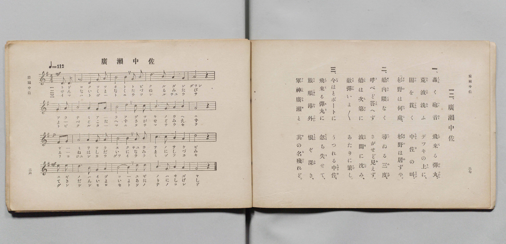

# 廣瀨中佐

> Re:Shōka 使用 AI 協助辨識與重建樂譜，可能會有錯誤。歡迎回報。

- **鋼琴伴奏版**：<br><audio controls src="hirose_chusa.mp3"></audio>

- 詞：文部省
- 曲：文部省
- 文部省《尋常小學唱歌 第四學年用》（明治四十五年五月，4080）

## 說明

原書資訊與歌詞全文（對應 P021.jpg，原書 pp. 36–37，第 12 首）：
調性與拍號：ト長調（G 大調）4/4 拍（弱起 1 拍），速度 ♩=112


## 歌詞

```text
一、
轟（とゞろ）く砲音（つゝおと）、飛來（とびく）る彈丸（だんぐゎん）。
荒波（あらなみ）洗（あら）ふ　デッキの上（うへ）に、
闇（やみ）を貫（つらぬ）く　中佐（ちゅうさ）の叫（さけび）。
「杉野（すぎの）は何處（いづこ）、杉野（すぎの）は居（ゐ）ずや。」

二、
船內（せんない）隈（くま）なく　尋（たづ）ぬる三度（みたび）、
呼（よ）べど答（こた）へず、さがせど見（み）えず。
船（ふね）は次第（しだい）に　波間（なみま）に沈（しづ）み、
敵彈（てきだん）いよ〳〵　あたりに繁（しげ）し。

三、
今（いま）はとボートに　うつれる中佐（ちゅうさ）、
飛來（とびく）る彈丸（たま）に　忽（たちま）ち失（う）せて、
旅順港外（りょじゅんかうぐゎい）　恨（うらみ）ぞ深（ふか）き、
軍神廣瀨（ぐんしんひろせ）と　其（そ）の名（な）殘（のこ）れど。
```

## ABC

<div class="abc-score" data-abc-src="hirose_chusa.abc" aria-label="五線譜載入中"></div>

[下載 ABC 原始檔](hirose_chusa.abc)

## TMD 檔案連結

- [主旋律 TMD 檔案](hirose_chusa.tmd) [[在 TMD Studio 編輯](https://tmdlang.github.io/Tmd-TS/#tmd=s7IKdvYPcrWy4qpTUCpJTLdSSM7PyUlNLsnMz7PKyszLyo8vzshPT8wuBdHZiUpwdWX5OaW5qVbpRYkpqfEm8SYGFgYIyeL80qLkVKvi5Iz8_Jz4ktSKkqT8_Gx0-fiCxPRUqwADI0OETEFRfllqXmIeUHdBUWZeSWoKWDtCQWpZZkoqSLostSgzLTM1BclJqUXFIHdDTS8pSswrTi7KLAB5BqEqv6gE6KOixIKMSquMzOKS_KLM5MSc-OzEPCTflWSkAj2Xm5mTWZJYVIkuDtGGJAw0Iz0zzyo3Py-pFBhOSlxaWgpPdy9-3rDiyY61T_ZOUNDS4lK0VTA0NOKyt1Vw57Ix0TexA-l-sXLe-z2znk1rf9m84vmcRrCJz2ZvwhSD8R43dD3d0P10x46nG_qfrt3xdMrGZ2t7FJ6vWfN09mwQf-eW51NWPG7ofr-n49mMvmebdoPEexuf7JoClAKSz-Z0vN_TA4qt93s6lbi49LUUbKkFuBQUFJ72zX82e8eLze0vVnS96GgHOg7oxaetK4AeADrp6YbeZ-2dCqAo18sqSAe6BKJeoaBAT8HY7FHDZGNzoCDQOwqGRgovl00DOhIYFiCDX6za_6xhOcjI7t4XM-cDRR83d7ycuh0oDjTYXeHpkuVgZicwaBWAakC27dn4Yut2BUMIF2hQz8uG-U93LVN4NHOlLSguQOY-2dHwuKERbMNeoKkdjxtXPG6a97gJpONxY__zBZtezt8MFl_yuGnu48YuoAKQVEPjy8Wzn-xrg2pp3AxUDBJv6n66t-PJjh1g8QWPmyY_bpzwuKkPyADragLb1Dvp2eZFYBVNj5uA1qx63Ahy-rMt0-GCYOu3Pm5oeNzc_ri5-XHT2seN657s6AIraHvcCLQAqGA11O0vp4OC93FTC8Sgx02TXmxaDXM1UN0aiG-AxkESJFhq4eOmVrBZU8Gy6572Q7RMfdw4EeghhHsfN_Q8m9v5sr0PLD3zcWMfUDVYz_one6e-mAnUDxQH2r30cSPEm4241D_d2Ap2KNAFQO4skIsbmh439ELiYlcPLC46dj5tXQ7WPhschsAQagFqeTkLmHyBgv2PG_eBTQCKg3wFzBNg8flAN4DF1wAj4smOTmBsg8X3g6UgXgJb8HTiHrA7gMYBVe983Ljy-dopYKVAy4DpACi4A-S-hkZwePSA3NG48sUyiDXgMG4EMoAKIDHasRMssfVx41qIR5-tWQhMxmDB6aCEAHY-OMIagHH_chownIBSoIiHeWX1s00QzwHVQzyxH-rYZ1O3AhMVWG7Z48ZeSLoCq2gB-uBxw-bHDeCUAkw4QG82AZPo6uc7G2FmTQKrnA5yKSTBw8LgyW5IagJGHMQF60EpuXnO4-Y9wLwFcSs4fQDTUA84PHEkHWgaJJwfgHEA9SsozvbvhQkuhIkvfLpkIySFg7nAMF8GC4PprS8XtD3bsf7pEmCpAIy5rsdN7Y8bZ4AcAkog3WDngLMaJKiB4QzKqeDcAsoCkDib92w7xAJgTAHjEijSC0tyu3ufL50HKbXBKoBmAc2dDiY3AQsEoHPAGoDFa8PT1m1gNXOhOWcCqLwBRicoE6-bAWavg-YFYNA1roQmE8rLWChQ0NLn4vLILMovTnXOKC1OtArITMzLd6jRNaypBlmkYGOhZQdmYCvgQfUFsNx7sbBHQQNaSGormCgAq5Tn6xt04MWzJhadQHtBptYoGCjowmF1blqtgmk8CNUAi1uIIJCjC-QYAYWMoUIg2hBI1iiYQvlGYBFdoAiIBYIgc8G6wPb4GNYogMyBQWC6BOJOoPrHzWthYk3rwTItYAyUaVqFpBqmZzJYBqQSJLIaiBvArM1g2x83bXjcvA7CA0GQnY-bFgHlV8JcYoTmksbZQBVgUxvh9jW2gMl-IN6HJtMPJucD8VKwzBqo27uB7P1QObBLGlHdAHR7406YG4zR3NC0BOjCeeDQAJmP7Oc5QLwHLAPiQ2S6wXqWwcKpGeoGcGg0Pm5eCpWGBMhWZGfAghBcguBOU7t6wGmKxKQESx6QxICcYEDJxAQIYSIgWUgyQqQzUIKpLqhVMI8HCiFSzePmLri_QSELj00gORU5DJvbgbgZ7GVIinrc3AcNhsfNMyCBAQ45RGCAQn0-UroAZnCYaY2ToXEJrD_AsTkL2a7GqUDcAxafDRVZCY9_UDwh6wDb1bgViNcixT8sDUPiDeSv_fA0AHMlJG2AxBvB4vOg6hth_mraDfVXG4q_Vj1uXg6U3AFMCqCsQCi2d3SSE9uwjI4Z2yDaCFw8mID5JlARkFMhBQY0tkHFjRkQIsf2JniogPMgMKYfN4NDGh5e0DAApXNQMCDSOCTCQezHTRuhAQOKRkQm3AnE61AiHB4JjdPB5AJw5gfJgCIFEeGrwNELEt8HFQFmNqgeUH4DyYCiHxHhwOzZ2IsS4TATYZEHKqrAeb8GySpYzoakcFCKB4nsg6Z2iCGINA7z2AZwCUggooFdCHIiGlbGgzIqJBKRI9oUCBHZGhHRyNkahJHjuA8aXcDyFeh7EKsV6itYmQnxNTS6UHU0bwDL7YLoAOZhRDiAMHLkLoCaMxlWogNLYUhUgXgQOXAp29gEzusgF0BKG-TonQTVA-JhsQkctduh7tsMxCD1kFoNJAPKoRA5sE1Ne8G-QZRrkEQL8jekHAfJdGLYVMvFpWungNRQUABylbkA)]
- [鋼琴伴奏 TMD 檔案](hirose_chusa_piano.tmd) [[在 TMD Studio 編輯](https://tmdlang.github.io/Tmd-TS/#tmd=s7IKdvYPcrWy4qpTUCpJTLdSSM7PyUlNLsnMz7PKyszLyo8vzshPT8wuBdHZiUpwdWX5OaW5qVbpRYkpqfEm8SYGFgYIyeL80qLkVKvi5Iz8_Jz4ktSKkqT8_Gx0-fiCxPRUqwADI0OETEFRfllqXmIeUHdqSmZJflFmYk58YlFRYl56am5qXglCZWpZZkoqSF1icnJ-bkFiXiaqfFlqUTHIFwWZiXn58TgU5ReVAL1XlFiQUWmVkVkMsi8ZaGF2Yh6SV0sygFZb5WbmZJYkFlWii0O0IQkDzUjPzLPKzc9LKgUGmhKXlpbC092LnzeseLJj7ZO9E97v6XjZvef5hC1P9mx5urT_eWfH-z2dClpaXIq2CoaGRlz2tgruXDYm-iZ2ICNfrJz3fs-sZ9PaXzaveD6nEWzNs9mbMMVgvMcNXU83dD_dsePphv6na3c8nbLx2doehedr1jydPRvE37nl-ZQVjxu6gc54NqPv2abdIPHexie7pgClgOSzOUD39IDiE-gsJS4uj8yi_OJU54zS4kSrAFBYBnk41Oga1lRzKQCBjYWWHZihr6Vgiw5Atj7Z0fBiYY-CxtM9G19s3a6grWCiAHTY8_UNOgqgmNfLKkjXxKJTSx9sao2CgYIuHFbnptUqmMaDUI2CIVQQyNEFcoyAQsZQIRBtCCRrFEyhfCOwiC5QBMQCQZC5YF1ge3wMaxRA5sDg4-YOIO4Eqn_cvBYm1rQeLNMCxkCZplVIqmF6JoNlQCpBIquBuAHM2gy2_XHThsfN6yA8EATZ-bhpEVB-JcwlRmguaZwNVAE2tRFuX2MLmOwH4n1oMv1gcj4QLwXLrIG6vRvI3g-VA7ukEdUNQLc37oS5wRjNDU1LgC6cBw4NkPnIfp4DxHvAMiA-RKYbrGcZLJyaoW4Ah0bj4-alUGlIgGxFdgYsCLnwp6ldPeA0RWJSgiUPSGJATjCgZGIChDARkCwkGSHSGSjBVBfUKpjHA4UQqeZxcxfc36CQhccmkJyKHIbN7UDcDPYyJEU9bu6DBsPj5hmQwACHHCIwQKE-HyldPG5cCTOtcTI0Lh837gDH5ixkuxqnAnEPWHw2VGQlPP5B8YSsA2xX41YgXosU_7A0DIk3kL_2w9MAzJWQtAESbwSLz4Oqb4T5q2k31F9tKP5a9bh5OVByBzApgLICodje0UlObMMyOmZsg2gjcPFgAuabQEVAToUUGNDYBhU3ZkCIHNub4KECzoPAmH7cDA5peHhBwwCUzkHBgEjjkAgHsR83bYQGDCgaEZlwJxCvQ4lweCQ0TgeTC8CZHyQDihREhK8CRy9IfB9UBJjZoHpA-Q0kA4p-RIQDs2djL0qEw0yERR6oqALn_Rokq2A5G5LCQSkeJLIPmtohhiDSOMxjG8AlIIGIBlZE5EQ0rIwHZVRIJCJHtCkQIrI1IqKRszUII8dxHzS6gOUr0PcgVivUV7AyE-JraHSh6mjeAJbbBdEBzMOIcABh5MhdADVnMqxEB5bCkKgC8SBy4FK2sQmc10EugJQ2yNE7CaoHxMNiEzhqt0PdtxmIQeohtRpIBpRDIXJgm5r2gn2DKNcgiRbkb0g5DpLpxLCpFks7wQelnWACbSeAanQIBMYBqCrXNoTT-ERM4-MVjOK1wVU_gg1iAU2CmoxNLUzMKF7BJF7bDFkImzIgjTAP1R4sSqFuNIlXMEMVIeRCUn2M5jxgcOvaKSCFeLSPYawCupARppAxWEiZCwA)]

## 分析

```text
================================================================================
📊 TMD Song Profile: [ 廣瀨中佐 ]
================================================================================
⏱  Duration:       0:34 (34.3s), 16 measures total
🎼 Key & Tempo:    首調基準 G, != 112.0 BPM, <4/4>
   - 分析範圍：      由實際發聲的音符與和弦推測調性；播放脈絡另行呈現
🎤 人聲音域:    D4 (MIDI 62) – E5 (MIDI 76) [跨度: 14 個半音 / 1.2 個八度, 難度: moderate]
   - 最低音:  D4 in [HiroseChusa #1 @ m.1, 0:01]
   - 最高音: E5 in [HiroseChusa #1 @ m.13, 0:27]
   - 適合: soprano, mezzo-soprano, contralto, tenor, baritone, bass
🏛  結構:      HiroseChusa (34.3s)
⚡ 編曲密度:        Peak 1 軌道同時演奏
🗝  調性診斷：       B 調性不明確（純淨自然大調，未偵測到可信轉調）
   - 風格氣質:    純淨自然大調（陽光明朗、易唱易記，無明顯調外色彩）
   - 轉調歷程:    全曲維持單一推測調性（未偵測到可信轉調）
   - 核心骨幹音:  B, A, G, D, C
   - 調性數值:    B 調性不明確 [相關度: 0.69, 穩定度: Ambiguous, 自然音純度: 95.0%]
   - 候選調性 (K-S): B 小調 (0.69), G 大調 (0.68), D 大調 (0.55)
   - 五度圈歷程:   +5
   - 各段落調性細節:
     • [HiroseChusa #1]: B 小調 (r: 0.70, 自然音純度: 94.8%, 調外音: C)

  [ 五度圈游移軌跡 ]
               C  
         F            G  
      Bb               D  
      Eb               A  
         Ab           E  
            Db      [B ]*
               F# 
     (* = active key center)

  [ 十二半音累積音高分佈 ]
     C  : ███                        5.0%
     C# :                            0.0%
     D  : ██████████                15.0%
     D# :                            0.0%
     E  : █                          1.7%
     F  :                            0.0%
     F# : █                          0.8%
     G  : ██████████████            20.0%
     G# :                            0.0%
     A  : ███████████████           22.5%
     A# :                            0.0%
     B  : ████████████████████████  35.0%
--------------------------------------------------------------------------------
Assignment 軌道音域：
  - Piano         : D4 – E5 (14 個半音 / 1.2 個八度, 60 個音符)
================================================================================
```


## 原書掃描頁




