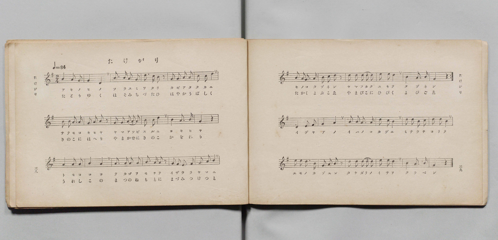
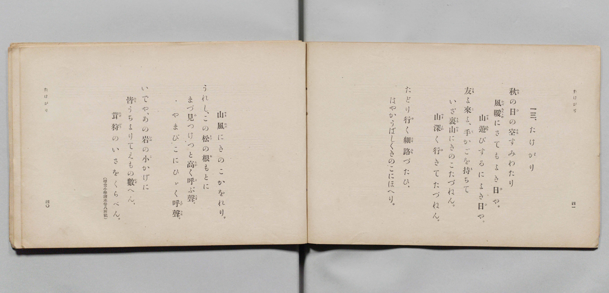

# たけがり

> Re:Shōka 使用 AI 協助辨識與重建樂譜，可能會有錯誤。歡迎回報。

- **鋼琴伴奏版**：<br><audio controls src="takegari.mp3"></audio>

- 詞：文部省（尋常小學讀本卷八所載）
- 曲：文部省
- 文部省《尋常小學唱歌 第四學年用》（明治四十五年五月，4080）

## 說明

原書資訊與歌詞全文（對應 P022.jpg–P023.jpg，原書 pp. 38–41，第 13 首）：
調性與拍號：ト長調（G 大調）2/4 拍，速度 ♩=84
曲式結構：第 1–24 小節反覆演唱前兩段歌詞，第 25–36 小節為結尾段。


## 歌詞

```text
秋（あき）の日（ひ）の空（そら）すみわたり
風暖（かぜあたたか）にさてもよき日（ひ）や。
山遊（やまあそ）びするによき日（ひ）や。
友（とも）よ來（こ）よ、手（て）かごを持（も）ちて
いざ裏山（うらやま）にきのこたづねん。
山深（やまふか）く行（ゆ）きてたづねん。

たどり行（ゆ）く細路（ほそみち）づたひ、
はやかうばしくきのこにほへり。
山風（やまかぜ）にきのこかをれり。
うれし、この松（まつ）の根（ね）もとに
まづ見（み）つけつと高（たか）く呼（よ）ぶ聲（こゑ）。
やまびこにひゞく呼聲（よびごゑ）。

いでや、あの岩（いは）の小（こ）かげに
皆（みな）うちよりてえもの數（かぞ）へん。
茸狩（たけがり）のいさをくらべん。
（尋常小學讀本卷八所載）
```

## ABC

<div class="abc-score" data-abc-src="takegari.abc" aria-label="五線譜載入中"></div>

[下載 ABC 原始檔](takegari.abc)

## TMD 檔案連結

- [主旋律 TMD 檔案](takegari.tmd) [[在 TMD Studio 編輯](https://tmdlang.github.io/Tmd-TS/#tmd=s7IKdvYPcrWy4qpTUCpJTLdSSM7PyUlNLsnMz7PKyszLyo8vzshPT8wuBdHZiUpwdWX5OaW5qVbpRYkpqfEm8SYGFgYIyeL80qLkVKvi5Iz8_Jz4ktSKkqT8_Gx0-fiCxPRUqwADIyOETEFRfllqXmIeUHdBUWZeSWoKWDtCQWpZZkoqSLostSgzLTM1BclJqUXFIHdDTS8pSswrTi7KLAB5BqEqv6gE6KOixIKMSquMzOKS_KLM5MSc-OzEPCTflWSkAj2Xl1hSWpSKLlqcmlicn1eMLpySmJlTGZ-TmYakAWh2emaeVW5-XlIpMPyUuLS0FB43zn_cOPFxY8_jpi4FLS0uRVsFCxMue1sFdy4bI30TO5DmFyvnvd8z69m09pfNK57PaXy_p-Pphu6nO3Y83dD_dO2OF-sans1Z87R3-9PW1c86G17s6Xy_pxNs6bPZm5D1QcRgvMcNXcimPJ2y8dnaHoXna9Y8nT0bxN-55fmUFY8buoG2PZvR92zTbpB4b-OTXVOAUkDy2ZyO93t6QBENto5LX0vBllqAS0FB4Wnf_Gezd7zY3P5iRdeLjnag44DB8LR1BdAD4ADofdbeqQBKLXpZBemPGiYDmcYgJtBREK0KBQV6CsYWQCkTQ6Ag0GcKhsYKL5dNA7oXGCwgO16s2v-sYTnI9O7eFzPnA0UfN3e8nLodKA60w13h6ZLlYGYnMCYUgGqAxrxsmP901zKFRzNX2gLjCWgGMJCf7ul_vnXCs-XAsJoFtgZop5GJAjBgn69veNrf-2JZ27M9U4Ah_LSz92nrymfrtkJ8A3WVkSlQvbEZVP3zpl1Aw55u2AdU9rihiQtkx3OQ0R2PG5seNwLd0Pm4cd2z6UvBIsAIBnGfr9wF5s593ASK_ceNMx837n_c1A9KXU1dICNeLlrxbBbQ60BF3Y8b54DNAqY8IAIaDdSw-nHj1MeNyx43NT1uAqrpRbGgqQXkElCkbNz4srELJAEUatwHNmUuWP9mkJ1NQKNX49XfD_HICqA9YImOJ_vawCKTIdzHDY3POiFqloHNBZo45XHTpGc9oGQP1dW4ECgLMu5xI9AV014s7ge6C6ynDeh_iNNgnuoFhg7QdLBPlz5uXPu4aTLCL8-2g7VB_bIVFhb9Lxb2gMWBTgNygUYsQ9cPsR0othIYvqjK-59v2fBi-3qwe3aDogQYE40LwVJAA4BaNgE9CdG_Hmw10Ittjxs3PG6cDtSM5GKg64H6dwAtQAr9RSuQXAyKSQyPdgOD63ETqDyBagMHSw_I-IZGsIp1z-YCwwfoPKARS6DpacFOsMhacDQAY3UF0FCIZqCipS-WQeIElBeAesAlFpBc8XL1DLA4PBn1P524B-xAYOEA5G57AUoAoOh93DQRJAJ1EdT9wEQD8eemx03zIJqhGkBpCCgLjHqYNnh8LwcnJ6BPgK5c93TTSrD5QHFgiIN8AsxFiAQFCqFJUJ88nwVJacDYWAWWAwb6QpBFwIACRTAodYFCYuoOWC4BZlCgMmAEwJLMi54dz7shFiJKbYi1YCdMBQU9MA6BibBxJ0IbMQU2SB3lBScUKGjpc3GFJGanpicWZVoFZCbm5TvUGNRUgyxRsDE007IDs7AV2aAa4MmOBmCSVtCAlWWwokkHXt5qYtEItBNkaI2CsYIuGBoBsSEQ14BZIGgWD2XAFJmCaZA0TMQIrMUALAJWDuKCFICkISaBWKYwg8B2-hjWANPUIqjY46a1ILK5D6zjcfMkmDhYBGL946a9ULGVQPZOMGs-VP16qCn7gexVQBbIFSAdq8Gie8AkyC6QCogMiIbKN3ejuswIKN8IMhlsZuNKsMouqL42uHg_wmWNu6Fic4EYbHLjQqjMUqjMfCDehHBZI8jFwFwBlgPZD0zbUJkNYN50VDvAeQl37O_qgce-OTD2DY1Ii36UWAPFFiTWYCKQqAXxQFDDEChorKmqoQsEmkAJUMSCMCySUZMTxDiYZpBR6IlgKzgSQN5_3AxJEI-bV4ADG5IoQInhcfMSROCB2WCnPG6eB45ZYNoAueRx82RwsEISByJyQTIrYBEHNhViLrJZ8HSOlAh6wZGwDkyCTAbRq-ERDixnwOaBkgYswYEiFOKyxn3gmAUW92CXAfWBdKCbCJKBJT9gSQSle8BmgcxFdRmBIqATUQQYg1KBxUAXAnAGzChjuJFICaC5AxYA4OiHRBUoADbDxWGRB1INyYGgvPu4aQtYFpSvQDKwxNMIVQWLFFAUP27aBiaXgVWA8jQi8sGpCGspAM_twCiB5UqQOCQxwKIS6jJgjEPElsCjGJTUQC5ogsqsgCYEWCkA0gEpI2DlBshFIJmJSGbBfY8_AQBb-4gEYIncoCUpAUBiEkRDRGDZGxK3sFJcA5QETJFKATOgIAiDFIBohFKYsfhLAViu7INHPKiQBkVSK1gcnHOaQTLYS4HmqaA0Ac5rTeDCtRkc1dAyBFq4got9iD0gUyHmgsyCJTVspQCkKoBkZkiBDGyCgCMJnKTAiQHY6EG4DL0U2AxShFwKgBIsSBhWxIP0wDMBWBxETwGLQxICsstqEQ0F5_yURDIaC7umwBMKpCdjQFpCMYU5BiODw2IbM8sbQpMTrOCAqMGsO5DTEXoagcX44-Z2MAnNLIhmBEpzAZa5--HioJSFaBaAYwGR7aHNicfNoHIXVlA0QmVAWRDStIAVQISzY-taeCgbg9pk8P4isbUyUkggilpY6QzJjrDQ1gBmRgUztEoZFqiQ7EhapQzxMKQ8BgUeJNBAMuAyq3kGmETKjvCspfG4aSOQuwYUXpBKGaIfUgpDKntoiQ3OqJBIApXIIHomjuwITPS6dgqwdB_tYxirgMI3QuGD8gVMjTIXAA)]
- [鋼琴伴奏 TMD 檔案](takegari_piano.tmd) [[在 TMD Studio 編輯](https://tmdlang.github.io/Tmd-TS/#tmd=s7IKdvYPcrWy4qpTUCpJTLdSSM7PyUlNLsnMz7PKyszLyo8vzshPT8wuBdHZiUpwdWX5OaW5qVbpRYkpqfEm8SYGFgYIyeL80qLkVKvi5Iz8_Jz4ktSKkqT8_Gx0-fiCxPRUqwADIyOETEFRfllqXmIeUHdqSmZJflFmYk58YlFRYl56am5qXglCZWpZZkoqSF1icnJ-bkFiXiaqfFlqUTHIFwWZiXn58TgU5ReVAL1XlFiQUWmVkVkMsi8ZaGF2Yh6SV0sygFZb5SWWlBaloosWpyYW5-cVowunJGbmVMbnZKYhaQCanZ6ZZ5Wbn5dUCgxMJS4tLYXHjfMfN0583NjzuKnr_Z6Ol917nk_Y8mTPlqdL-593drzf06mgpcWlaKtgYcJlb6vgzmVjpG9iBzLxxcp57_fMejat_WXziudzGoF6n27ofrpjx9MN_U_X7nixruHZnDVPe7c_bV39rLPhxZ5OoFFglzybvQlZH0QMxnvc0IVsytMpG5-t7VF4vmbN09mzQfydW55PWfG4oRto27MZfc827QaJ9zY-2TUFKAUkn80BOrkHlBTA1nGFJGanpicWZVoFgOIgyMOhxqCmmksBCGwMzbTswCx9LQVbdACy8smOhhcLexQ0gEwFw0cNk80UgI56vr5BRwGUYPSyCtI1sWjU0gcbWqNQnZtWq2CsoAuGRkBsCMQ1YBYImsVDGTVQRaZgGiQNEzECazEAi4CVg7ggBSBpiEkglinMILDFPoY1Co-bFkHFHjetBZHNfWAdj5snwcTBIhDrHzfthYqtBLJ3glnzoerXQ03ZD2SvArJArgDpWA0W3QMmQXaBVEBkQDRUvrkb1WVGQPlGkMlgMxtXglV2QfW1wcX7ES5r3A0VmwvEYJMbF0JllkJl5gPxJoTLGkEuftzUApYD2f-4EWQySGYDmDcd1Q4u_ElgVw88CZgDk4ChEWlpACXWQLEFiTWYCCRqQTwQ1DAEChprqmroAoEmUAIUsSAMi2RYukA2DqYZZBR6ItgKjgSQ9x83QxLE4-YV4MCGJApQYnjcvAQReGA22CmPm-eBYxaYNkAuedw8GRyskMSBiFyQzApYxIFNhZiLbBY8nSMlgl5wJKwDkyCTQfRqeIQ_btwBNg-UNGAJDhShEJc17gPH7OPGOWCXAfWBdKCbCJKBJb_HTZBk_7ipB2wWyFxUlxEoBzoR5YAxKBVYkJYKqF8IwBkwo4zhRiIlgOYOWACAox8SVaAA2AwXh0UeSDUkB4Ly7uOmLWBZUL4CycASTyNUFSxSQFH8uGkbmFwGVgHK04jIB6cirKUAPLcDowSWK0HikMQAi0qoy4AxDhFbAo9iUFIDuaAJKrMCmhBgpQBIB6SMgJUbIBeBZCYimQX3Pf4EAKxjEAnAEpgAjEzISQCQmATREBFY9obELawU1wAlAVOkUsAMKAjCIAUgGqEUZiz-UgCWK_vgEQ8qpEGR1AoWB-ecZpAM9lKgeSooTYDzWhO4cG0GRzW0DIEWruBiH2IPyFSIuSCzYEkNWykAqQogmRlSID9u6gBHEjhJgRPD4yZQhOEoBTaDFCGXAqAECxKGFfEgPfBMABYH0VPA4pCEgOyyWvT2gg9ye8EC2lwAhna8gmm8tiGQiFcwitc2jQfFCZxtBmQZx2sDsyh2lTAxIG0AztMw5diNQxKFVyqEdYBMRrIITOMTwe1A2voZWSM-P-P1C3bPmoBMJ9WzSEnAOT8lkaxm464p8NLCyBRYWhgbkNFwBDoOkiwxinpYvscs_EF-BMnBqhCIGsxWBHKJgl5awPL-4-Z2MAktNhENSpSGI6yY74eLg8oYRAMRnB8RFQC0Yfm4GVQDw6qMRqgMqDCGNDJhVRHhgrl1LTyojUFNdGMS2-jIIYGodGH1NKRghoW2BrBYVjBDa57BAhVSMJPWPIN4GFIzgwIPEmggGXDt1TwDTCIVzPBCVuNx00Ygdw0ovCDNM4h-SH0MafZB625wkQ2JJFDdDKJn4iiYsaZ9HEUg9qyPEEVkOqy5mlBWxJWFobZjZm0Um_EXfjDNxJYHunYKsGCJ9jGMVUDhG6HwQcEGU6PMBQA)]

## 分析

```text
================================================================================
📊 TMD Song Profile: [ たけがり ]
================================================================================
⏱  Duration:       1:25 (85.7s), 60 measures total
🎼 Key & Tempo:    首調基準 G, != 84.0 BPM, <2/4>
   - 分析範圍：      由實際發聲的音符與和弦推測調性；播放脈絡另行呈現
🎤 人聲音域:    D4 (MIDI 62) – E5 (MIDI 76) [跨度: 14 個半音 / 1.2 個八度, 難度: moderate]
   - 最低音:  D4 in [Takegari[L2] #1 @ m.49, 1:08]
   - 最高音: E5 in [Takegari[L1] #1 @ m.22, 0:30]
   - 適合: soprano, mezzo-soprano, contralto, tenor, baritone, bass
🏛  結構:      Takegari[L1] (34.3s) -> Takegari[L2] (34.3s) -> TakegariCoda[L1] (17.1s)
⚡ 編曲密度:        Peak 1 軌道同時演奏
🗝  調性診斷：       D 調性不明確（純淨自然大調，未偵測到可信轉調）
   - 風格氣質:    純淨自然大調（陽光明朗、易唱易記，無明顯調外色彩）
   - 轉調歷程:    全曲維持單一推測調性（未偵測到可信轉調）
   - 核心骨幹音:  B, A, D, G, E
   - 調性數值:    D 調性不明確 [相關度: 0.69, 穩定度: Ambiguous, 自然音純度: 100.0%]
   - 候選調性 (K-S): D 大調 (0.69), G 大調 (0.68), B 小調 (0.66)
   - 五度圈歷程:   +1 -> +1 -> +2
   - 各段落調性細節:
     • [Takegari[L1] #1]: G 調性不明確 (r: 0.70, 自然音純度: 100.0%)
     • [Takegari[L2] #1]: G 調性不明確 (r: 0.70, 自然音純度: 100.0%)
     • [TakegariCoda[L1] #1]: D 調性不明確 (r: 0.73, 自然音純度: 100.0%)

  [ 五度圈游移軌跡 ]
               C  
         F           [G ]*
      Bb              [D ]*
      Eb               A  
         Ab           E  
            Db       B  
               F# 
     (* = active key center)

  [ 十二半音累積音高分佈 ]
     C  :                            0.0%
     C# :                            0.0%
     D  : ████████████████          17.8%
     D# :                            0.0%
     E  : ███████████               13.0%
     F  :                            0.0%
     F# :                            0.0%
     G  : ███████████████           17.6%
     G# :                            0.0%
     A  : █████████████████████     24.4%
     A# :                            0.0%
     B  : ████████████████████████  27.3%
--------------------------------------------------------------------------------
Assignment 軌道音域：
  - Piano         : D4 – E5 (14 個半音 / 1.2 個八度, 190 個音符)
================================================================================
```


## 原書掃描頁






