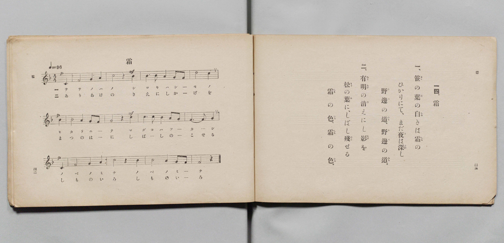

# 霜

> Re:Shōka 使用 AI 協助辨識與重建樂譜，可能會有錯誤。歡迎回報。

- **鋼琴伴奏版**：<br><audio controls src="shimo.mp3"></audio>

- 詞：文部省
- 曲：文部省
- 文部省《尋常小學唱歌 第四學年用》（明治四十五年五月，4080）

## 說明

原書資訊與歌詞全文（對應 P024.jpg，原書 pp. 42–43，第 14 首）：
調性與拍號：ヘ長調（F 大調）4/4 拍，速度 ♩=96


## 歌詞

```text
一、
笹（さゝ）の葉（は）の白（しろ）きは霜（しも）の
ひかりにて、まだ夜（よ）は深（ふか）し
野邊（のべ）の道（みち）、野邊（のべ）の道（みち）。

二、
有明（ありあけ）の消（き）えにし影（かげ）を
松（まつ）の葉（は）に、しばし殘（のこ）せる
霜（しも）の色（いろ）、霜（しも）の色（いろ）。
```

## ABC

<div class="abc-score" data-abc-src="shimo.abc" aria-label="五線譜載入中"></div>

[下載 ABC 原始檔](shimo.abc)

## TMD 檔案連結

- [主旋律 TMD 檔案](shimo.tmd) [[在 TMD Studio 編輯](https://tmdlang.github.io/Tmd-TS/#tmd=s7IKdvYPcrWy4qpTUCpJTLdSSM7PyUlNLsnMz7PKyszLyo8vzshPT8wuBdHZiUpwdWX5OaW5qVbpRYkpqfEm8SYGFgYIyeL80qLkVKvi5Iz8_Jz4ktSKkqT8_Gx0-fiCxPRUqwADIxOETEFRfllqXmIeUHdBUWZeSWoKWDtCQWpZZkoqSLostSgzLTM1BclJqUXFIHdDTS8pSswrTi7KLAB5BqEqv6gE6KOixIKMSquMzOKS_KLM5MSc-OzEPCTflWSkAj2Xl1hSWpSKLlqcmlicn1eMbGJmemaeVW5-XlIpMJSUuLS0FF7OmaOgpcWlaKtgacZlb6vgxmVjom9iB9LzYuW893tmPZvW_rJ5xfM5jWBzns3ehCkG4z1u6Hq6ofvpjh1PN_Q_Xbvj6ZSNz9b2KDxfs-bp7Nkg_s4tz6eseNzQ_X5Px7MZfc827QaJ9zY-2TUFKAUkn83peL-nBxRD7_d0KnFx6Wsp2FILcCkoKDztm_9s9o4Xm9tfrOh60dEOdBzQi09bVwA9AHTS0w29z9o7FUDRrJdVkA50CUS9QkGBnoKJ0aOGySbGQEGgdxQMTRReLpsGdCQwLEAGv1i1_1nDcpCR3b0vZs4Hij5unvFy6nagONBgN4WnS5aDmZ3AoFUAqgEa87Jh_tNdyxQezVxpCwx4kCFPdjQ8bmgEsZ6v2QnU9rhx6uOmuUBNjxvXvZgItAoosh7CfT5zL5g7_XET0CygSC9QChiTMMEmiDKQWY8bNz1u7H7c1PW4cfXjxmVAGx437nvcuODpErDqJmCIA5Wuf7Z9I1jzVqBisMh0kOaX7X0vm7rAEuseNwIdBTL1ZeNksMj-x40LQSINjcQpa4L4clcP1JfP5nQCUwFYTRPYfU2PGydC9D7bBnQWUBziOSAD6PTpT_dCnNj9uHESSLxpEtiUufvAokA_LcEWVqvBPp7-uHEDkHy2bgbMlUDHAWVnP27qBnsUI-xedAITOlCkBRrEQF8SVtMEMovytAoFClr6XFzBGZm5-VYBmYl5-Q41BjXVIBsUbCy07MAMbDkElOGAaenFwh4FDRMFYFZ8vr5BB56sNbFoANoDMqxGobqgVsE0XkFXwRCKjYC4RsEYSIKgARBX56bVggVqwJIglimYNgKKmEEVgkRAsAZsro9hjcLjpq1APpRs7gOT_WBTIDwQBFn8uGk7VHQtmAcmwSoRMoug6hE6ofYYAWUbm8Bqu0AkhN04EaKvcR2yPY29UNEOMG81mJwOJruhMpNg9jTBWDXgJIw71Hf1kBvqoJCDhCMo0A2hoYsl0CFBa4qk0AzkH1B0wXQghXozyOWPm8C-a14FJqG-a25DDo3meVDRBmjIroCFevNUiAzYDEhogOIBPdT3gUNuCZgEhTMw-0FDEaYPEuqgEAaJboCYBeQj4gUkPhkqPhtoD8ilxIT6jk6K0zosKcPCFxLsIDYiUUNC3BgoAtIBgyB1yAEOSdozwSSEPR8atI0oAQ6SA4mCVCISM6ZqmA7kwAYn0yZI4oYEdgtEVxMoUWMENlglJFixq0bYUcvFpWunAC5zFIAMZS4A)]
- [鋼琴伴奏 TMD 檔案](shimo_piano.tmd) [[在 TMD Studio 編輯](https://tmdlang.github.io/Tmd-TS/#tmd=s7IKdvYPcrWy4qpTUCpJTLdSSM7PyUlNLsnMz7PKyszLyo8vzshPT8wuBdHZiUpwdWX5OaW5qVbpRYkpqfEm8SYGFgYIyeL80qLkVKvi5Iz8_Jz4ktSKkqT8_Gx0-fiCxPRUqwADIxOETEFRfllqXmIeUHdqSmZJflFmYk58YlFRYl56am5qXglCZWpZZkoqSF1icnJ-bkFiXiaqfFlqUTHIFwWZiXn58TgU5ReVAL1XlFiQUWmVkVkMsi8ZaGF2Yh6SV0sygFZb5SWWlBaloosWpyYW5-cVI5uYmZ6ZZ5Wbn5dUCgwyJS4tLYWXc-a839PxsnvP8wlbnuzZ8nRp__POjvd7OhW0tLgUbRUszbjsbRXcuGxM9E3sQAa9WDnv_Z5Zz6a1v2xe8XxOI9jwZ7M3YYrBeI8bup5u6H66Y8fTDf1P1-54OmXjs7U9Cs_XrHk6ezaIv3PL8ykrHjd0A13xbEbfs027QeK9jU92TQFKAclnc4DO6QHFIdBVSlxcwRmZuflWAaCQC_JwqDGoqeZSAAIbCy07MENfS8EWHYCse7Kj4cXCHgUNEwWgQ56vb9BRAMWuXlZBuiYWDVr6YMNqFKoLahVM4xV0FQyh2AiIaxSMgSQIGgBxdW5aLVigBiwJYpmCaSOgiBlUIUgEBGvA5voY1ig8btoK5EPJ5j4w2Q82BcIDQZDFj5u2Q0XXgnlgEqwSIbMIqh6hE2qPEVC2sQmstgtEQtiNEyH6Gtch29PYCxXtAPNWg8npYLIbKjMJZk8TjFXDhT_Ud_WQG-qgkIOEIyjQDaGhiyXQIUFriqTQDOQfUHTBdCCFejPI5Y-bwL5rXgUmob5rbkMOjeZ5UNEGaMiugIV681SIDNgMSGiA4gE91PeBQ24JmASF8-PG9dBQhOmDhDoohEGiGyBmAfmIeAGJT4aKzwbaA3IpMaG-o5PitA5LyrDwhQQ7iI1I1JAQNwaKgHTAIEgdcoBDkvZMMAlhz4cGbSNKgIPkQKIglYjEjKkapgM5sMHJtAmSuCGB3QLR1QRK1BiBDVYJCVbsqhF21KIUOT7IRY4JtMiBhJxhPDDwtA3hNDBQoCwDSGoFcoGBGR-vYBSvDQxmhDqjeGCKRdaJZCqGHJIJyOZi2g7TiVCPbC5MHZIsknvBRqJYjaYESBtAAkfXTgEcPtE-hrEKCI4RmKPMBQA)]

## 分析

```text
================================================================================
📊 TMD Song Profile: [ 霜 ]
================================================================================
⏱  Duration:       0:30 (30.0s), 12 measures total
🎼 Key & Tempo:    首調基準 F, != 96.0 BPM, <4/4>
   - 分析範圍：      由實際發聲的音符與和弦推測調性；播放脈絡另行呈現
🎤 人聲音域:    C4 (MIDI 60) – D5 (MIDI 74) [跨度: 14 個半音 / 1.2 個八度, 難度: moderate]
   - 最低音:  C4 in [Shimo #1 @ m.1, 0:00]
   - 最高音: D5 in [Shimo #1 @ m.4, 0:07]
   - 適合: soprano, mezzo-soprano, contralto, tenor, baritone, bass
🏛  結構:      Shimo (30.0s)
⚡ 編曲密度:        Peak 1 軌道同時演奏
🗝  調性診斷：       C 大調（純淨自然大調，未偵測到可信轉調）
   - 風格氣質:    純淨自然大調（陽光明朗、易唱易記，無明顯調外色彩）
   - 轉調歷程:    全曲維持單一推測調性（未偵測到可信轉調）
   - 核心骨幹音:  C, A, G, F, D
   - 調性數值:    C 大調 [相關度: 0.79, 穩定度: Moderate, 自然音純度: 100.0%]
   - 候選調性 (K-S): C 大調 (0.79), F 大調 (0.74), A 小調 (0.68)
   - 五度圈歷程:   +0
   - 各段落調性細節:
     • [Shimo #1]: C 大調 (r: 0.79, 自然音純度: 100.0%)

  [ 五度圈游移軌跡 ]
              [C ]*
         F            G  
      Bb               D  
      Eb               A  
         Ab           E  
            Db       B  
               F# 
     (* = active key center)

  [ 十二半音累積音高分佈 ]
     C  : ████████████████████████  25.0%
     C# :                            0.0%
     D  : ██████████████            14.8%
     D# :                            0.0%
     E  :                            0.0%
     F  : ████████████████          17.0%
     F# :                            0.0%
     G  : ████████████████████      20.5%
     G# :                            0.0%
     A  : ██████████████████████    22.7%
     A# :                            0.0%
     B  :                            0.0%
--------------------------------------------------------------------------------
Assignment 軌道音域：
  - Piano         : C4 – D5 (14 個半音 / 1.2 個八度, 39 個音符)
================================================================================
```


## 原書掃描頁




