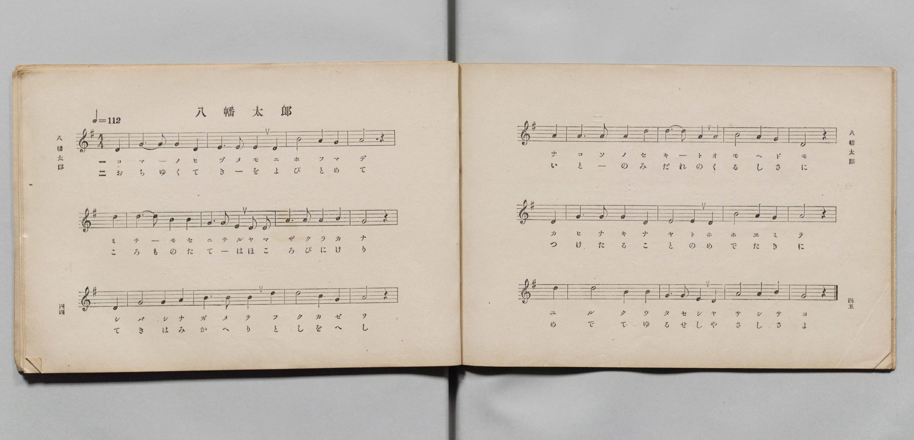
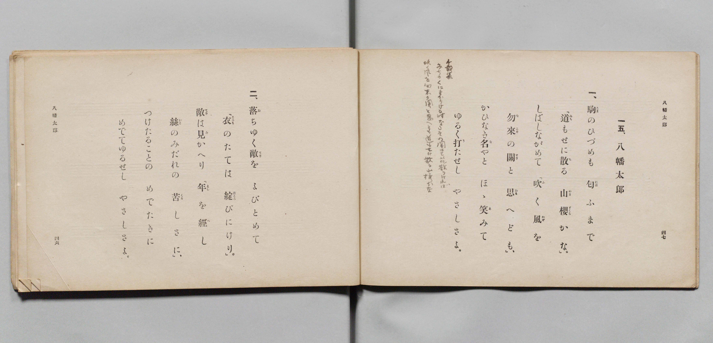

# 八幡太郎

> Re:Shōka 使用 AI 協助辨識與重建樂譜，可能會有錯誤。歡迎回報。

- **鋼琴伴奏版**：<br><audio controls src="hachimantaro.mp3"></audio>

- 詞：文部省
- 曲：文部省
- 文部省《尋常小學唱歌 第四學年用》（明治四十五年五月，4080）

## 說明

原書資訊與歌詞全文（對應 P025.jpg–P026.jpg，原書 pp. 44–47，第 15 首）：
調性與拍號：ト長調（G 大調）4/4 拍，速度 ♩=112


## 歌詞

```text
一、
駒（こま）のひづめも　匂（にほ）ふまで
「道（みち）もせに散（ち）る　山櫻（やまざくら）かな。」
しばしながめて　「吹（ふ）く風（かぜ）を
勿來（なこそ）の關（せき）と　思（おも）へども。」
かひなき名（な）やと　ほゝ笑（え）みて
ゆるく打（う）たせし　やさしさよ。

二、
落（お）ちゆく敵（てき）を　よびとめて
「衣（ころも）のたては　綻（ほころ）びにけり。」
敵（てき）は見（み）かへり　「年（とし）を經（へ）し
絲（いと）のみだれの　苦（くる）しさに。」
つけたることの　めでたきに
めでてゆるせし　やさしさよ。
```

## ABC

<div class="abc-score" data-abc-src="hachimantaro.abc" aria-label="五線譜載入中"></div>

[下載 ABC 原始檔](hachimantaro.abc)

## TMD 檔案連結

- [主旋律 TMD 檔案](hachimantaro.tmd) [[在 TMD Studio 編輯](https://tmdlang.github.io/Tmd-TS/#tmd=s7IKdvYPcrWy4qpTUCpJTLdSSM7PyUlNLsnMz7PKyszLyo8vzshPT8wuBdHZiUpwdWX5OaW5qVbpRYkpqfEm8SYGFgYIyeL80qLkVKvi5Iz8_Jz4ktSKkqT8_Gx0-fiCxPRUqwADI1OETEFRfllqXmIeUHdBUWZeSWoKWDtCQWpZZkoqSLostSgzLTM1BclJqUXFIHdDTS8pSswrTi7KLAB5BqEqv6gE6KOixIKMSquMzOKS_KLM5MSc-OzEPCTflWSkAj0Hka5E1puZnplnlZufl1QKDA8lLi0thaetq5_uXPh0yaqXzX0KWlpcirYKhoZGXPa2Cu5cNib6JnYg3S9Wznu_Z9azae0vm1c8n9MINvHZ7E2YYjDe44aupxu6n-7Y8XRD_9O1O55O2fhsbY_C8zVrns6eDeLv3PJ8yorHDd3v93Q8m9H3bNNukHhv45NdU4BSQPLZnI73e3pAsfJ-T6cSF5e-loIttQCXgoLC0775z2bveLG5_cWKrhcd7UDHAb34tHUF0ANAJz3d0PusvVMBFLV6WQXpjxomA5lmICbQURCtCgUFegomJkApE3OgINBnCoamCi-XTQO6FxgsIDterNr_rGE5yPTu3hcz5wNFHzd3vJy6HSgOtMNd4emS5WBmJzCUFYBqgMa8bJj_dNcyhUczV9qCIgFkypMdDY8bGkGsl8snAfU9bpz8uHEfUNfjxnWPGzc9blz6uKnxcVPT44aGpz1NYAWrHzfuBivYClT5uHE5SPPjhp6XjZPB0vsfNy4ESQP1NM4Gqn42dTFYHCLYDTJo48Znq4FGdDxuagEbMe1xY__jJqDHgIZ2P25c9bgBaF8v2NzG6Y8bN4DJVY8be0BuaVwGNAJo39MJO8HmbgVr63-5aAWYC9Q_B2zTJHBEdO9_sq8NLAHUD_TaXIjXXk4HKgIKAh0IDBigCDC1NDxrAMoCBbuAbgcL7njcuBLsd4RzgMYDAwVoVu_TCUCdIHPBtgE9AjICGDSPm-Y-XzMRLAVMZEBTgAGyDKy5qQ3k_8b-Z52QkAK6Cyg9H-yK6SDNIFOmgj079XFTB9BaSBTt6oFG0YsJeyEOBGtcCDIQaNpUYAgABZdBvdI0CWwUUGQzyE3gEING0YuFkKiY_LipF-ZHYCwDXQDUvB6o7fk2cLQAPQFWA1YANAUY4xMfN3UhwgHdzsb1L5aBMhvQs7BI3AHWAI6onVvAUiuAPoM48Pk2SADsACueDjLx-VZgdgcKgcIR5i5gwC143NQDYjc0vOheBlYATChAm0DawGG1GjlyloDcCfQOKJSBcQ20EKQTHATLwd7sBWqARAVEaBksTnDHAFA15WUCFCho6XNxeSQmZ2TmJuaVJBblWwVkJublO9QY1FSDLFKwsdCyAzOwFUig8g2YXV8s7FHQMFEAlnzP1zfowEsRTSwagNaBDKtRMI1X0FUwBGJdBSMwXaNgBhLSBVFgSTBRo2AMFgSpgqivAbNg0AAkAjbSx7AGGIibgfzHzfPAco-B5fvj5klgPY-bW6FiC4F4EZjVDZWZDTXrcfNUuG6QeDuSPWC3QOwxAso1doFUNgLNamoDs_qBeBlEX2MvzLwmkN3ASIOKg9wGFm9cARZvhIqD9KHagz_AdwFzDekBDgo7SFiihLchPLzBXIg6kBqQWlBIw0SwhnfzfHCIgXwCohcBfbUbGnqg0AXJPG5eDcRLkEO2aRs0fNYDxVaCWauhukDhiivMJ4NVgkIXWFIA-euAGGQ_IgyBuR6IQS6AqAbZBYkNUOgDcxqYNREqg2kXgYTeSU64g4MVORFDAhTEAomaQqICKg_igUSB-QMqAuKhJ_Lt4MCcAFUB4cMC73HTGrDsQjAJSpwgGVDChgU5UnA37YGJN2_CEuCgQEVKzsDAhQT2fjAPHMGNO8DmgWwGyYASNkTtdLA4NPOBVSHEiQhsYOuInMAGhSqkeDCGhjUoHCGhawoWQw1ZwgkcEqaQrPu4aS-4UIGEHTiZNa2Fhl8HkL0KGtqg4gUiOgNMdqKJY0vcLeDQQYTfOpSwXgC2qwea6PuhLgDFAFJoN4JiGaQHFLskFShTyC7BUQMbFJBgYRCEFDK4i29sKRucQcFFNojugoYvPB7AxQgsvNELbxDrcRMoBGEFE0QclAfQQxtcHIELAhA9HxqW8EIGMx7AhTVEZDlUD1phDw51YlJ261qyQhtoMnIpAQlZLBUorJwnnLTB2RtYOkM9AC4aQF4FizeBEh6I3o1UwICDrWkrmAQXQmA2SAYWYFiSNjjoIMEGCShoPQmpOaGJGNjegSZjkAwkM4BrY9SkDa5LUe2p5eLStVNAbsIoAPnKXAA)]
- [鋼琴伴奏 TMD 檔案](hachimantaro_piano.tmd) [[在 TMD Studio 編輯](https://tmdlang.github.io/Tmd-TS/#tmd=s7IKdvYPcrWy4qpTUCpJTLdSSM7PyUlNLsnMz7PKyszLyo8vzshPT8wuBdHZiUpwdWX5OaW5qVbpRYkpqfEm8SYGFgYIyeL80qLkVKvi5Iz8_Jz4ktSKkqT8_Gx0-fiCxPRUqwADI1OETEFRfllqXmIeUHdqSmZJflFmYk58YlFRYl56am5qXglCZWpZZkoqSF1icnJ-bkFiXiaqfFlqUTHIFwWZiXn58TgU5ReVAL1XlFiQUWmVkVkMsi8ZaGF2Yh6SV0sygFZDpSuR9WamZ-ZZ5ebnJZUCA0eJS0tL4Wnr6qc7Fz5dsuplc9_7PR0vu_c8n7DlyZ4tT5f2P-_seL-nU0FLi0vRVsHQ0IjL3lbBncvGRN_EDmTki5Xz3u-Z9Wxa-8vmFc_nNIKteTZ7E6YYjPe4oevphu6nO3Y83dD_dO2Op1M2Plvbo_B8zZqns2eD-Du3PJ-y4nFDN9AZz2b0Pdu0GyTe2_hk1xSgFJB8Ngfonh5QvAGdpcTF5ZGYnJGZm5hXkliUbxUACrQgD4cag5pqLgUgsLHQsgMz9LUUbNEByNYnOxpeLOxR0DBRALrn-foGHQVQxOplFaRrYtGgpQ82rEahOjetVsE0XkFXwRCIdRWMwHSNghlISBdEgSXBRI2CMVgQpAqivgbMgkEDkAjYXB_DGoXHTZuB_MfN88Byj5v7gHgSWM_j5lao2EIgXgRmdUNlZkPNetw8Fa4bJN6OZA_YLRB7jIByjV0glY1As5rawKx-IF4G0dfYCzOvCWT346YOqDjIbWDxxhVg8UaoOEgfqj34Q31XDzmhDgo7SFiihLchPLzBXIg6kBqQWlBIw0SwhnfzfHCIgXwCohcBfbUbGnqg0AXJPG5eDcRLkEO2aRs0fNYDxVaCWauhukDhiivMJ4NVgkL3cVMTkL8OiEH2I8LwcSPQxEaQCyCqQXZBYgMU-o8bQbY8bpwIlcG0i0Bq7yQn3MHBipyIIQEKYoFETSFRAZUH8UCiNWAWCIJ46Il8OzgwJ0BVQPiwwHvctAYsuxBMghInSAaUsGFBjhTcTXtg4s2bsAQ4KFCRkjMwcCGBvR_MA0dw4w6weSCbQTKghA1ROx0sDs18YFUIcSICG1hwkRPYoFCFFA_G0LAGhSMkdE3BYqghSziBQ8IUknUfN-0FFyqQsAMns6a10PDrALJXQUMbVLxARGeAyU40cWyJuwUcOojwW4cS1gvAdvVAE30_1AWgGEAK7UZQLIP0gGKXpAJlCjlhDS40UAMbFJBgYRCEFDK4i29sKRucQcFFNojugoYvPB7AxQgsvNELbxDrcRMoBGEFE0QclAfQQxtcHIELAhA9HxqW8EIGMx7AhTVEZDlUD1phDw51YlJ261qyQhtoMnIpAQlZLBUorJwnnLTB2RtYOkM9AC4aQF4FizeBEh6I3o1UwICDrWkrmAQXQmA2SAYWYFiSNjjoIMEGCShoPQmpOaGJ-HHjbGgyBslAMgO4NkZN2uC6FNWeWmzNGB_kZowJtBkDDA1QVadtCKdBQRavYByvDa4D4xWM4rWByRebOoQsiGUA9R_pJuKwBWEgsQ4yiQcqxeFEFANRXY7bQKJdSKqBBF0IUwDzElnxBDIOmBR07RSQU0O0j2GsAoaYEVhMmQsA)]

## 分析

```text
================================================================================
📊 TMD Song Profile: [ 八幡太郎 ]
================================================================================
⏱  Duration:       0:51 (51.4s), 24 measures total
🎼 Key & Tempo:    首調基準 G, != 112.0 BPM, <4/4>
   - 分析範圍：      由實際發聲的音符與和弦推測調性；播放脈絡另行呈現
🎤 人聲音域:    D4 (MIDI 62) – E5 (MIDI 76) [跨度: 14 個半音 / 1.2 個八度, 難度: moderate]
   - 最低音:  D4 in [Hachimantaro #1 @ m.1, 0:00]
   - 最高音: E5 in [Hachimantaro #1 @ m.11, 0:21]
   - 適合: soprano, mezzo-soprano, contralto, tenor, baritone, bass
🏛  結構:      Hachimantaro (51.4s)
⚡ 編曲密度:        Peak 1 軌道同時演奏
🗝  調性診斷：       G 大調（純淨自然大調，未偵測到可信轉調）
   - 風格氣質:    純淨自然大調（陽光明朗、易唱易記，無明顯調外色彩）
   - 轉調歷程:    全曲維持單一推測調性（未偵測到可信轉調）
   - 核心骨幹音:  G, A, B, D, E
   - 調性數值:    G 大調 [相關度: 0.82, 穩定度: Moderate, 自然音純度: 100.0%]
   - 候選調性 (K-S): G 大調 (0.82), D 大調 (0.71), E 小調 (0.62)
   - 五度圈歷程:   +1
   - 各段落調性細節:
     • [Hachimantaro #1]: G 大調 (r: 0.82, 自然音純度: 100.0%)

  [ 五度圈游移軌跡 ]
               C  
         F           [G ]*
      Bb               D  
      Eb               A  
         Ab           E  
            Db       B  
               F# 
     (* = active key center)

  [ 十二半音累積音高分佈 ]
     C  :                            0.0%
     C# :                            0.0%
     D  : █████████████████         18.3%
     D# :                            0.0%
     E  : ████████████              13.3%
     F  :                            0.0%
     F# :                            0.0%
     G  : ████████████████████████  26.7%
     G# :                            0.0%
     A  : █████████████████████     22.8%
     A# :                            0.0%
     B  : █████████████████         18.9%
--------------------------------------------------------------------------------
Assignment 軌道音域：
  - Piano         : D4 – E5 (14 個半音 / 1.2 個八度, 75 個音符)
================================================================================
```


## 原書掃描頁






