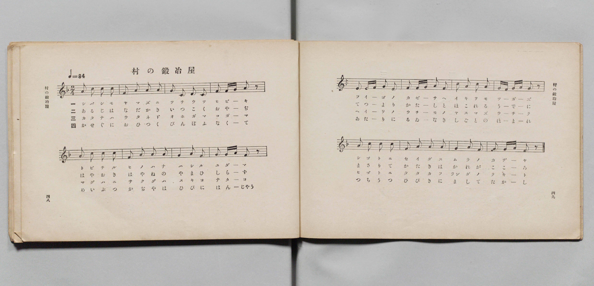
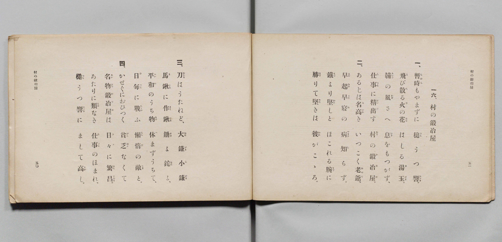

# 村の鍛冶屋

> Re:Shōka 使用 AI 協助辨識與重建樂譜，可能會有錯誤。歡迎回報。

- **鋼琴伴奏版**：<br><audio controls src="mura_no_kajiya.mp3"></audio>

- 詞：文部省
- 曲：文部省
- 文部省《尋常小學唱歌 第四學年用》（明治四十五年五月，4080）

## 說明

原書資訊與歌詞全文（對應 P027.jpg–P028.jpg，原書 pp. 48–51，第 16 首）：
調性與拍號：ヘ長調（F 大調）2/4 拍，速度 ♩=84


## 歌詞

```text
一、
暫時（しばし）もやまずに　槌（つち）うつ響（ひゞき）、
飛（と）び散（ち）る火（ひ）の花（はな）、はしる湯玉（ゆだま）。
鞴（ふいご）の風（かぜ）さへ　息（いき）をもつかず、
仕事（しごと）に精出（せいだ）す　村（むら）の鍛冶屋（かぢや）。

二、
あるじは名高（なだか）き　いつこく老爺（おやぢ）、
早起（はやおき）早寢（はやね）の　病（やまひ）知（し）らず、
鐵（てつ）より堅（かた）しと　ほこれる腕（うで）に、
勝（まさ）りて堅（かた）きは　彼（かれ）がこゝろ。

三、
刀（かたな）はうたねど、大鎌（おほがま）小鎌（こがま）、
馬鍬（まぐは）に作鍬（さくぐは）、鋤（すき）よ鉈（なた）よ、
平和（へいわ）のうち物（もの）　休（やす）まずうちて、
日毎（ひごと）に戰（たゝか）ふ　懶惰（らんだ）の敵（てき）と。

四、
かせぐにおひつく　貧乏（びんぼふ）なくて、
名物（めいぶつ）鍛冶屋（かぢや）は　日々（ひゞ）に繁昌（はんじゃう）。
あたりに類（るゐ）なき　仕事（しごと）のほまれ、
槌（つち）うつ響（ひゞき）に　まして高（たか）し。
```

## ABC

<div class="abc-score" data-abc-src="mura_no_kajiya.abc" aria-label="五線譜載入中"></div>

[下載 ABC 原始檔](mura_no_kajiya.abc)

## TMD 檔案連結

- [主旋律 TMD 檔案](mura_no_kajiya.tmd) [[在 TMD Studio 編輯](https://tmdlang.github.io/Tmd-TS/#tmd=s7IKdvYPcrWy4qpTUCpJTLdSSM7PyUlNLsnMz7PKyszLyo8vzshPT8wuBdHZiUpwdWX5OaW5qVbpRYkpqfEm8SYGFgYIyeL80qLkVKvi5Iz8_Jz4ktSKkqT8_Gx0-fiCxPRUqwADI3OETEFRfllqXmIeUHdBUWZeSWoKWDtCQWpZZkoqSLostSgzLTM1BclJqUXFIHdDTS8pSswrTi7KLAB5BqEqv6gE6KOixIKMSquMzOKS_KLM5MSc-OzEPCTflWSkAj1Xnl-E5GiIWEpiZk5lfE5mWiqykZnpmXlWufl5SaXAYFLi0tJSeDZ34uPGdS97Zz9t2_Z0Y7eClhaXoq2ChQmXva2CG5eNkb6JHUj_i5Xz3u-Z9Wxa-8vmFc_nNILNfDZ7E6YYjPe4oevphu6nO3Y83dD_dO2Op1M2Plvbo_B8zZqns2eD-Du3PJ-y4nFD9_s9Hc9m9D3btBsk3tv4ZNcUoBSQfDan4_2eHlB0vd_TqcTFpa-lYEstwKWgoPC0b_6z2TtebG5_saLrRUc70HFALz5tXQH0ANBJTzf0PmvvVADFuV5WQfqjhslApgWICXQURKtCQYGegokFUMrUECgI9JmCoZnCy2XTgO4FBgvIjher9j9rWA4yvbv3xcz5QNHHzTNeTt0OFAfa4abwdMlyMLMTGMoKQDVAY142zH-6a5nCo5krbYFxADLkyY6Gxw2NINazWaufzWwC6nzcOP1x4wYgCdT6uKnpcVPL48Z9jxtnPW5c_bih4dnyHrCaJY8bF4IUNLYB2S_ng6x83LjpcdO8x41Amzqhhr5cPBsssQKsdPOzqYvBXLDOpu7njash2sCy6150bQRz1z9uXAUxAsyeDlT5bOf6531Aj3c8bgLatwDoILCCJrAd87aAtW193Ah06RSIWS8XAa0ECnY_bpwDFpn6uHEHyPmN68HiQJVgZzZNAnkR5BugyllQVz_ZPfXJLlDaAQfFFJjzVz_ftO9p-y6w-GywEQvA4jNB5s6dCHZdw-MmoDPBLoAlepg7FgFDEupqsCW7eqDWPW4EBjJQwQygd59O6H25egZYyyqwR4Hagab1Aq0A2wh06OTHjf0vGhqfd0Bc0gWOoEWIMH82feWLrduhIQmS64L4FSj-dD1QHVx8LcShQKOfT28Fux4S06DoeD5_KcT_4EACKoOFzcsJW8ESy4BuAcsBtXU9XQDWD_IlMB0CVQODDZj9gE7eDXJvUw_Qfy9ap4LVAONvOSQ4oSY-7Z4LlgDaDFQBNBHo3mUYJvaCXN3Q8HTvHqh4EzAdAsV7wBbMfdwEDCJowO6AhcTTjga4IdA0BUpQQBcAuWsfN64EqgPmkpd9kCQNtBfoXKCBoMQFLFhg4sAAhwrCwmDZmpe9a2COngA0FOKhJ3vnwMSBya0fIdXQ-LIbGFpA8ZmwdNfxshNYBEGiGexDYEBCXb1z89NJEJt3gOK8qR8aTyCHL3zeuRIcVcBEuw5sdMOTPZCkB4y8mWCVkMwKUgyKJliiWPpsfR80kyIl6WcdG8CC80FhCE1sW0HpuX3bs2awFDDym4AhAEnq655NhUc_2B-gaIYEO7CEhadnYIADMwjQ96vBoQq0EZhu-4HGvti0_MlOoH-AJmwGG7sHaB3YHGAwAAMM5lxgNoB5FFgIAH22DZLccGYqcOIAevJxAyTdgEoiaKbd2fhsBiQ4gckeaOWMx03NwOBBFCCg_AcKAKBLV79cCNQGtBWYvibA3AXKfDiKBGCkAJPMPlAKh4YzkcUjuCwFRxXQuGWwLA9MlpAomA51GuW1ERQoaOlzcfmWFiX65XsnZmVWJloFZCbm5TvUGNRUgyxSsDE007IDs7DVhaCqFVhVvFjYo6BhogDMG8_XN-jAKzBNLBqA9oEMq1EwVtBVMEXCNQqGQBIkCsM1CkYguXggYQYiwCyIMkOgFEiJAUgEbKCPYY3C46btQP7j5gkgEspeBNbzuHkJmDcPLLMLzO6GyrSAeY1gmWVgNkgEJDMJzJsMllkLJMH2Q2wzAso3NoFlQOYAUw-YXA_R2bgKzFsAJiHyvVAZsG2NYNc0gk1u7IfKdIFNg8iDXI1kmzHIb6vB8vvBbgKrbYbqhLgaKgOy53FzJ1QG7I7m2WD5NfAQAMlsRhNDss0E5BqIq8E6G8Hh2QiyH-7Oxk1I_oD5AGImxFd7wORWlPAAqQOmarht-JPVrh5aJisQBPFAbIgIKEWB1KKlqeYOcBiBfQVJJc3QkICmjz54XEDiBSQD4oEgLBXCdEDSVwO2UAenKFD6gaUBSDjD0g2yDCgtAssYaEyCxMB2Ne6DxwxIx3SwDlBKAJb7qHaB0hM0L2xAcj00RzSBYu1xE8RGhDxIZifcX2A3NK-A-guSdiEpECSGlpqawOEGTfvbwCQo5SDSGSi9w3wHy0Mgf0D8BU5X8PQHcRcklUHLbLiNBAqqTnJSlDnIaCABKnPADPRCCMSuASc2WOKDJTOICpA29EQ1FewJcPZp2gIONlAyQmRzcPaBREQzqGgByUBUQwIenP3ghRs44KA6QYUberICJztIZm0CJ-cmaEKFBv98MAlOMI3QKG3cDeZBCr8eMAlNHuDgBjbW4JGCnrDARSHEtc3gyIL7DZL8IZkIHOUwGUjxDE5eyIU0uh5ERCMKKnAhDPEB2FfwhAIpmJsghRekAIJlJohPp8D9C89MUF-DMxLY10QkK2ADZ1AUVJCiBpqaIIUWLEODfQWNEXDhAw5pULiDqihwJmteiRJT4LTUDA5bcNygpyhIUQNJxZBQB8UTeooCV0bwDA2SgRQe4PTUCCJB4pCsDElpIB3o6QlczGL1F7jAgZIQF4NcBNKz8nEzqNSAeA1S3sKSGjj5QrMRyDj0BAWp0xaCSUhSh5VVkDoPUhpBvAYrk0DBASmrIEkLFhiQYIAECUgGYlctF5eunQJyq0sByFfmAgA)]
- [鋼琴伴奏 TMD 檔案](mura_no_kajiya_piano.tmd) [[在 TMD Studio 編輯](https://tmdlang.github.io/Tmd-TS/#tmd=s7IKdvYPcrWy4qpTUCpJTLdSSM7PyUlNLsnMz7PKyszLyo8vzshPT8wuBdHZiUpwdWX5OaW5qVbpRYkpqfEm8SYGFgYIyeL80qLkVKvi5Iz8_Jz4ktSKkqT8_Gx0-fiCxPRUqwADI3OETEFRfllqXmIeUHdqSmZJflFmYk58YlFRYl56am5qXglCZWpZZkoqSF1icnJ-bkFiXiaqfFlqUTHIFwWZiXn58TgU5ReVAL1XlFiQUWmVkVkMsi8ZaGF2Yh6SV0sygFZblecXIfkAIpaSmJlTGZ-TmZaKbGRmemaeVW5-XlIpMMyUuLS0FJ7Nnfi4cd3L3tlP27Y93dj9fk_Hy-49zydsebJny9Ol_c87O97v6VTQ0uJStFWwMOGyt1Vw47Ix0jexAxn6YuW893tmPZvW_rJ5xfM5jWCLns3ehCkG4z1u6Hq6ofvpjh1PN_Q_Xbvj6ZSNz9b2KDxfs-bp7Nkg_s4tz6eseNwAcsWzGX3PNu0Gifc2Ptk1BSgFJJ_NATqnBxShQFcpcXH5lhYl-uV7J2ZlViZaBYBCM8jDocagpppLAQhsDM207MAsfS0FW3QAsvbJjoYXC3sUNEwUgA56vr5BRwEU5XpZBemaWDRo6YMNq1Gozk2rVTBW0FUwRcI1CoZAEiQKwzUKRiC5eCBhBiLALIgyQ6AUSIkBSARsqo9hjcLjpu1A_uPmCSASyl4E1vO4eQmYNw8sswvM7obKtIB5jWCZZWA2SAQkMwnMmwyWWQskwfZDbDMCyjc2gWVA5jxunAEm10N0Nq4C8xaASYh8L1QGbFsj2DWNYJMb-6EyXWDTIPIgVyPZZgzy22qw_H6wm8Bqm6E6Ia6GyoDsedzcCZUBu6N5Nlh-DTwEQDKb0cSQbDMBuQbiarDORnB4NoLsh7uzcROSP2A-gJgJ8dUeMLkVJTxA6h43glwLsQ1_2trVQ07aIjZZgSCIB2JDREApCqQWLU01d4DDCOwrSCpphoYENH30weMCEi8gGRAPBGGpEKYDkr4asIU6OEWB0g8sDUDCGZZukGVAaRFY6EBjEiQGtqtxHzxmQDqmg3WAUsLjxlmodoHSEzQvbEByPTRHNIFi7XETxEaEPEhmJ9xfYDc0r4D6C5J2ISkQJIaWmprA4QZN-9vAJCjlINIZKL3DfAfLQyB_QPwFTlfw9AdxFySVzXjc1Py4sQ1uI4HSqpOcFGUOMhpIgMocMAO9EAKxa8CJDZb4YMkMogKkDT1RTQV7Apx9mraAgw2UjBDZHJx9IBHRDCpaQDIQ1ZCAB2c_eOEGDjioTlDhhp6swMkOklmbwMm5CZpQocE_H0yCE0wjNEobd4N5kMKvB0xCkwc4uB83LodHCnrCAheFENc2gyML7jdI8odkInCUw2QgxTM4eSEX0uh6EBGNKKjAhTDEB2BfwRMKpGBughRekAIIlpkgPp0C9y88M0F9Dc5IYF8TkayAdeygKKggRQ00NUEKLViGBvsKGiPgwgcc0qBwB1VR4EzWvBIlpsBpqRkctuC4QU9RkKIGkoohoQ6KJ_QUBa6M4BkaJAMpPMDpqRFEgsQhWRmS0kA60NMTuJjF6i9wgQMlIS4GuQikZ-XjZlCpAfEapLyFJTVw8oVmI5Bx6AkKUqctBJOQpA4rqyB1HqQ0gngNViaBggNSVkGSFiwwIMEACRKQDMSuWmwtLx_klpcFtOEFTBTxwHaPtiGcxiZiGh-vYBSvDWwfIVgo6gygHqTEOAQbxUCCdhNpDU2cCAxoXTsF5LCO9jGMBduDIW6EQ9wYh7gJXFyZCwA)]

## 分析

```text
================================================================================
📊 TMD Song Profile: [ 村の鍛冶屋 ]
================================================================================
⏱  Duration:       0:22 (22.9s), 16 measures total
🎼 Key & Tempo:    首調基準 F, != 84.0 BPM, <2/4>
   - 分析範圍：      由實際發聲的音符與和弦推測調性；播放脈絡另行呈現
🎤 人聲音域:    C4 (MIDI 60) – C5 (MIDI 72) [跨度: 12 個半音 / 1.0 個八度, 難度: easy]
   - 最低音:  C4 in [MuraNoKajiya #1 @ m.3, 0:03]
   - 最高音: C5 in [MuraNoKajiya #1 @ m.1, 0:00]
   - 適合: soprano, mezzo-soprano, contralto, tenor, baritone, bass
🏛  結構:      MuraNoKajiya (22.9s)
⚡ 編曲密度:        Peak 1 軌道同時演奏
🗝  調性診斷：       A 小調（純淨自然小調，未偵測到可信轉調）
   - 風格氣質:    純淨自然小調（陰鬱抒情、旋律集中，無明顯調外色彩）
   - 轉調歷程:    全曲維持單一推測調性（未偵測到可信轉調）
   - 核心骨幹音:  A, G, C, F, E
   - 調性數值:    A 小調 [相關度: 0.77, 穩定度: Moderate, 自然音純度: 100.0%]
   - 候選調性 (K-S): A 小調 (0.77), C 大調 (0.71), F 大調 (0.65)
   - 五度圈歷程:   +3
   - 各段落調性細節:
     • [MuraNoKajiya #1]: A 小調 (r: 0.77, 自然音純度: 100.0%)

  [ 五度圈游移軌跡 ]
               C  
         F            G  
      Bb               D  
      Eb              [A ]*
         Ab           E  
            Db       B  
               F# 
     (* = active key center)

  [ 十二半音累積音高分佈 ]
     C  : ████████████████          21.7%
     C# :                            0.0%
     D  : █                          1.7%
     D# :                            0.0%
     E  : ███                        4.2%
     F  : ████████████              16.7%
     F# :                            0.0%
     G  : █████████████████         23.3%
     G# :                            0.0%
     A  : ████████████████████████  32.5%
     A# :                            0.0%
     B  :                            0.0%
--------------------------------------------------------------------------------
Assignment 軌道音域：
  - Piano         : C4 – C5 (12 個半音 / 1.0 個八度, 65 個音符)
================================================================================
```


## 原書掃描頁






