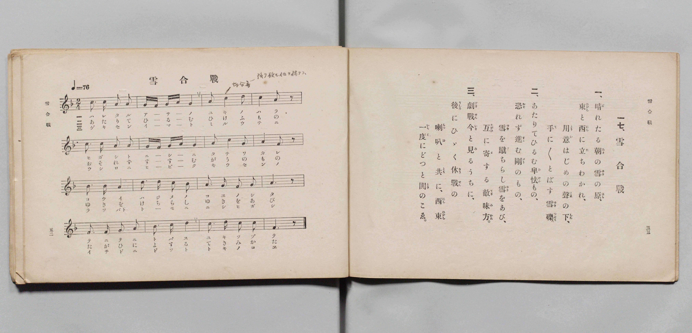

# 雪合戰

> Re:Shōka 使用 AI 協助辨識與重建樂譜，可能會有錯誤。歡迎回報。

- **鋼琴伴奏版**：<br><audio controls src="yukigassen.mp3"></audio>

- 詞：文部省
- 曲：文部省
- 文部省《尋常小學唱歌 第四學年用》（明治四十五年五月，4080）

## 說明

原書資訊與歌詞全文（對應 P029.jpg，原書 pp. 52–53，第 17 首）：
調性與拍號：ヘ長調（F 大調）2/4 拍，速度 ♩=76


## 歌詞

```text
一、
晴（は）れたる朝（あさ）の雪（ゆき）の原（はら）、
東（ひがし）と西（にし）に立（た）ちわかれ、
用意（ようい）はじめの聲（こゑ）の下（した）、
手（て）に〳〵とばす雪礫（ゆきつぶて）。

二、
あたりてひるむ卑怯（ひけふ）もの、
恐（おそ）れず進（すゝ）む剛（ごう）のもの、
雪（ゆき）を蹴（け）ちらし雪（ゆき）をあび、
互（たがひ）に寄（よ）する敵味方（てきみかた）。

三、
劇戰今（げきせんいま）と見（み）るうちに、
後（うしろ）にひゞく休戰（きうせん）の
喇叭（らっぱ）と共（とも）に、西東（にしひがし）
一度（いちど）にどつと鬨（とき）のこゑ。
```

## ABC

<div class="abc-score" data-abc-src="yukigassen.abc" aria-label="五線譜載入中"></div>

[下載 ABC 原始檔](yukigassen.abc)

## TMD 檔案連結

- [主旋律 TMD 檔案](yukigassen.tmd) [[在 TMD Studio 編輯](https://tmdlang.github.io/Tmd-TS/#tmd=s7IKdvYPcrWy4qpTUCpJTLdSSM7PyUlNLsnMz7PKyszLyo8vzshPT8wuBdHZiUpwdWX5OaW5qVbpRYkpqfEm8SYGFgYIyeL80qLkVKvi5Iz8_Jz4ktSKkqT8_Gx0-fiCxPRUqwADI0uETEFRfllqXmIeUHdBUWZeSWoKWDtCQWpZZkoqSLostSgzLTM1BclJqUXFIHdDTS8pSswrTi7KLAB5BqEqv6gE6KOixIKMSquMzOKS_KLM5MSc-OzEPCTflWSkAj1XkJNYiS5WnJpYnJ9XjGxeZnpmnlVufl5SKTCMlLi0tBRezl71dELHs44NClpaXIq2CuZmXPa2Cm5cNkb6JnYgnS9Wznu_Z9azae0vm1c8n9MINu3Z7E2YYjDe44aupxu6n-7Y8XRD_9O1O55O2fhsbY_C8zVrns6eDeLv3PJ8yorHDd3v93Q8m9H3bNNukHhv45NdU4BSQPLZnI73e3pAsfR-T6cSF5e-loIttQCXgoLC0775z2bveLG5_cWKrhcd7UDHAb34tHUF0ANAJz3d0PusvVMBFNV6WQXpQJdA1CsUFOgpmBo9aphsagwUBHpHwdBc4eWyaUBHAsMCZPCLVfufNSwHGdnd-2LmfKDo4-YZL6duB4oDDXZTeLpkOZjZCQxaBaAaoDEvG-Y_3bVM4dHMlbbAgAcZ8mRHw-OGRhDr2cwtQG2PG9cDdTxu6nncOP9xU_ezOXPBgk2PG6eCxBvXASMQJNLU9rgRaCJIBOhgiMbHTUCndcKMm7sRLLrpcSPQrOlgpSteLAU57XHjapjI6uerQREDtAzMXfi4qf9xYzfIeogpwKh71tIPthCoCGhnC1jd-seNMx43NQItf9EITBpAqcmPmyZCnPNkB8TE6VBDoc7phIgug1j7uGHz44atQBc9btzwuHEm0FPPl6yG--tx45LHjdugihuaIAG1C-YmcGgAA6cLqADkvyagexue9k581gAMOoiPJz5u3AoORqDKdTAXNE4ASwO1AcMUEsSzXjZAnD_zcRNEsOFp52ywyBSgdyEeQjEFPfibJr3YCYk3iPeBIQgkp2MqA7sa6GmwKU92TYKEOjhygE4AhcnT9cDABQU0mAt0UfezqVufTtz8bNpOSNCBQ2Y_KH6gIQsNmR2wQH7a1Q7M2U92d4HVA60Eqp_9uGkyMNoeN-6DJoFlkIgAJUxQ0IEidSE4RiBG7OsBSwNFpz9ugqQwYGoBhvK8x439T_ZMBFoAVgA0GqgGZDoklMCap7U_7V8L9gRQaPHjRmASBNn5tBWSFlcAgxIW_43AtAhLo6DkiJxSoRkDmFXA0kDHA124EuaWleDkseLlmhVQQ2EZAZIKQcEC1E954QEFClr6XFyRpdmZ6YnFxal5VgGZiXn5DjUGNdUgaxRsDM207MAsbAUXqBwE-uTFwh4FDRMFYAn5fH2DDry00cSiAWgbyLAaBVMFXTA2g9I1CsYKRkBsAuaBIEgEIQ9iQ3TBoAFIBGyaj2GNwuPmfiD_cfMaENm0H8xeDdbzuGkRWGwrWKwPbvrj5mVg8bVwcYgZIJmVSPbEI-wxAso1NoFUNs4H6-0Cs0HmgGQ2gcW6wWQDwh6IeONEMAl2RRPIDJDMOuz2GINcDTEN7Lqm3WDXbYb6ZwmYNw9MdiD5B-wmsK8fN4H91twIlQG5CdUe_HG6q4ecODUDGW0IxEZADIkwSKSagkUgzkSWh0Q8KIpxReoksGcgkbod7mGYl2BiMO-BAgcS9SCPP25eD1YDTQbgpIErUiEROResvgfMngXR1TgTzAOTKJE6BSzeBiZB0UhcpEKSHMTVkIQHcjvcp82TwfIgd8P8A0kAEH0oyQCelImN1B2d5GZUUDZEz4SgmEWOU9R4x5dRV4BFQX6CJWVotmvaAZFpXoiaUZtAPn7cvBFMgjMqOARhsY0jTptAcQOKnV4gGxy64CwIiqGFUBd0AtnTkeyBxGYvWA6iAxanIBfgiFNoYfG4uRmIwZkcnkYhmfNx8yLUNIqSdhEpHOQCkBgJcQpsbJITp7C8B8p5hnFgq83BVkKiGeJMSLY0BSsGRSwkmnFFKjjoIB5DYiMHwgSg93YiBQIoSUNKuMfNLWAV06AykIjDnlHBZVwjJItCylVYKQ-1B5hVIWUwLKNC7QElg0Zw4dAIdRnYLByRCk2YkGKkE8U_IB4supFLX6j9YP9AEikso4ISLqo9tVxcunYKiGpXAchT5gIA)]
- [鋼琴伴奏 TMD 檔案](yukigassen_piano.tmd) [[在 TMD Studio 編輯](https://tmdlang.github.io/Tmd-TS/#tmd=s7IKdvYPcrWy4qpTUCpJTLdSSM7PyUlNLsnMz7PKyszLyo8vzshPT8wuBdHZiUpwdWX5OaW5qVbpRYkpqfEm8SYGFgYIyeL80qLkVKvi5Iz8_Jz4ktSKkqT8_Gx0-fiCxPRUqwADI0uETEFRfllqXmIeUHdqSmZJflFmYk58YlFRYl56am5qXglCZWpZZkoqSF1icnJ-bkFiXiaqfFlqUTHIFwWZiXn58TgU5ReVAL1XlFiQUWmVkVkMsi8ZaGF2Yh6SV0sygFZbFeQkVqKLFacmFufnFSObl5memWeVm5-XVAoMMCUuLS2Fl7NXPZ3Q8axjw_s9HS-79zyfsOXJni1Pl_Y_7-x4v6dTQUuLS9FWwdyMy95WwY3LxkjfxA5k3IuV897vmfVsWvvL5hXP5zSCrXg2exOmGIz3uKHr6Ybupzt2PN3Q_3TtjqdTNj5b26PwfM2ap7Nng_g7tzyfsuJxQzfQFc9m9D3btBsk3tv4ZNcUoBSQfDYH6JweUDwCXaXExRVZmp2ZnlhcnJpnFQAKwiAPhxqDmmouBSCwMTTTsgOz9LUUbNEByNInOxpeLOxR0DBRADrn-foGHQVQPOtlFaRrYtGgpQ82rEahOjetVsFUQReMzaB0jYKxghEQm4B5IAgSQciD2DVwORA0AImAjfQxrFF43NwP5D9uXgMim_aD2avBeh43LQKLbQWL9cFNf9y8DCy-Fi4OMQMksxLJnniEPUZAucYmkMrG-WC9XWA2yByQzCawWDeYbEDYAxFvnAgmwa5oApkBklmH3R5jkKshpoFd17Qb7LrNUP8sAfPmgckOJP-A3QT29eMmsN-aG6EyIDeh2oM_Ynf1kBOxZiCjDYHYCIghEQaJVFOwCMSZyPKQiAdFMa5InQT2DCRSt8M9DPMSTAzmPVDgQKIe5PHHzevBaqDJAJw0cEUqJCLngtX3gNmzILoaZ4J5YBIlUqeAxdvAJCgaiYtUSJKDuBqS8EBuh_u0eTJYHuRumH8gCQCiDyUZwJMysZG6o5OcSIVkOTOMTAiKWeQ4RY13fBl1BVgU5CdYUoZmu6YdEJnmhagZtQnk48fNG8EkOKOCQxAW2zjitAkUN6DY6QWywaELzoKgGFoIdUEnkD0dyR5IbPaC5SA6YHEKcgGOOIUWFo-bm4EYnMnhaRSSOR83L0JNoyhpF5HCQS4AiZEQp8DinZw4heU9UM4zjANbbQ62EhLNEGdCsqUpWDEoYiHRjCtSwUEH8RgSGzkQJgC9txMpEEBJGlLCPW5uAauYBpWBRBz2jAou4xohWRRSrsJKeag9wKwKKYNhGRVqDygZNIILh0aoy8Bm4YhUaMKEFCOdKP4B8WDRjVz6Qu0H-weSSGEZFZRwUe2pxax6fZCrXgtozQsM83gF03htQzhNsogB1Fs1CkbxwBIaqzLT-HigrLZpPFbDYPqANMIw3HbiNwyry2CCJlCbgOUH3BCEVpgsDgtAxgHDVddOARG00T6GsQpoIkYYIsZgEWUuAA)]

## 分析

```text
================================================================================
📊 TMD Song Profile: [ 雪合戰 ]
================================================================================
⏱  Duration:       0:25 (25.3s), 16 measures total
🎼 Key & Tempo:    首調基準 F, != 76.0 BPM, <2/4>
   - 分析範圍：      由實際發聲的音符與和弦推測調性；播放脈絡另行呈現
🎤 人聲音域:    D4 (MIDI 62) – F5 (MIDI 77) [跨度: 15 個半音 / 1.2 個八度, 難度: moderate]
   - 最低音:  D4 in [Yukigassen #1 @ m.5, 0:06]
   - 最高音: F5 in [Yukigassen #1 @ m.13, 0:20]
   - 適合: soprano, mezzo-soprano, contralto, tenor, baritone, bass
🏛  結構:      Yukigassen (25.3s)
⚡ 編曲密度:        Peak 1 軌道同時演奏
🗝  調性診斷：       C 大調（純淨自然大調，未偵測到可信轉調）
   - 風格氣質:    純淨自然大調（陽光明朗、易唱易記，無明顯調外色彩）
   - 轉調歷程:    全曲維持單一推測調性（未偵測到可信轉調）
   - 核心骨幹音:  C, A, D, G, F
   - 調性數值:    C 大調 [相關度: 0.86, 穩定度: High, 自然音純度: 99.2%]
   - 候選調性 (K-S): C 大調 (0.86), F 大調 (0.72), A 小調 (0.69)
   - 五度圈歷程:   +0
   - 各段落調性細節:
     • [Yukigassen #1]: C 大調 (r: 0.86, 自然音純度: 99.2%, 調外音: A#)

  [ 五度圈游移軌跡 ]
              [C ]*
         F            G  
      Bb               D  
      Eb               A  
         Ab           E  
            Db       B  
               F# 
     (* = active key center)

  [ 十二半音累積音高分佈 ]
     C  : ████████████████████████  35.0%
     C# :                            0.0%
     D  : ███████████               15.8%
     D# :                            0.0%
     E  : ██                         2.5%
     F  : █████████                 13.3%
     F# :                            0.0%
     G  : ██████████                15.0%
     G# :                            0.0%
     A  : ████████████              17.5%
     A# : █                          0.8%
     B  :                            0.0%
--------------------------------------------------------------------------------
Assignment 軌道音域：
  - Piano         : D4 – F5 (15 個半音 / 1.2 個八度, 52 個音符)
================================================================================
```


## 原書掃描頁




