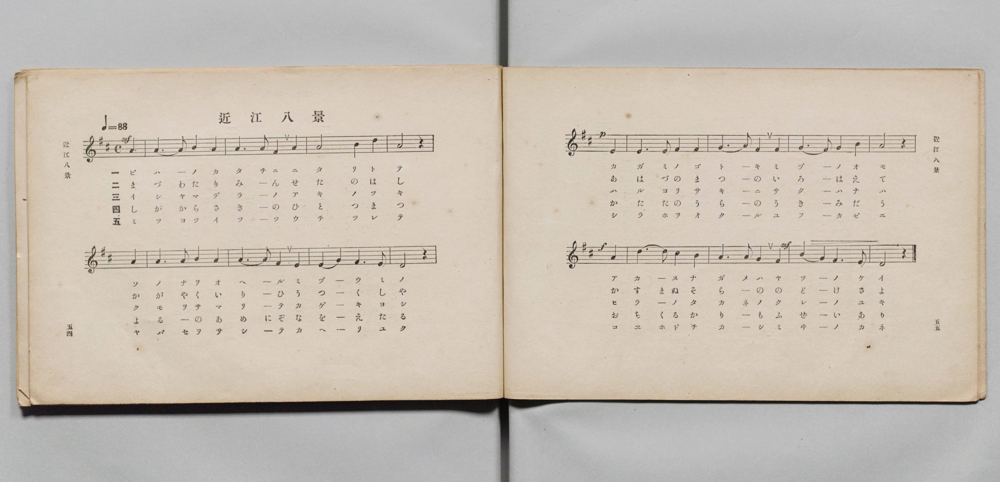
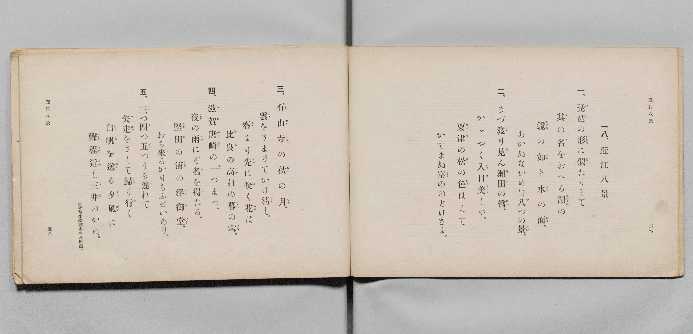

# 近江八景

> Re:Shōka 使用 AI 協助辨識與重建樂譜，可能會有錯誤。歡迎回報。

- **鋼琴伴奏版**：<br><audio controls src="omi_hakkei.mp3"></audio>

- 詞：文部省（尋常小學讀本卷八所載）
- 曲：文部省
- 文部省《尋常小學唱歌 第四學年用》（明治四十五年五月，4080）

## 說明

原書資訊與歌詞全文（對應 P030.jpg–P031.jpg，原書 pp. 54–57，第 18 首）：
調性與拍號：ニ長調（D 大調）4/4 拍，速度 ♩=88


## 歌詞

```text
一、
琵琶（びは）の形（かたち）に似（に）たりとて
其（そ）の名（な）をおへる湖（みづうみ）の
鏡（かゞみ）の如（ごと）き水（みづ）の面（おも）、
あかぬながめは八（や）つの景（けい）。

二、
まづ渡（わた）り見（み）ん瀨田（せた）の橋（はし）、
かゞやく入日（いりひ）美（うつく）しや。
粟津（あはづ）の松（まつ）の色（いろ）はえて
かすまぬ空（そら）ののどけさよ。

三、
石山寺（いしやまでら）の秋（あき）の月（つき）、
雲（くも）をさまりてかげ清（きよ）し。
春（はる）より先（さき）に咲（さ）く花（はな）は
比良（ひら）の高（たか）ねの暮（くれ）の雪（ゆき）。

四、
滋賀唐崎（しがからさき）の一（ひと）つまつ、
夜（よる）の雨（あめ）にぞ名（な）を得（え）たる。
堅田（かたた）の浦（うら）の浮御堂（うきみだう）、
おち來（く）るかりもふぜいあり。

五、
三（み）つ四（よ）つ五（いつ）つうち連（つ）れて
矢走（やばせ）をさして歸（かへ）り行（ゆ）く
白帆（しらほ）を送（おく）る夕風（ゆふかぜ）に
聲程近（こゑほどちか）し三井（みゐ）のかね。
（尋常小學讀本卷八所載）
```

## ABC

<div class="abc-score" data-abc-src="omi_hakkei.abc" aria-label="五線譜載入中"></div>

[下載 ABC 原始檔](omi_hakkei.abc)

## TMD 檔案連結

- [主旋律 TMD 檔案](omi_hakkei.tmd) [[在 TMD Studio 編輯](https://tmdlang.github.io/Tmd-TS/#tmd=s7IKdvYPcrWy4qpTUCpJTLdSSM7PyUlNLsnMz7PKyszLyo8vzshPT8wuBdHZiUpwdWX5OaW5qVbpRYkpqfEm8SYGFgYIyeL80qLkVKvi5Iz8_Jz4ktSKkqT8_Gx0-fiCxPRUqwADYySdBUX5Zal5iXlA3QVFmXklqSlg7QgFqWWZKakg6bLUosy0zNQUJCelFhWD3A01vaQoMa84uSizAOQZhKr8ohKgj4oSCzIqrTIyi0vyizKTE3PisxPzkHxXkpEK8lwqVCG6RF5iSWlRKrKZmemZeVa5-XlJpcBwUuLS0lJ4sX_is43zn7aufjZzvYKWFpeirYKFBZe9rYILl42JvokdSPOLlfPe75n1bFr7y-YVz-c0vt_T8XRD99MdO55u6H-6dseLdQ3P5qx52rsdZEhnw4s9ne_3dIItfTZ7E7I-iBiM97ihC9mUp1M2Plvbo_B8zZqns2eD-Du3PJ-y4nFDN9C2ZzP6nm3aDRLvbXyyawpQCkg-m9Pxfk8PKELB1nHpaynYUgtwKSgoPO2b_2z2jheb21-s6HrR0Q50HDAYnrauAHoAHAC9z9o7FUCpQi-rIP1Rw2Qg0xDEBDoKolWhoEBPwdQEKGVqDhQE-kzB0ELh5bJpQPcCgwVkx4tV-581LAeZ3t37YuZ8oOjj5u6XU7cDxYF2uCg8XbIczOwExoQCUA3QmJcN85_uWqbwaOZKW2A8gQx5sqPhcUMjiPV8wtbnE7YBdT5u3Py4cT1Q3-PGdU_3LgKLdD9unP-4cSFYcPWTPXvAgqvB3PmPm7oeN6543LgM7PFWiBFzofonAK0FcleBuE2THjcCle543NT9bCfQI0Dx_Y8blz5ubAMyIOpBRrzsB9oDtrNpHlzi6bImsOAUoFVgkd5nG7bAjYCoeTkX4tiux01AxZ1Qfz1ubAK7fw3QFY8bex43NQJ9B0xtIKVNLWCdS4CagSkYrHni40awYEMTJHx29cDN2Qe06dkOsOOa-oEeB_up68UyUCqDOrRp8vOGFc-nbACLzIaqARq-EqJm_ePG6cguA3uxqeVxY__T1qXPpgP9AVTUAg5QYOLvfL6vDywCDB-gE_vBZk0HqQc6DhRjm-Y_2wLRA_Qi0GxoODybuw8sCHTvEojIi06gcRCjgfEBFAEqBnLBMQYOnJlg1Wuer9wFib3HTaB8CNQJRivBwTL1cVMHPFh2wDzxfP7mpxs3Pl0P0Qj0CtiBINOWww15vhzifaArIdavA-c_oAjQW2ARiFkvQVkeKNoPjUBQgpkKMgsUIMvADp30bEcrWE0v0DXQAIGExrMZkKBYD0xeYM3AWOp62gqxB2gKxObVTydB7JgK5va_6NoIixlwGm1cDzZr_ZQXnZD0sAnui5erZ4BFgBkBbEHjWpBHZq2DObkHqmw20CCg3cBIg3gNEmLAAgjqy2e7u19sbng6ZcLTLZDonQ5KlqC0ANQOd-g6YM6EOgCa4oFhBYpRqClPl8wBWwNEENcALQaqA4dyE7CUBfn1ceM8tAz4dB8w_QG5kKADZt1uaOg9XdAKS7aQvA5LuVuXQZMgLBiebV33dN_Cpwsg-RHkS3AeXABkIydtYIwtfLIPKAQKHLDlQHOBfgRlzseNWx83zgGnFqBjuxB5bQpUOzB5IfJU4xJg2EH8CuEC1cESGyR9A0MG6I6FLxsWQxIV2DpgkILT9_P5i15sBfsMlC43ALMlUtICBv2yZ2t3wPwNZICz9EJgXIKiEJJGwKbM3Pt0B8Q3wAQOFN0NMeVlA6hGA3sX6sunS6a-XASOCVASAHoUaC4wqkDxAS61Gzc9X9ENrDjB2iY_bgLmrN3gLLYQlq6mA73_ZBcwgYJLt6YJsJwINGgtNLqIqUVB6iivzaBAQUufi8s_N9MjMTs7NdMqIDMxL9-hxqCmGmSLgo2Flh2Yga0eBVXLwMQMDFQFDRMFoIOfr2_QgVd-mlg0AO0CGVajUJ2bVqtgrKALhKZg2hSIaxTMoCxdoJgRWAQmB4KGcWAhcyAJUgiCBiARsJk-hjUKj5sng0UfN_dD6T6wjsdNq0G8pv1Q0UYg7obIgGmYDEhuFVS8A8xrg4rHI-wxAso27oOoblwK1AuyC5itoDZ1gXlw85pALgLpmA1XBdG5Diq-HsybjmmPMci0JVBTtgPdAmI_bp4HdV87mLcS7m6YTxeB1a9FF29uQRFHsscE5AqI_cDiClRrgFV2Qt03FSzei-HuTWDeCrg4yHWwkIHw0OwxBbkC4n-Qax43g_RC3AXzKYQHUwERXwbmNaKLN68B81DjB39K3dVDTkpFTo6gxAgRgaQ_UzCNqgZE1ygYQt2FJY027YXHzONmcGppBoUlSAaU9h43z4DKr4aGF8i3rTD_g8MDJDsfLA6KXRhET6OgeITGaRM49htBKRUkA0kLILtBopuAGBSOIBlYvEHUQlImyGWweMGWRkEpGOSiRVCfPG7aCnU1KK1CchQkriD5EKQHpA7iH0iKBKUGkPh27PaA0mgTKEeCdHRDUyGwjoGaBkodwFIY6uJ5QAzNxU2T4P6B6gbmQJA4JGywp1FonmueAFS3G8yCxQ_IXzA3ovgHGmfIvl0G1gEJG-LT6I5OskrTglpw2oOkOiOMdGqOJZ1CClxIEYw9nULKTFA-g6Q3RBmzBSwCi4-12NIpWC0kRYPEQaUSrnQKikVIOQiigSUqvIxBLktAopCUC3JBL8weaPkJcgtIByR3YE2n4DoBlKtg6Q1e1kPjFZYSgekLloLh8QfTDcozMLNwpFNI-Qkt6UE0wj-gXAYpWWH-geU7hH9ANQew0YWkA0c6BadDWA3wuHk2ejkCz5egcgQULiB3g0pzSKxBYncPVBwzP-BNp8B2G1npFFjpg1IiuCIHJU7MWh_cMEBU_bByFpKi8ZWqkHoPErsgX_dAfQYuYeGpeCE07mD5HFbjgEvjpo3Q8IOVgthSKyR2Z0J0AVMosHMF0dU4F2wTcuzC4h0UR8CeFsxt4DoVUaJhT62gkgtb_Q5OH1B_Pm7uRZIB5wRwvQj1DyzW4bU-ttQKaa8shLqsH1o2wn0KrSVALGhp2wjOLY1zoDqANTm8HIapxZZaN4NdBQphWGqFtjDAdTtSzIHTNayt8Lh5A8I_8NIWllsQ9tRycenaKcCbsQpAjjIXAA)]
- [鋼琴伴奏 TMD 檔案](omi_hakkei_piano.tmd) [[在 TMD Studio 編輯](https://tmdlang.github.io/Tmd-TS/#tmd=s7IKdvYPcrWy4qpTUCpJTLdSSM7PyUlNLsnMz7PKyszLyo8vzshPT8wuBdHZiUpwdWX5OaW5qVbpRYkpqfEm8SYGFgYIyeL80qLkVKvi5Iz8_Jz4ktSKkqT8_Gx0-fiCxPRUqwADYySdBUX5Zal5iXlA3akpmSX5RZmJOfGJRUWJeempual5JQiVqWWZKakgdYnJyfm5BYl5majyZalFxSBfFGQm5uXH41CUX1QC9F5RYkFGpVVGZjHIvmSghdmJeUheLckAWm2VngpViC6Rl1hSWpSKbGZmemaeVW5-XlIpMNCUuLS0FF7sn_hs4_ynraufzVz_fk_Hy-49zydsebJny9Ol_c87O97v6VTQ0uJStFWwsOCyt1Vw4bIx0TexA5n4YuW893tmPZvW_rJ5xfM5jUC9Tzd0P92x4-mG_qdrd7xY1_BszpqnvdtBJnc2vNjTCTQK7JJnszch64OIwXiPG7qQTXk6ZeOztT0Kz9eseTp7Noi_c8vzKSseN3QDbXs2o-_Zpt0g8d7GJ7umAKWA5LM5QCf3gKIcbB2Xf26mR2J2dmqmVQAosIM8HGoMaqq5FIDAxkLLDszQ11KwRQcgK5_saHixsEdBw0QB6Jjn6xt0FEAJQi-rIF0TiwYtfbBhNQrVuWm1CsYKukBoCqZNgbhGwQzK0gWKGYFFYHIgaBgHFjIHkiCFIGgAEgGb6WNYo_C4eTJY9HFzP5TuA-t43LQaxGvaDxVtBOJuiAyYhsmA5FZBxTvAvDaoeDzCHiOgbOM-iOrGpUC9ILseN86H2tQF5sHNawK5CKRjNlwVROc6qPh6MG86pj3GINOWQE3ZDnQLiP24eR7Ufe1g3kq4u2E-XQRWvxZdvLkFRRzJHhOQKyD2P27sAWJIiHRC3TcVLN6L4e5NYN4KuDjIdbCQgfDQ7DEFuQLif5BrHjeD9ELcBfMphAdTARFfBuY1oos3rwHzUOMHf0rd1UNOSkVOjqDECBGBpD9TMI2qBkTXKBhC3YUljTbthcfM42ZwamkGhSVIBpT2HjfPgMqvhoYXyLetMP-DwwMkOx8sDopdGERPo6B4hMZpEzj2G0EpFSQDSQsgu0Gim4AYFI4gGVi8QdRCUibIZbB4wZZGQSkY5KJFUJ88btoKdTUorUJyFCSuIPkQpAekDuIfSIoEpQaQ-Hbs9oDSaBMoR4J0dENT4ePGJqhpoNTxuBFkNoieB8TQXNw0Ce4fqG5gDgSJQ8IGexqF5rnmCUB1u8EsWPyA_AVzI4p_oHGG7NtlYB2QsCE-je7oJKs0LagFpz1IqjPCSKfmWNIppMCFFMHY0ymkzATlM0h6Q5QxW8AisPhYiy2dgtVCUjRIHFQq4UqnoFiElIMgGliiwssY5LIEJApJuSAX9MLsgZafILeAdEByB9Z0Cq4TQLkKlt7gZT00XmEpEZi-YCkYHn8w3aA8AzMLRzqFlJ_Qkh5EI_wDymWQkhXmH1i-Q_gHVHM8blyApANHOgWnQ1gN8Lh5Nno5As-XoHIEFC4gd4NKc0isQWJ3D1QcMz_gTafABgVZ6RRY6YNSIrgiByVOzFof3DBAVP2wchaSovGVqpB6DxK7IF_3QH0GLmHhqXghNO5g-RxW44BL46aN0PCDlYLYUiskdmdCdAFT6ONGkNkgmblgm5BjFxbvoDh63DgR5jZwnYoo0bCnVlDJha1-B6cPqD8fN_ciyYBzArhehPoHFuvwWh9baoW0VxZCXdYPLRvhPoXWEiAWtLRtBOeWxjlQHcCaHF4Ow9RiS62bwa4ChTAstUJbGOC6HSnmwOka1lZ43LwB4R94aQvLLQh7ajFasT7IrVgTaCsW2vA0jFcwjdc2hNM1CibxCmaoIjAWTAZYesbHKxjFa5uCBOKB6Q_iO4RKhDw23fhUAWmEcaDCHKEIn4OINxLoZ0wfIomAQwVkDNgAk3htM2w2Q80EhrWunQI8uKN9DGPB9qAKGmETNMYmaIJN0BQuqMwFAA)]

## 分析

```text
================================================================================
📊 TMD Song Profile: [ 近江八景 ]
================================================================================
⏱  Duration:       0:43 (43.6s), 16 measures total
🎼 Key & Tempo:    首調基準 D, != 88.0 BPM, <4/4>
   - 分析範圍：      由實際發聲的音符與和弦推測調性；播放脈絡另行呈現
🎤 人聲音域:    D4 (MIDI 62) – D5 (MIDI 74) [跨度: 12 個半音 / 1.0 個八度, 難度: easy]
   - 最低音:  D4 in [OmiHakkei #1 @ m.8, 0:19]
   - 最高音: D5 in [OmiHakkei #1 @ m.3, 0:07]
   - 適合: soprano, mezzo-soprano, contralto, tenor, baritone, bass
🏛  結構:      OmiHakkei (43.6s)
⚡ 編曲密度:        Peak 1 軌道同時演奏
🗝  調性診斷：       D 調性不明確（純淨自然大調，未偵測到可信轉調）
   - 風格氣質:    純淨自然大調（陽光明朗、易唱易記，無明顯調外色彩）
   - 轉調歷程:    全曲維持單一推測調性（未偵測到可信轉調）
   - 核心骨幹音:  A, F#, B, D, E
   - 調性數值:    D 調性不明確 [相關度: 0.76, 穩定度: Ambiguous, 自然音純度: 100.0%]
   - 候選調性 (K-S): D 大調 (0.76), A 大調 (0.74), F# 小調 (0.74)
   - 五度圈歷程:   +2
   - 各段落調性細節:
     • [OmiHakkei #1]: D 調性不明確 (r: 0.76, 自然音純度: 100.0%)

  [ 五度圈游移軌跡 ]
               C  
         F            G  
      Bb              [D ]*
      Eb               A  
         Ab           E  
            Db       B  
               F# 
     (* = active key center)

  [ 十二半音累積音高分佈 ]
     C  :                            0.0%
     C# : ██                         2.5%
     D  : ███████████████           16.7%
     D# :                            0.0%
     E  : ███████████               11.7%
     F  :                            0.0%
     F# : ████████████████████      22.5%
     G  :                            0.0%
     G# :                            0.0%
     A  : ████████████████████████  26.7%
     A# :                            0.0%
     B  : ██████████████████        20.0%
--------------------------------------------------------------------------------
Assignment 軌道音域：
  - Piano         : D4 – D5 (12 個半音 / 1.0 個八度, 52 個音符)
================================================================================
```


## 原書掃描頁






