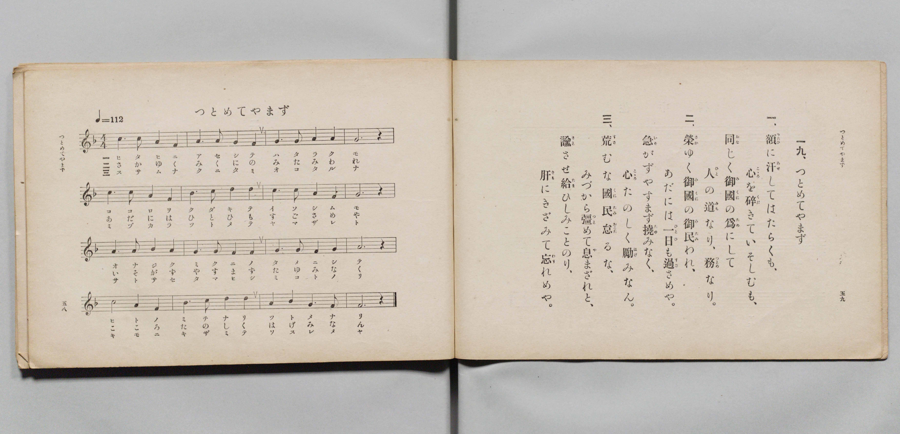

# つとめてやまず

> Re:Shōka 使用 AI 協助辨識與重建樂譜，可能會有錯誤。歡迎回報。

- **鋼琴伴奏版**：<br><audio controls src="tsutomete_yamazu.mp3"></audio>

- 詞：文部省
- 曲：文部省
- 文部省《尋常小學唱歌 第四學年用》（明治四十五年五月，4080）

## 說明

原書資訊與歌詞全文（對應 P032.jpg，原書 pp. 58–59，第 19 首）：
調性與拍號：ハ長調（C 大調）4/4 拍，速度 ♩=112


## 歌詞

```text
一、
額（ひたひ）に汗（あせ）してはたらくも、
心（こゝろ）を碎（くだ）きていそしむも、
同（おな）じく御國（みくに）の爲（ため）にして
人（ひと）の道（みち）なり、務（つとめ）なり。

二、
榮（さか）ゆく御國（みくに）の御民（みたみ）われ、
あだには一日（ひとひ）も過（すご）さめや。
急（いそ）がずやすまず撓（たゆ）みなく、
心（こゝろ）たのしく勵（はげ）みなん。

三、
荒（すさ）むな國民（くにたみ）怠（おこた）るな、
みづから彊（つと）めて息（や）まざれと、
諭（さと）させ給（たま）ひしみことのりの、
肝（きも）にきざみて忘（わす）れめや。
```

## ABC

<div class="abc-score" data-abc-src="tsutomete_yamazu.abc" aria-label="五線譜載入中"></div>

[下載 ABC 原始檔](tsutomete_yamazu.abc)

## TMD 檔案連結

- [主旋律 TMD 檔案](tsutomete_yamazu.tmd) [[在 TMD Studio 編輯](https://tmdlang.github.io/Tmd-TS/#tmd=s7IKdvYPcrWy4qpTUCpJTLdSSM7PyUlNLsnMz7PKyszLyo8vzshPT8wuBdHZiUpwdWX5OaW5qVbpRYkpqfEm8SYGFgYIyeL80qLkVKvi5Iz8_Jz4ktSKkqT8_Gx0-fiCxPRUqwADYyOETEFRfllqXmIeUHdBUWZeSWoKWDtCQWpZZkoqSLostSgzLTM1BclJqUXFIHdDTS8pSswrTi7KLAB5BqEqv6gE6KOixIKMSquMzOKS_KLM5MSc-OzEPCTflWSkAj2Xm1-UmIMumJKZk5kOcgGykZnpmXlA5XlJpcBgUuLS0lJ43LjkceOKx02NjxuXPW5qedy473HjLAUtLS5FWwVDQyMue1sFZy4bE30TO5AxL1bOe79n1rNp7S-bVzyf0wg2-tnsTZhiMN7jhq6nG7qf7tjxdEP_07U7nk7Z-Gxtj8LzNWuezp4N4u_c8nzKiscN3e_3dDyb0fds026QeG_jk11TgFJA8tmcjvd7ekCx9n5PpxIXl76Wgi21AJeCgsLTvvnPZu94sbn9xYquFx3tQMcBvfi0dQXQA0AnPd3Q-6y9UwEU9XpZBelAl0DUKxQU6CmYWjxqmGxqCRQEekfB0FLh5bJpQEcCwwJk8ItV-581LAcZ2d37YuZ8oOjj5v6XU7cDxYEGOys8XbIczOwEBq0CUA3QmJcN85_uWqbwaOZKW1DIg0x5sqPhcUMjiPVyIVBJx-PGTY8b5wNJoMbHjaufbZwOFmx63DgbLDIdFIuN60FqmoDc_sdNTVD9T_c3g5VOftw093ET0KzOx02Tni_qAwv2P25cANbfC9YPTAVzQWY1NSDpn9ADVtr1uHEVWOkMoLan-xY-nQOKu8eN-8GmrAZLrXveAXQgUBDoikaISyFOA3tp1y6YR1ZAVL9snAwzYiFYZNXjpi6gtU-7Z4LFoQkUSaoJEji7eqCOe7ZsHVjl1MeNQNcAfdaGx3FA8WcbJsLEgYEJioXHTcCwghkHDtAFYFevB8bAs-lL4S6GBn1T08tGSNDNfNw4BWzuVFAeAmYgoONALmqA6AEFJVi6B5itwPkLqAGUxZ5NgngaGERtYAVAt6wCORNndIGcug4cjv1Pu7eCZYERPQmhuWkyPGR2dELNedELVABx5lSwwxuAKoHBAgsBULDAA-FZAzAVQOJ4MlAQrL4bZDIsWIDWLAUGMTBtPd3bBY8bsDpQ-fGscT1IsKkF7CagL6eBwhQYaFC3rF4LiyVIzAMZs59vXQYNh8Z9YEFgKAO9CLQJ6ARgcK8DRTiQhBrRBAxNoOpeYAzAEhYwzU4Da1j2dP8MsP1ATwFTDtBRPShxQnmJAQUKWvpcXCHFpSX5uaklqZGJuYlVpVYBmYl5-Q41BjXVILsUbEy07MAMbCUWqAAEJqwXC3sUNEwUgEXj8_UNOvBiRhOLBqCNIMNqFAyB0EjBGMgyVTADYggLRBsCWUYKukBooFADVu1jWKPwuHmSwuOm_RC6uRuo5nHTIiDeDcTbgSJtIJHmfqialUB6PVhkEdikeJhJRkCxxqlA3A1U0Qak-0GqGoF6gCxgNADxOrjIfAjdBFbT1INqkjFIbCcQbwXasgCIu8Cq1oNdB3HFfLDIKiDeDBVZDXZTF9wk_CG7q4d6IWsMFTPEDFmw64C4eS0Qb4L7ogFIg0TAIdu0BIj3QsN6Ac6QbQJiYFiAwxEc_o2bgHgFhG5qAovMBOIpkFhoagSb3YIZssCwe9zcCpQDmgSMTZBICxB3APFCeGwD3dQ8D6hmG5BeAxbpIDJkd3SSE7Kg9GmmYA4KxThoYoUJmgJZxliCFhj5wOh-3LQDniCBHoMlkuY-sPdBCQPkKVCy2Q5W04YlaIHeb5wLxD1APAsabJDA3AcTASVYcKIGJd5VYJF-LIkWlGCBAQmigdkH5gJgQIKzGMQFIJNASQIU4GBXNq8iLmiB7R5ygtYICE2AGBSKpqDg1SWUasHlAMR50JzW3AgJbLBT0VMMOHcieQIRsJMhuKkXHIAgkXVAPB0aeCA-MLoagbYhgrVpMpZgBeUVYIkEjsa1YFWgdAlKx6DoBNkONAdUYgDTKshNkBQMM6eWi0vXTgGtMFYACilzAQA)]
- [鋼琴伴奏 TMD 檔案](tsutomete_yamazu_piano.tmd) [[在 TMD Studio 編輯](https://tmdlang.github.io/Tmd-TS/#tmd=s7IKdvYPcrWy4qpTUCpJTLdSSM7PyUlNLsnMz7PKyszLyo8vzshPT8wuBdHZiUpwdWX5OaW5qVbpRYkpqfEm8SYGFgYIyeL80qLkVKvi5Iz8_Jz4ktSKkqT8_Gx0-fiCxPRUqwADYyOETEFRfllqXmIeUHdqSmZJflFmYk58YlFRYl56am5qXglCZWpZZkoqSF1icnJ-bkFiXiaqfFlqUTHIFwWZiXn58TgU5ReVAL1XlFiQUWmVkVkMsi8ZaGF2Yh6SV0sygFZb5eYXJeagC6Zk5mSmg1yBbGRmemYeUHleUikwzJS4tLQUHjcuedy44nFT4-PGZY-bWh437nvcOOv9no6X3XueT9jyZM-Wp0v7n3d2vN_TqaClxaVoq2BoaMRlb6vgzGVjom9iBzL7xcp57_fMejat_WXziudzGsH2PZu9CVMMxnvc0PV0Q_fTHTuebuh_unbH0ykbn63tUXi-Zs3T2bNB_J1bnk9Z8bihG-iMZzP6nm3aDRLvbXyyawpQCkg-mwN0Tw8oXoHOUuLiCikuLcnPTS1JjUzMTawqtQoAhWuQh0ONQU01lwIQ2Jho2YEZ-loKtugAZPGTHQ0vFvYoaJgoAJ30fH2DjgIo7vWyCtI1sWjQ0gcbVqNQnZtWq2AIhEYKxkCuqYIZEENYINoQyDJS0AVCA4UasBYfwxqFx82TFB437YfQzd1ANY-bFgHxbiDeDhRpA4k090PVrATS68Eii8AmxcNMMgKKNU4F4m6gijYg3Q9S1QjUA2Q9blwNxOvgIvMhdBNYTVMPqknGILGdQLwVaMsCIO4Cq1oPdh3EFfPBIquAeDNUZDXYTV1wk_AH764ecoIXe8gaQ8UMMUMW7Dogbl4LxJvgvmgA0iARcMg2LQHivdCwXoAzZJuAGBgW4HAEh3_jJiBeAaGbmsAiM4F4CiQWmhrBZrdghiww7B43twLlgCYBYxMk0gLEHUC8EB7bQDc1zwOq2Qak14BFOogM2R2d5IQsKH2aKZiDQjEOmlhhgqZAljGWoAVGPjC6HzftgCdIoMdgiaS5D-x9UMIAeQqUbLaD1bRhCVqg9xvnAnEPEM-CBhskMPfBREAJFpyoQYl3FVikH0uiBSVYYECCaGD2gbkAGJDgLAZxAcgkUJIABTjYlc2riAtaYKFDTtAaAaEJEINC0RQUvLqEUi24HIA4D5rTmhshgQ12KnqKAedOJE8gAnYyBDf1ggMQJLIOiKdDAw_EB0ZXI9A2RLA2TcYSrKC8AiyRwNG4FqwKlC5B6RgUnSDbgeaASgxgWgW5CZKCYebU4iiQfbAVyMAAiVcwjdc2BBLxCkbx2qZAI-BiMBqbCEI9iAULUFLNw6GKXONM4hXMMByMMAzVzejGYWrG4zpgKOvaKaAFdLSPYawCNmEj7MLGYGFlLgA)]

## 分析

```text
================================================================================
📊 TMD Song Profile: [ つとめてやまず ]
================================================================================
⏱  Duration:       0:34 (34.3s), 16 measures total
🎼 Key & Tempo:    首調基準 C, != 112.0 BPM, <4/4>
   - 分析範圍：      由實際發聲的音符與和弦推測調性；播放脈絡另行呈現
🎤 人聲音域:    C4 (MIDI 60) – C5 (MIDI 72) [跨度: 12 個半音 / 1.0 個八度, 難度: easy]
   - 最低音:  C4 in [TsutometeYamazu #1 @ m.1, 0:00]
   - 最高音: C5 in [TsutometeYamazu #1 @ m.10, 0:19]
   - 適合: soprano, mezzo-soprano, contralto, tenor, baritone, bass
🏛  結構:      TsutometeYamazu (34.3s)
⚡ 編曲密度:        Peak 1 軌道同時演奏
🗝  調性診斷：       C 大調（純淨自然大調，未偵測到可信轉調）
   - 風格氣質:    純淨自然大調（陽光明朗、易唱易記，無明顯調外色彩）
   - 轉調歷程:    全曲維持單一推測調性（未偵測到可信轉調）
   - 核心骨幹音:  G, C, E, D, A
   - 調性數值:    C 大調 [相關度: 0.85, 穩定度: Moderate, 自然音純度: 100.0%]
   - 候選調性 (K-S): C 大調 (0.85), G 大調 (0.78), E 小調 (0.73)
   - 五度圈歷程:   +0
   - 各段落調性細節:
     • [TsutometeYamazu #1]: C 大調 (r: 0.85, 自然音純度: 100.0%)

  [ 五度圈游移軌跡 ]
              [C ]*
         F            G  
      Bb               D  
      Eb               A  
         Ab           E  
            Db       B  
               F# 
     (* = active key center)

  [ 十二半音累積音高分佈 ]
     C  : █████████████████████     23.3%
     C# :                            0.0%
     D  : ███████████████           16.7%
     D# :                            0.0%
     E  : █████████████████████     23.3%
     F  : ██                         1.7%
     F# :                            0.0%
     G  : ████████████████████████  26.7%
     G# :                            0.0%
     A  : ██████                     6.7%
     A# :                            0.0%
     B  : ██                         1.7%
--------------------------------------------------------------------------------
Assignment 軌道音域：
  - Piano         : C4 – C5 (12 個半音 / 1.0 個八度, 51 個音符)
================================================================================
```


## 原書掃描頁




