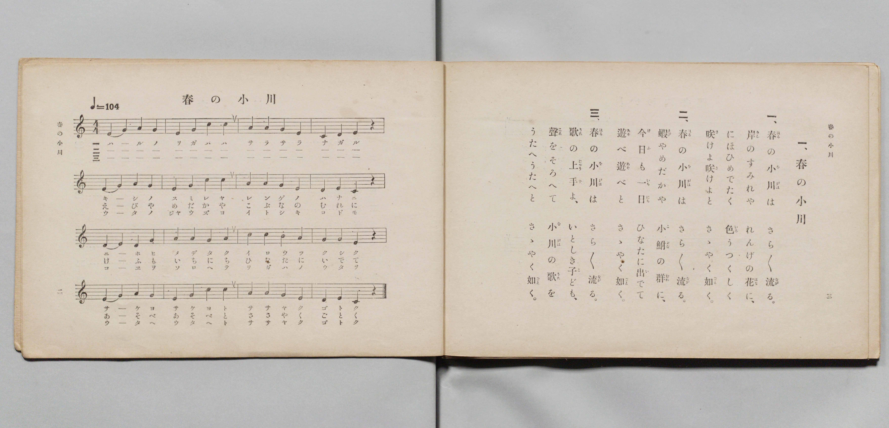

# 春の小川

> Re:Shōka 使用 AI 協助辨識與重建樂譜，可能會有錯誤。歡迎回報。

- **鋼琴伴奏版**：<br><audio controls src="haru_no_ogawa.mp3"></audio>

- 文部省唱歌
- 文部省《尋常小學唱歌 第四學年用》（明治四十五年五月，4080）

## 說明

原書資訊與歌詞全文（對應 P024.jpg，書頁 p. 1，第一學期第 1 首）：
調性與拍號：は調四拍子（C 大調 4/4 拍，♩=104，文部省）


## 歌詞

```text
一
春（はる）の小川（をがは）はさら／＼流（なが）る
岸（きし）のすみれやれんげの花（はな）に
にほひめでたく色（いろ）うつくしく
咲（さ）けよ咲けよとさゝやく如（ごと）く

二
春の小川はさら／＼流る
蝦（えび）やめだかや　小鮒（こぶな）の群（むれ）に
今日（けふ）も一日（いちにち）ひなたに出（い）でて
遊（あそ）べ遊べとさゝやく如く

三
此（こ）の小川はさら／＼流る
歌（うた）の上手（じゃうず）よいとしき子ども
聲（こゑ）をそろへて　小川の歌を
うたへ／＼とさゝやく如く
```

## ABC

<div class="abc-score" data-abc-src="haru_no_ogawa.abc" aria-label="五線譜載入中"></div>

[下載 ABC 原始檔](haru_no_ogawa.abc)

## TMD 檔案連結

- [主旋律 TMD 檔案](haru_no_ogawa.tmd) [[在 TMD Studio 編輯](https://tmdlang.github.io/Tmd-TS/#tmd=s7IKdvYPcrWy4qpTUCpJTLdSSM7PyUlNLsnMz7PKyszLyo8vzshPT8wuBdHZiUpwdWX5OaW5qVbpRYkpqfEm8SYGFgYIyeL80qLkVKvi5Iz8_Jz4ktSKkqT8_GyEfEFRfllqXmIeUE1BUWZeSWoKWBFCQWpZZkoqSDo1JbMkvygzMQfJ5tSiYpDzIJbElxQl5hUnF2UWgNyMUFWSkQp0Xl5iSWlRKrpocWpicX5eMUIYaEN6Zp5Vbn5eUinQn0pcWloKz2Ysfdy47umG_qfb5ypoaXEp2ioYGphw2dsqOHPZmOib2IF0P5vW_rJ5xfM5jU-nbHy2tgdsIlzscUPX0w3dT3fsABmydgdEicLzNWuezp4N4u_c8nzKiscN3e_3dDyb0fds026QeG_jk11TgFJA8tmcjvd7ekAh-35PpxIXl76Wgi21AJeCgsLTvvnPZu94sbn9xYquFx3tQMe9WDnvaesKoAeATnq6ofdZe6dCgIGRiV5WQTrQJUDFLxc0KhToKRgCeUB_PNnRAPTHsznzgWwFQ4WXy6YBHfp-zyyQ4S9W7X_WsBxkbHfvi5nzgaKPG9cDBYF-BIo8XTsBaIWzwtMly4FiCsDgVACKAk19NHOlLTCYQbbBghFoJhfIRKBtIAoYL0CtQMMeNwFDrhMeRyDBpkmPG3uAUmDx9Y8bpz5uArqn__2ePc-2As0B6loFVACSbeoGh8CmHWDR3seN0yFmPW6c-bhx_-OmnsdNLWBy8uNGoKHrXnRthNrauAqscjVIP5B63Lj7ceOmx02NjxuXP26c_7ix_0XnJrBSoH6gj4BK2x43LgGKA-0AkmBrJ0FUTAVLT3zc1AEUgTAeN64AO3suyP7G_qfLmsAqpwDFwYr7IUGxqwcaFHDvY_oX6scXc5eBjQCizWCfA90FdOyCx43dIHZDA1D_y3WTwGqAnt0G8-C65_uWgMO0ARgOCC8_2d31bDokBiY-btwKNrEJGDUwQaCrF4KDZSFYD9BbwCAHBsvqp-27IArA4sCwWgYy7mVjF1i06XEjMAaBEjuBIkASMxzgft_RCfb7WrDrGicjpwGcgQBM22DVwKgAJkWQhic7up51grLe48YZj5uawVKzwL6BeAJoPTC6QAn1ceNKoBfBQdkIibfJj5smgpUCUwbQgcDUswPoHUhQgl2xDmgfUBaSREB2AlVAnITdX0B1lGdpKFDQ0ufi8kgsKvXL909PLE-0CshMzMt3qDGoqQbZo2BjomUHZmArTkClEzAyXyzsUdAwUQB65_n6Bh14GaCJRQPQNqhhGkCNmlYKj5v7gXgPEK8G4j6FGiC5SeFx0xqoTD9IpGkrkLUSToPUdEHVrAaahmzorh6QoY3rIYY2dQPZ68BGTAKyeiAyQAwUaZwKFO2E0yCRVRA1QF1wQ2sUjBVMFcyAGMIyjAOhGiDLFMg3ArIMgaSxgoFCDVi9jyHIdf0KuhT4KB5mlhHIUetBZpHtEbhZxiDxySCzgOaATAHxEeboEmUS_pSwq4eilNC0Fhpp22Hh1rQTyJoPxKBwWQIOJRBrM1AGGKLQsAWFKTDsmpEiDTkldEAMbQRpagEb2gjkLQBiYJBCRIDBAizJoJ6FBHIDEIMCByl5EU4JoHRgiJoSgH4CxR65PkJNCR3g2CPXI6gpoQ1sFtAlEHWwUg3ImgXUAbIJJNoCxCuAeDoQ98JtAKXbJiLSw45OykoGoL_AJcNsIAan1-aFQNwOtH0_EIPTftMSoAgw3TQtA9KQUAGmZ1B4A2ms6WEiND0AMx7QEzBPAg0GBhGIBokAowIchKDgWQ1XsxyIlyGnB1B8G4HTgxk4XZiBSgNwqjAHsyEpA7Vk6AaXDOT6CDU9TATHIbkewVIyNAEDB1oyzAWyeoH0DrBa9HIHkmZAqQVoMlCGYFoAtuMoKxtA5SSobNgIpFfASlAo73FzB1wEpA4YgtCw3AKWw5kWmqBpAejZxp1gLwFFoDxQwocWieDiEBRw4KK7cQo0U_QTLhsg6cIYR9mwFRzm5PoINS00gdMCuR7BVTbsQI5ncFogzqxaLi5dOwWkZoUCkKvMBQA)]
- [鋼琴伴奏 TMD 檔案](haru_no_ogawa_piano.tmd) [[在 TMD Studio 編輯](https://tmdlang.github.io/Tmd-TS/#tmd=s7IKdvYPcrWy4tLSUng2Y-njxnVPN_Q_3T73_Z6Ol917nk_Y8mTPlqdL-593drzf06mgpcWlaKtgaGDCZW-r4MxlY6JvYsdVp6D0bFr7y-YVz-c0Pp2y8dnaHiWQ2Iv2Xc8bFz-bOvNF06Znc5qftq55sar3cUPXs2kbnq6b9bR10vPVSyHKHzd0P93Q_XTHjufLJz5fs-bp7NlP1-54unPL8ykrgM4wMjAy0DMwMNMzsDAxBzIMTIAuUeLi8kgsKvXL909PLE-0CshMzMsP8nCoMaip5lIAAhsTLTswQ19LwRYdKAAtebKj4cXCHgUNEwWgf5-vb9BRCDAwMtHLKkjXxKJBSx9mmAZQo6aVwuPmfiDeA8SrgbhPoQZIblJ43LQGKtMPEmnaCmSthNMgNV1QNauBpiEbuqsHZGjjeoihTd1A9jqwEZOArB6IDBADRRqnAkU74TRIZBVEDVAX3NAaherctFoFYwVTBTMgrgGzDONAqAbIMgXyjYAsQyBprGCgUAPW5GMIcmK_gi4F3oqHmWUEctl6kFlk-wZuljFIfDLILKA5IFNAfIQ5ukSZhD857OqhKDk0rYXG3HZYuDXtBLLmAzEoXJaAQwnE2gyUAYYoNGxBYQoMu2akmENODh0QQxtBmlrAhjYCeQuAGBikEBFgsDxu3Ab1LCSQG4AYFDhIaQwS__hSAigdGKKmBKCfQLFHro9QU0IHOPbI9QhqSmgDmwV0CURd44zHTc0g0ceNs4A6QDaBRFuAeAUQTwfiXrgNoHTbRER62NFJWfEA9Be4eJgNxOD02rwQiNuBtu8HYnDab1oCFAGmm6ZlQBoSKsD0DApvII01PUyEpgdgxgN6AuZJoMHAIALRIBFgVICDEBQ8q-FqlgPxMuT0AIpvI3B6MAOnCzNQaQBOFeZgNiRloJYM3eCSgVwfoaaHieA4JNcjWEqGJmDgQEuGuUBWL5DeAVaLXu5A0gwotQBNBsoQTAvA-oiysgFUToLKho1AegWsBIXyHjd3wEVA6oAhCA3LLWA5nGmhCZoWgJ5t3An2ElAEygMlfGiRCC4OQQEHLrobp0AzRT_hsgGSLoxxlA1bwWFOro9Q00ITOC2Q6xFcZcMO5HgGpwXizKrF0rTwwdG0eLa18dmGLS861jyf1fK0o-3F8sVPJ_U83bMM0mhCqowLahUM4xVM44HhCCSAWQ2TYxoPpuBy8fAQx6ocu14oA0UzVAyuxgSkGUxQZjXYCIgIusXAMNS1U0AKxmgfw1gFdCEjTCFjsJAyFwA)]

## 分析

```text
================================================================================
📊 TMD Song Profile: [ 春の小川 ]
================================================================================
⏱  Duration:       0:36 (36.9s), 16 measures total
🎼 Key & Tempo:    首調基準 C, != 104.0 BPM, <4/4>
   - 分析範圍：      由實際發聲的音符與和弦推測調性；播放脈絡另行呈現
🎤 人聲音域:    C4 (MIDI 60) – C5 (MIDI 72) [跨度: 12 個半音 / 1.0 個八度, 難度: easy]
   - 最低音:  C4 in [HaruNoOgawa #1 @ m.4, 0:06]
   - 最高音: C5 in [HaruNoOgawa #1 @ m.2, 0:03]
   - 適合: soprano, mezzo-soprano, contralto, tenor, baritone, bass
🏛  結構:      HaruNoOgawa (36.9s)
⚡ 編曲密度:        Peak 1 軌道同時演奏
🗝  調性診斷：       C 調性不明確（純淨自然大調，未偵測到可信轉調）
   - 風格氣質:    純淨自然大調（陽光明朗、易唱易記，無明顯調外色彩）
   - 轉調歷程:    全曲維持單一推測調性（未偵測到可信轉調）
   - 核心骨幹音:  G, E, C, A, D
   - 調性數值:    C 調性不明確 [相關度: 0.80, 穩定度: Ambiguous, 自然音純度: 100.0%]
   - 候選調性 (K-S): C 大調 (0.80), G 大調 (0.77), E 小調 (0.77)
   - 五度圈歷程:   +0
   - 各段落調性細節:
     • [HaruNoOgawa #1]: C 調性不明確 (r: 0.80, 自然音純度: 100.0%)

  [ 五度圈游移軌跡 ]
              [C ]*
         F            G  
      Bb               D  
      Eb               A  
         Ab           E  
            Db       B  
               F# 
     (* = active key center)

  [ 十二半音累積音高分佈 ]
     C  : ███████████████           18.3%
     C# :                            0.0%
     D  : █████████                 11.7%
     D# :                            0.0%
     E  : ███████████████████       23.3%
     F  :                            0.0%
     F# :                            0.0%
     G  : ████████████████████████  30.0%
     G# :                            0.0%
     A  : ████████████              15.0%
     A# :                            0.0%
     B  : █                          1.7%
--------------------------------------------------------------------------------
Assignment 軌道音域：
  - Piano         : C4 – C5 (12 個半音 / 1.0 個八度, 60 個音符)
================================================================================
```


## 原書掃描頁




