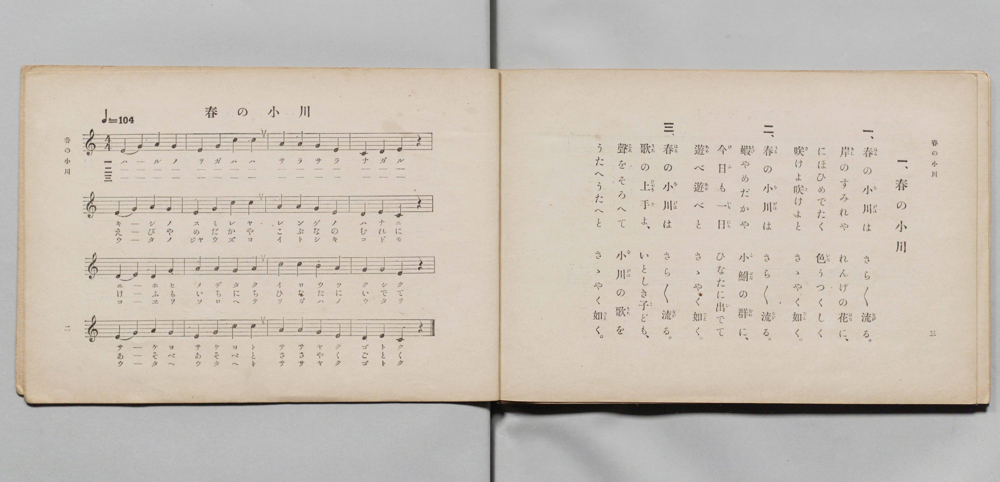

# 春の小川

> Re:Shōka 使用 AI 協助辨識與重建樂譜，可能會有錯誤。歡迎回報。

- **鋼琴伴奏版**：<br><audio controls src="haru_no_ogawa.mp3"></audio>
- **NEUTRINO 歌聲合成版**：<br><audio controls src="haru_no_ogawa_neutrino.mp3"></audio>

- 文部省唱歌
- 文部省《尋常小學唱歌 第四學年用》（明治四十五年五月，4080）

## 說明

原書資訊與歌詞全文（對應 P024.jpg，書頁 p. 1，第一學期第 1 首）：
調性與拍號：は調四拍子（C 大調 4/4 拍，♩=104，文部省）


## 歌詞

```text
一
春（はる）の小川（をがは）はさら／＼流（なが）る
岸（きし）のすみれやれんげの花（はな）に
にほひめでたく色（いろ）うつくしく
咲（さ）けよ咲けよとさゝやく如（ごと）く

二
春の小川はさら／＼流る
蝦（えび）やめだかや　小鮒（こぶな）の群（むれ）に
今日（けふ）も一日（いちにち）ひなたに出（い）でて
遊（あそ）べ遊べとさゝやく如く

三
此（こ）の小川はさら／＼流る
歌（うた）の上手（じゃうず）よいとしき子ども
聲（こゑ）をそろへて　小川の歌を
うたへ／＼とさゝやく如く
```

## ABC

<div class="abc-score" data-abc-src="haru_no_ogawa.abc" aria-label="五線譜載入中"></div>

[下載 ABC 原始檔](haru_no_ogawa.abc)

## TMD 檔案連結

- [主旋律 TMD 檔案](haru_no_ogawa.tmd) [[在 TMD Studio 編輯](https://tmdlang.github.io/Tmd-TS/#tmd=s7IKdvYPcrWy4qpTUCpJTLdSSM7PyUlNLsnMz7PKyszLyo8vzshPT8wuBdHZiUpwdWX5OaW5qVbpRYkpqfEm8SYGFgYIyeL80qLkVKvi5Iz8_Jz4ktSKkqT8_GyEfEFRfllqXmIeUE1BUWZeSWoKWBFCQWpZZkoqSDo1JbMkvygzMQfJ5tSiYpDzIJbElxQl5hUnF2UWgNyMUFWSkQp0Xl5iSWlRKrpocWpicX5eMUIYaEN6Zp5Vbn5eUinQn8gSJUDvFyUWZFRaZWQWg5ySnJgTn52YhxQUUIcUJKanWgUYGJgocWlpKTybsfRx47qnG_qfbp-roKXFpWirYGhgwmVvq-DMZWOib2IH0v5sWvvL5hXP5zQ-nbLx2doesJFwsccNXU83dD_dsQNkyNodECUKz9eseTp7Noi_c8vzKSseN3S_39PxbEbfs027QeK9jU92TQFKAclnczre7-kBRcz7PZ1KXFz6Wgq21AJcCgoKT_vmP5u948Xm9hcrul50tAMd92LlvKetK4AeADrp6YbeZ-2dCgEGRiZ6WQXpQJcAFb9c0KhQoKdgCOQB_fFkRwPQH8_mzAeyFQwVXi6bBnTo-z2zQIa_WLX_WcNykLHdvS9mzgeKPm5cDxQE-hEo8nTtBKAVzgpPlywHiikAg1MBKAo09dHMlbbAYAbZBgtGoJlcIBOBtoEoYLwAtQINe9wEDLlOeByBBJsmPW7sAUqBxdc_bpz6uAnonv73e_Y82wo0B6hrFVABSLapGxwCm3aARXsfN06HmPW4cebjxv2Pm3oeN7WAycmPG4GGrnvRtRFqa-MqsMrVIP1A6nHj7seNmx43NT5uXP64cf7jxv4XnZvASoH6gT4CKm173LgEKA60A0iCrZ0EUTEVLD3xcVMHUATCeNy4AuzsuSD7G_ufLmsCq5wCFAcr7ocExa4eaFDAvY_pX6gfX8xdBjYCiDaDfQ50F9CxCx43doPYDQ1A_S_XTQKrAXp2G8yD657vWwIO0wZgOCC8_GR317PpkBiY-LhxK9jEJmDUwASBrl4IDpaFYD1AbwGDHBgsq5-274IoAIsDw2oZyLiXjV1g0abHjcAYBErsBIoAScxwgPt9RyfY72vBrmucjJwGcAYCMG2DVQOjApgUQRqe7Oh61gnKeo8bZzxuagZLzQL7BuIJoPXA6AIl1MeNK4FeBAdlIyTeJj9umghWCkwZQAcCU88OoHcgQQl2xTqgfUBZSBIB2QlUAXESdn8B1VGepaFAQUufi8sjsajUL98_PbE80SogMzEv36HGoKYaZI-CjYmWHZiBrTgBlU7AyHyxsEdBw0QB6J3n6xt04GWAJhYNQNughmkANWpaKTxu7gfiPUC8Goj7FGqA5CaFx01roDL9IJGmrUDWSjgNUtMFVbMaaBqyobt6QIY2rocY2tQNZK8DGzEJyOqByAAxUKRxKlC0E06DRFZB1AB1wQ2tUTBWMFUwA2IIyzAOhGqALFMg3wjIMgSSxgoGCjVg9T6GINf1K-hS4KN4mFlGIEetB5lFtkfgZhmDxCeDzAKaAzIFxEeYo0uUSfhTwq4eilJC01popG2HhVvTTiBrPhCDwmUJOJRArM1AGWCIQsMWFKbAsGtGijTklNABMbQRpKkFbGgjkLcAiIFBChEBBguwJIN6FhLIDUAMChyk5EU4JYDSgSFqSgD6CRR75PoINSV0gGOPXI-gpoQ2sFlAl0DUwUo1IGsWUAfIJpBoCxCvAOLpQNwLtwGUbpuISA87OikrGYD-ApcMs4EYnF6bFwJxO9D2_UAMTvtNS4AiwHTTtAxIQ0IFmJ5B4Q2ksaaHidD0AMx4QE_APAk0GBhEIBokAowKcBCCgmc1XM1yIF6GnB5A8W0ETg9m4HRhBioNwKnCHMyGpAzUkqEbXDKQ6yPU9DARHIfkegRLydAEDBxoyTAXyOoF0jvAatHLHUiaAaUWoMlAGYJpAdiOo6xsAJWToLJhI5BeAStBobzHzR1wEZA6YAhCw3ILWA5nWmiCpgWgZxt3gr0EFIHyQAkfWiSCi0NQwIGL7sYp0EzRT7hsgKQLYxxlw1ZwmJPrI9S00AROC-R6BFfZsAM5nsFpgTizarm4dO0UkJoVCkCuMhcA)]
- [鋼琴伴奏 TMD 檔案](haru_no_ogawa_piano.tmd) [[在 TMD Studio 編輯](https://tmdlang.github.io/Tmd-TS/#tmd=s7IKdvYPcrWy4qpTUCpJTLdSyC8qychPL0osyKi0ysgsLskvykxOzInPTsxLVIIrKs4vLUpOjS9ITE-1CjAwMFHi0tJSeDZj6ePGdU839D_dPvf9no6X3XueT9jyZM-Wp0v7n3d2vN_TqaClxaVoq2BoYMJlb6vgzGVjom9iBzLz2bT2l80rns9pfDpl47O1PWB7XrTvet64-NnUmS-aNj2b0_y0dc2LVb2PG7qeTdvwdN2sp62Tnq9eClH-uKH76Ybupzt2PF8-8fmaNU9nz366dsfTnVueT1kBdIaRgZGBnoGBmZ6BhYk5kGFgAnSJEheXR2JRqV--f3pieaJVQGZiXn6Qh0ONQU01lwIQ2Jho2YEZ-loKtuhAAWjJkx0NLxb2KGiYKAD9-3x9g45CgIGRiV5WQbomFg1a-jDDNIAaNa0UHjf3A_EeIF4NxH0KNUByk8LjpjVQmX6QSNNWIGslnAap6YKqWQ00DdnQXT0gQxvXQwxt6gay14GNmARk9UBkgBgo0jgVKNoJp0EiqyBqgLrghtYoVOem1SoYK5gqmAFxDZhlGAdCNUCWKZBvBGQZAkljBQOFGrAmH0OQE_sVdCnwVjzMLCOQy9aDzCLbN3CzjEHik0FmAc0BmQLiI8zRJcok_MlhVw9FyaFpLTTmtsPCrWknkDUfiEHhsgQcSiDWZqAMMEShYQsKU2DYNSPFHHJy6IAY2gjS1AI2tBHIWwDEwCCFiACD5XHjNqhnIYHcAMSgwEFKY5D4x5cSQOnAEDUlAP0Eij1yfYSaEjrAsUeuR1BTQhvYLKBLIOoaZzxuagaJPm6cBdQBsgkk2gLEK4B4OhD3wm0ApdsmItLDjk7Kigegv8DFw2wgBqfX5oVA3A60fT8Qg9N-0xKgCDDdNC0D0pBQAaZnUHgDaazpYSI0PQAzHtATME8CDQYGEYgGiQCjAhyEoOBZDVezHIiXIacHUHwbgdODGThdmIFKA3CqMAezISkDtWToBpcM5PoINT1MBMchuR7BUjI0AQMHWjLMBbJ6gfQOsFr0cgeSZkCpBWgyUIZgWgDWR5SVDaByElQ2bATSK2AlKJT3uLkDLgJSBwxBaFhuAcvhTAtN0LQA9GzjTrCXgCJQHijhQ4tEcHEICjhw0d04BZop-gmXDZB0YYyjbNgKDnNyfYSaFprAaYFcj-AqG3YgxzM4LRBnVi2WpoUPjqbFs62NzzZsedGx5vmslqcdbS-WL346qefpnmWQRhNSZVxQq2AYr2AaDwxHIAHMapgc03gwBZeLh4c4VuXY9UIZKJqhYnA1JiDNYIIyq8FGQETQLQaGoa6dAlIwRvsYxiqgCxlhChmDhZS5AA)]

## 分析

```text
================================================================================
📊 TMD Song Profile: [ 春の小川 ]
================================================================================
⏱  Duration:       0:36 (36.9s), 16 measures total
🎼 Key & Tempo:    首調基準 C, != 104.0 BPM, <4/4>
   - 分析範圍：      由實際發聲的音符與和弦推測調性；播放脈絡另行呈現
🎤 人聲音域:    C4 (MIDI 60) – C5 (MIDI 72) [跨度: 12 個半音 / 1.0 個八度, 難度: easy]
   - 最低音:  C4 in [HaruNoOgawa #1 @ m.4, 0:06]
   - 最高音: C5 in [HaruNoOgawa #1 @ m.2, 0:03]
   - 適合: soprano, mezzo-soprano, contralto, tenor, baritone, bass
🏛  結構:      HaruNoOgawa (36.9s)
⚡ 編曲密度:        Peak 1 軌道同時演奏
🗝  調性診斷：       C 調性不明確（純淨自然大調，未偵測到可信轉調）
   - 風格氣質:    純淨自然大調（陽光明朗、易唱易記，無明顯調外色彩）
   - 轉調歷程:    全曲維持單一推測調性（未偵測到可信轉調）
   - 核心骨幹音:  G, E, C, A, D
   - 調性數值:    C 調性不明確 [相關度: 0.80, 穩定度: Ambiguous, 自然音純度: 100.0%]
   - 候選調性 (K-S): C 大調 (0.80), G 大調 (0.77), E 小調 (0.77)
   - 五度圈歷程:   +0
   - 各段落調性細節:
     • [HaruNoOgawa #1]: C 調性不明確 (r: 0.80, 自然音純度: 100.0%)

  [ 五度圈游移軌跡 ]
              [C ]*
         F            G  
      Bb               D  
      Eb               A  
         Ab           E  
            Db       B  
               F# 
     (* = active key center)

  [ 十二半音累積音高分佈 ]
     C  : ███████████████           18.3%
     C# :                            0.0%
     D  : █████████                 11.7%
     D# :                            0.0%
     E  : ███████████████████       23.3%
     F  :                            0.0%
     F# :                            0.0%
     G  : ████████████████████████  30.0%
     G# :                            0.0%
     A  : ████████████              15.0%
     A# :                            0.0%
     B  : █                          1.7%
--------------------------------------------------------------------------------
Assignment 軌道音域：
  - Piano         : C4 – C5 (12 個半音 / 1.0 個八度, 60 個音符)
================================================================================
```


## 原書掃描頁




