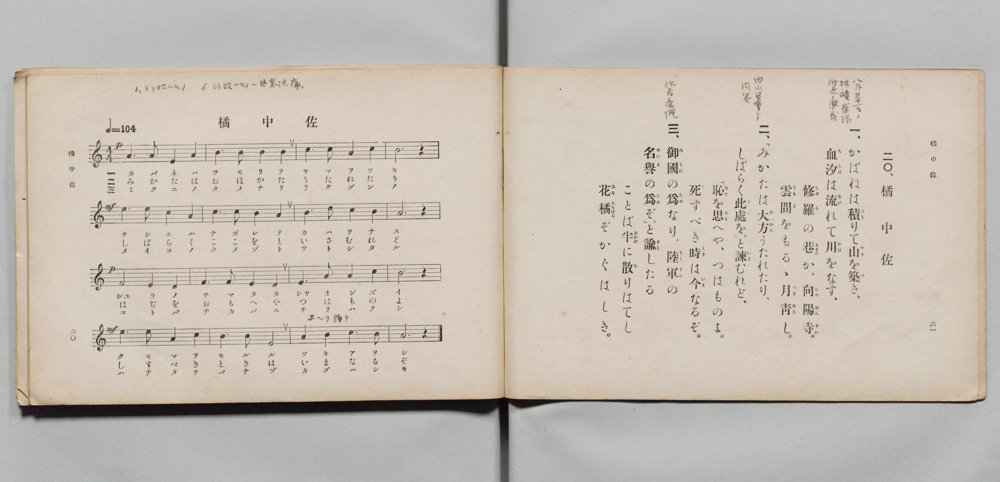

# 橘中佐

> Re:Shōka 使用 AI 協助辨識與重建樂譜，可能會有錯誤。歡迎回報。

- **鋼琴伴奏版**：<br><audio controls src="tachibana_chusa.mp3"></audio>

- 詞：文部省
- 曲：文部省
- 文部省《尋常小學唱歌 第四學年用》（明治四十五年五月，4080）

## 說明

原書資訊與歌詞全文（對應 P033.jpg，原書 pp. 60–61，第 20 首）：
調性與拍號：ニ短調／ヘ長調調號（1 降記號，四七抜き短音階）4/4 拍，速度 ♩=104


## 歌詞

```text
一、
かばねは積（つも）りて山（やま）を築（つ）き、
血汐（ちしほ）は流（なが）れて川（かは）をなす、
修羅（しゅら）の巷（ちまた）か、向陽寺（しゃうやうい）。
雲間（くもま）をもるゝ月青（つきあを）し。

二、
「みかたは大方（おほかた）うたれたり、
しばらく此處（こゝ）を。」と諫（いさ）むれど、
「恥（はぢ）を思（おも）へや、つはものよ。
死（し）すべき時（とき）は今（いま）なるぞ。

三、
御國（みくに）の爲（ため）なり、陸軍（りくぐん）の
名譽（めいよ）の爲（ため）ぞ。」と諭（さと）したる
ことば半（なかば）に散（ち）りはてし
花橘（はなたちばな）ぞかぐはしき。
```

## ABC

<div class="abc-score" data-abc-src="tachibana_chusa.abc" aria-label="五線譜載入中"></div>

[下載 ABC 原始檔](tachibana_chusa.abc)

## TMD 檔案連結

- [主旋律 TMD 檔案](tachibana_chusa.tmd) [[在 TMD Studio 編輯](https://tmdlang.github.io/Tmd-TS/#tmd=s7IKdvYPcrWy4qpTUCpJTLdSSM7PyUlNLsnMz7PKyszLyo8vzshPT8wuBdHZiUpwdWX5OaW5qVbpRYkpqfEm8SYGFgYIyeL80qLkVKvi5Iz8_Jz4ktSKkqT8_Gx0-fiCxPRUqwADY2OETEFRfllqXmIeUHdBUWZeSWoKWDtCQWpZZkoqSLostSgzLTM1BclJqUXFIHdDTS8pSswrTi7KLAB5BqEqv6gE6KOixIKMSquMzOKS_KLM5MSc-OzEPCTflWSkAj2Xm5mTWZJYVIkuDtGGJAw0Iz0zzyo3Py-pFBhOSlxaWgrPVs54smPtk70TFLS0uBRtFQwNTLjsbRXcuGxM9E3sQFpfrJz3fs-sZ9PaXzaveD6nEWzcs9mbMMVgvMcNXU83dD_dsePphv6na3c8nbLx2doehedr1jydPRvE37nl-ZQVjxu63-_peDaj79mm3SDx3sYnu6YApYDkszkd7_f0gKLq_Z5OJS4ufS0FW2oBLgUFhad985_N3vFic_uLFV0vOtqBjgN68WnrCqAHgE56uqH3WXunAii-9bIK0oEugahXKCjQUzAzeNQw2cwQKAj0joKRgcLLZdOAjgSGBcjgF6v2P2tYDjKyu_fFzPlA0cfN3c_nrwWKv9_T_7h5xsup24FsEALJdhgqvJzZ-2LFDDCvBxgKT3Y0P-ua87ixF6jp5fzNL2f1AQ0HxoMC0ECgipcN85_uWqbwaOZKW1A0gax8sqPhcUMjiPW4sftx44bHjWsfN65_vhKovONx45LHTU1AEx43dT1uXPZ040aQYFPL48Z9YMFJz9cDXQ5SBuI29kINerGw4dnGCWCJhY8bpz9u3A2WXv9sayNYcNXjxh6w_h6QodvnggWBdq-HGApWMBNq1pP9657vawWrmP64qfVxE9BCoFnrnm7fDrNg3-NGoO-Bgt1APU8nTHw5c-_T9btgWpofN7aBndz2uLEFpKyhCWTuy9mbXk6bDFbUD_Qj3EcgdlP346a5wDT0cu4kaCAAvdYIFAdygdZMBxkBdtuuHljQNQC9sh_siflAfzxdsvzZtJ1gvcBw2w0RB-sFOmI-2N9Asgse7sAg2gD0GdApz9YueTFzKljnZKAjoG5qaHrcAHTBiherV4OlgL4BqgFKNYDNWolwxbPGpWAV6x83LoJoftYACd8uaEw27gCFRkMj2FvrwV5f97ipAxosz9YC4woUcGClMx837gT6_dlMoE6g4AogGxKTT3Z3wRwCDjdgjAEDrXEePGR2AMMZ7Kan-xY-nQPKqODw6X_cCPQBKP6edwDzP1AQGA7ARAExARQgL2fueLEbnPZASQ6ofsLjJmA0gbSAjZvQ-2LtXrA00ActQIfjMA7kFFigrQVLTQWyofEHUtYNCfrJYG9teNoL8RAw5YEyAVjd6mdTF0PSGCwHAEN1GVA_OI13bQQWfLCwBmoDxjswLQKzzyqo_SCDJoBlgRYCswY4fCkvf6BAQUufiyskMTkjMwlYoDtnlBYnWgVkJublO9QY1FSDrFKwsdCyAzOwFX-g0hSY9V8s7FHQMFEAlrPP1zfowMssTSwagBaCDKtRqC6oVTCLV9AFQiBlCKSMgLhGwRgkAMSmQAxi14B5IDF0EQg0AImAzfQxrFF43LQaLPq4eQIQ94JZ_WA9j5tbwLxFYHIVmGyDyiyB6pkHxJvALJBakGlrkWwCORZqkxFQrnE_RFdjNxDPB7PWQ3Q1doF5u6GyIBIkD5IB2QjhA_McskwTSA8Wm4xB7gOpAaptWg9kg81r7oPqArnhcfNCMAm2FewzkB4QDdXTtAEssxkqA9KLahP--N3VQ1b85qbVgqMMhEERZhgHtt8cykXEJogF4oN4iDSAI36bG8G-2g720WwwCYtfsP-b1oDFICQ0fuFpoh8evyC1IJmd2EMdHL_TwfEDDrumTjAbalPjZDAPTDZNArNXQGVA6QbEnwqUaQDLg2IZJLMSu03g-AXHXxMoFT5uBpmENX6b9oHZHVCZrVA_dcBCA6wWZBrEt8TH745OyvMvatzBeKBcXQNmgfioeRxX_t3-uHkp1GsroQEBiXSQ1-bBPQqLVEhgADUthmhqWgbNzyAWRBKSu7HHMSjHguJrETwmYSmjCczbATYJEquQeISWFUCdMDXroDpAMYMjhptAeQ8aW8CSCTkFgrwBEwPlbag9YC9D8jMkhSNSMyi2SYhfYHuO7PwLyqiomRUWrdCoR8QmJH7NwQ5CyGKLYVCYw8phcISC8yTIzxAxSIggRS-4NAbFw1oghqiB6sASFuj5dyaYBOVzYP0J0QXOrRAeLAWg5t59QAyuIZpAMQKSAbkTV-6FxA6k9IHkV1hyRcQ0JPfCkiu0PAKWy1DdYH9gr29qubh07RRQ62gFoIgyFwA)]
- [鋼琴伴奏 TMD 檔案](tachibana_chusa_piano.tmd) [[在 TMD Studio 編輯](https://tmdlang.github.io/Tmd-TS/#tmd=s7IKdvYPcrWy4qpTUCpJTLdSSM7PyUlNLsnMz7PKyszLyo8vzshPT8wuBdHZiUpwdWX5OaW5qVbpRYkpqfEm8SYGFgYIyeL80qLkVKvi5Iz8_Jz4ktSKkqT8_Gx0-fiCxPRUqwADY2OETEFRfllqXmIeUHdqSmZJflFmYk58YlFRYl56am5qXglCZWpZZkoqSF1icnJ-bkFiXiaqfFlqUTHIFwWZiXn58TgU5ReVAL1XlFiQUWmVkVkMsi8ZaGF2Yh6SV0sygFZb5WbmZJYkFlWii0O0IQkDzUjPzLPKzc9LKgUGmhKXlpbCs5UznuxY-2TvhPd7Ol5273k-YcuTPVueLu1_3tnxfk-ngpYWl6KtgqGBCZe9rYIbl42JvokdyLwXK-e93zPr2bT2l80rns9pBNvxbPYmTDEY73FD19MN3U937Hi6of_p2h1Pp2x8trZH4fmaNU9nzwbxd255PmXF44ZuoDOezeh7tmk3SLy38cmuKUApIPlsDtA9PaDIBDpLiYsrJDE5IzMJGBrOGaXFiVYBoLAM8nCoMaip5lIAAhsLLTswQ19LwRYdgOx9sqPhxcIeBQ0TBaCLnq9v0FEAxbdeVkG6JhYNWvpgw2oUqgtqFcziFXSBEEgZAikjIK5RMAYJALEpEIPYNWAeSAxdBAINQCJgM30MaxQeN60Giz5ungDEvWBWP1jP4-YWMG8RmFwFJtugMkugeuYB8SYwC6QWZNpaJJtAjoXaZASUa9wP0dXYDcTzwaz1EF2NXWDebqgsiATJg2RANkL4j5t6kGWaQHqw2GQMch9IDVBt03ogG2xecx9UF8gNj5sXgkmwrWCfgfSAaKiepg1gmc1QGZBeVJvwx--uHrLiNzetFhxlIAyKMMM4sP3mUC4iNkEsEB_EQ6QBHPHb3Aj21Xawj2aDSVj8gv3ftAYsBiGh8QtPE_3w-AWpBcnsxB7q4PidDo4fcNg1dYLZUJsaJ4N5YLJpEpi9AioDSjcg_lSgTANYHhTLIJmV2G0Cxy84_ppAqfBxM8gkrPHbtA_M7oDKbIX6qQMWGmC1INMgviU-fnd0Up5_UeMOxgPl6howC8RHzeO48u_2x81LoV5bCQ0ISKSDvDYP7lFYpEICA6hpMURT0zJofgaxIJKQ3I09jkE5FhRfi-AxCUsZTWDeDrBJkFiFxCO0rADqhKlZB9UBihkcMdwEynvQ2AKWTMgpEOQNmBgob0PtAXsZkp8hKRyRmkGxTUL8Ast_svMvKKOiZlZYtEKjHhGbkPg1BzsIIYsthkFhDiuHwREKzpMgP0PEICGCFL3g0hgUD2uBGKIGqgNLWKDn35lgEpTPHzf2QnSBcyuEB0sBqLl3HxCDa4gmUIyAZEDuxJV7IbEDKX0g-RWWXBExDcm9sOQKLY-A5TJUN9gf2OubWuxVtA9yFW0CraJhuRKYH-O1gXGAYIGiBMY2jFcwjdc2BEUmSIk2MOYwRIC0AdST0KQAUwNTAYz3eGB0axsj6YaxTIF2GcVrm6LaC2IhGUqSSxEmEmU2yMGYnkNoxW6dMZBlHg_0EnazgTGha6eAGhnRPoaxClhEjbCKGoNFlbkA)]

## 分析

```text
================================================================================
📊 TMD Song Profile: [ 橘中佐 ]
================================================================================
⏱  Duration:       0:36 (36.9s), 16 measures total
🎼 Key & Tempo:    首調基準 F, != 104.0 BPM, <4/4>
   - 分析範圍：      由實際發聲的音符與和弦推測調性；播放脈絡另行呈現
🎤 人聲音域:    D4 (MIDI 62) – F5 (MIDI 77) [跨度: 15 個半音 / 1.2 個八度, 難度: moderate]
   - 最低音:  D4 in [TachibanaChusa #1 @ m.1, 0:00]
   - 最高音: F5 in [TachibanaChusa #1 @ m.5, 0:10]
   - 適合: soprano, mezzo-soprano, contralto, tenor, baritone, bass
🏛  結構:      TachibanaChusa (36.9s)
⚡ 編曲密度:        Peak 1 軌道同時演奏
🗝  調性診斷：       D 小調（純淨自然小調，未偵測到可信轉調）
   - 風格氣質:    純淨自然小調（陰鬱抒情、旋律集中，無明顯調外色彩）
   - 轉調歷程:    全曲維持單一推測調性（未偵測到可信轉調）
   - 核心骨幹音:  D, A, G, C, F
   - 調性數值:    D 小調 [相關度: 0.80, 穩定度: Moderate, 自然音純度: 100.0%]
   - 候選調性 (K-S): D 小調 (0.80), D 大調 (0.72), A 小調 (0.60)
   - 五度圈歷程:   +2
   - 各段落調性細節:
     • [TachibanaChusa #1]: D 小調 (r: 0.80, 自然音純度: 100.0%)

  [ 五度圈游移軌跡 ]
               C  
         F            G  
      Bb              [D ]*
      Eb               A  
         Ab           E  
            Db       B  
               F# 
     (* = active key center)

  [ 十二半音累積音高分佈 ]
     C  : ██████████                13.3%
     C# :                            0.0%
     D  : ████████████████████████  31.7%
     D# :                            0.0%
     E  : ███                        3.3%
     F  : ████████                  10.0%
     F# :                            0.0%
     G  : ███████████               14.2%
     G# :                            0.0%
     A  : █████████████████████     27.5%
     A# :                            0.0%
     B  :                            0.0%
--------------------------------------------------------------------------------
Assignment 軌道音域：
  - Piano         : D4 – F5 (15 個半音 / 1.2 個八度, 51 個音符)
================================================================================
```


## 原書掃描頁




