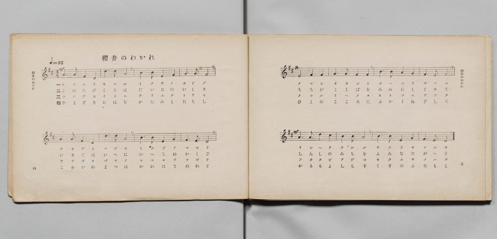
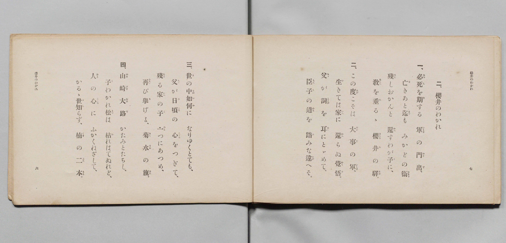

# 櫻井のわかれ

> Re:Shōka 使用 AI 協助辨識與重建樂譜，可能會有錯誤。歡迎回報。

- **鋼琴伴奏版**：<br><audio controls src="sakurai_no_wakare.mp3"></audio>

- 詞：文部省
- 曲：文部省
- 文部省《尋常小學唱歌 第四學年用》（明治四十五年五月，4080）

## 說明

原書資訊與歌詞全文（對應 P005.jpg–P006.jpg，原書 pp. 4–7，第 2 首）：
調性與拍號：ニ長調（D 大調）4/4 拍，速度 ♩=96


## 歌詞

```text
一、
必死（ひっし）を期（き）する　軍（いくさ）の門出（かどで）、
亡（な）きあと迄（まで）も　みかどの衞（まもり）
殘（のこ）しおかんと　還（かへ）すわが子（こ）に、
教（をしへ）を垂（た）るゝ　櫻井（さくらゐ）の驛（えき）。

二、
この度（たび）こそは　大事（だいじ）の軍（いくさ）。
生（い）きては家（いへ）に　還（かへ）らぬ覺悟（かくご）。
父（ちゝ）が詞（ことば）を　耳（みゝ）にとゞめて、
臣子（しんし）の道（みち）を　踏（ふ）みな違（たが）へそ。

三、
世（よ）の中（なか）如何（いか）に　なりゆくとても、
父（ちゝ）が日頃（ひごろ）の　心（こゝろ）をつぎて、
殘（のこ）る家（いへ）の子（こ）　一（ひと）つにあつめ、
再（ふたゝ）び擧（あ）げよ、菊水（きくすゐ）の旗（はた）。

四、
山崎大路（やまざきおほぢ）　かたみとたちし、
子（こ）わかれ松（まつ）は　枯（か）れはてぬれど、
人（ひと）の心（こゝろ）に　ふかくねざして、
かるゝ世知（よし）らず、楠（くす）の二本（ふたもと）。
```

## ABC

<div class="abc-score" data-abc-src="sakurai_no_wakare.abc" aria-label="五線譜載入中"></div>

[下載 ABC 原始檔](sakurai_no_wakare.abc)

## TMD 檔案連結

- [主旋律 TMD 檔案](sakurai_no_wakare.tmd) [[在 TMD Studio 編輯](https://tmdlang.github.io/Tmd-TS/#tmd=s7IKdvYPcrWy4qpTUCpJTLdSSM7PyUlNLsnMz7PKyszLyo8vzshPT8wuBdHZiUpwdWX5OaW5qVbpRYkpqfEm8SYGFgYIyeL80qLkVKvi5Iz8_Jz4ktSKkqT8_Gx0-fiCxPRUqwADA1OETEFRfllqXmIeUHdBUWZeSWoKWDtCQWpZZkoqSLostSgzLTM1BclJqUXFIHdDTS8pSswrTi7KLAB5BqEqv6gE6KOixIKMSquMzOKS_KLM5MSc-OzEPCTflWSkAj0Hka5EF87NzMksSUQWB5qRnplnlZufl1QKDCclLi0thWerdz_ZNfVx47rHTf2PG7sfN_UoaGlxKdoqWJpx2dsquHDZmOib2IGMeLFy3vs9s55Na3_ZvOL5nEawsc9mb8IUg_EeN3Q93dD9dMeOpxv6n67d8XTKxmdrexSer1nzdPZsEH_nludTVjxu6H6_p-PZjL5nm3aDxHsbn-yaApQCks_mdLzf0wOKsvd7OpW4uPS1FGypBbgUFBSe9s1_NnvHi83tL1Z0vehoBzoO6MWnrSuAHgA66emG3mftnQqgeNfLKkh_1DAZyDQDMYGOgmhVKCjQUzABypgDhYD-UjBSeLlsGtCxwDABWfBi1f5nDctBRnf3vpg5Hyj6uLn75dTtQHGgBS4KT5csBzM7gUGsAFQDNOVlw_ynu5YpPJq50hYYASBDnuxoeNzQCHbv_tZna3cDdT5u3PS4cfHjxulArY-bJj2bAzQaKAjU3_m4cebjpu7HDQ0vdgO5QMGWx43AeJ0Kllr3clrD0_ZdYPHux40rHzcuB4lDTH-yayFYYhVYae_jxqbHjSte7G8BC-6DKm1qAhr9uHE_TP-6FwuBiQKsACjV1AVUAzLr2boZYNF1jxsng42b_rixC5y6JgMNBRrxsgliLtCUHTBXA53Z83TtBLA4RNdqqNOeTZ0JEm2aBDYIrKFp0tN5TWClQL8DuUCj5wLNhaRmsDgwTfc_bgJKAU0E-33lbLA4LKAamiDBu6sHagvQVqAyYOhDjH3cuBmsESg493HjeqDhwOh6sguUWh83LgAHLNCTIJOxBDXQcKCJz6dAIgboV0iQLgMa9HTdNphqiNeBvsQID6C7G9e8WLbrWRPEBKA40OgpSEZ3QExZCPQ32BRQ2oUEHSiEGzdAAgmUEBqA_gCK74epXA1S0DTvcVMjyEEQv79oXwwL-ungSAInLWCggWICrLkRmDpgJu7oBwtuBasBSq16CfI1JNB6wII7QIEGC-Ed8CS2A5g5gPEIzNYgw5_sWAtJcUD_AUWeLmt6shdiDjBsQCKQsAEpaOp63NQGDgOg35aBkyHYRMxgeDZ96csFzbBMMuVxEyRXrAPF336I-GRQWoGIg5LUkseNfYiQQE-6Td0YEbYOJZU2NABzKMy-FWAFQBOBgQzMP0tAgQzNvG2QRLIVFEpQx25-NhmYq4CCwJQM5E4ChgxQ9Yv-rmcbtkByNNjLwLwBTcPPpgPjBSi-HprsoSEMLDdhtmzc-HRLH6hc2b4eHNRARwPz7jSwUcAcuPtx4yKIo8FpChhfwOgDBimQsRAU9VBTkP0Hqxaezd0HKwqWgF0DyhLP5oGtgcRWUw_YZcBEvgbMXgkvWSBFDjx81mGJCWhUA4MHktbXgl0NzO6wiAG7ApTNgano-fylkIQEKwOB-mcB1T1bugBsLijQoGlsV8-zOWuQQh5UqiGyEeUVCRQoaOlzcQUDGyBFiZl--eGJ2YlFwDZDZmJevkONQU01yC4FGwstOzADW0UGqheBCenFwh4FDRMFYI35fH2DDrz20cSiAWgjyLAaherctFoFUwVdIDRVMAaShkBco2AYBxYCUhA5kJgZmDYDVlS6YJU1CiZgERMwD6wGbKiPYY3C4-ZJYJHHzc0Kj5u2g1mbwHoeN62FyDTtBIqthpv-uGkJVHw9EG8F6-iDykBUPW7uBOJ2VLuMgPKNkyHyjeuAeD6YtRmiEy4zF4jXI-xqXAAVbwHiGVC9EJkWqEw_EE9FtcsY5K8VULf0AXEX2L0g1yG7fzVQphthF1gVSMcqIF4G9SFEpgMq0wbEi1DtMgGZCHPLPiCeBmb1Ql0JNbNxNxDDdYKSOVR8PhDvB7NA7gXJgMIFxF8IxNPhduFPUrt6yElSpKcmUDqqgaYiI7Ae9NQE9S8w7TxuAvkXEnYgmXnQMGxHDkMgG-pfcGx0QmMMVccicJxgpiZYqPcCMTi-wCkHWWYHECOlXHioA8WbwHY1rkGTAaWmKah2gVNTI9QtjUCdID2QfAOK-y1QGaCPwS6H5RJQygb5azNYDilfNUNd1wTMBcAUhZGaYHmhCeQWkLtAzXWIK_dBXbkELZdAXQ9UBxGHhAdIBuRWmMxKuF0ECqhOsgqoglpwGgFBUArBLHkgIrD0BEphqOkJW-kEC1FIeEJKKFDoQtIDJNWAZWDpDF4GzQCXXCAWNFWA4w0WI_B8j5SeFsLsArOAzQxoGMLKphVAvAFsAjTuwTkXJLMfms4QuRgS1sCWATQu0NMTmr_A5StS2QRyPVgNRB65nO6ApiCIH0B6ILkJJPq4GeYH5PQESncwHyCXoDB_TQaa0QtmQV3RCCrVQfxucI4AsUApGCQDKt1A_Oko_sKbnoANF4orPHDBZA52A3L6gaR_0kooSGiAUhIolJHyZRM0NoFxgVrfQUMDVN81g-L1cTMoFSBi8XETMGVAa0vUFAUpv4FtbSgbEfawlAMs5cGpCZaTYSEPSlGgNA6pD0AyoNQIK9PmotoFTlGQOhDkC4hPHjeD4hcpfTRtgteKEHGIiyH1OCSnoPmrGVgCQUMFNUXByhtg-gBiEAua--A-BrYAGmch-QuUikCunwkNA4hPkeq7piZo-oTYVcvFpWungNbWUgAKKXMBAA)]
- [鋼琴伴奏 TMD 檔案](sakurai_no_wakare_piano.tmd) [[在 TMD Studio 編輯](https://tmdlang.github.io/Tmd-TS/#tmd=s7IKdvYPcrWy4qpTUCpJTLdSSM7PyUlNLsnMz7PKyszLyo8vzshPT8wuBdHZiUpwdWX5OaW5qVbpRYkpqfEm8SYGFgYIyeL80qLkVKvi5Iz8_Jz4ktSKkqT8_Gx0-fiCxPRUqwADA1OETEFRfllqXmIeUHdqSmZJflFmYk58YlFRYl56am5qXglCZWpZZkoqSF1icnJ-bkFiXiaqfFlqUTHIFwWZiXn58TgU5ReVAL1XlFiQUWmVkVkMsi8ZaGF2Yh6SV0sygFZDpSvRhXMzczJLEpHFgWakZ-ZZ5ebnJZUCA02JS0tL4dnq3U92TX3cuO5xU__jxu7HTT3v93S87N7zfMKWJ3u2PF3a_7yz4_2eTgUtLS5FWwVLMy57WwUXLhsTfRM7kLkvVs57v2fWs2ntL5tXPJ_TCLbr2exNmGIw3uOGrqcbup_u2PF0Q__TtTueTtn4bG2PwvM1a57Ong3i79zyfMqKxw3dQFc8m9H3bNNukHhv45NdU4BSQPLZHKBzekCRCnSVEhdXMDAFFCVm-uWHJ2YnFgEjDRSoQR4ONQY11VwKQGBjoWUHZuhrKdiiA5DFT3Y0vFjYo6BhogB00vP1DToKoIjXyypI18SiQUsfbFiNQnVuWq2CqYIuEJoqGANJQyCuUTCMAwsBKYgcSMwMTJspGAFJkMoaBROwiAmYB1YDNtTHsEbhcfMksMjj5maFx03bwaxNYD2Pm9ZCZJp2AsVWw01_3LQEKr4eiLeCdfRBZSCqHjd3AnE7ql1GQPnGyRD5xnVAPB_M2gzRCZeZC8TrEXY1LoCKtwDxDKheiEwLVKYfiKei2mUM8tcKqFv6gLgL7F6Q65Ddvxoo042wC6wKpGMVEC-D-hAi0wGVaQPiRah2mYBMhLllHxBPA7N6oa6Emtm4G4jhOoFsiL2gUHjcuB_MArkXJAMKFxB_IRBPh9uFP0nt6iEnSZGemkDpqAaaiozAetBTE9S_wLTzuAnkX0jYgWTmQcOwHTkMgWyof8Gx0QmNMVQdi8BxgpmaYKHeC8Tg-AKnHGSZHUCMlHLhoQ4UbwLb1bgGTQaUmqag2gVOTY1QtzQCdYL0QPINKO63QGWAPga7HJZLQCkb5K_NYDmkfNUMdV0TMBcAUxRGaoLlhSaQW0DuAhaSUFfug7pyCVougboeqA4iDgkPkAzIrTCZlXC7CBRQnWQVUAW14DQCgqAUglnyQERg6QmUwlDTE7bSCRaikPCElFCg0IWkB0iqAcvA0hm8DJoBLrlALGiqAMcbLEbg-R4pPS2E2QVmPW6EhTqsbFoBxBvAJkDjHpxzQTL7oekMkYshYf24CZhewHGBnp7Q_AUuX5HKJpDrwWog8sjldAc0BUH8ANIDyU0g0cfNMD8gpydQuoP5ALkEhflrMtCMXjAL6opGUKkO4neDcwSIBUrBIBlQ6QbiT0fxF970BKxRKa7wwAWTOdgNyOkHkv5JK6EgoQFKSaBQRsqXTdDYBMYFan0HDQ1QfdcMitfHzaBUgIjFx03AlAGtLVFTFKT8ftwEDGEwGxH2sJQDLOXBqQmWk2EhD0pRoDQOqQ9AMqDUCCvT5qLaBU5RkDoQ5AuITx43g-IXKX00bYLXihBxiIsh9Tgkp6D5qxlYAkFDBTVFwcobYPoAYhALmvvgPga2ABpnIfkLlIpArp8JDQOIT5Hqu6YmaPqE2FWLo6nlg9zUMoE2taCJxTBewTRe2xBOA0ufeAUz7CKm8fEKRvHapvGgehDOBqqDeRRYGZJpHFgW0zhQ-YhiE9QIbGJIFpnEa5vhMxXZ4zBtZLsUGOq6dgpoAR_tYxgLtg2blBFuKWPcUiZwKWUuAA)]

## 分析

```text
================================================================================
📊 TMD Song Profile: [ 櫻井のわかれ ]
================================================================================
⏱  Duration:       0:40 (40.0s), 16 measures total
🎼 Key & Tempo:    首調基準 D, != 96.0 BPM, <4/4>
   - 分析範圍：      由實際發聲的音符與和弦推測調性；播放脈絡另行呈現
🎤 人聲音域:    D4 (MIDI 62) – D5 (MIDI 74) [跨度: 12 個半音 / 1.0 個八度, 難度: easy]
   - 最低音:  D4 in [SakuraiNoWakare #1 @ m.1, 0:01]
   - 最高音: D5 in [SakuraiNoWakare #1 @ m.2, 0:02]
   - 適合: soprano, mezzo-soprano, contralto, tenor, baritone, bass
🏛  結構:      SakuraiNoWakare (40.0s)
⚡ 編曲密度:        Peak 1 軌道同時演奏
🗝  調性診斷：       D 大調（純淨自然大調，未偵測到可信轉調）
   - 風格氣質:    純淨自然大調（陽光明朗、易唱易記，無明顯調外色彩）
   - 轉調歷程:    全曲維持單一推測調性（未偵測到可信轉調）
   - 核心骨幹音:  F#, A, D, B, G
   - 調性數值:    D 大調 [相關度: 0.86, 穩定度: High, 自然音純度: 100.0%]
   - 候選調性 (K-S): D 大調 (0.86), B 小調 (0.72), F# 小調 (0.70)
   - 五度圈歷程:   +2
   - 各段落調性細節:
     • [SakuraiNoWakare #1]: D 大調 (r: 0.86, 自然音純度: 100.0%)

  [ 五度圈游移軌跡 ]
               C  
         F            G  
      Bb              [D ]*
      Eb               A  
         Ab           E  
            Db       B  
               F# 
     (* = active key center)

  [ 十二半音累積音高分佈 ]
     C  :                            0.0%
     C# : ██                         1.6%
     D  : █████████████████         17.2%
     D# :                            0.0%
     E  : ██████████                10.2%
     F  :                            0.0%
     F# : ████████████████████████  24.2%
     G  : ███████████               10.9%
     G# :                            0.0%
     A  : ████████████████████      20.3%
     A# :                            0.0%
     B  : ███████████████           15.6%
--------------------------------------------------------------------------------
Assignment 軌道音域：
  - Piano         : D4 – D5 (12 個半音 / 1.0 個八度, 56 個音符)
================================================================================
```


## 原書掃描頁






