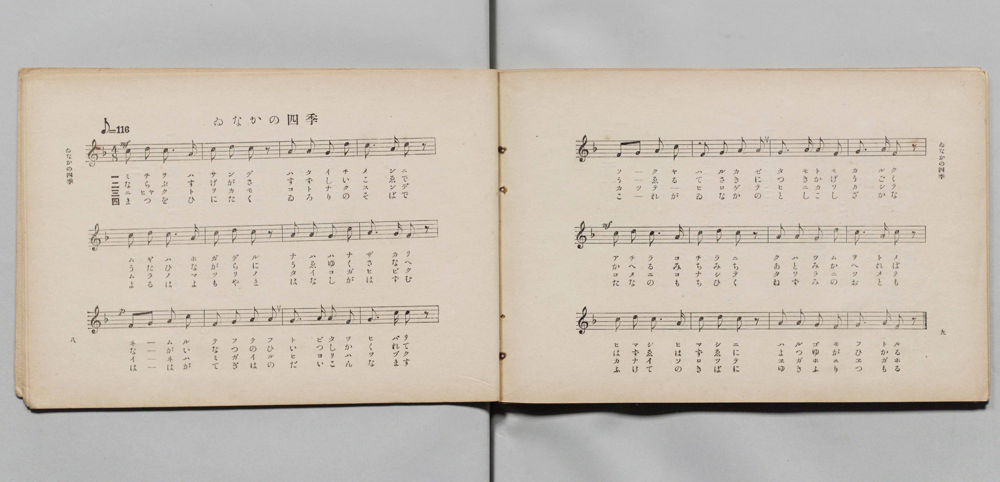
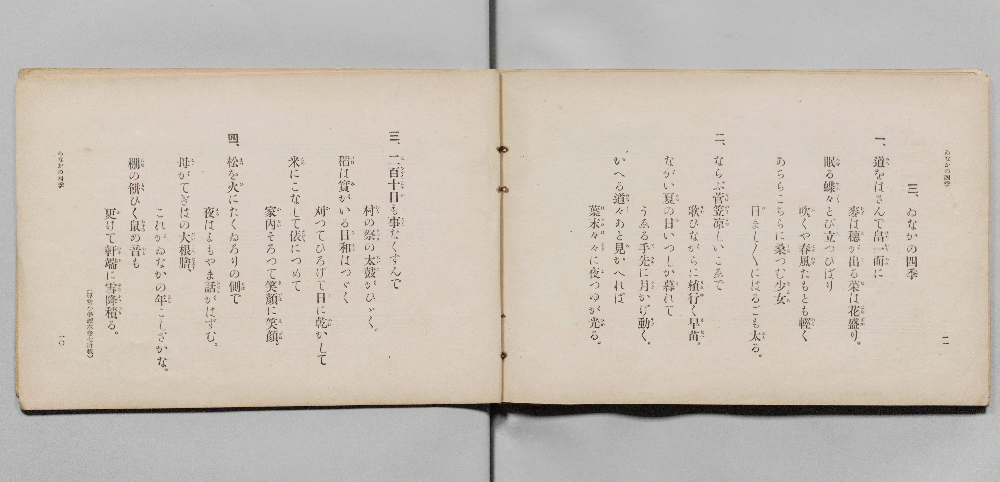

# ゐなかの四季

> Re:Shōka 使用 AI 協助辨識與重建樂譜，可能會有錯誤。歡迎回報。

- **鋼琴伴奏版**：<br><audio controls src="inaka_no_shiki.mp3"></audio>

- 詞：文部省（尋常小學讀本卷七所載）
- 曲：文部省
- 文部省《尋常小學唱歌 第四學年用》（明治四十五年五月，4080）

## 說明

原書資訊與歌詞全文（對應 P007.jpg–P008.jpg，原書 pp. 8–11，第 3 首）：
調性與拍號：ヘ長調（F 大調）4/8 拍，速度 ♪=116


## 歌詞

```text
一、
道（みち）をはさんで畠一面（はたいちめん）に
麥（むぎ）は穗（ほ）が出（で）る、菜（な）は花盛（はなざか）り。
眠（ねむ）る蝶々（てふ〳〵）、とび立（た）つひばり、
吹（ふ）くや春風（はるかぜ）、たもとも輕（かる）く
あちらこちらに桑（くは）つむ少女（をとめ）、
日（ひ）まし〳〵にはるごも太（ふと）る。

二、
ならぶ菅笠（すげがさ）、涼（すゞ）しいこゑで
歌（うた）ひながらに植行（うゑゆ）く早苗（さなへ）。
ながい夏（なつ）の日（ひ）いつしか暮（く）れて、
うふる手先（てさき）に月（つき）かげ動（うご）く。
かへる道々（みち〳〵）あと見（み）かへれば、
葉末々々（はずゑ〳〵）に夜（よ）つゆが光（ひか）る。

三、
二百十日（にひゃくとをか）も事（こと）なくすんで、
村（むら）の祭（まつり）の太鼓（たいこ）がひゞく。
稻（いね）は實（み）がいる、日和（ひより）はつゞく、
刈（か）つてひろげて日（ひ）に乾（かわ）かして、
米（こめ）にこなして俵（たはら）につめて、
家內（かない）そろつて笑顔（ゑがほ）に笑顔（ゑがほ）。

四、
松（まつ）を火（ひ）にたくゐろりの側（そば）で、
夜（よる）はよもやま話（はなし）がはずむ。
母（はゝ）がてぎはの大根膾（だいこんなます）、
これがゐなかの年（とし）こしざかな。
棚（たな）の餅（もち）ひく鼠（ねずみ）の音（おと）も
更（ふ）けて軒端（のきば）に雪降積（ゆきふりつも）る。
（尋常小學讀本卷七所載）
```

## ABC

<div class="abc-score" data-abc-src="inaka_no_shiki.abc" aria-label="五線譜載入中"></div>

[下載 ABC 原始檔](inaka_no_shiki.abc)

## TMD 檔案連結

- [主旋律 TMD 檔案](inaka_no_shiki.tmd) [[在 TMD Studio 編輯](https://tmdlang.github.io/Tmd-TS/#tmd=s7IKdvYPcrWy4qpTUCpJTLdSSM7PyUlNLsnMz7PKyszLyo8vzshPT8wuBdHZiUpwdWX5OaW5qVbpRYkpqfEm8SYGFgYIyeL80qLkVKvi5Iz8_Jz4ktSKkqT8_Gx0-fiCxPRUqwADA3OETEFRfllqXmIeUHdBUWZeSWoKWDtCQWpZZkoqSLostSgzLTM1BclJqUXFIHdDTS8pSswrTi7KLAB5BqEqv6gE6KOixIKMSquMzOKS_KLM5MSc-OzEPCTflWSkAj2Xl1hSWpSKLlqcmlicn1eMLpySmJlTGZ-TmYakAWh2emaeVW5-XlIpMPyUuLS0FB43TXjcuOpxY_fjxnVPZ89-unaxgpYWl6KtgqGhGZe9rYIbl42JvoUdyIwXK-e93zPr2bT2l80rns9pfL-n4-mG7qc7djzd0P907Y4X6xqezVnztHf7kx3NzzobXuzpfL-nE2z3s9mbkPVBxGC8xw1dyKY8nbLx2doehedr1oAds-Ppzi3Pp6x43NANtO3ZjL5nm3aDxHsbn-yaApQCks_mdLzf0wOKb7B1XPpaCrbUAlwKCgpP--Y_m73jxeb2Fyu6XnS0Ax0HDIanrSuAHgAHQO-z9k4FUKLRyypIf9QwGci0ADGBjoJoVSgo0FOwAMoYGgLFgB5TMFZ4uWwa0LXAQAHZ8GLV_mcNy0Fmd_e-mDkfKPq4ecbLqduB4kAb3BSeLlkOZnYC40EBqAZoysuG-U93LVN4NHOVLSiaQKY82dHwuKERxHrZOBmo73Hj_seNC4G6HjdNety4_nHj1MdNkx83Ln8-dQFQ6cu5i8BqgOLzHze2AFU-bmoEKgCpb1wNNmXXUpCKpobHjX1g0fXPV04H69kN5vY8bd8F5i4H29ENtPxF_xywyCqI-hddG5_Png2zBpjEpgFTGVhx1-OGJpAdz-csAEuvBVoDMeXF3G2PG1rBgsseN2593LD5ccNWkFRD4-PGFY8bNz9fDUoJQFeD7VjyuHHT48YNYBPBfn86YSdYGqynsf9xU8uzGUtfLloBdQXQmaCEDnQmxMT5j5uaQOY2Nb3YMxWsphuoBqIXZNzjRqA0MGiAfGDYQRirny2cCFbaDzQR6oqmhqcbJj5duhkcYsDgBpoIzB4gO0CmPJsODspGYC4Aqt73uHE6xF9As2COmgJ0wtMlwIADuR2oHxamTZC43dUDNQoUjiBHbHvR3_p8DST0Zj5uBFrZA4xhiJXPtu2BijcB8ytQ8XRwDE9-3DQRGFtgB63tAatog4UjMBCB8dMD9d-S3hcLYQqAepraIAHybPrKF92QJDAVrH4H2D5wTEL1N7Y8XdIPSQPAYAFrW4fqe6BDgJEGdFH3s1nrIMEI9itQ7zK4H4Hu2gr0_rPO7qetwNwNSQxAO4FJH-xAUJYHCgINgogAA3DS025IBAL1ToFGPsxpQOkdQOOA-QKWtkBZA5G2QJG84sUySMICZTSYFqCjNkAd9WJi57M5q4H6YUYAk_QsUOggTFn9dAk4_TcBXQdJFUC39DxtBeZzkPdhiR8RqztgCQQYv89n7gOWarCwAqaLTY-bmsFpDJiWgNEL0dv0ZBfElcDUCE4joHAGqgFGNShvw9LbXHACBWbdJlAZDIyD50vXgrUB0x7QWV0QQWB6e7kHUlRAygBI7gd6Gmj3PEQAPl8BzPFARUAVQFNAOfvp-mVIYQWKdkgBAHT-00mQlAM0AugCiE3AoALaCjERkks7IBEIyWnAaARGL1BDLzghL0NNMKuf7NwHy5ngpAKKG2D6gaWW5xvBuQ6UvMFZDhR2wLAAhgtI0ZP9wLiBeBCY0SChAVQAdA4w98OMeLpu29NWYDEGtgSkswWsbi7YRSDXPV8z8eVCYKoC-giYhYD-hRSBq7GLQ6MXWE_B4wPiA1DoQwrk542rkb0Idh-wsJoAshFYlgHjpnELWMFcYAoEq4HFLTyNwcopoLeA7CZgSQe04MXKjUjlLTCvQqIHklaB9QM4Pp-tB-YaSHE4F6YCGAF9YHXAVLH82YKdL9ogTl4AKzogQQr0wUxEuQaWAGoGlhtIbYidEJcDC2uI_UCdwJgAlf0gNVAnLJ4FixZIZbHu5RJwtgIVx-BKC5Rf-l_ugdUPQPdDU9u6l_MhEQ4MJkgxCTFxNsRaSFYExsayF7snPV8NLKCBguuABQUsIFe_nL3q5cze5yvBgQDKokApYGkDNA6YKpoQWRRoKFAFwRYOSB3lLQ0oUNDS5-LyzEvMTvTLD87IzM60CshMzMt3qDGoqQZZpGBjaKZlB2Zha-eAmk3Ayh1YeitomCgAHf18fYMOvHGiiUUD0D6QYTUK1blptQqGCroKRkAMos3igUSNgimIQhAGYEGwHJiA6agBNmp0wWwQDVYFNtjHsEbhcfN8IP9xcyOY3AQm-8F6HjdtBfM2g8l2IAmxFCL_uGk_mFwC1w2SWQi2B6TncXM3TAfELiOgfOMqsJ5OENm4DUzOhOhsnATm9YDJqQi7wPLABAYmp4PJFqjMZIhdTROB7OWodhmD3AKy_3HzpMfNi8HK1oO5HVCHgj3atBostghhXRPEsyBVj5u74PpAMjuRvAYPDIh1JiDn7AM7DhwcTRDPgOwAyYBtaQQHcyMo6GB2TQCr7QWTYLsa10F1zIXY1bgBxWv4U9auHnJSlinQZBAGJQxQcoEmH3Bygqch5ISGJAhLVCAeeqJaAPYVyD_Q5NI8G-rrNWAeKAQfN0PCH-R3eLKCkpCwByURkB6QOkjogxIQeqJqQwpfcLyCkxlIBpycoMkNEgsgtSATJ4JlIDrBNoITHSyJQkJ_B6pd4EQF9lfzSjDZBybnQV0PSpYQ90FlwBkEZBckTYBTFtT3oPQB0gNJwrBUhpaimsCpsAmcjBvBqRcsApJpAvPANkLTHTSVQjIYNKNAMhNMBpSFIHY1wO0iUFZ1klVWFdRCEgkIIpJMDTiZIJdhOJIaSBqUHkE0eqoC5RVIOoDEAyhOQeLgeGwGxSAyGyQDycmgcIYWWOB4AsmA4gDEn4AjVSHSASQcYcUOJITBcQrOr4h8DokPiAwkBkBxB5IBpTCQC3qA7GWodoFSFTiFQFwDLg1gBTCkaIakGWhBC_MxuIRpXgEmIWkOpgfkChC_FXuqAqcHiL_AaQrsO5A4yF3AdgaSDKw0Aoc11HeQkASRiDACpUFIQU1EqgI2vMhJVaC0ASpvQKkCRONIPHAmcVUfKJUg8t_jZlAYI0oicIkBqSOa9kBkoGkIVGPA0haIjSijQLowwh1eSkFCC1ytgvM1ItzBabcRHPvgkgokA0lJEDFIKQAtN6BmAftSyDUKUnqClKvNYBKSH2Alzlqw3ZBqHlUGbANUJ6S0gbqjaTvM5WAd6OkJUYZB8gk0PUFqN2hugbgelp7AqRaaQ8DpCcwGyUyD-qsbqpOoem8K2S0q5MoPRAPTD5IIJPkgJyaIGjzVXhMkYUDaUuBKAlzsg4IXSQwa1NCCGZrYINUHpFiDFijgBAYJeFC7Cj1BQQIVVEnBKglohdMIUg3hwdigCgMR9BAZhH6Qy0HRBmt0YCYoSLMIbBbU9TB_QSpqUBKBJihYtQf1F5KP4UUvpJWIK0FBKnJIwgEXsODqDuEvSBUPqbRByRlWucH8BSmUoY0KsI8hyRNkCjEFVOtachIUKH3ACieksghRSkEa5yiNeLAIJLlhb0VBSnlQCwMWxNBSA0MMpWkOLbm2gNnQ8glaO0LKLJA8enKClPng5jakdQRvOSCLwXXC2ifQFi-kJQWrSyBRBEkoaN0ApPIJknQg-vdCXQkun5BKLpi_NoJVQVpPoJYkIiTQZdCTE7i0bYS4HlLWwsohSMkKSu6o_oL4BSILKathiQniVkjrC-GvWi4uXTsF5I6hApCvzAUA)]
- [鋼琴伴奏 TMD 檔案](inaka_no_shiki_piano.tmd) [[在 TMD Studio 編輯](https://tmdlang.github.io/Tmd-TS/#tmd=s7IKdvYPcrWy4qpTUCpJTLdSSM7PyUlNLsnMz7PKyszLyo8vzshPT8wuBdHZiUpwdWX5OaW5qVbpRYkpqfEm8SYGFgYIyeL80qLkVKvi5Iz8_Jz4ktSKkqT8_Gx0-fiCxPRUqwADA3OETEFRfllqXmIeUHdqSmZJflFmYk58YlFRYl56am5qXglCZWpZZkoqSF1icnJ-bkFiXiaqfFlqUTHIFwWZiXn58TgU5ReVAL1XlFiQUWmVkVkMsi8ZaGF2Yh6SV0sygFZb5SWWlBaloosWpyYW5-cVowunJGbmVMbnZKYhaQCanZ6ZZ5Wbn5dUCgxMJS4tLYXHTRMeN6563Nj9uHHd09mzn65d_H5Px8vuPc8nbHmyZ8vTpf3POzve7-lU0NLiUrRVMDQ047K3VXDjsjHRt7ADGfxi5bz3e2Y9m9b-snnF8zmNQM1PN3Q_3bHj6Yb-p2t3vFjX8GzOmqe925_saH7W2fBiTyfQLLCDns3ehKwPIgbjPW7oQjbl6ZSNz9b2KDxfswbswh1Pd255PmXF44ZuoG3PZvQ927QbJN7b-GTXFKAUkHw2B-jmHlCKAFvH5ZmXmJ3olx-ckZmdaRUAio4gD4cag5pqLgUgsDE007IDs_S1FGzRAcjaJzsaXizsUdAwUQA66Pn6Bh0FUJrRyypI18SiQUsfbFiNQnVuWq2CoYKughEQg2izeCBRo2AKohCEAVgQLAcmYDpqFIyBJIgNosGqwAb7GNYoPG6eD-Q_bm4Ek5vAZD9Yz-OmrWDeZjDZDiQhlkLkHzftB5NL4LpBMgvB9oD0PG7uhumA2GUElG9cBdbTCSIbt4HJmRCdjZPAvB4wORVhF1j-ceMsMDkdTLZAZSZD7GqaCGQvR7XLGOQWkP2Pmyc9bl4MVrYezO2AOhTs0abVYLFFCOuaIJ4FqXrc3AXXB5LZieQ1eGBArDMBOWcf2HHg4GiCeAZkB0gGbEsjOJgbQUEHs2sCWG0vmATb1bgOqmMuxK7GDShew5-ydvWQk7JMgSaDMChhgJILNPmAkxM8DSEnNCRBWKIC8dAT1QKwr0D-gSaX5tlQX68B80Ah-LgZEv4gv8OTFZSEhD0oiYD0gNRBQh-UgNATVRtS-ILjFZzMQDLg5ARNbpBYAKkFmTgRLAPRCbYRnOhgSRQS-jtQ7QInKrC_mleCyT4wOQ_qelCyhLgPKgPOICC7IGkCnLKgvgelD5AeSBKGpTK0FNUEToVN4GTcCE69YBGQTBOYB7YRmu6gqRSSwaAZBZKZYDKgLASxqwFuF4GyqpOssqqgFpJIQBCRZGrAyQS5DMOR1EDSoPQIotFTFSivQNIBJB5AcQoSB8djMygGkdkgGUhOBoUztMACxxNIBhQHIP4EHKkKkQ4g4QgrdiAhDI5TcH5F5HNIfEBkIDEAijuQDCiFgVzQA2QvQ7ULlKrAKQTiGnBpACuAIUUzJM1AC1qYj8ElTPMKMAlJczA9IFeA-K3YUxU4PUD8BU5TYN-BxEHuetwITrlQGVhpBA5rqO8gIQkiEWEESoOQgpqIVAWsYMlJVaC0ASpvQKkCRONIPHAmcVUfKJUg8t_jZlAYI0oicIkBqSOa9kBkoGkIVGPA0haIjSijQLowwh1eSkFCC1ytgvM1ItzBabcRHPvgkgokA0lJEDFIKQAtN6BmPW6cglyjIKUnSLnaDCYh-QFW4qwF2w2p5lFlwDZAdUJKG6g7mrbDXA7WgZ6eEGUYJJ9A0xOkdoPmFojrYekJnGqhOQScnsBskMw0qL-6oTqJqvemkN2iQq78QDQw_SCJQJIPcmKCqMFT7TVBEgakLQWuJMDFPih4kcSgQQ0tmKGJDVJ9QIo1aIECTmCQgAe1q9ATFCRQQZUUrJKAVjiNINUQHowNqjAQQQ-RQegHuRwUbbBGB2aCgjSLwGZBXQ_zF6SiBiURaIKCVXtQfyH5GF70QlqJuBIUpCKHJBxwAQuu7hD-glTxkEoblJxhlRvMX5BCGdqoAPsYkjxBphBTQLWuJSdBgdIHrHBCKosQpRSkcY7SiAeLQJIb9lYUpJQHtTBgQQwtNTDEUJrm0JJrC5gNLZ-gtSOkzALJoycnSJkPbm5DWkfwlgOyGFwnrH0CbfFCWlKwugQSRZCEgtYNQCqfIEkHon8v1JXg8gmp5IL5ayNYFaT1BGpJIkICXQY9OYFL20aI6yFlLawcgpSsoOSO6i-IXyCykLIalpggboW0vhD-qsXWL_RB7hdaQLuFsJ5cPDBJaBuCaJN4bWASAaYLhJABKDXFA1MOhAsWRlcAqxURglBlMI0wGqEGTSReG5gqUQwDNdyQ7MXiMpx2AI0D8kAmgliY7kPIY9NNpGfRgw6q1gSnbmRbcfgZoQTTe9CogEnA7MFiFjAB6NopIKeBaB_DWLAVGOJGOMSNcYibwMWVuQA)]

## 分析

```text
================================================================================
📊 TMD Song Profile: [ ゐなかの四季 ]
================================================================================
⏱  Duration:       0:24 (24.8s), 24 measures total
🎼 Key & Tempo:    首調基準 F, != 116.0 BPM, <4/8>
   - 分析範圍：      由實際發聲的音符與和弦推測調性；播放脈絡另行呈現
🎤 人聲音域:    C4 (MIDI 60) – D5 (MIDI 74) [跨度: 14 個半音 / 1.2 個八度, 難度: moderate]
   - 最低音:  C4 in [InakaNoShiki #1 @ m.2, 0:01]
   - 最高音: D5 in [InakaNoShiki #1 @ m.18, 0:17]
   - 適合: soprano, mezzo-soprano, contralto, tenor, baritone, bass
🏛  結構:      InakaNoShiki (24.8s)
⚡ 編曲密度:        Peak 1 軌道同時演奏
🗝  調性診斷：       F 大調（純淨自然大調，未偵測到可信轉調）
   - 風格氣質:    純淨自然大調（陽光明朗、易唱易記，無明顯調外色彩）
   - 轉調歷程:    全曲維持單一推測調性（未偵測到可信轉調）
   - 核心骨幹音:  F, C, D, G, A
   - 調性數值:    F 大調 [相關度: 0.82, 穩定度: Moderate, 自然音純度: 100.0%]
   - 候選調性 (K-S): F 大調 (0.82), D 小調 (0.74), C 大調 (0.70)
   - 五度圈歷程:   -1
   - 各段落調性細節:
     • [InakaNoShiki #1]: F 大調 (r: 0.82, 自然音純度: 100.0%)

  [ 五度圈游移軌跡 ]
               C  
        [F ]*          G  
      Bb               D  
      Eb               A  
         Ab           E  
            Db       B  
               F# 
     (* = active key center)

  [ 十二半音累積音高分佈 ]
     C  : ████████████████████      20.5%
     C# :                            0.0%
     D  : ████████████████████      20.5%
     D# :                            0.0%
     E  :                            0.0%
     F  : ████████████████████████  25.0%
     F# :                            0.0%
     G  : ████████████████          17.0%
     G# :                            0.0%
     A  : ████████████████          17.0%
     A# :                            0.0%
     B  :                            0.0%
--------------------------------------------------------------------------------
Assignment 軌道音域：
  - Piano         : C4 – D5 (14 個半音 / 1.2 個八度, 88 個音符)
================================================================================
```


## 原書掃描頁






