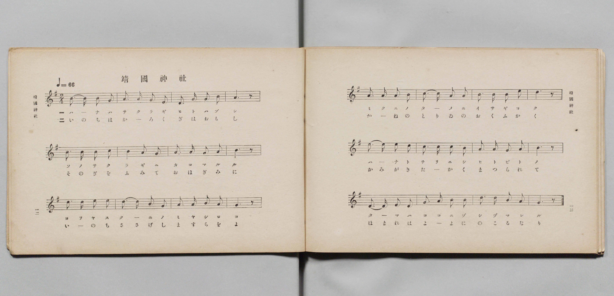
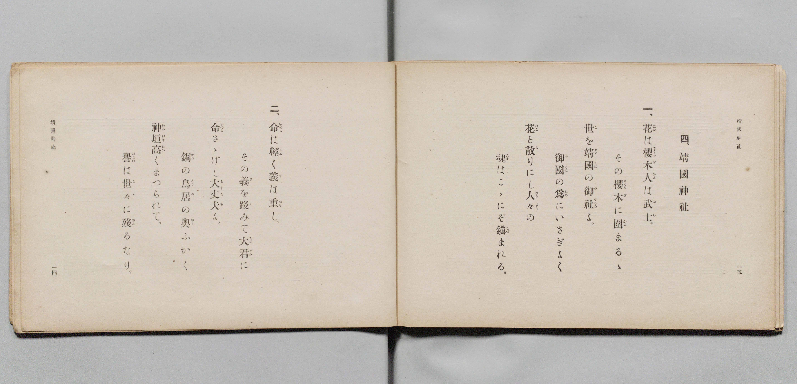

# 靖國神社

> Re:Shōka 使用 AI 協助辨識與重建樂譜，可能會有錯誤。歡迎回報。

- **鋼琴伴奏版**：<br><audio controls src="yasukuni_jinja.mp3"></audio>

- 詞：文部省
- 曲：文部省
- 文部省《尋常小學唱歌 第四學年用》（明治四十五年五月，4080）

## 說明

原書資訊與歌詞全文（對應 P009.jpg–P010.jpg，原書 pp. 12–15，第 4 首）：
調性與拍號：ト長調（G 大調）2/4 拍，速度 ♩=66


## 歌詞

```text
一、
花（はな）は櫻木（さくらぎ）、人（ひと）は武士（ぶし）。
その櫻木（さくらぎ）に圍（かこ）まるゝ
世（よ）を靖國（やすくに）の御社（みやしろ）よ。
御國（みくに）の爲（ため）にいさぎよく
花（はな）と散（ち）りにし人々（ひと〲）の
魂（たま）はこゝにぞ鎭（しづ）まれる。

二、
命（いのち）は輕（かる）く、義（ぎ）は重（おも）し。
その義（ぎ）を踐（ふ）みて大君（おほぎみ）に
命（いのち）さゝげし大丈夫（ますらを）よ。
銅（かね）の鳥居（とりゐ）の奧（おく）ふかく、
神垣（かみがき）高（たか）くまつられて、
譽（ほまれ）は世々（よ〲）に殘（のこ）るなり。
```

## ABC

<div class="abc-score" data-abc-src="yasukuni_jinja.abc" aria-label="五線譜載入中"></div>

[下載 ABC 原始檔](yasukuni_jinja.abc)

## TMD 檔案連結

- [主旋律 TMD 檔案](yasukuni_jinja.tmd) [[在 TMD Studio 編輯](https://tmdlang.github.io/Tmd-TS/#tmd=s7IKdvYPcrWy4qpTUCpJTLdSSM7PyUlNLsnMz7PKyszLyo8vzshPT8wuBdHZiUpwdWX5OaW5qVbpRYkpqfEm8SYGFgYIyeL80qLkVKvi5Iz8_Jz4ktSKkqT8_Gx0-fiCxPRUqwADA0uETEFRfllqXmIeUHdBUWZeSWoKWDtCQWpZZkoqSLostSgzLTM1BclJqUXFIHdDTS8pSswrTi7KLAB5BqEqv6gE6KOixIKMSquMzOKS_KLM5MSc-OzEPCTflWSkAj2XnFqUmpufl5mYgy6Tm5mTWZJYVIlsbGZ6Zp4VUHlSKTColLi0tBRezp32dE7386Xzni_Zp6ClxaVoq2BmxmVvq-DOZWOkb2IH0vxi5bz3e2Y9m9b-snnF8zmNYAOfzd6EKQbjPW7oerqh--mOHU839D9du-PplI3P1vYoPF-z5uns2SD-zi3Pp6x43ND9fk_Hsxl9zzbtBon3Nj7ZNQUoBSSfzel4v6cHFF_v93QqcXHpaynYUgtwKSgoPO2b_2z2jheb21-s6HrR0Q50HNCLT1tXAD0AdNLTDb3P2jsVQJGul1WQ_qhhcoCBoQGICXQURKtCQYGegqERUMrQFCgI9JmCicLLZdOAzgWGCsiKF6v2P2tYDjK8u_fFzPlA0cfNHS-nbgeKA61wV3i6ZDmY2QkMZAWgGqApLxvmP921TOHRzJW2wCgAGfJkR8PjhkawcV0bgdoeN65_3LgKqAnIeLZ697M5K8CCUx839j9uAgr2gaQagOG4Cyy-6XEjUAFY8dplTxevBgtue9w4HaysCWTu48a5jxvX4TSrcfXTOUCnAcW7HzdOBovse9zU_bhpLsR5QA93PG4CRlbn46ZJkKQEFml53DgTZFAj0E6gnnVP9y0Epi-wQfvBstMfNwHNBerqgDoEqAKqGagCSefzDmA6AwrOf9zUCHHR40agfqAz-0CaG_uxhs6KZ1MXg0UWgi3pAmubDgyXxw2t8KB53AA0GmQHyIiXa5ug9jQC3QkKM6CHgf4E65z3sm8tWHb648alsFDoAQUE0PHgkNjVA42opxP3glUC3bgOan3j-hd7pkIDsQnoRaBIP1D1830rwYKQgF7_sh0S0F2Pm4AuAYpMR4kiFNVNk17smADmbgUrBYbYMmCCejphNtSIxt2g8GkEpS-gB3C5ayrYf5OAVgE1P9nR8XQJJInsA8UeMA00TUKJopddkLADJgVgaIAC7uXmpU83QgRXgEK5CegocHQvXQ5zSD9YZCtYF8jXIIOApc3TeZD4AYoCHd_zuBGUGl6ungGLA1gwgdyyBOwWoJplsMywFuIXoCdB8QAJP2BihEYuyMGQmF39bB3ERKCXwakXGGONq0AuhfiI8tIEChS09Lm4IhOLS7NL8zK9gHVSolVAZmJevkONQU01yCYFG0MzLTswC1thBiobgZn9xcIeBQ0TBWCp-Xx9gw68BNLEogFoIciwGgVjBV0gNAbThkBco2AEFjEC88ziwUKmIAokDxIDqYSpgkADkAjYPB_DGoXHzf1Q8cfNXWASxAeKN22FiDatB4qtBLPWQWSaJ0HVd0BVP26eBtWzHckesGMg9hgB5RpbILoa1wHxQjBrPURXYzfMBU0gFjAlQMX7oDqALmgEu62pCSozHcMe_KG9q4fS0DYB2wwRAYU3tvAHsRFqsIR1015oyPVBwxcUupAwBYUwJAxAofy4GRQSIB2roaKbgWLzwDIgEZAOiAz2sJ6LFNagUATmbmjIQWIVJLcfTC6DioPCF8TfDdMBlgfJYNpDIGV3khPWpmDzTRXMgCQII0Qw0zpIBBLWIHFc6XoFNKw3AfEScBjshIYpKMwhcuD0BowNSIjOh4ougabkx81roTIQs_Cla0hog0hQ2gaJT4WKTgViUOhDUi1IZh9UZibQnk6wy6Cx09RBWlgDW1LkhDUsHEE0pHwApW5QGgeJIKdiSNpHjg_sYQ0NOXBZgRKmTaBUBAlVcJ6Hp2tQjIB0bIWneFAYI8cOtrCGlxSNoJiBhDhIHBrXTV1APAFFBpau-6FpH2IGSAZW7hGbrndNISesQWEHCkEQDQpBRFiDaOTSmcgyBKO8BqUZkHgjVHQVLA7AaRi9vJ6MogdSwuILa1A5AKyzwaxeaMhBYhsWlojyGpauQfkHkq5B-kAyoFKGlHTdupasMgRS8QEpcE0I5sLKCEipAQlv5JKFYDmClIIh5S-sftwMEQWXzJDwBvkfUQs-bm6F61kDDW98ZfZuaOjtg4YbvH6ElwoQFqREBukApXEQfzK85lwF1QFJ9cj21HJx6dopoLRaFIACylwA)]
- [鋼琴伴奏 TMD 檔案](yasukuni_jinja_piano.tmd) [[在 TMD Studio 編輯](https://tmdlang.github.io/Tmd-TS/#tmd=s7IKdvYPcrWy4qpTUCpJTLdSSM7PyUlNLsnMz7PKyszLyo8vzshPT8wuBdHZiUpwdWX5OaW5qVbpRYkpqfEm8SYGFgYIyeL80qLkVKvi5Iz8_Jz4ktSKkqT8_Gx0-fiCxPRUqwADA0uETEFRfllqXmIeUHdqSmZJflFmYk58YlFRYl56am5qXglCZWpZZkoqSF1icnJ-bkFiXiaqfFlqUTHIFwWZiXn58TgU5ReVAL1XlFiQUWmVkVkMsi8ZaGF2Yh6SV0sygFZbJacWpebm5wHdgy6Tm5mTWZJYVIlsbGZ6Zp4VUHlSKTDclLi0tBRezp32dE7386Xzni_Z935Px8vuPc8nbHmyZ8vTpf3POzve7-lU0NLiUrRVMDPjsrdVcOeyMdI3sQOZ-GLlvPd7Zj2b1v6yecXzOY1gW57N3oQpBuM9buh6uqH76Y4dTzf0P1274-mUjc_W9ig8X7Pm6ezZIP7OLc-nrHjc0A10xbMZfc827QaJ9zY-2TUFKAUkn80BOqcHFKNAVylxcUUmFpdml-ZlegHTQ6JVACg8gzwcagxqqrkUgMDG0EzLDszS11KwRQcge5_saHixsEdBw0QB6KLn6xt0FECRrpdVkK6JRYOWPtiwGoXq3LRaBWMFXSA0BtOGQFyjYAQWMQLzzOLBQqYgCiQPEgOphKmCQAOQCNhQH8MahcfN_VDxx81dYBLEB4o3bYWINq0Hiq0Es9ZBZJonQdV3QFU_bp4G1bMdyR6wYyD2GAHlGlsguhrXAfFCMGs9RFdjN8wFTSDW40aoCxr7oDqALmgEu62pCSozHcMe_EG-q4ecIEcObROwzRARUHhjC38QG6EGS1g37YWGXB80fEGhCwlTUAhDwgAUyo-bQSEB0rEaKroZKDYPLAMSAemAyGAP67lIYQ0KxcdNoDgDyUBiFSS3H0wug4qDwhfE3w3TAZYHyWDaQyB5d5KVvIGp2xRsh6mCGZAEYWBShopgpneQCCS8QeK40vYKaHhvAuIl4HDYCQ1XULhD5MBpDhgjkFCdDxVdAk3Nj5vXQmUgZuFL25AQB5Gg9A0SnwoVnQrEoBiApFyQzD6ozEygPZ1gl0FjqKmDtPAGFldkhXdBLTwsQTSknAClclBaB4kgp2ZIHkCOE-zhDQ09cJmBEq5NoNQECVlw3oenb1CsgHRshad8UDgjxxC28IaXGI2g2IGEOkgcGt9NXUA8AUUGlr77oXkAYgZIBlb-EZu-d00hu_gGBSAoGEE0KBgRAQ6ikYtqIgsUjMIblHhA4o1Q0VWwiAAnZvTCezKKHkhxiy_AQYXC48YeMKsXGnyQKIcFKKLwhiVwUEaCJHCQPpAMqMghJYG3riW7QIHUhEAKXDWCubACA1KEQMIcuZghWKggJWVIgQyrMDdDRMFFNSTMQWGAqBYfN7fC9ayBhjm-Qnw3NAT3QcMOXmHCiwgIC1JEg3SAEjuIPxlela6C6oAkf2R7arE2ZXyQmzIW0JYMMDjigYGnDWxRQGlQIyNewSheGxy08QrG8drAEMavDsQygHoQRaUJmmaQQqCBQC3o2iEsFM2YJpqAnAS2m5Br8BqHXakRzLnY9COHBC5_w1yHcBOmCGmehgQVnIHN28ghi8M4YHLQtVNASRHRPoaxCpiCRmBBZS4A)]

## 分析

```text
================================================================================
📊 TMD Song Profile: [ 靖國神社 ]
================================================================================
⏱  Duration:       0:43 (43.6s), 24 measures total
🎼 Key & Tempo:    首調基準 G, != 66.0 BPM, <2/4>
   - 分析範圍：      由實際發聲的音符與和弦推測調性；播放脈絡另行呈現
🎤 人聲音域:    D4 (MIDI 62) – E5 (MIDI 76) [跨度: 14 個半音 / 1.2 個八度, 難度: moderate]
   - 最低音:  D4 in [YasukuniJinja #1 @ m.3, 0:03]
   - 最高音: E5 in [YasukuniJinja #1 @ m.9, 0:15]
   - 適合: soprano, mezzo-soprano, contralto, tenor, baritone, bass
🏛  結構:      YasukuniJinja (43.6s)
⚡ 編曲密度:        Peak 1 軌道同時演奏
🗝  調性診斷：       G 大調（純淨自然大調，未偵測到可信轉調）
   - 風格氣質:    純淨自然大調（陽光明朗、易唱易記，無明顯調外色彩）
   - 轉調歷程:    全曲維持單一推測調性（未偵測到可信轉調）
   - 核心骨幹音:  B, A, G, D, E
   - 調性數值:    G 大調 [相關度: 0.71, 穩定度: Moderate, 自然音純度: 100.0%]
   - 候選調性 (K-S): G 大調 (0.71), B 小調 (0.64), D 大調 (0.63)
   - 五度圈歷程:   +1
   - 各段落調性細節:
     • [YasukuniJinja #1]: G 大調 (r: 0.71, 自然音純度: 100.0%)

  [ 五度圈游移軌跡 ]
               C  
         F           [G ]*
      Bb               D  
      Eb               A  
         Ab           E  
            Db       B  
               F# 
     (* = active key center)

  [ 十二半音累積音高分佈 ]
     C  : ██████                     6.7%
     C# :                            0.0%
     D  : ██████████████            16.1%
     D# :                            0.0%
     E  : ████████                   8.9%
     F  :                            0.0%
     F# :                            0.0%
     G  : ██████████████            16.7%
     G# :                            0.0%
     A  : █████████████████████     23.9%
     A# :                            0.0%
     B  : ████████████████████████  27.8%
--------------------------------------------------------------------------------
Assignment 軌道音域：
  - Piano         : D4 – E5 (14 個半音 / 1.2 個八度, 77 個音符)
================================================================================
```


## 原書掃描頁






