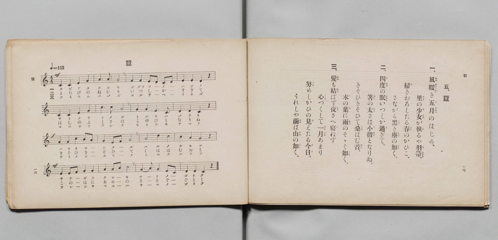

# 蠶

> Re:Shōka 使用 AI 協助辨識與重建樂譜，可能會有錯誤。歡迎回報。

- **鋼琴伴奏版**：<br><audio controls src="kaiko.mp3"></audio>

- 詞：文部省
- 曲：文部省
- 文部省《尋常小學唱歌 第四學年用》（明治四十五年五月，4080）

## 說明

原書資訊與歌詞全文（對應 P011.jpg，原書 pp. 16–17，第 5 首）：
調性與拍號：ハ長調（C 大調）4/4 拍，速度 ♩=112


## 歌詞

```text
一、
風（かぜ）暖（あたたか）き五月（ごぐゎつ）のはじめ、
里（さと）の少女（をとめ）が執（と）るや羽箒（はばうき）、
掃（は）きおろしたる春（はる）のかひこ、
さながら黑（くろ）き塵（ちり）の如（ごと）く。

二、
四度（よたび）の眠（ねむり）いつしか過（す）ぎて、
箸（はし）の太（ふと）さは小指（こゆび）となりぬ。
きそひきそひて桑（くは）はむ音（おと）、
木（こ）の葉（は）に雨（あめ）のそゝぐ如（ごと）く。

三、
髮（かみ）も結（むす）ばず夜（よる）さへ寢（い）ねず
心（こゝろ）つくして一月（ひとつき）あまり、
努（つと）めしかひの見（み）えたる今日（けふ）、
うれしや繭（まゆ）は山（やま）の如（ごと）く。
```

## ABC

<div class="abc-score" data-abc-src="kaiko.abc" aria-label="五線譜載入中"></div>

[下載 ABC 原始檔](kaiko.abc)

## TMD 檔案連結

- [主旋律 TMD 檔案](kaiko.tmd) [[在 TMD Studio 編輯](https://tmdlang.github.io/Tmd-TS/#tmd=s7IKdvYPcrWy4qpTUCpJTLdSSM7PyUlNLsnMz7PKyszLyo8vzshPT8wuBdHZiUpwdWX5OaW5qVbpRYkpqfEm8SYGFgYIyeL80qLkVKvi5Iz8_Jz4ktSKkqT8_Gx0-fiCxPRUqwADQ0OETEFRfllqXmIeUHdBUWZeSWoKWDtCQWpZZkoqSLostSgzLTM1BclJqUXFIHdDTS8pSswrTi7KLAB5BqEqv6gE6KOixIKMSquMzOKS_KLM5MSc-OzEPCTflWSkAj1Xnl-E5GiIWF5iSWlRKrJxmemZeVa5-XlJpcAgUuLS0lJ4sWCbgpYWl6KtgqGhEZe9rYIzl42JvokdSNOLlfPe75n1bFr7y-YVz-c0gg16NnsTphiM97ih6-mG7qc7djzd0P907Y6nUzY-W9uj8HzNmqezZ4P4O7c8n7LicUP3-z0dz2b0Pdu0GyTe2_hk1xSgFJB8Nqfj_Z4eUPy839OpxMWlr6VgSy3ApaCg8LRv_rPZO15sbn-xoutFRzvQcUAvPm1dAfQA0ElPN_Q-a-9UAEWyXlZBOtAlEPUKBQV6CoZmjxomG5oDBYHeUTBVeLlsGtCNwKAAmfti1f5nDctBJnb3vpg5Hyj6uLn_5dTtQHGguc4KT5csBzM7gSGrAFQDNOVlw_ynu5YpPJq50hYU8CBTnuxoeNzQCGK9XLQCqO9xY_fjxjlAXc9mAe0CcpseN84HI2AAdj5u7IWFGFBqyuPGCY-b-h43LgFLrXvcuP5x44zHTcAogZjY3gNWN_VxI9BokIqnGyY-XboZJNg0CSgIVAoW73k6fztYJVhZU_fjppbn-_Y-XzcJLAg0dMPjxjag3SBZiNHP-pohchBHPW7setwEJKeDXNrU_WzGUqjOJoirgU4DemvT48bJUP1gR60C2vy4qfPl7olg1f1AIyDGPV24FSyy8HFTF9Thy5pgXoZ4pf9xQxMkAHf1QM0Epatdy8CeA6oEhhjQoyC9z-csAOtd-7ipAWZgCzDQwM7tftnYB5adCRYHBuYyqHHP1-2AeX861BFLVoFFtsIcAfTDemCqf9YDSkkgzzUBQwli6wqQ95q6HjeuATkU7GNg-MwFBwKcsezZQpjXoSEJDLGGl_PBMQQMUog10BCfA0kekyFueTERmA7hEbD65WyIbBMsSoEhPvdxE9CaCXiCbgfM8Jer18HSHijFPm5qer51AjgkG2AhA0wCs54uAaZMcPBC4xUYADuerl8E1tsCFlkLVAaOjP2QBAIME6A7IPEKDHGgR4GBvgyY6mGJGBgMwLACSkHUAJP7PlC4QaO0CxLiQGlI0myERBpY27oXy0CFCtTJjeA4b-p-srvr2XRI8psIjCpEAIKScFMPSD8wde9cC1YBtKoNEu5PN24Eew2YMPbhS3JAgygvlqBAQUufi8s7MTM73yogMzEv36HGoKYaZIOCjYWWHZiBrTAEla3AAHyxsEdBw0QBmP6er2_QgZdgmlg0AO0BGVajUJ2bVqtgqKALxsZAbArENQpmQFIXSIJ4IFijYAIkQdhYwQio1ggoAlINwkZAbABSAzbSx7BG4XHTaiD_cdMeMLkITO4HmwKhQfzVQLwWbvrjpi1g0Q2Pm9eBGM0tYLIPItncD5bcARZbCCTjEdYZgTR3gGQa54PJzWASZApQphFiBTDVAnEXwrpGsPmNS8DkdDDZDZWZCeaBbAYmS1S7jOFeawbb1Qz2WvMCqBd2QuxqngBk70LY1bwCLAoJkq1g9gyoDrD9zb1gGZAOiF3443lXDznxjBnFhnFgBwIpSGSDxEAyIAxSBVJfA45cEAbpRY9kiF_AYQ-OqcfNm6A-BolB4upx0xqkkICohYQgyO8guh8sMwEcBqDwhiQLtBhuXI8UU-AU0giyHSQDCl0QfypUFSyGJ4PNagPLgdIEiF4BllkFlgGlBmBhjGoXOIbBKQhCNoPcAkmNIBmI-Y-btgPFQCbD_DUJKSRAaiG-AOmApJB5YBJkLzExvKOTrJwMzMiw-APHrTkwYmFRaoKUk2HRbQRSBFZZA1QLyu0QzWjRDM184IBoAgcdOFBAntsOFgPlaEikwoIDpAMSuZCohmZjaNYBBxY4eNEjGZwRGueCSVBSgoiAZJDFQIkEFslwm6AJBESCbGoA8yBRDEogaFEMLV4gEQYqUCB-QXMj2N0wP4EyPCRiwdkZVp5Bs_VGsPqpcJvwRjCwWUJ2UQ0pdCHRiSiqzYARCM3PsGwMK72NiczG4LACZ9bHzSuhYQEOU0gWQC6rmxthYQFO0oj4BZfhkFAF60WPX3CWhGZfSHyBQg8k0wTWAzIXIg-LX1C8Q-IXkgJAxQRIfAqYB44JcBpAz8LggqQZ7BtIKgUXNyC3Q7IiRB6WekDikOIIkVnx-6mWi0vXTgFcUysAGcpcAA)]
- [鋼琴伴奏 TMD 檔案](kaiko_piano.tmd) [[在 TMD Studio 編輯](https://tmdlang.github.io/Tmd-TS/#tmd=s7IKdvYPcrWy4qpTUCpJTLdSSM7PyUlNLsnMz7PKyszLyo8vzshPT8wuBdHZiUpwdWX5OaW5qVbpRYkpqfEm8SYGFgYIyeL80qLkVKvi5Iz8_Jz4ktSKkqT8_Gx0-fiCxPRUqwADQ0OETEFRfllqXmIeUHdqSmZJflFmYk58YlFRYl56am5qXglCZWpZZkoqSF1icnJ-bkFiXiaqfFlqUTHIFwWZiXn58TgU5ReVAL1XlFiQUWmVkVkMsi8ZaGF2Yh6SV0sygFZblecXIfkAIpaXWFJalIpsXGZ6Zp5Vbn5eUikwvJS4tLQUXizY9n5Px8vuPc8nbHmyZ8vTpf3POzve7-lU0NLiUrRVMDQ04rK3VXDmsjHRN7EDmfRi5bz3e2Y9m9b-snnF8zmNYNOfzd6EKQbjPW7oerqh--mOHU839D9du-PplI3P1vYoPF-z5uns2SD-zi3Pp6x43NANdMazGX3PNu0Gifc2Ptk1BSgFJJ_NAbqnBxSDQGcpcXF5J2Zm51sFgMItyMOhxqCmmksBCGwstOzADH0tBVt0ALLuyY6GFwt7FDRMFIAOeb6-QUcBFLd6WQXpmlg0aOmDDatRqM5Nq1UwVNAFY2MgNgXiGgUzIKkLJEE8EKxRMAGSIGysYARUawQUAakGYSMgNgCpARvpY1ij8LhpNZD_uGkPmFwEJveDTYHQIP5qIF4LN_1x0xaw6IbHzetAjOYWMNkHkWzuB0vuAIstBJLxCOuMQJo7QDKN88HkZjAJMgUo0wix4nFTAxB3IaxrBJvfuARMTgeT3VCZmWAeyObHjctQ7TKGe60ZbFcz2GvNC6Be2Amxq3kCkL0LYVfzCrAoJEi2gtkzoDrA9jf3gmVAOiB24Y_nXT3kxDNmFBvGgR0IpCCRDRIDyYAwSBVIfQ04ckEYpBc9kiF-AYc9OKYeN2-C-hgkBomrx01rkEICohYSgiC_g-h-sMwEcBiAwhuSLNBiuHE9UkyBU0gjyHaQDCh0QfypUFWwGJ4MNqsNLAdKEyB6BVhmFVgGlBoeN4Jchx7D4BQEIZtBboGkRpAMxPzHTduBYiCTYf6ahBQSILUQX4B0QFLIPDAJspeYGN7RSVZOBmZkWPyB49YcGLGwKDVBysmw6DYCKQKrrAGqBeV2iGa0aIZmPnBANIGDDhwoIM9tB4uBcjQkUmHBAdIBiVxIVEOzMTTrgAMLHLzokQzOCI1zwSQoKUFEQDLIYqBEAotkuE3QBAIiQTY1gHmQKAYlELQohhYvkAgDFSgQv6C5EexumJ9AGR4SseDsDCvPoNl6I1j9VLhNeCMYWAOQXVRDCl1IdCKKajNgBELzMywbw0pvYyKzMTiswJn1cfNKaFiAwxSSBZDL6uZGWFiAkzQifsFlOCRUwXrR4xecJaHZFxJfoNADyTSB9YDMhcjD4hcU75D4haQAUDEBEp8C5oFjApwG0LMwuCBpBvsGkkrBxQ3I7ZCsCJGHpR6QOKQ4QmRW_H6qRamofZArahNoRQ0sYeMVTOO1DeE0sBKNVzBDFTHCEIGxTOPjgVEF8RQ-s2A0NjUgM4zitU3jQWL4DMNtPMyByIYR6zR85mM4DRikunYK4FCN9jGMVUBwjJA5xmCOMhcA)]

## 分析

```text
================================================================================
📊 TMD Song Profile: [ 蠶 ]
================================================================================
⏱  Duration:       0:34 (34.3s), 16 measures total
🎼 Key & Tempo:    首調基準 C, != 112.0 BPM, <4/4>
   - 分析範圍：      由實際發聲的音符與和弦推測調性；播放脈絡另行呈現
🎤 人聲音域:    C4 (MIDI 60) – D5 (MIDI 74) [跨度: 14 個半音 / 1.2 個八度, 難度: moderate]
   - 最低音:  C4 in [Kaiko #1 @ m.1, 0:00]
   - 最高音: D5 in [Kaiko #1 @ m.11, 0:22]
   - 適合: soprano, mezzo-soprano, contralto, tenor, baritone, bass
🏛  結構:      Kaiko (34.3s)
⚡ 編曲密度:        Peak 1 軌道同時演奏
🗝  調性診斷：       C 大調（純淨自然大調，未偵測到可信轉調）
   - 風格氣質:    純淨自然大調（陽光明朗、易唱易記，無明顯調外色彩）
   - 轉調歷程:    全曲維持單一推測調性（未偵測到可信轉調）
   - 核心骨幹音:  G, C, A, E, D
   - 調性數值:    C 大調 [相關度: 0.90, 穩定度: Moderate, 自然音純度: 100.0%]
   - 候選調性 (K-S): C 大調 (0.90), G 大調 (0.80), A 小調 (0.62)
   - 五度圈歷程:   +0
   - 各段落調性細節:
     • [Kaiko #1]: C 大調 (r: 0.90, 自然音純度: 100.0%)

  [ 五度圈游移軌跡 ]
              [C ]*
         F            G  
      Bb               D  
      Eb               A  
         Ab           E  
            Db       B  
               F# 
     (* = active key center)

  [ 十二半音累積音高分佈 ]
     C  : ███████████████████       22.5%
     C# :                            0.0%
     D  : ██████████                11.7%
     D# :                            0.0%
     E  : ███████████               13.3%
     F  : ████                       5.0%
     F# :                            0.0%
     G  : ████████████████████████  28.3%
     G# :                            0.0%
     A  : █████████████             15.8%
     A# :                            0.0%
     B  : ███                        3.3%
--------------------------------------------------------------------------------
Assignment 軌道音域：
  - Piano         : C4 – D5 (14 個半音 / 1.2 個八度, 62 個音符)
================================================================================
```


## 原書掃描頁




