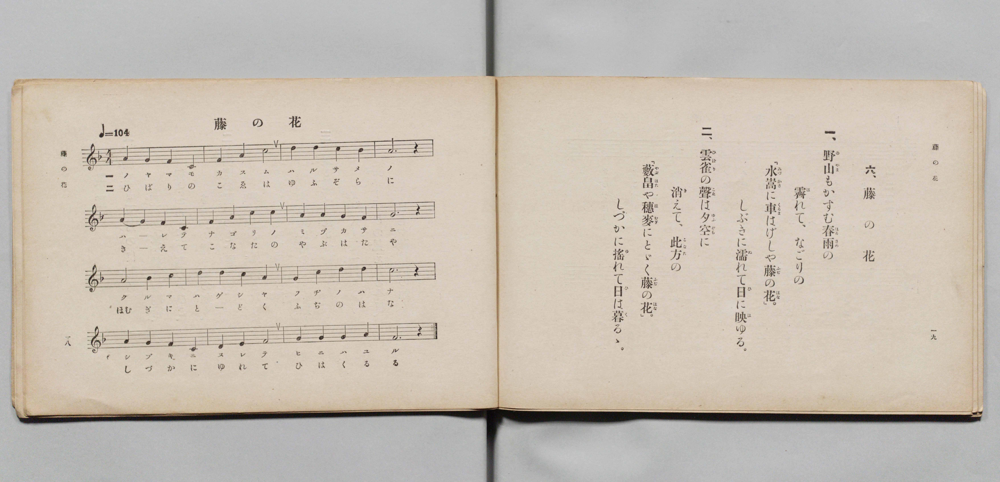

# 藤の花

> Re:Shōka 使用 AI 協助辨識與重建樂譜，可能會有錯誤。歡迎回報。

- **鋼琴伴奏版**：<br><audio controls src="fuji_no_hana.mp3"></audio>

- 詞：文部省
- 曲：文部省
- 文部省《尋常小學唱歌 第四學年用》（明治四十五年五月，4080）

## 說明

原書資訊與歌詞全文（對應 P012.jpg，原書 pp. 18–19，第 6 首）：
調性與拍號：ヘ長調（F 大調）4/4 拍，速度 ♩=104


## 歌詞

```text
一、
野山（のやま）もかすむ春雨（はるさめ）の
霽（は）れて、なごりの
「水嵩（みづかさ）に車（くるま）はげしや、藤（ふぢ）の花（はな）。」
しぶきに濡（ぬ）れて日（ひ）に映（は）ゆる。

二、
雲雀（ひばり）の聲（こゑ）は夕空（ゆふぞら）に
消（き）えて、此方（こなた）の
「藪畠（やぶはた）や穗麥（ほむぎ）にとゞく藤（ふぢ）の花（はな）。」
しづかに搖（ゆ）れて日（ひ）は暮（く）るゝ。
```

## ABC

<div class="abc-score" data-abc-src="fuji_no_hana.abc" aria-label="五線譜載入中"></div>

[下載 ABC 原始檔](fuji_no_hana.abc)

## TMD 檔案連結

- [主旋律 TMD 檔案](fuji_no_hana.tmd) [[在 TMD Studio 編輯](https://tmdlang.github.io/Tmd-TS/#tmd=s7IKdvYPcrWy4qpTUCpJTLdSSM7PyUlNLsnMz7PKyszLyo8vzshPT8wuBdHZiUpwdWX5OaW5qVbpRYkpqfEm8SYGFgYIyeL80qLkVKvi5Iz8_Jz4ktSKkqT8_Gx0-fiCxPRUqwADQyOETEFRfllqXmIeUHdBUWZeSWoKWDtCQWpZZkoqSLostSgzLTM1BclJqUXFIHdDTS8pSswrTi7KLAB5BqEqv6gE6KOixIKMSquMzOKS_KLM5MSc-OzEPCTflWSkAj2Xl1hSWpSKLlqcmlicn1eMbGJmemaeVW5-XlIpMJSUuLS0FF5MX_K4cd2Lro0KWlpcirYKhgYmXPa2Cm5cNib6JnYgrS9Wznu_Z9azae0vm1c8n9MINu7Z7E2YYjDe44aupxu6n-7Y8XRD_9O1O55O2fhsbY_C8zVrns6eDeLv3PJ8yorHDd3v93Q8m9H3bNNukHhv45NdU4BSQPLZnI73e3pAEfV-T6cSF5e-loIttQCXgoLC0775z2bveLG5_cWKrhcd7UDHAb34tHUF0ANAJz3d0PusvVMBFNt6WQXpQJdA1CsUFOgpGFo8aphsaAkUBHpHwUzh5bJpQDcCgwJk7otV-581LAeZ2N37YuZ8oOjj5hkvp24HigPNdVN4umQ5mNkJDFkFoBqgKS8b5j_dtUzh0cyVtqCAB5nyZEfD44ZGEOtle9_TjRuBWoER9Lip5XHjPqDex01Njxu7HzfOfNzU8GzG0pezV4AVrH_cBBSc-ripEaSmcR1Y_5y9EDmwtp7HjcuABj9uXPW4ccrjpi6ooscNPc82bHm6dSVY6f7HjUvBxk8FG7P6xe4usHg_2Hiw_UCrGic9bpwOclFDIzD5gBVsfdy4CGIzMClBXdS4CiTS0PS4oRdsE1BP47bHjb1Ac5_tXwhWtAbutGfTl4JFgOkKZPGzGQuQ3N4Gsr6hCRI-u3pg4TN708vZDRBdjxs3AP0EdQHIEKDg5MdNEyEufrpk6vOVu0CCQKNAbp33uAkYayCLQAY92wZMcEANwBgBCgEZoIB6tnbJs2k7oQaBAg0YobCQBQbai-mrnk8FuxEUM0BvAf0LVtHU8nzl9Je7IL7ZDYylx419EKseN6543DQPGJikBhokSlY_mwBMbCAv4Ai09c9mrYPEFlhB9-OmuaBAA5pCeb6BAgUtfS4ut9KsTL98D2A5ZBWQmZiX71BjUFMNskbBxkTLDszAlmVBJQAwcb9Y2KOgYaIALBuer2_QgeczTSwagJaBDKtRMAZCIwXTeCDTEMgwVtAFssyA0BTIrgGSukBooFADVu5jWKPwuLkPiJcA8TwgXgRU87hpNRDvBPIWgHU_bu4HYpDYViC9ECzSBzYHaAvEHCOgWOMmIN4AVNUFpNeBVDVOBvImAun1EHOa2oBsoBmNQJuaOsEqVsPNwR8Yu3rICQyzeKDhoGAAhYspNAiMgCJACUMwEzM0-oEij5vXAHEb2KdA3zRtAdKrwL4GicwH4lZoKG0Fi3RjCY1ekDmNHUC8DBYWjUAzGoG6IaHT1AJkbQOHDkgUIkJcaOzoJC9pgLwOCwxQioCwjMFhAQ4rtMBoAjoNFPHgpNEPdiIwkpu2g4NoCdjrU4G4CZqIwCqAAYYZGLuBuhqANFAVMMpBIivAwbMSiMG6wMliEThoQAECEllFXGAAa0RyAsMQCEGeB2UOUBCAEigkKEABZIglLLYD_TYNSK8FRzjIpz3whALJJpPAMpDsAo50YNhhhsV0IF4KxECVkLAAZYsmoFnAhAI2B5yRQIkCaE4T2CYgCTOnlotL104BUa4oAHnKXAA)]
- [鋼琴伴奏 TMD 檔案](fuji_no_hana_piano.tmd) [[在 TMD Studio 編輯](https://tmdlang.github.io/Tmd-TS/#tmd=s7IKdvYPcrWy4qpTUCpJTLdSSM7PyUlNLsnMz7PKyszLyo8vzshPT8wuBdHZiUpwdWX5OaW5qVbpRYkpqfEm8SYGFgYIyeL80qLkVKvi5Iz8_Jz4ktSKkqT8_Gx0-fiCxPRUqwADQyOETEFRfllqXmIeUHdqSmZJflFmYk58YlFRYl56am5qXglCZWpZZkoqSF1icnJ-bkFiXiaqfFlqUTHIFwWZiXn58TgU5ReVAL1XlFiQUWmVkVkMsi8ZaGF2Yh6SV0sygFZb5SWWlBaloosWpyYW5-cVI5uYmZ6ZZ5Wbn5dUCgwyJS4tLYUX05c8blz3omvj-z0dL7v3PJ-w5cmeLU-X9j_v7Hi_p1NBS4tL0VbB0MCEy95WwY3LxkTfxA5k3ouV897vmfVsWvvL5hXP5zSC7Xg2exOmGIz3uKHr6Ybupzt2PN3Q_3TtjqdTNj5b26PwfM2ap7Nng_g7tzyfsuJxQzfQGc9m9D3btBsk3tv4ZNcUoBSQfDYH6J4eUFQCnaXExeVWmpXpl-8BDAyrAFAoBnk41BjUVHMpAIGNiZYdmKGvpWCLDkB2PtnR8GJhj4KGiQLQNc_XN-gogGJaL6sgXROLBi19sGE1CtW5abUKxkBopGAaD-QbAhnGCrpAlhkQmgLZNUBSFwgNFGrAenwMaxQeN_cB8RIgngfEi4BqHjetBuKdQN4CsO7Hzf1ADBLbCqQXgkX6wOYAbYGYYwQUa9wExBuAqrqA9DqQqsbJQN5EIL0eYk5TG5ANNKMRaFNTJ1jFarg5-ENkVw85IWIWDzQcFAw1QM-bQoPACCgClDAEMzFDox8o8rh5DRC3gX0K9E3TFiC9CuxrkMh8IG6FhtJWsEg3ltDoBZnT2AHEy2Bh0Qg0oxGoGxI6TS1A1jZw6IBEISLEhcaOTnJCA5QwEIEBShEQljE4LMBhhRYYTUCngSIenDT6wU4ERnLTdnAQLQF7fSoQN0ETEVgFMMAwA2M3UFcDkAaqAkY5SGQFOHhWAjFYFzhZLAIHDShAQCKriAsMYEYkJzAMgRDkeVDmAAUBKIFCggIUQIZYwmI70G_TgPRacISDfNoDTyiQbDIJLAPJLuBIB4YdZlhMB-KlQAxUCQkLULZoApoFTChgc8AZCZQogOY0gW0CkjBzajHLFh9sZQuwOCioVTCMBxYF2oZAIl7BKF4bUixAxWA0MBvEA2MfRQRJDSwQEMpgNDajEBYhVCHEQCyEeZi6YSx8NiC5Ap9RuP2EIyxAhgEDV9dOARG-0T6GsQpoIkZgEWUuAA)]

## 分析

```text
================================================================================
📊 TMD Song Profile: [ 藤の花 ]
================================================================================
⏱  Duration:       0:36 (36.9s), 16 measures total
🎼 Key & Tempo:    首調基準 F, != 104.0 BPM, <4/4>
   - 分析範圍：      由實際發聲的音符與和弦推測調性；播放脈絡另行呈現
🎤 人聲音域:    C4 (MIDI 60) – D5 (MIDI 74) [跨度: 14 個半音 / 1.2 個八度, 難度: moderate]
   - 最低音:  C4 in [FujiNoHana #1 @ m.1, 0:01]
   - 最高音: D5 in [FujiNoHana #1 @ m.3, 0:04]
   - 適合: soprano, mezzo-soprano, contralto, tenor, baritone, bass
🏛  結構:      FujiNoHana (36.9s)
⚡ 編曲密度:        Peak 1 軌道同時演奏
🗝  調性診斷：       F 大調（純淨自然大調，未偵測到可信轉調）
   - 風格氣質:    純淨自然大調（陽光明朗、易唱易記，無明顯調外色彩）
   - 轉調歷程:    全曲維持單一推測調性（未偵測到可信轉調）
   - 核心骨幹音:  A, C, F, D, G
   - 調性數值:    F 大調 [相關度: 0.78, 穩定度: Moderate, 自然音純度: 100.0%]
   - 候選調性 (K-S): F 大調 (0.78), A 小調 (0.70), C 大調 (0.70)
   - 五度圈歷程:   -1
   - 各段落調性細節:
     • [FujiNoHana #1]: F 大調 (r: 0.78, 自然音純度: 100.0%)

  [ 五度圈游移軌跡 ]
               C  
        [F ]*          G  
      Bb               D  
      Eb               A  
         Ab           E  
            Db       B  
               F# 
     (* = active key center)

  [ 十二半音累積音高分佈 ]
     C  : █████████████████████     21.7%
     C# :                            0.0%
     D  : ████████████████          16.7%
     D# :                            0.0%
     E  :                            0.0%
     F  : ███████████████████       20.0%
     F# :                            0.0%
     G  : ████████████████          16.7%
     G# :                            0.0%
     A  : ████████████████████████  25.0%
     A# :                            0.0%
     B  :                            0.0%
--------------------------------------------------------------------------------
Assignment 軌道音域：
  - Piano         : C4 – D5 (14 個半音 / 1.2 個八度, 49 個音符)
================================================================================
```


## 原書掃描頁




