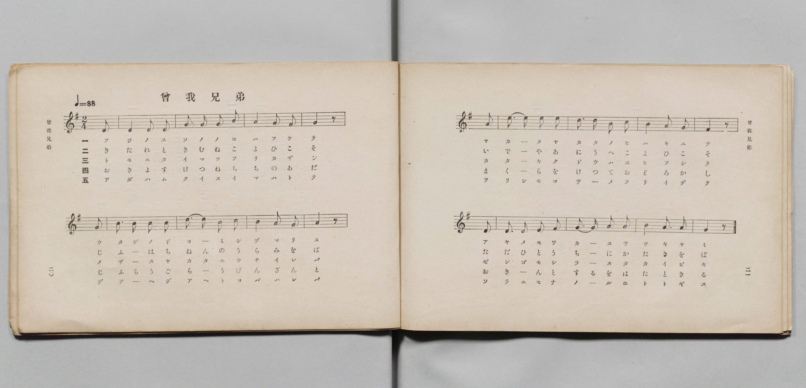
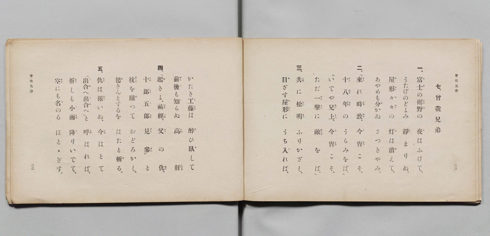

# 曾我兄弟

> Re:Shōka 使用 AI 協助辨識與重建樂譜，可能會有錯誤。歡迎回報。

- **鋼琴伴奏版**：<br><audio controls src="soga_kyodai.mp3"></audio>

- 詞：文部省
- 曲：文部省
- 文部省《尋常小學唱歌 第四學年用》（明治四十五年五月，4080）

## 說明

原書資訊與歌詞全文（對應 P013.jpg–P014.jpg，原書 pp. 20–23，第 7 首）：
調性與拍號：ホ短調／ト長調調號（1 升記號，都節音階）2/4 拍，速度 ♩=88


## 歌詞

```text
一、
富士（ふじ）の裾野（すその）の　夜（よ）はふけて、
うたげのどよみ　靜（しづ）まりぬ。
屋形々々（やかた〳〵）の　灯（ひ）は消（き）えて、
あやめも分（わ）かぬ　さつきやみ。

二、
「來（きた）れ時致（ときむね）、今宵（こよひ）こそ、
十八年（じふはちねん）の　うらみをば。」
「いでや兄上（あにうへ）、今宵（こよひ）こそ、
ただ一擊（ひとうち）に　敵（かたき）をば。」

三、
共（とも）に松明（たいまつ）　ふりかざし、
目（め）ざす屋形（やかた）に　うち入（い）れば、
かたき工藤（くどう）は　醉（ゑ）ひ臥（ふ）して
前後（ぜんご）も知（し）らぬ　高鼾（たかいびき）。

四、
「起（お）きよ、祐經（すけつね）、父（ちゝ）の仇（あだ）、
十郎五郎（じふらうごらう）　見參（げんざん）。」と
枕（まくら）を蹴（け）つて　おどろかし、
起（お）きんとするを　はたと斬（き）る。

五、
仇（あだ）は報（むく）いぬ、今（いま）はとて
「出合（であ）へ出合（であ）へ。」と　呼（よ）ばはれば、
折（をり）しも小雨（こさめ）　降（ふ）りいでて、
空（そら）にも名（な）のる　ほとゝぎす。
```

## ABC

<div class="abc-score" data-abc-src="soga_kyodai.abc" aria-label="五線譜載入中"></div>

[下載 ABC 原始檔](soga_kyodai.abc)

## TMD 檔案連結

- [主旋律 TMD 檔案](soga_kyodai.tmd) [[在 TMD Studio 編輯](https://tmdlang.github.io/Tmd-TS/#tmd=s7IKdvYPcrWy4qpTUCpJTLdSSM7PyUlNLsnMz7PKyszLyo8vzshPT8wuBdHZiUpwdWX5OaW5qVbpRYkpqfEm8SYGFgYIyeL80qLkVKvi5Iz8_Jz4ktSKkqT8_Gx0-fiCxPRUqwADQ2OETEFRfllqXmIeUHdBUWZeSWoKWDtCQWpZZkoqSLostSgzLTM1BclJqUXFIHdDTS8pSswrTi7KLAB5BqEqv6gE6KOixIKMSquMzOKS_KLM5MSc-OzEPCTflWSkAj0Hka5E1puZnplnlZufl1QKDA8lLi0thWez9z3rmPi0teXpnvkKWlpcirYKFhZc9rYK7lw2RvomdiDNL1bOe79n1rNp7S-bVzyf0wg28NnsTZhiMN7jhq6nG7qf7tjxdEP_07U7nk7Z-Gxtj8LzNWuezp4N4u_c8nzKiscN3e_3dDyb0fds026QeG_jk11TgFJA8tmcjvd7ekCR8n5PpxIXl76Wgi21AJeCgsLTvvnPZu94sbn9xYquFx3tQMcBvfi0dQXQA0AnPd3Q-6y9UwEUs3pZBemPGiYDmSYgJtBREK0KBQV6CkYGQCkjY6Ag0GcK5govl00DOhcYKiArXqza_6xhOcjw7t4XM-cDRR83z34-fy1Q_P2e_sfNHS-nbgeyQQgk22Go8LQX6JwZYF7Py-a9z9c3vJy_-eWsPqCZwIhQAJoDkmiY_3TXMoVHM1faAqMJZNGTHQ2PGxrBvlrf83TxaqBZjxu3Pm6cAdT3uHHdi8X7XrYDzQAKznzcOBcoAhF_3NDwdMkckHgTMKyBIuvBuiY-blwGNe5xY9vjxvmPGyeBVDeuBKp73LgfqO3lXLC2xumPG5eCde573NT1uHHN44YmsCs2dj_du-hxQysQgY1vedzYDTKoYfPjhq1wy583rgebAkxFIMufbQO6AsgF-hHIBTIQrmgCGdHU-Lip6WlHG9jEfrAioKFAOxseN0593LgEqBNsE9CBTZBg2dUDM6Gh58k-sEagmkZg6HY-bup5NrPpRfsWsOAKsF6gOWtBUg2NT3Z3PV0HdChQajLY0xAnTgaFHjSgexuftq4GJlWwohnggAMG30KgEY-bJsO9CArAJiB7_-MmYBhuALrscUMv1EWPG4GOXQ50MjDnPdnRBTao6XHjanCg7yDWIeD4WQBMAc8mQ4zYBPYO0IiFYKWrga54NhViBDgOIOGL7BxIEgJZB_ZZ60ZomDQ1QUx4NncfMIuCBYHagY7eBwxtsPuA_tsKjnmgydNAyQFixPPZwBQGjKRGsH6gxExIikBOC3DHQdz6tBWYkIAWtEDiBuw4qP-grn66femL6UBrgYr6QWmxERif4DQLTI5twCwHNHoiWGTTi3aIWZCUBkyjy8D-6ux9uq8HLDEHGEWPG6eArWp6Ph-iejqYC9QASlEvV894uWcfzMtAFwBdvRkadNDUBSyvEKnrxdbtYMXAKACaAExLHUC550snPN8GTAuQfAfMVsAkCk1gzzu2gcUXPm6aC0ksT3aDyh1wClgAUQNNZi-b-4DFIZBEpDSQK4GBNgXCgMTEi2XdT_ubwWomgb03DZoOwXEMjE6Qcc_mTQWrAEZgP1AzJCG8gCZiSOgB3QjMd8BYAcYqMMMDdQJ9D4tYDG8C7QEmtpmPm7pBKQqkDZgJgCEGLEbXIDIzUBaeJadAjUL3b-P6pwvACQ-UDSG5GxjmwLgA5QFI0gC6G1ZMAS0FRyow6J-273o6AVJyLAcaB1axA6sgPChABd_EPUgF3waQocip7lkXsOwESgODEuLX6aCyZ0P_y9kroJkRWORA0jcwscwE-hKW3kC5AZyv4cXX85W7wNJzoSEOTPVAsyZA9KyCFhWgIAJ6fDc43wGL6D5QqEJKU8rrOyhQ0NLn4goGtoW8K_NTEjOtAjIT8_IdagxqqkHWKNgYmmnZgVnY6lpQ1Q0sZV4s7FHQMFEABgWwctKBV5CaWDQAbQMZVqNgFq-gq2AExcZAXKNgAiRBbIQIiAWC5iDFYB1QjTBoABICm-hjWKPwuHkqkP-4aQeIbO4Ds3eCNT1u2gtWDxKFyjSvgMg090PNguneCBVvQ7IHbDXEHiOgXGMvSGXjfLD6HjAbahpYBiTaAGSvBctMhrqgA2ZP4yZk8ca52O0xBrkBpOdx8yIw2Q02dz_UtCVQN88D4ha460F6VsHsaVoNJrdBdWzHbo8JyA1dYBeBfQV2JzChQV03EermJXD_LITKgGiI3Dow2QQVX4DdHlOQGyA-aQCToHB_3AxSDZJZD3Uz0J5mcIiCfQjyzzyYPVAdIPdhjx_86XRXD9npFJQaQRiUQmvALDMgNoWKQlIuiAVKr-C0ij-ZNi0DexAUlY-bwIkBnCRBnuoE80CJCeJlUBKDRd7j5lYwCQoQSDSDdIACC1cynQGOmK1gEhTAiMgDR2UTKAkiohAkDgpUYJEEFoO4bxJUZgN2e8DJFGQqJKFBMtzjZmjkQZMgyCSIf0CJGB4CzY1gWZDax81roP6ZgN0ecDJF8g_UjSD3gmSmwMUg_oGJg1wP8Sew8oOzQTKwMMaSTJvbwSohiRVsJ1gEkYBBYhD_wBIjyDSI22HJFLd_CBSnneQkU_xpEpFu4SkUWprCSlgsqRQch5AYhGRNaNGDJA5Nw_DUCw5tiP-bICkMVsjiK0zBxVfjcrg9ID5IHFSgACtGMAlOl42ggh0kA45PaEFFdGGKnhbBLoQVPdCcB02XIB-AXA2qCmC-glQOoHyIxz_gVLoP7CJ4tQJOlSB7wOaAC1RQcQoiQbYhit-VYNW9YDY0nzROx24POJVCSg5EcQ9zGziNNm0Gk-C8As6f8OoRrAOW66DpmtTCFNjOJSeVwup79BQIK1sRtT6MR0xpCsmTEP-ASyJwCIB8BY5ZRAoGl5UgHZBQAac7SDqFlVfg8hZXOgVX9-DqDZbqYJU-JHUiKkSQjSBxcJUN1QeOV2JK06Y9YBdB4m8Lsn-gtQAonaD6B1JSQ9I3JBxgjQ6Q73ClU-RKH1JCwvwDqvyBrU-YPXBXQ-oQiH_AJR5YN8gemFos6RTc9IK4GtqIgccP2AXg0gPiH2i4Nc8G8yCNHzDZBK2fwLULqj21XFy6dgqIFqwCkKfMBQA)]
- [鋼琴伴奏 TMD 檔案](soga_kyodai_piano.tmd) [[在 TMD Studio 編輯](https://tmdlang.github.io/Tmd-TS/#tmd=s7IKdvYPcrWy4qpTUCpJTLdSSM7PyUlNLsnMz7PKyszLyo8vzshPT8wuBdHZiUpwdWX5OaW5qVbpRYkpqfEm8SYGFgYIyeL80qLkVKvi5Iz8_Jz4ktSKkqT8_Gx0-fiCxPRUqwADQ2OETEFRfllqXmIeUHdqSmZJflFmYk58YlFRYl56am5qXglCZWpZZkoqSF1icnJ-bkFiXiaqfFlqUTHIFwWZiXn58TgU5ReVAL1XlFiQUWmVkVkMsi8ZaGF2Yh6SV0sygFZDpSuR9WamZ-ZZ5ebnJZUCA0eJS0tL4dnsfc86Jj5tbXm6Z_77PR0vu_c8n7DlyZ4tT5f2P-_seL-nU0FLi0vRVsHCgsveVsGdy8ZI38QOZOKLlfPe75n1bFr7y-YVz-c0gm15NnsTphiM97ih6-mG7qc7djzd0P907Y6nUzY-W9uj8HzNmqezZ4P4O7c8n7LicUM30BXPZvQ927QbJN7b-GTXFKAUkHw2B-icHlC0AV2lxMUVDIxl78r8lMRMqwBQiAV5ONQY1FRzKQCBjaGZlh2Ypa-lYIsOQJY-2dHwYmGPgoaJAtA5z9c36CiAolUvqyBdE4sGLX2wYTUK1blptQpm8Qq6CkZQbAzENQomQBLERoiAWCBoDlIM1lEDoWDQACQENtbHsEbhcfNUIP9x0w4Q2dwHZu8Ea3rctBesHiQKlWleAZFp7oeaBdO9ESrehmQP2GqIPUZAucZekMrG-WD1PWA21DSwDEi0AcheC5aZDHVBB8yexk3I4o1zsdtjDHIDSM_j5kVgshts7n6oaUugbp4HxC1w14P0rILZ07QaTG6D6tiO3R4TkBu6wC4C-wrszseNM6Gumwh18xK4fxZCZUA0RG4dmGyCii_Abo8pyA0QnzSASVC4P24GqQbJrIe6GWhPMzhEwT4E-WcezB6oDpD7sMcP_sS6q4ecxApObqDUCMKgFFoDZpkBsSlUFJJyQSxQegWnVfzJtGkZ2IOgqHzcBE4M4CQJ8lQnmAdKTBAvg5IYLPIeN7eCSVCAQKIZpAMUWLiS6QxwxGwFk6AARkQeOCqbQEkQEYUgcVCgPm4Cu6IR4r5JUJkN2O0BJ1OQqZCEBslwj5uhkQdNgiCTIP4BJWJ4CDQ3gmVBah83r4H6ZwJ2e8DJFMk_UDeC3AuSmQIXg_gHJg5yPcSfjxunwdkgGVgYY0mmze1glZDECrYTLIJIwCAxiH9giRFkGsTtsGSK2z8EytROcpIp_jSJSLfwFAotTWElLJZUCo5DSAxCsia06EESh6ZheOoFhzbE_02QFAYrZPEVpuDiq3E53B4QHyQOKlAeN4LtgaTLRlDBDpIBxye0oCK6MEVPi2AXwooeaM6DpkuQD0CuBlUFMF9BKgdQPsTjH3Aq3Qd2EbxaAadKkD1gc8AFKqg4BZEg2xDF70qw6l4wG5pPGqdjtwecSiElB6K4h7kNnEabNoNJcF4B50949QjWAct10HRNamEKbFaQk0ph9T16CoSVrYhaH8YjpjSF5EmIf8AlETgEQL4CxywiBYPLSpAOSKiA0x0kncLKK3B5iyudgqt7cPUGS3WwSh-SOhEVIshGkDi4yobqA8crMaVp0x6wiyDxtwXZP9BaAJROUP0DKakh6RsSDrBGB8h3uNIpcqUPKSFh_gFV_o-bQK6HpCyYqyF1CMQ_4BIPrBtkD0wtlnQKbnpBXA1txMDjB-wCcOkB8Q803Jpng3mQxg-YbILWT-DaBdWeWsxWrA9yK9YC2ogFtjsLQM3OeAXjeG1gejKKB3K0jUDpDcrCFDGOByZAbWNwAoTpA7EMoP5DF4ewkEURJlBqJqYrYSbhUIUwECaITSE2MXxOBAa3rp0CIsSjfQxjwdagiRphFTXGKmqCVdQULqrMBQA)]

## 分析

```text
================================================================================
📊 TMD Song Profile: [ 曾我兄弟 ]
================================================================================
⏱  Duration:       0:21 (21.8s), 16 measures total
🎼 Key & Tempo:    首調基準 G, != 88.0 BPM, <2/4>
   - 分析範圍：      由實際發聲的音符與和弦推測調性；播放脈絡另行呈現
🎤 人聲音域:    E4 (MIDI 64) – E5 (MIDI 76) [跨度: 12 個半音 / 1.0 個八度, 難度: easy]
   - 最低音:  E4 in [SogaKyodai #1 @ m.1, 0:00]
   - 最高音: E5 in [SogaKyodai #1 @ m.6, 0:07]
   - 適合: soprano, mezzo-soprano, contralto, tenor, baritone, bass
🏛  結構:      SogaKyodai (21.8s)
⚡ 編曲密度:        Peak 1 軌道同時演奏
🗝  調性診斷：       E 大調（流行色彩大調，未偵測到可信轉調）
   - 風格氣質:    流行大調（略帶和弦色彩音與裝飾副屬和弦）
   - 轉調歷程:    全曲維持單一推測調性（未偵測到可信轉調）
   - 核心骨幹音:  E, A, B, C, F#
   - 調性數值:    E 大調 [相關度: 0.72, 穩定度: Moderate, 自然音純度: 84.2%]
   - 候選調性 (K-S): E 大調 (0.72), A 小調 (0.69), A 大調 (0.67)
   - 五度圈歷程:   +4
   - 各段落調性細節:
     • [SogaKyodai #1]: E 大調 (r: 0.72, 自然音純度: 84.2%, 調外音: C, D)

  [ 五度圈游移軌跡 ]
               C  
         F            G  
      Bb               D  
      Eb               A  
         Ab          [E ]*
            Db       B  
               F# 
     (* = active key center)

  [ 十二半音累積音高分佈 ]
     C  : ███████████               12.5%
     C# :                            0.0%
     D  : ███                        3.3%
     D# :                            0.0%
     E  : ████████████████████████  26.7%
     F  :                            0.0%
     F# : ████████                   8.3%
     G  :                            0.0%
     G# :                            0.0%
     A  : ███████████████████████   25.0%
     A# :                            0.0%
     B  : ██████████████████████    24.2%
--------------------------------------------------------------------------------
Assignment 軌道音域：
  - Piano         : E4 – E5 (12 個半音 / 1.0 個八度, 51 個音符)
================================================================================
```


## 原書掃描頁






