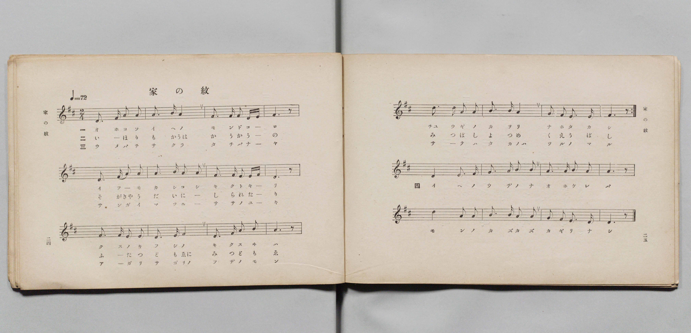
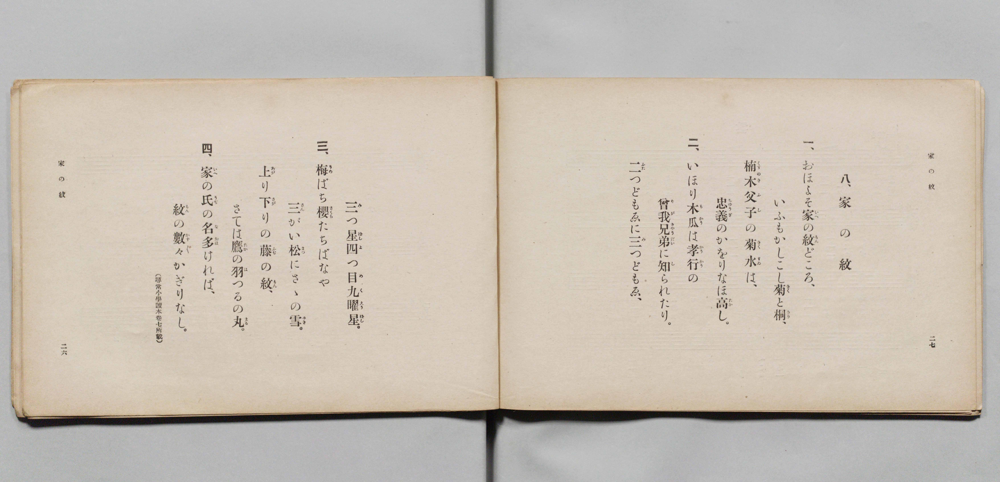

# 家の紋

> Re:Shōka 使用 AI 協助辨識與重建樂譜，可能會有錯誤。歡迎回報。

- **鋼琴伴奏版**：<br><audio controls src="ie_no_mon.mp3"></audio>

- 詞：文部省（尋常小學讀本卷七所載）
- 曲：文部省
- 文部省《尋常小學唱歌 第四學年用》（明治四十五年五月，4080）

## 說明

原書資訊與歌詞全文（對應 P015.jpg–P016.jpg，原書 pp. 24–27，第 8 首）：
調性與拍號：ニ長調（D 大調）2/4 拍，速度 ♩=72
曲式結構：第 1–16 小節反覆演唱一、二、三段歌詞，第 17–24 小節為第四段結尾樂段。


## 歌詞

```text
一、
おほよそ家（いへ）の紋（もん）どころ、
いふもかしこし菊（きく）と桐（きり）、
楠木父子（くすのきふし）の菊水（きくすゐ）は、
忠義（ちゅうぎ）のかをりなほ高（たか）し。

二、
いほり木瓜（もかう）は孝行（かうかう）の
曾我兄弟（そがきゃうだい）に知（し）られたり。
二（ふた）つどもゑに三（み）つどもゑ、
三（み）つ星（ぼし）四（よ）つ目（め）九曜星（くえうぼし）。

三、
梅（うめ）ばち櫻（さくら）たちばなや
三（さん）がい松（まつ）にさゝの雪（ゆき）。
上（あが）り下（さが）りの藤（ふぢ）の紋（もん）、
さては鷹（たか）の羽（は）つるの丸（まる）。

四、
家（いへ）の氏（うぢ）の名（な）多（おほ）ければ、
紋（もん）の數々（かず〳〵）かぎりなし。
（尋常小學讀本卷七所載）
```

## ABC

<div class="abc-score" data-abc-src="ie_no_mon.abc" aria-label="五線譜載入中"></div>

[下載 ABC 原始檔](ie_no_mon.abc)

## TMD 檔案連結

- [主旋律 TMD 檔案](ie_no_mon.tmd) [[在 TMD Studio 編輯](https://tmdlang.github.io/Tmd-TS/#tmd=s7IKdvYPcrWy4qpTUCpJTLdSSM7PyUlNLsnMz7PKyszLyo8vzshPT8wuBdHZiUpwdWX5OaW5qVbpRYkpqfEm8SYGFgYIyeL80qLkVKvi5Iz8_Jz4ktSKkqT8_Gx0-fiCxPRUqwADQ1OETEFRfllqXmIeUHdBUWZeSWoKWDtCQWpZZkoqSLostSgzLTM1BclJqUXFIHdDTS8pSswrTi7KLAB5BqEqv6gE6KOixIKMSquMzOKS_KLM5MSc-OzEPCTflWSkAj2XXJpTUlqUii4M0VWJbGRmemaeVW5-XlIpMJiUuLS0FJ6u2_a4cd3zLd0KWlpcirYK5kZc9rYKLlw2RvomdiCdL1bOe79n1rNp7S-bVzyf0_h-T8fTDd1Pd-x4uqH_6dodL9Y1PJuz5mnv9ic7mp91NrzY0_l-TyfYxmezNyHrg4jBeI8bupBNeTpl47O1PQrP16x5Ons2iL9zy_MpKx43dANtezaj79mm3SDx3sYnu6YApYDkszkd7_f0gCITbB2XvpaCLbUAl4KCwtO--c9m73ixuf3Fiq4XHe1AxwGD4WnrCqAHwAHQ-6y9UwGUIvSyCtIfNUwGMs1ATKCjIFoVCgr0FIxMgFJG5kBBoM8ULBReLpsGdC4wVEBWvFi1_1nDcpDh3b0vZs4Hij5u7n45dTtQHGiFi8LTJcvBzE5gRCgA1QBNedkw_-muZQqPZq60BUYT0AxgGD_d0_9864Rny4FBNQtkiyHQSkMzBWC4Pl_f8LS_98Wytmd7pgAD-MmOhscNwBDsAZE7Op-t2wrxFdR1huYgt5pANT5v2gWJDKAyoPFPN-x7tqIJyH7c0MQFshhiGIj1uLHrcePux00djxvnAtMS0OmPG1seN-4AOhySrkAiTU2PmyaDRVY-bpz8uKkXrhmodCtIurH7ceN0kFzj9Bf9XWBTeh839oP1rHi2cAJUpAko1QnV_GzpgmdzVjzv2PZ0LUS6_3HjTKCdYJ1bgQZBnAA07tmGLXATQWqagOqBUuuhBj3dv-D5vpVgFQsfN7U-bmx73NgH0QxyV9MkoLWPG1cBvfly9QywsvlAcbCC6fAAAYcr3E_AAOkCOW7yHKj3Qf5rg9j6dO3cFwt7wOaABJGk1kHidN-zjolPW1ue7gEmClCwPm7sAfu9Gax6AdACsOrVz-cvBSsAe7QJiIDK5oPcCnQTxElgaWBQAA0CalgCCn5QVEwEagYmAbAsKIWhSEF8gSb9bAbELXsgtgETBthfwEwIkn0-ex2YCywcOp_snPts9hyYemBwA0mgq6EaEekHHouLWsEq2yDaHzduAMbCs9W7wYJTQSY0gYoUcJgvBMuuetzUguzEqbC0BfR-y7O5-8CC-4DOgoQSWAEwDNe9nL0K7Eqga4CZCewUsCmQ1AaMImBwAQOx68kOcJoFWQ4VAaWi6UDjIIG5CHvShsU-UNsyYCy_3L4TNamse75vL1hkPTTEm4Dxvu7JDmBOAbu3CawMGj7AAIYlTow89WwDMFtAQhXqlKcTgB4CigD91_l0ySwwG5QrwbITweliA9Q4jAy57tnUHY8bIHEAdNCsxw2bHzdsBUsBuX2wpA9O6ED9xBT_IHWUF8NQoKClz8XlmeqX7wusMQMyE_PyHWoMaqpBdijYGJpp2YFZ2Mp_UHUCLKeAeU1BA1Yywso3HXjhrYlFI9BKkKE1CoYKukBopGAMJEG4RsEULKKrYAbEIHYNWBymxhRI1gDZEDUgaABSAzbNx7BG4XHTKrDo4-bZQLwCxGraCzblcdMSqI7HzTPAZB9EvHkRVHQzEHeCdWyGyqxFsiceYY8RUK6xBWZa426wni6oLU1wcVCpA2ash0g1dkMl2qBsiDxIZh12i4xBBi6DOm8hEE8AsxqhVm2FWdUEsuFx80qo-H6ojka4DqjjmmFBgLAHf-Tu6oFHrikwci2oEbmwiMUWuWZICQBb5ELc_7h5KpQGRR1IfDU4FLaDSVDkQdggGUgUgkLocXMHmAUSAYUFJKFgj9y5EF2NPUAMrRegKkGyC8ByoAQALP2QxKdD7eoE4h6w7HyoK0Dhjyt-IbEITn5Na8D6Qb4EuXAeWBxsTzMk7SDHO4iGJOLHzaA0gvAt8fG7oxMev5agZo0RaREMiTxQtEGiFZsIciKARDlIHFcEgxIyyGs7YV6DRxc0yoERC5GBBQZSBAN1gQJjA1RHP_ZAB0cwPOuAowhYWUD0NIKyEMi0JiCeCJYBRTBIBpqpgCohqiA5HeQCkDpckQspW0CqwVELTnTIUbgGKoYojWBJG-gCaORCEzkwgZAUucAaDlEyGyM3WonNvnFgq8zA0QbJv6CCF8QC0SAMiV4QhsnAIhxr9DY3Pm5eCvX5MiAGFXtwn0MycfMmeDhBYxhceIHKc5AuUCxAVIJ0gDI5rhhGjq89YBYoe4J0gYsBcIwDW0QIexpB6QXYmgKTkIIbpA-RsfFlX5ALwXrAqQ5WCMP8BIlHqAw0QyPLgDI6SAZWmCDsqYVXzc75KYlkVM-7psASAbSvAe-JGJBTmEMiGhTVsIIakjwgeR1ZBJFgcOV11PoYEhrIFR4iB8DqVqS6vWkjmAXKVaCQA1VzpOSN1rWYwWIEar_AO2ikZRLk9gqkfAO1VGCZBFbJwTIK_kwCLzPAOR41f4DS1C54hbcLTWYdvDSBhRhmDgGmKF07BWiiivYxjFVA5hqhco2RuaAUCNOgzAUA)]
- [鋼琴伴奏 TMD 檔案](ie_no_mon_piano.tmd) [[在 TMD Studio 編輯](https://tmdlang.github.io/Tmd-TS/#tmd=s7IKdvYPcrWy4qpTUCpJTLdSSM7PyUlNLsnMz7PKyszLyo8vzshPT8wuBdHZiUpwdWX5OaW5qVbpRYkpqfEm8SYGFgYIyeL80qLkVKvi5Iz8_Jz4ktSKkqT8_Gx0-fiCxPRUqwADQ1OETEFRfllqXmIeUHdqSmZJflFmYk58YlFRYl56am5qXglCZWpZZkoqSF1icnJ-bkFiXiaqfFlqUTHIFwWZiXn58TgU5ReVAL1XlFiQUWmVkVkMsi8ZaGF2Yh6SV0sygFZbJZfmlJQWpaILQ3RVIhuZmZ6ZZ5Wbn5dUCgwzJS4tLYWn67Y9blz3fEv3-z0dL7v3PJ-w5cmeLU-X9j_v7Hi_p1NBS4tL0VbB3IjL3lbBhcvGSN_EDmTci5Xz3u-Z9Wxa-8vmFc_nNAL1Pt3Q_XTHjqcb-p-u3fFiXcOzOWue9m5_sqP5WWfDiz2dQKPAzng2exOyPogYjPe4oQvZlKdTNj5b26PwfM2ap7Nng_g7tzyfsuJxA8ilz2b0Pdu0GyTe2_hk1xSgFJB8Ngfo5B5QdIOt4_JM9cv3BQZzACiYgzwcagxqqrkUgMDG0EzLDszS11KwRQcgG5_saHixsEdBA8hUMHzUMNlEAeim5-sbdBRAaUIvqyBdE4tGLX2woTUK1blptQqGCrpAaKRgDCRBuEbBFCyiq2AGxCB2DVgcpsYUSNYA2RA1IGgAUgM20sewRuFx0yqw6OPm2UC8AsRq2gs25XHTEqiOx80zwGQfRLx5EVR0MxB3gnVshsqsRbInHmGPEVCusQVmWuNusJ4uqC1NcPHux41tYMZ6iFRjN1SiDcqGyINk1mG3yBhk4DKo8xYC8QQwqxFq1VaYVU0gGx43r4SK74fqaITrgDquGRYECHvwx_CuHngMmwJj2IK0GMYeubCIxRa5ZkgJAFvkQtz_uHkqlAZFHUh8NTgUtoNJUORB2CAZSBSCQuhxcweYBRIBhQUkoWCP3LkQXY09QNz7uKkZElMgCJJdAJYDJYDHjSCbYeLToXZ1AnEPWHY-1BWg8McVv5BYBCe_pjVg_SBfglw4DywOtqcZknaQ4x1EQxLx42ZQGkH4lvj43dEJj19LYPwaGpEWwZDIA0UbJFqxiSAnAkiUg8RxRTAoIYO8thPmNXh0QaMcGLEQGVhgIEUwUBcoMDZAdfRjD3RwBMOzDjiKHjdCg7wRlIVApjUB8USwDCiCQTLQTAVUCVEFyekgF4DU4YpcSNkCUg2OWnCiQ47CNVAxRGkES9pAF0AjF5rIgQmEpMgFFvyI4tkYFLtmJGbfOLBVZuBog-RfUMELYoFoEIZELwjDZGARjjV6mxsfNy-F-nwZEIOKPbjPIZm4eRM8nKAxDC68QOU5SBcoFiAqQTpAmRxXDCPH1x4wC5Q9QbrAxQA4xh83gYpSWPYFpZfHjRBZSMEN0ofI2PiyL8iFYD3gVAcrhGF-gsQjVAaaoZFlQBkdJAMrTBD21KLV0D7INbQFtIIGhnm8gmm8tiGcRoiYxCuYoYog1JjGxysYxWubggTigXEF8RY-04gUQRhlBjTYOF7bLB7JIdjEMI2DyQFphHEwQVx-gLAQxmETg7oPEbLO-SmJZLV_dk2BZTBgXnu2bis4p5kDc5qRAdlNIUhOAuUlWE0IyX-QwhRZBJEjcRWmqA0eSHJDblEgihhY4wWp8dS0EcwCFVugpAlqR5BS-LSuxQwbI1Ar0YjEZiK0FEJuEEIqEFBTEFYKwVoRsJIIfykEL5TBRSpqAQTKtLvgLYpdaDLr4MU1LMQwiyBsCYtAtsWWTMnJuJjZA1OEuKyha6cA9US0j2GsAjLXCJVrjMwF-RimQZkLAA)]

## 分析

```text
================================================================================
📊 TMD Song Profile: [ 家の紋 ]
================================================================================
⏱  Duration:       1:33 (93.3s), 56 measures total
🎼 Key & Tempo:    首調基準 D, != 72.0 BPM, <2/4>
   - 分析範圍：      由實際發聲的音符與和弦推測調性；播放脈絡另行呈現
🎤 人聲音域:    D4 (MIDI 62) – D5 (MIDI 74) [跨度: 12 個半音 / 1.0 個八度, 難度: easy]
   - 最低音:  D4 in [IeNoMon[L1] #1 @ m.1, 0:00]
   - 最高音: D5 in [IeNoMon[L1] #1 @ m.13, 0:20]
   - 適合: soprano, mezzo-soprano, contralto, tenor, baritone, bass
🏛  結構:      IeNoMon[L1] (26.7s) -> IeNoMon[L2] (26.7s) -> IeNoMon[L3] (26.7s) -> IeNoMonCoda[L1] (13.3s)
⚡ 編曲密度:        Peak 1 軌道同時演奏
🗝  調性診斷：       D 大調（純淨自然大調，未偵測到可信轉調）
   - 風格氣質:    純淨自然大調（陽光明朗、易唱易記，無明顯調外色彩）
   - 轉調歷程:    全曲維持單一推測調性（未偵測到可信轉調）
   - 核心骨幹音:  F#, A, D, E, B
   - 調性數值:    D 大調 [相關度: 0.78, 穩定度: Moderate, 自然音純度: 100.0%]
   - 候選調性 (K-S): D 大調 (0.78), F# 小調 (0.71), A 大調 (0.70)
   - 五度圈歷程:   +2 -> +2 -> +2 -> +2
   - 各段落調性細節:
     • [IeNoMon[L1] #1]: D 調性不明確 (r: 0.76, 自然音純度: 100.0%)
     • [IeNoMon[L2] #1]: D 調性不明確 (r: 0.76, 自然音純度: 100.0%)
     • [IeNoMon[L3] #1]: D 調性不明確 (r: 0.76, 自然音純度: 100.0%)
     • [IeNoMonCoda[L1] #1]: D 大調 (r: 0.81, 自然音純度: 100.0%)

  [ 五度圈游移軌跡 ]
               C  
         F            G  
      Bb              [D ]*
      Eb               A  
         Ab           E  
            Db       B  
               F# 
     (* = active key center)

  [ 十二半音累積音高分佈 ]
     C  :                            0.0%
     C# :                            0.0%
     D  : ██████████████████        19.5%
     D# :                            0.0%
     E  : ████████████████          16.9%
     F  :                            0.0%
     F# : ████████████████████████  25.5%
     G  :                            0.0%
     G# :                            0.0%
     A  : ████████████████████      21.7%
     A# :                            0.0%
     B  : ███████████████           16.4%
--------------------------------------------------------------------------------
Assignment 軌道音域：
  - Piano         : D4 – D5 (12 個半音 / 1.0 個八度, 183 個音符)
================================================================================
```


## 原書掃描頁






