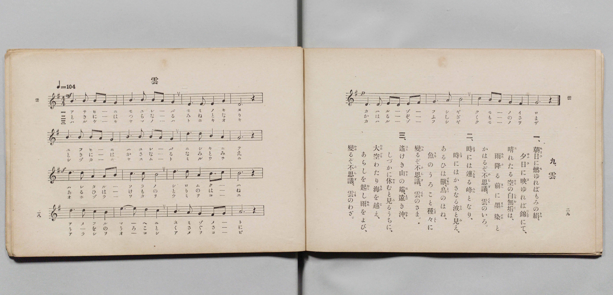

# 雲

> Re:Shōka 使用 AI 協助辨識與重建樂譜，可能會有錯誤。歡迎回報。

- **鋼琴伴奏版**：<br><audio controls src="kumo.mp3"></audio>

- 詞：文部省
- 曲：文部省
- 文部省《尋常小學唱歌 第四學年用》（明治四十五年五月，4080）

## 說明

原書資訊與歌詞全文（對應 P017.jpg，原書 pp. 28–29，第 9 首）：
調性與拍號：ト長調（G 大調）4/4 拍，速度 ♩=104


## 歌詞

```text
一、
朝日（あさひ）に燃（も）ゆればもみの絹（きぬ）、
夕日（ゆふひ）に映（は）ゆれば錦（にしき）にて、
晴（は）れたる空（そら）の白無垢（しろむく）は、
雨（あめ）降（ふ）る前（まへ）に墨染（すみぞめ）と
かはるぞ不思議（ふしぎ）、雲（くも）のいろ。

二、
時（とき）には連（つらな）る峰（みね）となり、
時（とき）にはかさなる波（なみ）と見（み）え、
あるひは獸（けもの）、鳥（とり）のはね、
魚（うを）のうろこと種々（くさ〲）に
變（かは）るぞ不思議（ふしぎ）、雲（くも）のさま。

三、
遙（はる）けき山（やま）の端（は）、遠（とほ）き沖（おき）、
しづかに休（やす）むと見（み）るうちに、
大空（おほぞら）わたり海（うみ）を越（こ）え、
あらしを起（おこ）し雨（あめ）をよび、
變（かは）るぞ不思議（ふしぎ）、雲（くも）のわざ。
```

## ABC

<div class="abc-score" data-abc-src="kumo.abc" aria-label="五線譜載入中"></div>

[下載 ABC 原始檔](kumo.abc)

## TMD 檔案連結

- [主旋律 TMD 檔案](kumo.tmd) [[在 TMD Studio 編輯](https://tmdlang.github.io/Tmd-TS/#tmd=s7IKdvYPcrWy4qpTUCpJTLdSSM7PyUlNLsnMz7PKyszLyo8vzshPT8wuBdHZiUpwdWX5OaW5qVbpRYkpqfEm8SYGFgYIyeL80qLkVKvi5Iz8_Jz4ktSKkqT8_Gx0-fiCxPRUqwADQ3OETEFRfllqXmIeUHdBUWZeSWoKWDtCQWpZZkoqSLostSgzLTM1BclJqUXFIHdDTS8pSswrTi7KLAB5BqEqv6gE6KOixIKMSquMzOKS_KLM5MSc-OzEPCTflWSkAj2Xl1hSWpSKLlqemghkFCGbmJmemWeVm5-XVAoMJSUuLS2Fl7M3KWhpcSnaKhgamHDZ2yq4c9mY6JvYgTS9WDnv_Z5Zz6a1v2xe8XxOI9igZ7M3YYrBeI8bup5u6H66Y8fTDf1P1-54OmXjs7U9Cs_XrHk6ezaIv3PL8ykrHjd0v9_T8WxG37NNu0HivY1Pdk0BSgHJZ3M63u_pAUXR-z2dSlxc-loKttQCXAoKCk_75j-bvePF5vYXK7pedLQDHQf04tPWFUAPAJ30dEPvs_ZOBVA862UVpANdAlGvUFCgp2Bk8ahhspElUBDoHQVLhZfLpgHdCAwKkLkvVu1_1rAcZGJ374uZ84Gij5s7Xk7dDhQHmuuu8HTJcjCzExiyCkA1QFNeNsx_umuZwqOZK21BAQ8y5cmOhscNjSDWszlzn01fCtT6uLHpcePUx43AMO983Lj6eXszSLCpCcRtanvc1PO4cQOQ-7hx_-PGdc-37gRr6X3cuAakAGLW0yVToWYBNTRuhZv1bMYCsOr1yGa97FkGFlz9uHE60CCIyseNy2DumrkFSQ9Qw_zHTd3PV-4CC8593AQMD6CGdc9n7n3esvDpvEVg8emPm3ofNzU8buwHy66HmvVy9gqoB5sagRIvZwJtA3K3go3uftoJ4e573LgD4oqni1Y8mz8ZLDgT7N95EI2PG1eAjHvc2A0yuwlIznuyo_dZw9wXazdATAT7pQ8SIsDkDhbshwZi47rHjS0gBzY0QeJgVw_cr0AFQJUrkMJh_cuGxWDBJUC_Pm5cBXXrZohFQDethTgIKPW4qQufQWDnAiMWqK772WZIQK0CGgHR_2IZKIvAuB1Qg8BhBdS2Caj_eS8wWIAqJoJjfx3Uc5shaWYF0HKY54A2rYWF-NpZYGlgXE-CSQPZwOQyGajn-Yp1jxtaoYEDdFoDNJ2A0_c6oHlACVAQQ_xMeigDPbsPHso7YKnzZeNMSIoCmglWOREYSk83bgSn1xagFmiKWg20F5bwgOY3QtIuMEh3gxX0PtsEzI5AkS5oIMNCDOimpWB3r36yZyLMUKCVQD8AUyRqQIN8BcwiC0ExBMs7y2GpG2jwbnCaA6fxJmAQAdN-17Ot26FBCjVi0ottkKACplT0qAPygXlh0guoHqCJEEXT0bICUM3jJiB3M1QzFUIf5N5poNAHGkd5UQoFClr6XFzepbn5VgGZiXn5DjUGNdUgCxRsLLTswAxs5TeoOgCWdC8W9ihomCgAK4rn6xt04IWuJhYNQGtAhtUoVOem1SoYK-gCoTEQGikYAlk1WETM4sFCQArMggiaQgQh0AAkBDbWx7BG4XHTIrDo46atCo-bJ4FYzd1gTY-boTLNy4B4DZg1AU1mPhD3gXWvhcr0INkEshVqkxFQrnEFRFdjLxCvBrPWQ3Q1LoG6oRPIXgVmQd3QuB-qZy1UP0Qe5O4u7DYZg1zRD3XfaqC6jSjug9rUPA_mcrBakEwHVGY2VPXjJphNIB6qTfijeFcPOVFMTOyagkVMwTJGYBGQOI6YBcYbxEdTMWIWFj6YMQtSAfL7dlgowPW0YQ9vAjELNa8R6Aa0mAXxQDL74TELimuQDCQmsMYs0F0Ql7cC2WCb4O6DpaGdQPYCsAzIHJDMfKgeUGoAhcnj5kYU3xIfszs6ycq8wLwLizlQrBkB469GwQQsYgKNZeTYBakxBsrAUgD22IXF4Rqgr0AhB_IfJL3uhcqshKZxiOmIsAPmJUgINUFjCWoW9rhtgoZrN5C9CRxPsLidCJVpArLXIeyBpQZgDoWII3Rg5iREzELTAzj_7YO6H-I6kG6QecCU0gxRBfEPLH2DSiGwy5o2Q2UgLiA6XoFtcXLiFRZfoJgExRSw9AWLmIFlQKKwGITkX_N4IFUDjl4ckQorjJsXgrMtUqQCCyyIjsfNM8AkNNkDkzs8EKDBthCqA0c2AkcqLDMDK1wQCY4mhDiwZQRkTwbLgIISJANNbuCMDCosQCyIDMiFuCIV5h9gUgQnP0hEIUU3MMpgCRMijhwC4EhthrqgGeQeEiIV2KkiK7MWADMrpL4EUsBKFEIC4w5W2IKyL8y9kKiHRy-BEhlcYkHqHEjEQqIM5DlQYMLKXaS8BM6hkPoWVtOCyjmQDhx5CRy9sFJ3PbS8BbaaoJG1FSozHYiRygZw9IJyMiwxIKIX5EJc0UsF_4BzN0hmG4Y9tVxcunYKoGaWApBW5gIA)]
- [鋼琴伴奏 TMD 檔案](kumo_piano.tmd) [[在 TMD Studio 編輯](https://tmdlang.github.io/Tmd-TS/#tmd=s7IKdvYPcrWy4qpTUCpJTLdSSM7PyUlNLsnMz7PKyszLyo8vzshPT8wuBdHZiUpwdWX5OaW5qVbpRYkpqfEm8SYGFgYIyeL80qLkVKvi5Iz8_Jz4ktSKkqT8_Gx0-fiCxPRUqwADQ3OETEFRfllqXmIeUHdqSmZJflFmYk58YlFRYl56am5qXglCZWpZZkoqSF1icnJ-bkFiXiaqfFlqUTHIFwWZiXn58TgU5ReVAL1XlFiQUWmVkVkMsi8ZaGF2Yh6SV0sygFZb5SWWlBaloouWpyYCGUXIJmamZ-ZZ5ebnJZUCg0yJS0tL4eXsTe_3dLzs3vN8wpYne7Y8Xdr_vLPj_Z5OBS0tLkVbBUMDEy57WwV3LhsTfRM7kEkvVs57v2fWs2ntL5tXPJ_TCDb9GcgQdDEY73FD19MN3U937Hi6of_p2h1Pp2x8trZH4fmaNU9nzwbxd255PmXF44ZuoDOezeh7tmk3SLy38cmuKUApIPlsDtA9PaBIBDpLiYvLuzQ33yoAFHJBHg41BjXVXApAYGOhZQdm6Gsp2KIDkG1PdjS8WNijoGGiAHTH8_UNOgqg2NXLKkjXxKJBSx9sWI1CdW5arYKxgi4QGgOhkYIhkFWDRcQsHiwEpMAsiKApRBACDUBCYGN9DGsUHjctAos-btqq8Lh5EojV3A3W9LgZKtO8DIjXgFkT0GTmA3EfWPdaqEwPkk0gW6E2GQHlGldAdDX2AvFqMGs9RFfjEqgbOoHsVWAW1A2N-6F61kL1Q-RB7u7CbpMxyBX9UPetBqrbiOI-qE3N82AuB6sFyXRAZWZDVT9ugtkE4qHahD-Kd_WQE8XExK4pWMQULGMEFgGJ44hZYLxBfDQVI2Zh4YMZsyAVIL9vh4UCXE8b9vAmELNQ8xqBbkCLWRAPJLMfHrOguAbJQGICa8wC3QVxeSuQDbYJ7j5YGtoJZC8Ay4DMAcnMh-oBpQZQmDxubkTxLfExu6OTrMwLzLuwmAPFmhEw_moUTMAiJtBYRo5dkBpjoAwsBWCPXVgcrgH6ChRyIP9B0uteqMxKaBqHmI4IO2BegoRQEzSWoGZhj9smaLh2A9mbwPEEi9uJUJkmIHsdwh5YagDmUIg4QgdmTkLELDQ9gPPfPqj7Ia4D6QaZB0wpzRBVEP_A0jeoFAK7rGkzVAbiAqLjFVjUkxOvsPgCxSQopoClL1jEDCwDEoXFICT_mscDqRpw9OKIVFhh3LwQnG2RIhVYYEF0PG6eASahyR6Y3OGBAA22hVAdOLIROFJhmflxE7hgAEcTQvxxEygjTwbLgIISJANNbuCMDCosQCyIDMiFuCIV5h9gUgQnP0hEIUU3MMpgCRMijhwC4EhthrqgGeQeEiIVWGeTlVkLgJkVUl8CKWAlCiGBcQcrbEHZF-ZeSNTDo5dAiQwusSB1DiRiIVEG8hwoMGHlLlJeAudQSH0Lq2lB5RxIB468BI5eWKm7HlrePm4EJR-QzFaozHQgRiobwNELysmwxICIXpALcUUvFfwDzt0gmW0Y9tQit7J8kFtZJtBWFjC0QRGkbQinsYmYgGIQyILRoAZRvIJRvDYwakEsA6ifiDMNxkKYgaIK0zBkhQg2BQZi-gybVjOgmHG8NjDt4vYvqjgWy6H2GMUDrQIZhceNwNjStVMARVi0j2GsApxthMQ2BrOVuQA)]

## 分析

```text
================================================================================
📊 TMD Song Profile: [ 雲 ]
================================================================================
⏱  Duration:       0:46 (46.2s), 20 measures total
🎼 Key & Tempo:    首調基準 G, != 104.0 BPM, <4/4>
   - 分析範圍：      由實際發聲的音符與和弦推測調性；播放脈絡另行呈現
🎤 人聲音域:    D4 (MIDI 62) – E5 (MIDI 76) [跨度: 14 個半音 / 1.2 個八度, 難度: moderate]
   - 最低音:  D4 in [Kumo #1 @ m.4, 0:06]
   - 最高音: E5 in [Kumo #1 @ m.14, 0:30]
   - 適合: soprano, mezzo-soprano, contralto, tenor, baritone, bass
🏛  結構:      Kumo (46.2s)
⚡ 編曲密度:        Peak 1 軌道同時演奏
🗝  調性診斷：       G 大調（純淨自然大調，未偵測到可信轉調）
   - 風格氣質:    純淨自然大調（陽光明朗、易唱易記，無明顯調外色彩）
   - 轉調歷程:    全曲維持單一推測調性（未偵測到可信轉調）
   - 核心骨幹音:  B, G, D, A, E
   - 調性數值:    G 大調 [相關度: 0.83, 穩定度: Moderate, 自然音純度: 100.0%]
   - 候選調性 (K-S): G 大調 (0.83), B 小調 (0.78), D 大調 (0.61)
   - 五度圈歷程:   +1
   - 各段落調性細節:
     • [Kumo #1]: G 大調 (r: 0.83, 自然音純度: 100.0%)

  [ 五度圈游移軌跡 ]
               C  
         F           [G ]*
      Bb               D  
      Eb               A  
         Ab           E  
            Db       B  
               F# 
     (* = active key center)

  [ 十二半音累積音高分佈 ]
     C  : ██████                     7.3%
     C# :                            0.0%
     D  : ████████████████          19.3%
     D# :                            0.0%
     E  : ███████                    8.0%
     F  :                            0.0%
     F# : ██                         2.7%
     G  : ████████████████          20.0%
     G# :                            0.0%
     A  : ███████████               13.3%
     A# :                            0.0%
     B  : ████████████████████████  29.3%
--------------------------------------------------------------------------------
Assignment 軌道音域：
  - Piano         : D4 – E5 (14 個半音 / 1.2 個八度, 73 個音符)
================================================================================
```


## 原書掃描頁




