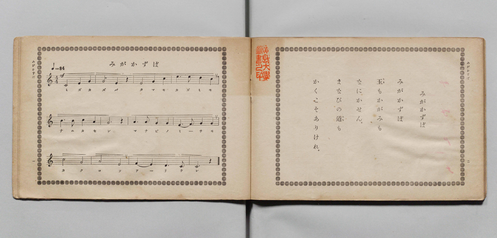

# みがかずば

> Re:Shōka 使用 AI 協助辨識與重建樂譜，可能會有錯誤。歡迎回報。

- **鋼琴伴奏版**：<br><audio controls src="migakazuba.mp3"></audio>

- 文部省《尋常小學唱歌 第五學年用》（大正二年五月，索書號 4100）
- lyricist: 昭憲皇太后（御歌）
- composer: 東儀季芳

## 說明

原書資訊與歌詞全文（對應 P004.jpg，原書 pp. 1–2）：
- 調性與拍號：ハ長調（C 大調）4/4 拍，速度 ♩=84，力度標記 mf


## 歌詞

```text
みがかずば
みがかずば
玉（たま）もかがみも
なにかせん。
まなびの道（みち）も
かくこそありけれ。
```

## ABC

<div class="abc-score" data-abc-src="migakazuba.abc" aria-label="五線譜載入中"></div>

[下載 ABC 原始檔](migakazuba.abc)

## TMD 檔案連結

- [主旋律 TMD 檔案](migakazuba.tmd) [[在 TMD Studio 編輯](https://tmdlang.github.io/Tmd-TS/#tmd=s7IKdvYPcrWy4qpTUCpJTLdSSM7PyUlNLsnMz7PKyszLyo8vzshPT8wuBdHZiUpwdWX5OaW5qVbpRYkpqfGm8SaGBgYIyeL80qLkVKvi5Iz8_Jz4ktSKkqT8_Gx0-fiCxPRUqwADAxOETEFRfllqXmIeUHdBUWZeSWoKWDtCQWpZZkoqSLostSgzLTM1BclJqUXFIHdDTS8pSswrTi7KLAB5BqEqv6gE6KOixIKMSquMzOKS_KLM5MSc-OzEPCTflWSkAj2XmVsAtCQxB108N78IWRBoQnpmHlA0L6kUGEqYEqmZWZlIoaClpfC4cf_jxp7Hjd2PG2c9btygoKXFpWirYGHCZW-r4MxlY6JvYgcy5dm09pfNK57PaXzc0PV0Q_fTHTuebuh_unbH0ykbn63tUXi-Zs2TXVNA_J1bnk9Z8bih-_2ejqdLlj9bu_jJrh6gIFD22ZyO93t6nm9Z9Gz2jhcz5yuAIur9nk6wI3MqgX4HBoGVwrMZa5-1bXo-q_3pklVPJ_SBjNm3EGgFTGVyfm5BfnFqEVDl3I1PWxqerl38omuzEheXvpaCLbUAl4KCwtO--SCHbm5_saLrRUc70AkvVs572roCGBIgR23ofdbeqQBKMnpZBelAj0HUKxQU6CkYPmqYbAR08Ps9s0Am6Sq8WLX_WcNykCndvUCvA8UfN_e_nLodKA40y1kBGFJgZicwuBWAaoDGvWyY_3TXMoVHM1faWpiAjO-aDeQ_WzHzxYoZCrlpXCCD0eIOh9DzPqBDOh43zn_cuA9oxeOmJrA0UNF-IBuiadXjxtVg0dmPmyY_boCK7gNLbH7cuO5l42SwGUDDF0LMgKgA6uh_3Dj5cePcx41Nj5u6HjdOfNzUAzWA8niAAgUtfS4u30xg5k-sKk1KtArITMzLd6gxqKkGWaNgY6FlB2ZgSwLgpLmj4cXCHgUNEwVgon2-vkEHHm-aWDQALQMZVqNQnZtWq2AIjD4QNAZiUyCuAZMwEQOwCIgFgiAZwziIEIgCqolTMAKxIKJgc31qFB43z4fqeNy0BkyuBmt63LQLJt48AUjGQ0X3w0XngclFUHGQLogZEBOhMuC0gTswdvWQExjmYLvMIT4xQwkIEIQEBEgcJAuSgQQWJGhMECKIMOiC-qkb6pPHTbsh_mrejGQwNAzAPgep7gLiyWBWH1Rmfh1U4ePmRqIDYUcnOYEA9jwspkEQ5mVIaoCImEB5RmC-IUgbekDBAwEahSDPr4cb8LgJFgCPm_YiiS4CeRQUHo-bV0GlN4JDAJSGUMKLq5aLS9dOAZFlFIA8ZS4A)]
- [鋼琴伴奏 TMD 檔案](migakazuba_piano.tmd) [[在 TMD Studio 編輯](https://tmdlang.github.io/Tmd-TS/#tmd=s7IKdvYPcrWy4qpTUCpJTLdSSM7PyUlNLsnMz7PKyszLyo8vzshPT8wuBdHZiUpwdWX5OaW5qVbpRYkpqfGm8SaGBgYIyeL80qLkVKvi5Iz8_Jz4ktSKkqT8_Gx0-fiCxPRUqwADAxOETEFRfllqXmIeUHdBUWZeSWoKWDtCQWpZZkoqSDoxOTk_tyAxLzM3NQ9Jviy1qBjkeKgVJUWJecXJRZkFIB8hVOUXlQC9VZRYkFFplZFZXJJflJmcmBOfnZiH5MXEIqDm9FSQ-VYFmYl5-fE47CzJACqyyswtSC3KTMxBF8_NL0IWBFqVnpkHFM1LKgWGKaZEamZWJlKYaWkpPG7c_7ix53Fj9-PGWY8bN7zf0_Gye8_zCVue7NnydGn_886O93s6FbS0uBRtFSxMuOxtFZy5bEz0TexARj-b1v6yecXzOY2PG7qebuh-umPH0w39T9fueDpl47O1PQrP16x5smsKiL9zy_MpKx43dANNf7pk-bO1i5_s6gEKAmWfzQFa0PN8y6Jns3e8mDlfARTXQBvBLs-pBIYcMACtFJ7NWPusbdPzWe1Pl6x6OqEPZMy-hUArYCpBIZdfnFoEVDl349OWhqdrF7_o2qzExeWbCUxfiVWlSYlWAaBQDvJwqDGoqeZSAAIbCy07MENfS8EWHYAdv6PhxcIeBQ0TBaC3nq9v0FEApSe9rIJ0TSwatPTBhtUoVOem1SoYKuiCoTEQmwJxDZiEiRiARUAsEATJGMZBhEAUUE2cghGIBREFm-tTo_C4eT5Ux-OmNWByNVjT46ZdMPHmCUAyHiq6Hy46D0wugoqDdEHMgJgIleHCHxi7esgJDHOwXeYQn5ihBAQIQgICJA6SBclAAgsSNCYIEUQYdEH91A31yeOm3RB_NW9GMhgaBmCfg1R3AfFkMKsPKjO_DqrwcXMj0YGwo5OcQAB7HhbTIAjzMiQ1QERMoDwjMN8QpA09oOCBAI1CkOfXww143AQLgMdNe5FEF4E8CgqPx82roNIbwSEASkMo4cVVi5ljfJBzjAkix7zo63rZ3vu0dcfL2a1PZ89-1t37dO0ESKGB5PF4BeN4bdN4BANFTNs4HugxAspM4-MVjCCCUFMRIibxCmbx2uCwQlYOMhMmRZyR2FyAxQSYEJIBWPwDCkZdOwVESCoAecpcAA)]

## 分析

```text
================================================================================
📊 TMD Song Profile: [ みがかずば ]
================================================================================
⏱  Duration:       0:34 (34.3s), 12 measures total
🎼 Key & Tempo:    首調基準 C, != 84.0 BPM, <4/4>
   - 分析範圍：      由實際發聲的音符與和弦推測調性；播放脈絡另行呈現
🎤 人聲音域:    C4 (MIDI 60) – E5 (MIDI 76) [跨度: 16 個半音 / 1.3 個八度, 難度: moderate]
   - 最低音:  C4 in [Migakazuba #1 @ m.1, 0:00]
   - 最高音: E5 in [Migakazuba #1 @ m.4, 0:08]
   - 適合: soprano, mezzo-soprano, contralto, tenor, baritone, bass
🏛  結構:      Migakazuba (34.3s)
⚡ 編曲密度:        Peak 1 軌道同時演奏
🗝  調性診斷：       C 大調（純淨自然大調，未偵測到可信轉調）
   - 風格氣質:    純淨自然大調（陽光明朗、易唱易記，無明顯調外色彩）
   - 轉調歷程:    全曲維持單一推測調性（未偵測到可信轉調）
   - 核心骨幹音:  G, C, E, A, D
   - 調性數值:    C 大調 [相關度: 0.89, 穩定度: Moderate, 自然音純度: 100.0%]
   - 候選調性 (K-S): C 大調 (0.89), E 小調 (0.79), G 大調 (0.71)
   - 五度圈歷程:   +0
   - 各段落調性細節:
     • [Migakazuba #1]: C 大調 (r: 0.89, 自然音純度: 100.0%)

  [ 五度圈游移軌跡 ]
              [C ]*
         F            G  
      Bb               D  
      Eb               A  
         Ab           E  
            Db       B  
               F# 
     (* = active key center)

  [ 十二半音累積音高分佈 ]
     C  : ███████████████████       23.3%
     C# :                            0.0%
     D  : █████                      5.6%
     D# :                            0.0%
     E  : ███████████████████       23.3%
     F  : ███                        3.3%
     F# :                            0.0%
     G  : ████████████████████████  28.9%
     G# :                            0.0%
     A  : █████████                 11.1%
     A# :                            0.0%
     B  : ████                       4.4%
--------------------------------------------------------------------------------
Assignment 軌道音域：
  - Piano         : C4 – E5 (16 個半音 / 1.3 個八度, 34 個音符)
================================================================================
```


## 原書掃描頁




