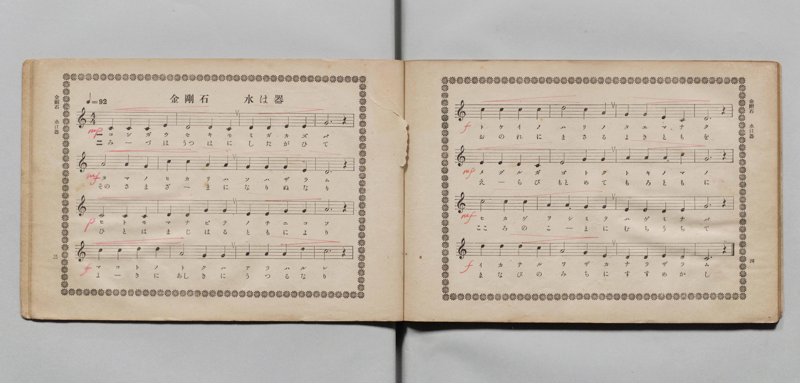
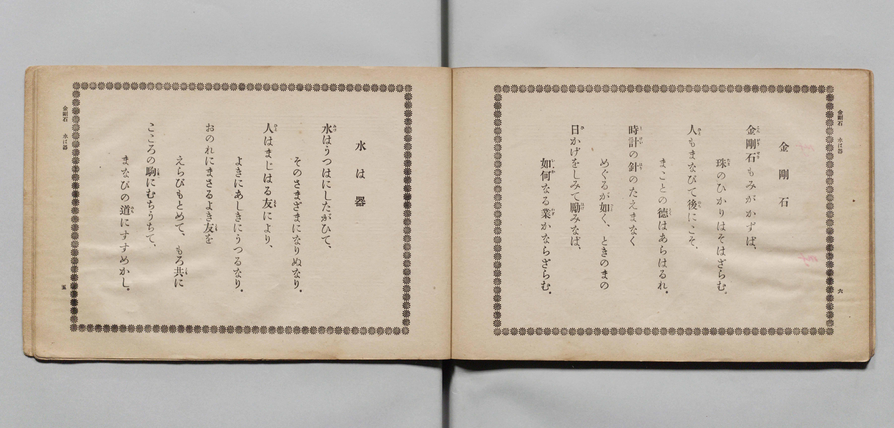

# 金剛石・水はうつは

> Re:Shōka 使用 AI 協助辨識與重建樂譜，可能會有錯誤。歡迎回報。

- **鋼琴伴奏版**：<br><audio controls src="kongoseki_mizu_wa_utsuwa.mp3"></audio>

- 詞：昭憲皇太后御歌
- 曲：奧好義
- 文部省《尋常小學唱歌 第五學年用》（大正二年五月，索書號 4100）

## 說明

原書資訊與歌詞全文（對應 P006.jpg–P009.jpg，原書 pp. 2–5）：
調性與拍號：ハ長調（C 大調）4/4 拍，速度 ♩=92


## 歌詞

```text
水はうつは（P008.jpg，p. 4）
水はうつはにしたがひて、
そのさま〴〵になりぬなり。
人はまじはる友により、
よきにあしきにうつるなり。
おのれにまさるよき友を
えらびもとめて、もろともに
こゝろのこまにむちうちて、
まなびのみちにすゝめかし。

金剛石（P009.jpg，p. 5）
金剛石（こんがうせき）もみがかずば、
たまのひかりはそはざらん。
人もまなびてのちにこそ、
まことの徳（とく）はあらはるれ。
とけいのはりのたえまなく、
めぐるがごとく、ときのまの
日かげをしみてはげみなば、
いかなる業（わざ）かならざらん。
```

## ABC

<div class="abc-score" data-abc-src="kongoseki_mizu_wa_utsuwa.abc" aria-label="五線譜載入中"></div>

[下載 ABC 原始檔](kongoseki_mizu_wa_utsuwa.abc)

## TMD 檔案連結

- [主旋律 TMD 檔案](kongoseki_mizu_wa_utsuwa.tmd) [[在 TMD Studio 編輯](https://tmdlang.github.io/Tmd-TS/#tmd=s7IKdvYPcrWy4qpTUCpJTLdSSM7PyUlNLsnMz7PKyszLyo8vzshPT8wuBdHZiUpwdWX5OaW5qVbpRYkpqfGm8SaGBgYIyeL80qLkVKvi5Iz8_Jz4ktSKkqT8_Gx0-fiCxPRUqwADAzOETEFRfllqXmIeUHdBUWZeSWoKWDtCQWpZZkoqSLo4OTEvviy1KDMtMzUFyV2pRcUgx0OtKClKzCtOLsosAPkIoSq_qAToraLEgoxKq4zM4pL8oszkxJz47MQ8JC-WZKQCfZiZWwC0JDEHXbw8sSS1CNnEzPTMPKvc_LykUmBQYUqkZmZlIgWFlpbCy_aJTztnP5-_-XHz7mcbtjxuXP-4se1x4xIgQ0FLi0vRVsHSiMveVsGZy8ZE38QOZOKLlfPe75n1bMbaZ22bns9qf7pk1dMJfU_3LXy2tgds47PZm4DyT5cuf7p07_N9KyFi09pfNq94PqfxcUPX0w3dT3fseLqh_-naHU-nbARqU3i-Zs2TXVNA_J1bnk9Z8bih-_2ejqdLlj9bu_jJrh6gIFD22ZyO93t6nm9Z9Gz2jhcz5yuAYvv9nk4lLi59LQVbagEuBQWFp33zQXZsbn-xoutFRzvQgUAvP21dAfQEyFkbep-1dyqAkoxeVkH6o4bJQKYliAl0HkSrQkGBnoIRUMYU6EBgWIAMfbFq_7OG5SDjunuBzgeKPm7ufzl1O1AcaKizAtC3YGYnMJgVgGqAhr1smP901zKFRzNX2gIjAWQIWgwBNQLttoDaDbTTBKgfi7rHjasfN05_3Dj_cWPP48ZNjxuXPW5oBKl73Dj3ceO6x41THzfue9yw5XHDVrDSVY-buh43roEyGppASp_s2gU2ad_jxhkgRlP30_5ukOqmDrAiiHlATmMv2IwmsI0QNtgZTUDVSOY9bgRase5xE9BBQBVAU6eCVID1gwxumgRRBDS883Hj5sdNQPNWPG5qhLgdxG0Cmg0UAYqvhiid_LhpLlgU6KHJYCOBjmt43LgQ7AAgifA1UG4VyFSQ0v1gOaAbZoL1A20AOnQ6yJUgtfD8AQlrWDwDwxoUt-gqwI4A2g30FNDK2UC_ABWB3Qi0BSgINHnW48YNcHcAIwToFKAjgHEC9DMwRIAhDIwSIDkN5HGgWYjQBxkDd_gysDaIw4EWzkX2GpC_Aij9dB_ESUB2P8gZIFOBwQZmgIK6Bx4TQBUTHze2gI0EyoEjBuQ2oGaIhf3w-AUGzwRwVAJ9MwViNig-QAxIyIP8A06C05eC_TsJGJXgpAAMAaCjgW4AcoFsoKmIcABaDUkd3c-WrgU5uqkfGAJgR0PEgQzUAKE8p0OBgpY-F5d3fl56fnFqdqZvZlVpeGJoSXFpeaJVQGZiXr5DjUFNNchGBRsLLTswA1t5Ay7CdjS8WNijoGGiACzcnq9v0IEXEppYNADtBRlWo1Cdm1arYKigC8fGQFyjYAQkQRBEg0QhIiAMkoeoMYWqAUEDkAjYSB_DGmBMAUv0zVCpx01rwOQysKbHTbvh4mtBZPMiiHjzfCS1q8HkLqjMBCSL4hEWGQHlGvfDTGtcCibXQ_SAcz1cCiQITKxQqelgHti6xh4wuQkqA3IiqkX4g3xXDzlBbga1AUSDwrBGwTAOSQiEIYELw6hRgi244aHQPA9M9kFDDpj-Qb6GSK0Ck_0Qqaa9cN7jpm1g9kqoJljEYQtuUIkND9apYHIfNPCmwcVBIojgBlvb1AUWA8cuWATkBJAYKcG9o5O8FF4ASeEgCEvliPQMC-QaeMpGiMBiCkuQN0-Ch2sHmIQlY0gEgL3bPBlMtkFlQJHyuLkRTHaDAwUU0rC4wBXioLQJCdYVYBKWwCGBPAMuBiy-oDJgdU1N8EgA1mvkBfjT2bPJL1JgSdoIxAATiPBEhHA1UCks0YMwVCFcN7aQnwcJOOTAh6V3EA8s3gQOEnhiB0UOJIFDk3wzNHU2g1IkjqAHBxsk6HvhgQkKYFDrAocUKK4hJQ8kPshP7LumYIa9OQlhj0YAEzwsTMF81FIGlOwR2QJXwIPDumkjmAR7ER7uoDBFLmSg4uBy6XETOEEiZQyQDCh-cCV5SFkBKmeA7QSU4AUleqSyB5bkwTEFiwpE8gfJwLIpsUm-dS15wQ4sY0CBCE7x8MCEiaCWKDAMjRc81WjzwsdNG-BBC8nLoAQL8tgWuDgkWqDlApS3Fh4NkICHlT-4ghyRcTrBgQgrmUANX7gUuOgCV5JgKbAYljAHxxYpSX1HM2VJHZ6ooSGKWczAinZYAwZ_qMOLdmg7BNo8aN70uGk7PNTB7Qd42Q6pR0EKYTLQhI638QJsK4OqCIhdkJAEpXqwFEwctTZtagDzFoJJSGEDYpPReHnaupqsUAcGOqJIBxNYQh0SxuAYQm43gmhg4Y476CHFCiTYoXUorKCGFRjQ1gpYDUgcogpctJPQjoEEKriwAqd1RMAjGpSQQIYVPTPBPDAJzQiw-hZWFyDsqeXi0rVTwNquVwBKKHMBAA)]
- [鋼琴伴奏 TMD 檔案](kongoseki_mizu_wa_utsuwa_piano.tmd) [[在 TMD Studio 編輯](https://tmdlang.github.io/Tmd-TS/#tmd=s7IKdvYPcrWy4tLSUnjZPvFp5-zn8zc_bt79bMOWx43rHze2PW5cAmS839PxsnvP8wlbnuzZ8nRp__POjvd7OhW0tLgUbRUsjbjsbRWcuWxM9E3suOoUlF6snPd-z6xnM9Y-a9v0fFb70yWrnk7oe7pv4bO1PUog-WezNwHlny5d_nTp3uf7VoLFXrTvet64-PmOvc_nLn66a87jhq6nrWuert3xbMHCp1M2AnU-buh-vmbNk11TgIJPd255PmUF0E1AO55O6nna2_hkRwNQ8P2enudbFj2bvePFzPkKpkbGesbmCibGRka6JkDXKnFxeefnpecXp2Zn-mZWlYYnhpYUl5YnWgVkJublB3k41BjUVHMpAIGNhZYdmFGjUJ2bVqtgqKALx8ZAXKNgBCRBEESDRCEiIAySh6gxhaoBQQOQCNhIH8MahcdNwBDeDJV63LQGTC4Da3rctBsuvhZENi-CiDfPR1K7GkzugspMQLIoHmGREVCucT_MtMalYHI9RA84WuFSIMHHjSBDQVLTwTywdY09YHITVAbkRFSLoKFkBhUE0SBv1ygYxiEJgTAkPGAYNRSxhRDc4c3zwGQf1LOTIL6HSK0Ck_0Qqaa9cN7jpm1g9kqoJlhYYwuhuY8b18FDYiqY3Af17zS4OEgEEUJga5u6wGLgCAGLgJwAEsMaQtW5BZB0BIKwtIRINbBwqYGnH4QILHCxhFLzJHhQdIBJWGKBhBnYhc2TwWQbVAYUjo-bG8FkN9gfoMCBBR-uQAKlAEhIrACTsGQECZcZcLHHTSAzQTJgdU1N8HB73ARyIYEwAuU1WMIxAjHABCIIEIFSDVQKS1ogDFUI140tsOZB_IocXrBUBeKBxZvAvoAnKVB4QpIRNGE1Q9NAMyjecYQW2KeQ0OqF-x8UJk2QzIVNChQ9kCwJCUKikhQsuNAIYLKCBQOYj5r9QIkLkfhwhRU4eJo2gkmwq-BBBQoG5NwHFQdn2MdN4GhHSn4gGVCQ4kpYkEwEyoCPmyCFDSxEQEkLKVPCEhY4cGGhh0hkIBlYZsCe-UD-BqcruP9hIqhZDYahQYmnFG9e-LhpAzw0IIkclCxAbtkCF4eEJDTDQHlr4SEHCStYxsQVSojk2Qn2NyzLAhMUKAggUuA8DS6jwVJgMSzBBA5gAgkKnnSggYCZ_2DFFKzKwx9Q8GIKWnNBK5TmTY-btsMDClzjwMspSDEOUgiTgSYnvNXdZCCC2wXxPChtgaVg4qiFeVMDmLcQTEJyIYiNt7oDFT6I4glMYAkoSLCAAxW5cQCigQUV7tCC5DdISEGLcFihA8tJ0PoNrAYkDlEFLqZIqPkg4QDOxeAUhQgrRKsBEi6wPDkTzAOT0OQGK-5h5RrCnlq8zS0f5OaWCby5ZRivEG0YC6OAiSoeyDKNj4UwUIWwKzKAerFGwQQoaoKkDMqHUgTsQhiDUxlcBF0FwiIMx8A143QekgqEubhdg8NTZiBTzOJzSfAXkSbjNwTdU0SGMWaYohuEmhCwhQ8wvenaKWBNctE-QGW4JY3AkspcAA)]

## 分析

```text
================================================================================
📊 TMD Song Profile: [ 金剛石・水はうつは ]
================================================================================
⏱  Duration:       1:23 (83.5s), 32 measures total
🎼 Key & Tempo:    首調基準 C, != 92.0 BPM, <4/4>
   - 分析範圍：      由實際發聲的音符與和弦推測調性；播放脈絡另行呈現
🎤 人聲音域:    C4 (MIDI 60) – D5 (MIDI 74) [跨度: 14 個半音 / 1.2 個八度, 難度: moderate]
   - 最低音:  C4 in [KongosekiMizuWaUtsuwa #1 @ m.1, 0:00]
   - 最高音: D5 in [KongosekiMizuWaUtsuwa #1 @ m.13, 0:32]
   - 適合: soprano, mezzo-soprano, contralto, tenor, baritone, bass
🏛  結構:      KongosekiMizuWaUtsuwa (83.5s)
⚡ 編曲密度:        Peak 1 軌道同時演奏
🗝  調性診斷：       C 大調（純淨自然大調，未偵測到可信轉調）
   - 風格氣質:    純淨自然大調（陽光明朗、易唱易記，無明顯調外色彩）
   - 轉調歷程:    全曲維持單一推測調性（未偵測到可信轉調）
   - 核心骨幹音:  C, D, G, A, E
   - 調性數值:    C 大調 [相關度: 0.81, 穩定度: Moderate, 自然音純度: 100.0%]
   - 候選調性 (K-S): C 大調 (0.81), G 大調 (0.76), A 小調 (0.64)
   - 五度圈歷程:   +0
   - 各段落調性細節:
     • [KongosekiMizuWaUtsuwa #1]: C 大調 (r: 0.81, 自然音純度: 100.0%)

  [ 五度圈游移軌跡 ]
              [C ]*
         F            G  
      Bb               D  
      Eb               A  
         Ab           E  
            Db       B  
               F# 
     (* = active key center)

  [ 十二半音累積音高分佈 ]
     C  : ████████████████████████  25.8%
     C# :                            0.0%
     D  : ████████████████████      21.7%
     D# :                            0.0%
     E  : ████████████              13.3%
     F  :                            0.0%
     F# :                            0.0%
     G  : ████████████████████      21.7%
     G# :                            0.0%
     A  : ████████████████          17.5%
     A# :                            0.0%
     B  :                            0.0%
--------------------------------------------------------------------------------
Assignment 軌道音域：
  - Piano         : C4 – D5 (14 個半音 / 1.2 個八度, 92 個音符)
================================================================================
```


## 原書掃描頁






