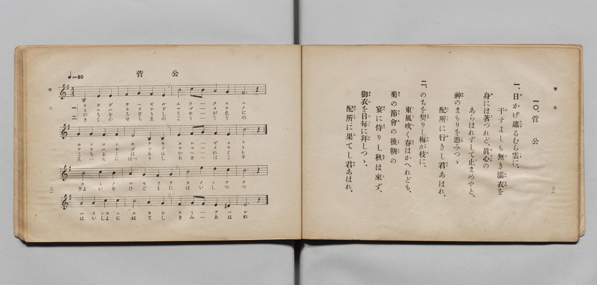

# 菅公

> Re:Shōka 使用 AI 協助辨識與重建樂譜，可能會有錯誤。歡迎回報。

- **鋼琴伴奏版**：<br><audio controls src="kanko.mp3"></audio>

- 文部省《尋常小學唱歌 第五學年用》（大正二年五月，索書號 4100）

## 說明

原書資訊與歌詞全文（對應 P019.jpg，原書 pp. 31–32）：
- 調性與拍號：ホ短調（e 小調）4/4 拍，速度 ♩=80
一〇、菅公


## 歌詞

```text
一、日（ひ）かげ遮（さへぎ）るむら雲（くも）に、
干（ほ）すよしも無（な）き濡衣（ぬれぎぬ）を
身（み）には著（き）つれど、眞心（まごころ）の
あらはれずして止（や）まめやと、
神（かみ）のまもりを憑（たの）みつゝ、
配所（はいしよ）に行（ゆ）きし君（きみ）あはれ。
二、のちを契（ちぎ）りし梅（うめ）が枝（え）に、
東風（こち）吹（ふ）く春（はる）はかへれども、
菊（きく）の節會（せちゑ）の後朝（こうてう）の
宴（えん）に侍（はべ）りし秋（あき）は來（こ）ず、
御衣（ぎよい）を日毎（ひごと）に拜（はい）しつゝ、
配所（はいしよ）に果（は）てし君（きみ）あはれ。
```

## ABC

<div class="abc-score" data-abc-src="kanko.abc" aria-label="五線譜載入中"></div>

[下載 ABC 原始檔](kanko.abc)

## TMD 檔案連結

- [主旋律 TMD 檔案](kanko.tmd) [[在 TMD Studio 編輯](https://tmdlang.github.io/Tmd-TS/#tmd=s7IKdvYPcrWy4qpTUCpJTLdSSM7PyUlNLsnMz7PKyszLyo8vzshPT8wuBdHZiUpwdWX5OaW5qVbpRYkpqfGm8SaGBgYIyeL80qLkVKvi5Iz8_Jz4ktSKkqT8_Gx0-fiCxPRUqwADQ0uETEFRfllqXmIeUHdBUWZeSWoKWDtCQWpZZkoqSLostSgzLTM1BclJqUXFIHdDTS8pSswrTi7KLAB5BqEqv6gE6KOixIKMSquMzOKS_KLM5MSc-OzEPCTflWSkAj0Hka5EF87NL0rMQTYwMz0zDyial1QKDCRMidTMrEykQNDSUnjR3_q0dY2ClhaXoq2ChQGXva2CO1d2aqWtgmsul42JvokdyJBn09pfNq94PqfxcUPX0w3dT3fseLqh_-naHU-nbHy2tkfh-Zo1T3ZNAfF3bnk-ZcXjhu73ezqeLln-bO3iJ7t6gIJA2WdzOt7v6Xm-ZdGz2TtezJyvAIqm93s6lbi49LUUbKkFuBQUFJ72zQfZsbn9xYquFx3tQAe-WDnvaesKoCdAztrQ-6y9UwEU13pZBelAN0HUKxQU6CkYGz5qmGxsBHTX-z2zQGbpKrxYtf9Zw3KQOd29QHcDxR83z34-fy1QHGhaqgIwIMDMTmBYKQDVAA182TD_6a5lCo9mrrQFhijImCc7Gh43tD9uaIQEN1yo8dn0pUBTHjduAhrwuLH7ceOkl43rwCJTHzfueNzYBxJv6n7c1PC4qfPlbKAyoFT_46YmsPrVQBNAZoHA050Qyd1gmZmPm4Ds6UCFz1sWgsVXgcV7n-1f-GLhYrDImsdNPUAbgAywJZNgJr3YtRosD_IUyI7G9S8mTgeLAD0HFFkC1rcSaPfzOfOe7m8GS-173DjlcePkx00QNetghj1ubAK6HGgGWNMskJsalz1buwikqakFrHbf46ZGIPtxIzDhwL3zfOk8sLnAIIG4Yx1YIdCwLqBTn7VNBMvOB4qDZfeDnTUXyYCXrb3POhvAqtY_bgSaDgwMYAoE-ejFwh6w9W2QIAFKPZ0wG-JBmG1NUBc3NIHjaheQ1Qh2w0Kg7U-XQmxfCIufLqARzxa1ggXbgL4BG9HzbN5csAjUViS3PZu78eWiFWDJyUBjgPJPJ-wEc7eC1fY_mwFJFkA3ALMSOPhAIbEDGvLAYEAY9qK_C-b2fkhIPV_f8GwOJFpmg10MdC5I_Om-nmdzIG4CWtsGjAggiRpdT9dtgbj5cdNkiLOf7APGKCQQgU6Eevb5clAOBwcTJL7XP9kHNAlkMJg7Czlh7oOnuD5wqgTHOjAOpy99th4YfqDUD048wAABWfisew481sAiwBRDfNw-mwfVDeYCPUgobikvc6BAQUufi8s7MS873yogMzEv36HGoKYa7GIbCy07MANbSQcuPHc0ANOkgoYJqDQBxp4OvHhSeLp92csFjToKhs_WLNTEohtoKcjkGgXjeGBhBYJmIAaYqFEwB1GGQAxmQAWNgaQJkDSCykGVwaABSAhsqI9hjcLj5klQ8cdNq8HkJrCWx01bQbzmGWCxdWA2SB6kYwGYt7JOIR4otR7MWQSV6kayCOwaiEVGQLlGkCFgixoXgg0FWQwSB_Ma-8BiXWD2dKhMG1isEWxRYw9YqgMqBXILqkX4Y2BXD8UxAApLeFiDiRpIkIMgOHrABFQQqMAQI1pwxcFssEd3goNyBZi9HRqgoIAFB1ozOGia1kLFwaHRvAYSB5DoAQmBpEARiCsOJiPCvxEcwY390AAFxSMkGYDiEMIHiUN4OyAWQeJgJUSqqYnEOADngqf9vS-WteGNCaMBywvz4aEN9nYzNHDAof64uQUS5mCyExrY88BBtgUSPJvBUrAoAqVoXPHQC7MIHP6QvAESBycEaP6YiCIDibk2SF5YBuFApWAZi6S8QI14oF2OaAKle2AZA48FSLiDZHbBgg6cRx43Q0OheQmYNw8cQM3gEAQLgaRAhQaumADJAStDcICCC0B4ygdlR4hFqKUSKNkDYxASE-DiDxw5IKlZJMbEjk78pRL-XAC1yAQUzmAHwFI5PCtAFJkBsSlUIf5Qh5WqkJwAScLwVA4uix43rwKTsFpiP1wdTA8ol4D0gGhcgQ5qKMCsagRnK3htADIY2FwAk-CiEBwrsBIKqhocF8BmA1QGRJMQ7E9nz6Yg2EGBDMKg0EQNUbRCBpzYwUndVB0tb2Are8CpvAmcipu2P25eDg5MUDEEkgRleEhaBBdFsOoBWjDNhxQ_kPiBllng_IIr_FGCEhIXqOEMiRlIMQNL96AyC9jGgqR7SCaAZhVwvYBqVy0Xl66dAri5FO1jGKuA4BiBOcpcAA)]
- [鋼琴伴奏 TMD 檔案](kanko_piano.tmd) [[在 TMD Studio 編輯](https://tmdlang.github.io/Tmd-TS/#tmd=s7IKdvYPcrWy4qpTUCpJTLdSSM7PyUlNLsnMz7PKyszLyo8vzshPT8wuBdHZiUpwdWX5OaW5qVbpRYkpqfGm8SaGBgYIyeL80qLkVKvi5Iz8_Jz4ktSKkqT8_Gx0-fiCxPRUqwADQ0uETEFRfllqXmIeUHdBUWZeSWoKWDtCQWpZZkoqSDoxOTk_tyAxLzM3NQ9Jviy1qBjkeKgVJUWJecXJRZkFIB8hVOUXlQC9VZRYkFFplZFZXJJflJmcmBOfnZiH5MXEIqDm9FSQ-VYFmYl5-fE47CzJACqCmlOJLpybX5SYg2xzZnpmHlA0L6kUGKSYEqmZWZlIQaalpfCiv_Vp65r3ezpedu95PmHLkz1bni7tf97Z8X5Pp4KWFpeirYKFAZe9rYI7V3Zqpa2Cay6XjYm-iR3I5GfT2l82r3g-p_FxQ9fTDd1Pd-x4uqH_6dodT6dsfLa2R-H5mjVPdk0B8XdueT5lxeOGbqAtT5csf7Z28ZNdPUBBoOyzOUCLep5vWfRs9o4XM-crgGIaaLMSF5d3Yl52vlUAKGSCPBxqDGqquRSAwMZCyw7M0NdSsEUHYCt3NLxY2KOgYaIAdMzz9Q06CqA0oJdVkK7wdPuylwsadRQMn61ZqIlFt5Y-2OQaBeN4BV0wNAMxwESNgjmIMgRiMAMqaAwkTYCkEVQOqgwGDUBCYEN9DGsUHjdPgoo_bloNJjeBtTxu2griNc8Ai60Ds0HyIB0LwLyVdQrxQKn1YM4iqFQ3kkVg10AsMgLKNYIMAVvUuBBsKMhikDiY19gHFusCs6dDZdrAYo1gixp7wFIdUCmQW1Atwh8Du3oojgFQWMLDGkzUQIIcBMHRAyaggkAFhhjRgisOZoM9uhMclCvA7O3QAAUFLDjQmsFB07QWKg4OjeY1kDiARA9ICCQFikBccTAZEf6N4Ahu7IcGKCgeIckAFIcQPkgcwtsBsQgSByshUk1NJMYBOBc87e99sawNb0wYDVhemA8PbbC3m6GBAw71x80tkDAHk53QwJ4HDrItkODZDJaCRREoReOKh16YReDwh-QNkDg4IUDzx0QUGUjMtUHywjIIByoFy1gk5QVqxAPtckQTKN0Dyxh4LEDCHSSzCxZ04DzyuBkaCs1LwLx54ABqBocgWAgkBSo0cMUESO5xEyR0wQUgPOWDsiPEItRSCZTsgTEIiQlw8QeOHJDULBJjYkcn_lIJfy6AWmQCCmewA2CpHJ4VIIrMgNgUqhB_qMNKVUhOgCRheCoHl0WPm1eBSVgtsR-uDqYHlEtAekA0rkDve9wEi5PHjeBsBa8NQAY_bpwCJsFFIThWYCUUVDU4Lh43QuMXTJMQ7E9nz6Yg2EGBDMKg0EQNUbRCBpzYwUndVB0tb2Are8CpvAmcipu2P25eDg5MUDEEkgRleEhaBBdFsOoBWjDNhxQ_kPiBllng_IIr_FGCEhIXqOEMiRlIMQNL96Ay63Hjfki6h2QCaFYB1wuodtWitJZ8kFtLJojW0rOmTU8Xr3_auuPl7FZgrDzr7n26dgIwUl6s2g9p9CGC3SweWHzEawMLFAQLVBPEA0M5Pl7bCFUcwQZKmMRrA0MeXG0AY0IbGCtAlgE0QJDVIpuGy0a4eajOIGDyUHczVhNIcTBcBZJSwsEDYgNNA3JAIhhaQMYDE5qunQI4rUX7GMYqIDhGYI4yFwA)]

## 分析

```text
================================================================================
📊 TMD Song Profile: [ 菅公 ]
================================================================================
⏱  Duration:       2:24 (144.0s), 48 measures total
🎼 Key & Tempo:    首調基準 G, != 80.0 BPM, <4/4>
   - 分析範圍：      由實際發聲的音符與和弦推測調性；播放脈絡另行呈現
🎤 人聲音域:    B3 (MIDI 59) – E5 (MIDI 76) [跨度: 17 個半音 / 1.4 個八度, 難度: challenging]
   - 最低音:  B3 in [Kanko[L1] #1 @ m.1, 0:00]
   - 最高音: E5 in [Kanko[L1] #1 @ m.19, 0:54]
   - 適合: soprano, mezzo-soprano, contralto, tenor, baritone, bass
🏛  結構:      Kanko[L1] (72.0s) -> Kanko[L2] (72.0s)
⚡ 編曲密度:        Peak 1 軌道同時演奏
🗝  調性診斷：       E 小調（純淨自然小調，未偵測到可信轉調）
   - 風格氣質:    純淨自然小調（陰鬱抒情、旋律集中，無明顯調外色彩）
   - 轉調歷程:    全曲維持單一推測調性（未偵測到可信轉調）
   - 核心骨幹音:  B, F#, E, G, A
   - 調性數值:    E 小調 [相關度: 0.75, 穩定度: Moderate, 自然音純度: 98.9%]
   - 候選調性 (K-S): E 小調 (0.75), B 大調 (0.68), B 小調 (0.66)
   - 五度圈歷程:   +4 -> +4
   - 各段落調性細節:
     • [Kanko[L1] #1]: E 小調 (r: 0.75, 自然音純度: 98.9%, 調外音: D#)
     • [Kanko[L2] #1]: E 小調 (r: 0.75, 自然音純度: 98.9%, 調外音: D#)

  [ 五度圈游移軌跡 ]
               C  
         F            G  
      Bb               D  
      Eb               A  
         Ab          [E ]*
            Db       B  
               F# 
     (* = active key center)

  [ 十二半音累積音高分佈 ]
     C  : █████                      5.6%
     C# :                            0.0%
     D  : █                          1.1%
     D# : █                          1.1%
     E  : ██████████████████        21.1%
     F  :                            0.0%
     F# : ██████████████████        21.7%
     G  : ████████████              13.9%
     G# :                            0.0%
     A  : ██████                     6.7%
     A# :                            0.0%
     B  : ████████████████████████  28.9%
--------------------------------------------------------------------------------
Assignment 軌道音域：
  - Piano         : B3 – E5 (17 個半音 / 1.4 個八度, 154 個音符)
================================================================================
```


## 原書掃描頁




