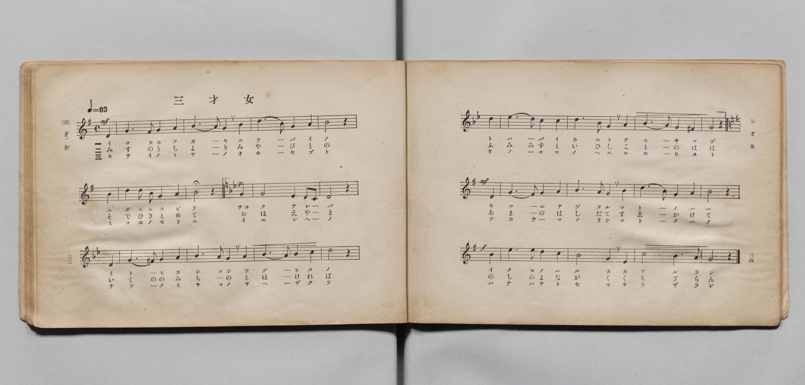
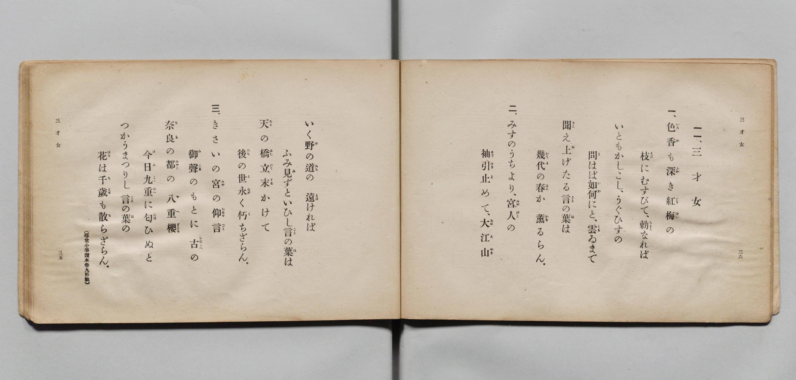

# 三才女

> Re:Shōka 使用 AI 協助辨識與重建樂譜，可能會有錯誤。歡迎回報。

- **鋼琴伴奏版**：<br><audio controls src="sansaijo.mp3"></audio>

- 文部省《尋常小學唱歌 第五學年用》（大正二年五月，索書號 4100）

## 說明

原書資訊與歌詞全文（對應 P020.jpg–P021.jpg，原書 pp. 33–36）：
- 調性與拍號：ホ短調（e 小調，中段第 7–16 小節轉入ニ短調 d 小調）4/4 拍，速度 ♩=92
- 備註：原書歌詞末註「（尋常小學讀本卷九所載）」


## 歌詞

```text
一一、三才女
一、色香（いろか）も深（ふか）き紅梅（こうばい）の
枝（えだ）にむすびて、勅（ちよく）なれば
いともかしこし、うぐひすの
問（と）はば如何（いか）にと、雲ゐ（くもゐ）まで
聞（きこ）え上（あ）げたる言（こと）の葉（は）は
幾代（いくよ）の春（はる）か薫（かを）るらん。
二、みすのうちより、宮人（みやびと）の
袖（そで）引止（ひきと）めて、大江山（おほえやま）
いく野（の）の道（みち）の遠（とほ）ければ
ふみ見（み）ずといひし言（こと）の葉（は）は
天（あま）の橋立（はしだて）末（すゑ）かけて
後（のち）の世（よ）永（なが）く朽（く）ちざらん。
三、きさいの宮（みや）の仰言（おほせごと）
御聲（みこゑ）のもとに古（いにしへ）の
奈良（なら）の都（みやこ）の八重櫻（やへざくら）
今日（けふ）九重（ここのへ）に匂（にほ）ひぬと
つかうまつりし言（こと）の葉（は）の
花（はな）は千歳（ちとせ）も散（ち）らざらん。
```

## ABC

<div class="abc-score" data-abc-src="sansaijo.abc" aria-label="五線譜載入中"></div>

[下載 ABC 原始檔](sansaijo.abc)

## TMD 檔案連結

- [主旋律 TMD 檔案](sansaijo.tmd) [[在 TMD Studio 編輯](https://tmdlang.github.io/Tmd-TS/#tmd=s7IKdvYPcrWy4qpTUCpJTLdSSM7PyUlNLsnMz7PKyszLyo8vzshPT8wuBdHZiUpwdWX5OaW5qVbpRYkpqfGm8SaGBgYIyeL80qLkVKvi5Iz8_Jz4ktSKkqT8_Gx0-fiCxPRUqwADIySdBUX5Zal5iXlA3QVFmXklqSlg7QgFqWWZKakg6bLUosy0zNQUJCelFhWD3A01vaQoMa84uSizAOQZhKr8ohKgj4oSCzIqrTIyi0vyizKTE3PisxPzkHxXkpEK9BxEuhJdOCezJLUosaS0KBXZ1Mz0zDyr3Py8pFJgSGFKpGZmZSKFhJaWwpMdnc86e58u3aygpcWlaKtgacRlb6vgzpWdWmmr4JrLZWOib2IHMufZtPaXzSuez2l83ND1dEP30x07nm7of7p2x9MpG5-t7VF4vmbNk11TQPydW55PWfG4ofv9no6nS5Y_W7v4ya4eoCBQ9tmcjvd7ep5vWfRs9o4XM-crgKLr_Z5OJS4ufS0FW2oBLgUFhad980F2bG5_saLrRUc70IEvVs572roC6AmQszb0PmvvVADFuV5WQfqjhslApiGICXQeRKtCQYGegrExUMrYDOjE93tmgYzVVXixav-zhuUgI7t7gV4Aij9unv18_lqgONDgVAVgmICZPU92rH22biswVBTMgYYYmoFknq9veLG382nr0sfN3RA9CilwHZ3AgFYAmgrU-7Jh_tNdyxQezVxpC4wOsL1Pm2a-WLEbaB3EeRAPPZuzGij4uKEH7CdElLxY1_Bszpqnvduf7Jz7rLPhBcj9nY8berlAZj3Z0QBEjxsa4TEPFQUKvejc9HLZTKBpjxtbHjf1Pm4ERmLn46amZ9s3ggW3QkUae59vaX22qBUsOPlxY9vjxg1ALWCpdSDjQODZvLlgeSBaAJZZ_bip4XHjzMeNmx83LgPa9rQbYsDCx01Ash-sZtXjph6gYTAzQO5oXAF0AdDix43TwZZNB2oFWznhceMmsHlwK59OBZoCNGsF2Kz1QIOeLmt6sncq1EdQx68GGdnQ-HL2psdNE8BS_SAbQGyg7L7Hjcth5r1onAeWB4bEZLBkx5MdXWCRJjB30uPG-Y-bul-saICFBMTmdS8mAoMcKLIe4hC4-3bue7J7Mcw1QFuB-QGk_NmMpRDlQMPAIt0vpq0Gi3Q_bpoEjgMgA0hOftzQBI6uXT3gUNgP8T84OMDB2NQFCth1657s2gXWv_9xE9AmYIBDHQb32aJpYPm5QN8CZZ7umfps7SKwCDBIgd4FK28C2gCOKGA23jj_6UZIIuh63LgbFKsgg_cBlaHEVf_L9j6wqnUQ-16CAg7sjsaFMBFgagDFEdAYsMhE9CgHprL9L5aByg8gA6xkFlg50Hig46YTH9pLVkLiCuJOUDiv7H6-GmIwMHEAk9MCoAeBUsCMBBac-bhpIiT8Qc5qXAY3aR8oi4EDGuqLJzvA4QeOwGcbdoBlVz1uBCoDyvY_m7MXkq7A3IWPG6ehxt4OYG4Ehi0wnKeCvbUOGGPw6IJasHsDzKOQAJ_9uHEKxMcIVy180bgJFryTYW5fB84uwPBa_bR_CSytAdM80LtAdyIngqdLO150AgMN7PYmcCEBjJ9miNshKQeS7Nc9bV39sr332WpgjEEifgfIT6AUDNIFM-_J7q5n0yEpGRh6W4EywAIIqA8WXUAEDEGII1Y_7QHmIaA40GWQdACM2zVAdyPSwRJwPABTNjBLLgGlbMJxj0jfXZDECozmVZBU8bS3-dnazdACBxQ8s6Fl21RIhgRHLDCW0OKK8voIChS09Lm4goGNgcTMrHyrgMzEvHyHGoOaarCLbSy07MAMbBUhuG7d0fBiYY-Chgm0HtGB114KT7cve7kAWJp36SjA6h9NLIYArQdZUKNQnZtWq2AWD6xUjMHYSMEQSNcomIOEdIEcI6hUjYIZWEQXSJtCRUyhIiBoABIBG-pjWKPwuGkJkP-4eS2IbFoNZC0C4qlgXUB-HVhLPJAJUbAZKrEMIgGWap4ANQUo0dyHZBPIZVCbjIByjftBRjTOBJPrgLgNiBdCDexA2NQFVgBSDJJoQbKpcTMQr4BIAE3AapMxSBPEsVvB5BKwqx43z4e6cAncJrBjHzetgkrMRrKpaTcQb4FKdGDYhD_Sd_UQivS1OiCFwMiBNi-2bge2MOCtCrzpAJwEwJEOinJI9MKiHh69CtUFtWBRWMSbgEWNdYCCIGFs6QAUro-bG8BkNxAvAIrthIbAZLBoG3IYAPmNj5uXg0NwPVTicTMo7kBSa-qgKQN7SpgLjmKw5sZNQNyLiNemRrDoMlS7GiGJYjfMokZQnECTByhh7MO0CJQQwJEOSbWPmzdCE8IipGgFeRXFImh2gIk-btoOVT0D4iNY-iYmHezoJJQOunWIi3RTcKTrQLI6MAWA-dB41wELghKDKVAIFNGQCDeCaiAm9yNyHyx0gEUBzPeQEASxgfkeLLcBOfdPQkon-HJ_Czje-qHxB8r_oByMKBcWwt0AllwBltqNnPsnAm3qgerZgN0mcKSD00rzStR8Dk8NzSAvQ_0ETg9LYPGLyP3boIkaJLESwya8sf509mycsd6_GVbkExfrwBiEWgxkmALjFBaXoNiFJQhokQBNGSbqKKkDR7QD0_7j5n7MMhwW8bAyAJxF4CGxCFnDBiCeB5Voxx4Z4GjfCopg5FjcD8SzwHEIyvGgmG8BlwIg1nRo7E5G1rACKanAShos0d4Eyt9TkWMRlGg3I6VLYCRDszaERC_0QUm5GZrASC_0pxCKdmChD-pHzp5HQoUPKtVB9Ty4yAfHM7AUB5KQZACp4JErfFC7AKYGR9zDanJEhQsreUFZ_3ETKCZANDCemoHtAWgIQksIWH4Cph5oOEEyNPa4bwJH6j7kjI2IRkhsg2hgTQMs70EtA5ArJiLHPTARArM9RBOsSsAS983gwgWWdIGlFCJtgmWaQXU8pDyD5PsOSLJA9lQ_vKBAWENcjm9dSyjqgeU8cXEOjXJIhIKiFxaZsMwMTQMwLjxtIJUC2OIcXMxD6-nHzcAcBS8TQfEHimiIPkgYgsQhyQAhByoIQeKguhRXfIOiF9KkgxbxTdBquhEU_sB-FsxMcDUAEoeoBYlMg9rfCU4EoAYHrriGuBhUyINoULSBmgzwGh3YdIO5HFbTw4pwUMGO3y-1XFy6dgqw9n60j2GsAgrfCI1vDOYrcwEA)]
- [鋼琴伴奏 TMD 檔案](sansaijo_piano.tmd) [[在 TMD Studio 編輯](https://tmdlang.github.io/Tmd-TS/#tmd=s7IKdvYPcrWy4qpTUCpJTLdSSM7PyUlNLsnMz7PKyszLyo8vzshPT8wuBdHZiUpwdWX5OaW5qVbpRYkpqfGm8SaGBgYIyeL80qLkVKvi5Iz8_Jz4ktSKkqT8_Gx0-fiCxPRUqwADIySdBUX5Zal5iXlA3QVFmXklqSlg7QgFqWWZKakg6cTk5PzcgsS8zNzUPCT5stSiYpDjoVaUFCXmFScXZRaAfIRQlV9UAvRWUWJBRqVVRmZxSX5RZnJiTnx2Yh6SFxOLgJrTU0HmWxVkJublx-OwsyQDqAhqTiW6cE5mSWpRYklpUSqy9ZnpmXlWufl5SaXAcMWUSM3MykQKNy0thSc7Op919j5duvn9no6X3XueT9jyZM-Wp0v7n3d2vN_TqaClxaVoq2BpxGVvq-DOlZ1aaavgmstlY6JvYgcy_Nm09pfNK57PaXzc0PV0Q_fTHTuebuh_unbH0ykbn63tUXi-Zs2TXVNA_J1bnk9Z8bihG2jL0yXLn61d_GRXD1AQKPtsDtCinudbFj2bvePFzPkKoBgH2qzExRUMDOLEzKx8qwBQIAV5ONQY1FRzKQCBjYWWHZihr6Vgiw7Atu5oeLGwR0HDRAHonufrG3QUQMlBL6sgXeHp9mUvFzQ-2dGlo5AKkn2xar8mFkO09MEW1ChU56bVKpjFK-gqGIOxkYIhkK5RMAcJ6QI5RlCpGgUzsIgukDaFiphCRUDQACQCNtTHsEbhcdMSIP9x81oQ2bQayFoExFPBuoD8OrCWeCATomAzVGIZRAIs1TwBagpQorkPySaQy6A2GQHlGveDjGicCSbXAXEbEC-EGtiBsKkLrACkGCTRgmRT42YgXgGRAJqA1SZjkCaIY7eCySVgVz1ung914RK4TWDHPm5aBZWYjWRT024g3gKV6MCwCX-k7-ohFOlrdUAKgZEDUfFi6_YXezsVUohJB-AkAI50UJRDohcW9fDoVaguqAWLwiLeBCxqrAMUBAljSwegcH3c3AAmu4F4AVBsJzQEJoNF25DDAMhvfNy8HByC66ESj5tBcQeSWlMHTRnYU8JccBSDNTduAuJeRLw2NYJFl6Ha1QhJFLthFjWC4gSaPEAJYx-mRaCEAI50SKp93LwRmhAWIUUryKsoFkGzA0z0cdN2qOoZEB_B0jcx6WBHJ6F00K1DXKSbgiNdB5LVgSkAzIfGuw5YEJQYTIFCoIiGRLgRVAMxuR-R-2ChAywKYL6HhCCIDcz3YLkNyLl_ElI6wZf7W8Dx1g-NP1D-B-VgRLmwEO4GsOQKsNRu5Nw_EWhTD1TPBuw2gSMdnFaaV6Lmc3hqaAZ5GeoncHpYAotfRO7fBk3UIImVGDbhjfWns2fjjPX-zbAin7hYB8Yg1GIgwxQYp7C4BMUuLEFAiwRoyjBRR0kdOKIdmPYfN_djluGwiIeVAeAsAg-JRcgaNgDxPKhEO_bIAEf7VlAEI8fifiCeBY5DUI4HxXwLuBQAsaZDY3cysoYVSEkFVtJgifYmUP6eihyLoES7GSldAiMZmrUhJHqhD0rKzdAERnqhP4VQtAMLfWAp_3T2PBIqfFCpDqrnwUU-OJ6BpTiQhCQDSAWPXOGD2gUwNTjiHlaTIypcWMkLyvqPm0AxAaKB8dQMbA9AQxBaQsDyEzD1QMMJkqGxx30TOFL3IWdsRDRCYhtEA2saYHkPahmAXDEROe6BiRCY7SGaYFUClrhvBhcusKQLLKUQaRMs0wyq4yHlGSTfd0CSBbKn-uEFBcIa4nJ861pCUQ8s54mLc2iUQyIUFL2wyIRlZmgagHHhaQOpFMAW5-BiHlpPP24G5ih4mQiKP1BEQ_RBwhAkDkkGCDlQQQgSB9WluOIbFL2QJh20iG-CVtONoPB_3AjKWxA5aOqBqgWJTIPa3wlOBKAGB664hrgYVMiDaFC0gZoM8Bod2HSDuRxW08OKcFDBjt8vtejNfR_k5r4Jorn_cnbri_YtT_uXvFy0AljkP-vufbp2AqTLgtxWi1cwjNc2BmVdGAsYnUC2eXx8vLYRqjiCjawCVPkjeCC2ATQ0cJkPVGYSrw1MDkAeUC1Evw6SAXAORK06WDGQhTCYkBaYDggDTb0JqnoMs3BYQ0gbihPAPo7XNgS5AuwFIAckgiwJVApiEwouoBnG8drAOhPOQFaJ5EkgzxQYVsDMBglYkk1Fihjk-EU1AGQwMBXq2inAEmK0j2GsAgrfCI1vDOYrcwEA)]

## 分析

```text
================================================================================
📊 TMD Song Profile: [ 三才女 ]
================================================================================
⏱  Duration:       3:07 (187.8s), 72 measures total
🎼 Key & Tempo:    首調基準 G, != 92.0 BPM, <4/4>
   - 分析範圍：      由實際發聲的音符與和弦推測調性；播放脈絡另行呈現
🎤 人聲音域:    C#4 (MIDI 61) – F5 (MIDI 77) [跨度: 16 個半音 / 1.3 個八度, 難度: moderate]
   - 最低音:  C#4 in [Sansaijo[L1] #1 @ m.15, 0:38]
   - 最高音: F5 in [Sansaijo[L1] #1 @ m.13, 0:31]
   - 適合: soprano, mezzo-soprano, contralto, tenor, baritone, bass
🏛  結構:      Sansaijo[L1] (62.6s) -> Sansaijo[L2] (62.6s) -> Sansaijo[L3] (62.6s)
⚡ 編曲密度:        Peak 1 軌道同時演奏
🗝  調性診斷：       D 調性不明確（流行色彩大調，未偵測到可信轉調）
   - 風格氣質:    流行大調（略帶和弦色彩音與裝飾副屬和弦）
   - 轉調歷程:    全曲維持單一推測調性（未偵測到可信轉調）
   - 核心骨幹音:  D, E, A, B, F
   - 調性數值:    D 調性不明確 [相關度: 0.71, 穩定度: Ambiguous, 自然音純度: 86.0%]
   - 候選調性 (K-S): D 大調 (0.71), A 大調 (0.68), A 小調 (0.62)
   - 五度圈歷程:   +2 -> +2 -> +2
   - 各段落調性細節:
     • [Sansaijo[L1] #1]: D 調性不明確 (r: 0.71, 自然音純度: 86.0%, 調外音: C, F, A#)
     • [Sansaijo[L2] #1]: D 調性不明確 (r: 0.71, 自然音純度: 86.0%, 調外音: C, F, A#)
     • [Sansaijo[L3] #1]: D 調性不明確 (r: 0.71, 自然音純度: 86.0%, 調外音: C, F, A#)

  [ 五度圈游移軌跡 ]
               C  
         F            G  
      Bb              [D ]*
      Eb               A  
         Ab           E  
            Db       B  
               F# 
     (* = active key center)

  [ 十二半音累積音高分佈 ]
     C  : ██████                     5.1%
     C# : █                          0.6%
     D  : ████████████████████████  19.7%
     D# :                            0.0%
     E  : ████████████████████████  19.7%
     F  : ████████                   6.7%
     F# : █████                      3.9%
     G  : ████████                   6.2%
     G# :                            0.0%
     A  : ████████████████████████  19.7%
     A# : ███                        2.2%
     B  : ████████████████████      16.3%
--------------------------------------------------------------------------------
Assignment 軌道音域：
  - Piano         : C#4 – F5 (16 個半音 / 1.3 個八度, 240 個音符)
================================================================================
```


## 原書掃描頁






