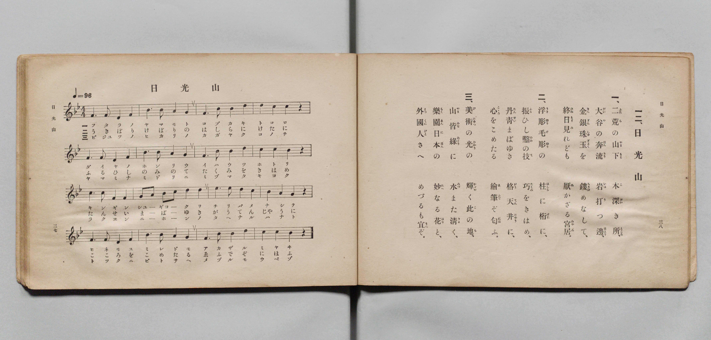

# 日光山

> Re:Shōka 使用 AI 協助辨識與重建樂譜，可能會有錯誤。歡迎回報。

- **鋼琴伴奏版**：<br><audio controls src="nikkozan.mp3"></audio>

- 文部省《尋常小學唱歌 第五學年用》（大正二年五月，索書號 4100）

## 說明

原書資訊與歌詞全文（對應 P022.jpg，原書 pp. 37–38）：
- 調性與拍號：変ロ長調（Bb 大調）4/4 拍，速度 ♩=96


## 歌詞

```text
一二、日光山
一、二荒（ふたら）の山下（やまもと）　木深（こぶか）き所（ところ）、
大谷（だいや）の奔流（ほんりう）　岩（いは）打（う）つ邊（ほとり）、
金銀珠玉（きんぎんしゆぎよく）を　鏤（ちりば）めなして、
終日（ひねもす）見（み）れども　厭（あ）かざる宮居（みやゐ）。
二、浮彫（うきぼり）毛彫（けぼり）の　柱（はしら）に桁（けた）に、
振（ふる）ひし鑿（のみ）の技（て）　巧（たくみ）をきはめ、
丹青（たんせい）まばゆき　格天井（がうてんじやう）に、
心（こころ）をこめたる　繪筆（ゑふで）ぞ匂（にほ）ふ。
三、美術（びじゆつ）の光（ひかり）の　輝（かがや）く此（こ）の地（ち）、
山（やま）皆（みな）緑（みどり）に　水（みづ）また清（きよ）く、
樂園（らくえん）日本（にほん）の　妙（たへ）なる花（はな）と、
外國人（とつくにびと）さへ　めづるも宜（うべ）ぞ。
```

## ABC

<div class="abc-score" data-abc-src="nikkozan.abc" aria-label="五線譜載入中"></div>

[下載 ABC 原始檔](nikkozan.abc)

## TMD 檔案連結

- [主旋律 TMD 檔案](nikkozan.tmd) [[在 TMD Studio 編輯](https://tmdlang.github.io/Tmd-TS/#tmd=s7IKdvYPcrWy4qpTUCpJTLdSSM7PyUlNLsnMz7PKyszLyo8vzshPT8wuBdHZiUpwdWX5OaW5qVbpRYkpqfGm8SaGBgYIyeL80qLkVKvi5Iz8_Jz4ktSKkqT8_Gx0-fiCxPRUqwADIyOETEFRfllqXmIeUHdBUWZeSWoKWDtCQWpZZkoqSLostSgzLTM1BclJqUXFIHdDTS8pSswrTi7KLAB5BqEqv6gE6KOixIKMSquMzOKS_KLM5MSc-OzEPCTflWSkgjyXClWILpFcmlNSWpSKbGhmemaeVW5-XlIpMKAwJVIzszKRAkJLS-HZ9KVPWzufbtyooKXFpWirYGnGZW-r4KTDZWOib2IHMuDZtPaXzSuez2l83ND1dEP30x07nm7of7p2x9MpG5-t7VF4vmbNk11TQPydW55PWfG4ofv9no6nS5Y_W7v4ya4eoCBQ9tmcjvd7ep5vWfRs9o4XM-crgKLp_Z5OJS4ufS0FW2oBLgUFhad980F2bG5_saLrRUc70IEvVs572roC6AmQszb0PmvvVADFtV5WQTrQTRD1CgUFegrG5o8aJhtbAN31fs8skFm6Ci9W7X_WsBxkTncv0N1A8adLOh83r305dTtQCmigU5IC0KtgdicwvBSA6oCGvmyY_3TXMoVHM1faAoMTZNSTHQ3AwHjc0AgPbqgoUAgo8aJ3EtCwx41bHzfOf9wEtL_zceM6oKInO0CB-bip5XHjvsdNTY8bV4CkGhqezVnxbPtGsJbJjxu3PW4EKgNq6X3W2QAWXAESbwI6Bai4EWQTCIAcumE7WH7B48YWoKlQe5ZOeba1ESy--3ETUF_X48Y2iD1PN60EiwPtXw8UedY5GcwFyzYuednUBdUFtBDERrbtZfvEl10Nz_sXPO8D-geoqhdkdmMfmJz-uKkNzAaK94P0NU0C2vayfwlY5UKwEzaAxRsfN64CqW9chmT2861NwHAEq930uHEtOGRmApW_WAYOrkZQbDxu6nncuBIkBfRG31qweBPY3d2PG6c9bup-ug4Ywq0Q9aAQbpoA9kATOGIgcbV13dO9qyE-Brm_cQ_El8_Wz4aJT4QLAgMSFDHzIbGyHuxHSESufrYQErpAxcAkBBJB8suzHmDIgqO-CRKJQB9NfzkRlLhARkL80rjuWRckZpdBI2b7cjB3PjD8YP6dBHbjelCYIYx_smPny7mQxAVMWcCgnw2MTbCR-4BBDI6GXpC7F-x5umTlk11TwSqBIQcUXwZWPwOc-iAxjuzup_ubYekPltRALgCygVEGtKobaOrznauerwVqBaZgoN-BiRvoaKAx8572AGMCqHc1MO2ARbbCwn0HKAk939f3YiEkpW0GOwDoGGDKAKfVVkhiAgZSN3K4v9gzFywOjNseWMLuf7YWkp6ARoH1zgEmKVDyQssWG8FRBs5jQJnns8AOBqaJxlUg7vaJMC4wMUEsBAZDw7MNW2DiwIQICc75z3ZA0hMwqQPLO5ATkCN6RdPTOeCYaALLNAIZIJcBU_KzOWvg4QERhPjq6TJgqobE8g6w4CpguL7ogicxkANBeQ85j097Oqf7ya5dsGJgCdgqoMHAkAQXHo1TgYYBzQbH01JQPDU1PV03B5bKd0JiCBoflJfJUKCgpc_F5ZeZnZ1flZhnFZCZmJfvUGNQUw12t42Flh2Yga0yANcvOxpeLOxR0DBRANY8z9c36MBLcIWn25e9XNCoiUUf0EaQmTUKpvHAktwYRIBZZiCiRsEQSOoqGIFpqBBCGiRoBBYzhrJAtAFIBGyoj2GNwuPmqUD-46b9ILJ5JZjsA-t53LwEbPjj5nlAvAjM6oDING0G86aBda4Gk2uhekAqYPIgMbCbILYZAeUb20Ayjb1gcg9YbRdEZ-NEiG1AUYgYMPFAZdaDedPBqjvBbJCdMD3AhAUXQ7LNGOSayWA9Ox43LwU7qAXFe5MgFgI98Lh5FbIM1EtrwGKgQHjcBHICwuMgdY-bG-EW4o92YMVIfrTDYg1Eg-KzBhK14FSASA1QUUTUQ6IdpMEclhLQ470B7DGw9yCehAfMbEjANG-GBUzTMqj3Ier64WKQIIXpgcY-WA96vG8F6-kGx9QmeHyCZECxDOLvh7KBRTZUBhKvYNuAsiD9oCgDyUDSDzhdNCGiARHvEHfOA5NgU5qhqQzMA_E74ZEOchNM5nFzK0InOE-AfA1Kx4-bV4DFQHYSE-k7OimIdFCEg6LdBEyCHAHK4cCYNARHLFLehyUPJCFwhIP5aDEO9gc0XpvAIQ1kQXy4HZhD6oD-Aoo_bl4OYYFDtxkUV6DQAYUyLMQmgMmFUBlwXm3aDhYD5W70mIeGeNNkIBucShqhaaZxH9iixg0Q-xAlA0iuB8yDiIFTGlA_RAZUlSNJYsv2oGIMElmPm8DRBvNoczfYrubZEAqRm0GBACkCZ8CTy-NmaDEDSfBQMVASJyIBPJ09myaFPSzCQUkDklDgRT8ReR6Ufx43g3MPpERv2gn1IiT1Q4o8cBkLlgcFC0QdpEjchhIsED2QvLYBS8yDS18I2QS2E55_IWLgNAXJ5eCSAWQbpEQHlxaNy8EkKC-C9IBd0LgbLo8e6ZCyB5w0oGkXlrPBtkFrJrDJ4EgGyYDSMCzPg82H-xpSus0E69kHt62Wi0vXTgHWAoj2MYxVQOEbofGNwXxlLgA)]
- [鋼琴伴奏 TMD 檔案](nikkozan_piano.tmd) [[在 TMD Studio 編輯](https://tmdlang.github.io/Tmd-TS/#tmd=s7IKdvYPcrWy4qpTUCpJTLdSSM7PyUlNLsnMz7PKyszLyo8vzshPT8wuBdHZiUpwdWX5OaW5qVbpRYkpqfGm8SaGBgYIyeL80qLkVKvi5Iz8_Jz4ktSKkqT8_Gx0-fiCxPRUqwADIyOETEFRfllqXmIeUHdBUWZeSWoKWDtCQWpZZkoqSDoxOTk_tyAxLzM3NQ9Jviy1qBjkeKgVJUWJecXJRZkFIB8hVOUXlQC9VZRYkFFplZFZXJJflJmcmBOfnZiH5MXEIqDm9FSQ-VYFmYl5-fE47CzJACqySk-FmogukVyaU1JalIpse2Z6Zp5Vbn5eUikwWDElUjOzMpGCTUtL4dn0pU9bO59u3Ph-T8fL7j3PJ2x5smfL06X9zzs73u_pVNDS4lK0VbA047K3VXDS4bIx0TexA5n6bFr7y-YVz-c0Pm7oerqh--mOHU839D9du-PplI3P1vYoPF-z5smuKSD-zi3Pp6x43NANNP7pkuXP1i5-sqsHKAiUfTYHaEPP8y2Lns3e8WLmfAVQTAOtVOLi8svMzs6vSsyzCgAFTpCHQ41BTTWXAhDYWGjZgRn6Wgq26ABs646GFwt7FDRMFIDueb6-QUcBlAz0sgrSFZ5uX_ZyQaMmFn1a-mAzaxRM4xV0FYxBBJhlBiJqFAyBpK6CEZiGCiGkQYJGYDFjKAtEG4BEwIb6GNYoPG6eCuQ_btoPIptXgsk-sJ7HzUvAhj9ungfEi8CsDohM02YwbxpY52owuRaqB6QCJg8SA7sJYpsRUL6xDSTT2Asm94DVdkF0Nk6E2AYUhYg9blwHlVkP5k0Hq-4Es0F2wvQ8bpwPF0OyzRjkmslgPTseNy8FO6gFxXuTIBYCPfC4eRWyDNRLa8BioEB43ARyAsLjIHWPmxvhFuKP9l09FEQ7LNZANCg-ayBRC04FiNQAFUVEPSTaQRrMYSkBPd4bwB4Dew_iSXjAzIYETPNmWMA0LYN6H6KuHy4GCVKYHmjsg_Wgx_tWsJ5ucExtgscnSAYUyyD-fij7cSPUNmi8gm0DyoL0g6IMJANJP-B00YSIBkS8Q9w5D0yCTWmGpjIwD8TvhEc6yE0wmcfNrQid4DwB8jUoHT9uXgEWA9lJTKTv6KQg0kERDop2EzAJcgQohwNj0hAcsUh5H5Y8kITAEQ7mo8U42B_QeG0ChzSQBfHhdmAOqQP6Cyj-uHk5hAUO3WZQXIFCBxTKsBCbACYXQmXAebVpO1gMlLvRYx4a4k2TgWxwKmmEppnGfWCLGjdA7EOUDCC5HjAPIgZOaUD9EJkZj5vA-RgqiS3bg4oxSGQ9bgJHG8yjzd1gu5pnQyhEbgYFAqQInAFPLo-bocUMJMFDxUBJnIgE8HT2bJoU9rAIByUNSEKBF_1E5HlQ_nncDM49kBK9aSfUi5DUDynywGUsWB4ULBB1kCJxG0qwQPRA8toGLDEPLn0hZBPYTnj-hYiB0xQkl4NLBpBtkBIdXFo0LgeToLwI0gN2QeNuuDx6pEPKHnDSgKZdWM4G2watmcAmgyMZJANKw7A8DzYf7mtI6TYTrGcf3LZa9AaAD3IDwATRAHjR1_V01pYX_etf7poOTArPunufrp0Aab0gYtkwHlSGawOjGMFCFjWLBzIN47WBCQGUJIAcIwzVSMJgpgE0THBqQDIUSQWKuBGQZRKvDUxUGKYgjEeYaQJkmcVrG6KqRnE8Dj-BLVIH2wQWx2Y69qBBshPNbKDtJjgcDow9XTsFWARG-xjGKqDwjdD4xmC-MhcA)]

## 分析

```text
================================================================================
📊 TMD Song Profile: [ 日光山 ]
================================================================================
⏱  Duration:       2:00 (120.0s), 48 measures total
🎼 Key & Tempo:    首調基準 B,, != 96.0 BPM, <4/4>
   - 分析範圍：      由實際發聲的音符與和弦推測調性；播放脈絡另行呈現
🎤 人聲音域:    D4 (MIDI 62) – D#5 (MIDI 75) [跨度: 13 個半音 / 1.1 個八度, 難度: moderate]
   - 最低音:  D4 in [Nikkozan[L1] #1 @ m.1, 0:00]
   - 最高音: D#5 in [Nikkozan[L1] #1 @ m.9, 0:21]
   - 適合: soprano, mezzo-soprano, contralto, tenor, baritone, bass
🏛  結構:      Nikkozan[L1] (40.0s) -> Nikkozan[L2] (40.0s) -> Nikkozan[L3] (40.0s)
⚡ 編曲密度:        Peak 1 軌道同時演奏
🗝  調性診斷：       G 小調（純淨自然小調，未偵測到可信轉調）
   - 風格氣質:    純淨自然小調（陰鬱抒情、旋律集中，無明顯調外色彩）
   - 轉調歷程:    全曲維持單一推測調性（未偵測到可信轉調）
   - 核心骨幹音:  A#, D, G, C, F
   - 調性數值:    G 小調 [相關度: 0.83, 穩定度: Moderate, 自然音純度: 100.0%]
   - 候選調性 (K-S): G 小調 (0.83), A# 大調 (0.80), F 大調 (0.62)
   - 五度圈歷程:   +1 -> +1 -> +1
   - 各段落調性細節:
     • [Nikkozan[L1] #1]: G 小調 (r: 0.83, 自然音純度: 100.0%)
     • [Nikkozan[L2] #1]: G 小調 (r: 0.83, 自然音純度: 100.0%)
     • [Nikkozan[L3] #1]: G 小調 (r: 0.83, 自然音純度: 100.0%)

  [ 五度圈游移軌跡 ]
               C  
         F           [G ]*
      Bb               D  
      Eb               A  
         Ab           E  
            Db       B  
               F# 
     (* = active key center)

  [ 十二半音累積音高分佈 ]
     C  : ██████████████████        16.7%
     C# :                            0.0%
     D  : █████████████████████     20.0%
     D# : ████                       3.3%
     E  :                            0.0%
     F  : █████████████             12.5%
     F# :                            0.0%
     G  : ████████████████████      19.2%
     G# :                            0.0%
     A  : ██████                     5.8%
     A# : ████████████████████████  22.5%
     B  :                            0.0%
--------------------------------------------------------------------------------
Assignment 軌道音域：
  - Piano         : D4 – D#5 (13 個半音 / 1.1 個八度, 186 個音符)
================================================================================
```


## 原書掃描頁




