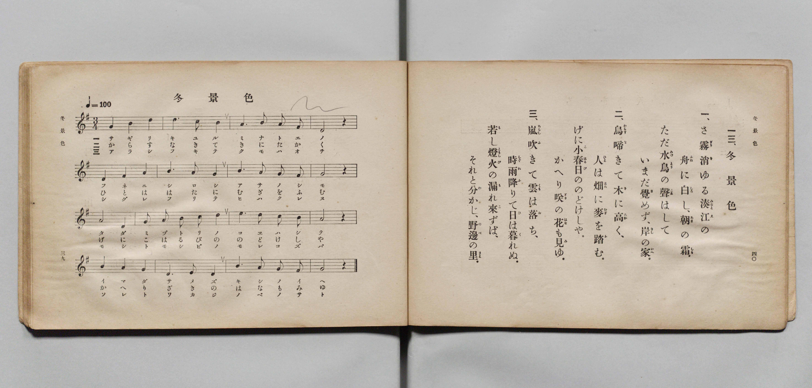

# 冬景色

> Re:Shōka 使用 AI 協助辨識與重建樂譜，可能會有錯誤。歡迎回報。

- **鋼琴伴奏版**：<br><audio controls src="fuyugeshiki.mp3"></audio>

- 文部省《尋常小學唱歌 第五學年用》（大正二年五月，索書號 4100）

## 說明

原書資訊與歌詞全文（對應 P023.jpg，原書 pp. 39–40）：
- 調性與拍號：ト長調（G 大調）3/4 拍，速度 ♩=100


## 歌詞

```text
一三、冬景色
一、さ霧（ぎり）消（き）ゆる湊江（みなとえ）の
舟（ふね）に白（しろ）し、朝（あさ）の霜（しも）。
ただ水鳥（みづとり）の聲（こゑ）はして、
いまだ覺（さ）めず、岸（きし）の家（いへ）。
二、烏（からす）啼（な）きて木（き）に高（たか）く、
人（ひと）は畑（はた）に麥（むぎ）を踏（ふ）む。
げに小春日（こはるび）ののどけしや、
かへり咲（ざき）の花（はな）も見（み）ゆ。
三、嵐（あらし）吹（ふ）きて雲（くも）は落（お）ち、
時雨（しぐれ）降（ふ）りて日（ひ）は暮（く）れぬ。
若（も）し燈火（ともしび）の漏（も）れ來（こ）ずば、
それと分（わ）かじ、野邊（のべ）の里（さと）。
```

## ABC

<div class="abc-score" data-abc-src="fuyugeshiki.abc" aria-label="五線譜載入中"></div>

[下載 ABC 原始檔](fuyugeshiki.abc)

## TMD 檔案連結

- [主旋律 TMD 檔案](fuyugeshiki.tmd) [[在 TMD Studio 編輯](https://tmdlang.github.io/Tmd-TS/#tmd=s7IKdvYPcrWy4qpTUCpJTLdSSM7PyUlNLsnMz7PKyszLyo8vzshPT8wuBdHZiUpwdWX5OaW5qVbpRYkpqfGm8SaGBgYIyeL80qLkVKvi5Iz8_Jz4ktSKkqT8_Gx0-fiCxPRUqwADI2OETEFRfllqXmIeUHdBUWZeSWoKWDtCQWpZZkoqSLostSgzLTM1BclJqUXFIHdDTS8pSswrTi7KLAB5BqEqv6gE6KOixIKMSquMzOKS_KLM5MSc-OzEPCTflWSkAj2Xl1hSWpSKLlqcmlicn1eMbGJmemaeVW5-XlIpMJQwJVIzszKRQkFLS-Fp25pnM9e_6NykoKXFpWirAAw9LntbBXcuG2N9EzuQAc-mtb9sXvF8TuPjhq6nG7qf7tjxdEP_07U7nk7Z-Gxtj8LzNWue7JoC4u_c8nzKiscN3e_3dDxdsvzZ2sVPdvUABYGyz-Z0vN_T83zLomezd7yYOV8BFEfv93QqcXHpaynYUgtwKSgoPO2bD7Jjc_uLFV0vOtqBDnyxct7T1hVAT4CctaH3WXunAiii9bIK0oFugqhXKCjQUzC2fNQw2QTkrvd7ZoHM0lV4sWr_s4blIHO6e4HuBoo_bu54OXU7UBxomrsC0JtgZicwrBSAaoAGvmyY_3TXMoVHM1fagoISZM6THQ1PdnQ-bmiEhzVUFCj0uHHqyznLgYY9bux73NQFNOrZNmBYAblAwzofN7U9bup-trPr2Uag5UDB_Y8bVz1uXPG4Eaim83HjOpBBIPCiAyK_9XHjWrDM6ucz94JFpj9uApsEZDQ0PpszFyzYBLQWYsDLOXNgyppAIg1NMCMfN85_3Ljg2YYtLzcvhdm9FGQ32JVArS8aN4HFJz9umggWWQ8ypnEZ0B6EGS2PG_cBjXmxbBdYLdjWJqCvZ4GCY9MOiE-B-iBGPl23DSwC1AWUgrkGmIyAqp8394Pluh83AZXOBEo_nboHLLIKrBloyrJnc1Ygwq5x9cvVM8BcoEeAiRIo0o_ktie7IE7aBPQTxPnPpwL9ARQB-gMYmmADdoG93tQAjB2wyye92AFxxVYwFxiDSOE1CagDmDWezVj6bDokyCaDDGvqfty4GeI_MFr5uHEiOMBbUEIKqGoHMGyfToKE6jSYL9a96NoIcxbYp01NL5aB8hgwRqBJBBpMkDS2dQI0ikHBBArXpxN2IpwMDqaXsyF29EMjvXH9iwmQ1AKJ2oVIDns2s-nlbEioAiN3wuOmHqCSlzOBboOHQhco5KE-BhoMMu_ZrHUQG8AKeh43rkEKqRfdkFCF2D39eXvH88bVYOXAxAVMmkB7oOH1bA84tCEqm3qe7GuDBCtYdtbjxg0oITgXbNOKpx1gVU1gu0HBOgOo6mV730tQwgXqBkYBMEDAib8d6BlQqoQmAYgTKS-IoEBBS5-Ly620sjQ9tTgjMzvTKiAzMS_focagphrsaBsLLTswA1shCC5XdzS8WNijoGGiAExWz9c36MBLLoWn25e9XNCoiUUf0FKQmTUKhsACTFfBSMEYSNYomEJ5INEaIA3iGYP5MJ6uggFIDqzbx7BG4XHTVrDo46Z1Co-bV4H1PW5aCxFrXgbEqyFizfOhYl1A3AFUswIs2gc1NR5hqhHIBJAukOqVQPZOqAldUJvWAtltaDZ1A9n7wfpAousxTTUGiS9CMnU71NSpWEyF6H_cvAiI-4H8VWCVjSim4o-UXT0URIoZyAZdBfN4jIhARBKIB1QHi0GMeIH5q7kXHDoQf4H8DBID-hXmf1iYAOMRFBsgcZBuiChGvDRPgpoAjEFgyEBCEESDTACGP8ym5gVQMVCq2AR2DUIUM16g7mraAFSzBjVegGkKHi9w20Fxsh6sFiTaQ0K87OikNF7ABCS7QOIFKACJJrAMJDrAMWMK44PjDSnL7Ad7ogFMgrIFyBOtSAELzUbgzPG4aTM0cCAZBhTYkACDBgtSptkEFgVFAUQXUuQAs-Hj5snI5kKz3uPmTnAy2Ihk7hLU6AEnBphcB9QMWLLZjmEuLJOBIwfsjsdNu8AiEwhH0NPZsymIIFC0gDAko8CjAhwRyGWdEe580wTy_OPmefAoQirjmhdCvYJU8oADAJRvloCDYAbUVGzlGUQWUUpug5oAKnlAQYccXaBSElT6zAeLLsM0FZxv9kIDGjlioGUX0MbHTTuQIgakZibUrVvBoiAdCFNrubh07RSQaqJoH8NYBXQhI0whY7CQMhcA)]
- [鋼琴伴奏 TMD 檔案](fuyugeshiki_piano.tmd) [[在 TMD Studio 編輯](https://tmdlang.github.io/Tmd-TS/#tmd=s7IKdvYPcrWy4qpTUCpJTLdSSM7PyUlNLsnMz7PKyszLyo8vzshPT8wuBdHZiUpwdWX5OaW5qVbpRYkpqfGm8SaGBgYIyeL80qLkVKvi5Iz8_Jz4ktSKkqT8_Gx0-fiCxPRUqwADI2OETEFRfllqXmIeUHdBUWZeSWoKWDtCQWpZZkoqSDoxOTk_tyAxLzM3NQ9Jviy1qBjkeKgVJUWJecXJRZkFIB8hVOUXlQC9VZRYkFFplZFZXJJflJmcmBOfnZiH5MXEIqDm9FSQ-VYFmYl5-fE47CzJACqyykssKS1KRRctTk0szs8rRrY6Mz0zzyo3Py-pFBimmBKpmVmZSGGmpaXwtG3Ns5nrX3Ruer-n42X3nucTtjzZs-Xp0v7nnR3v93QqaGlxKdoqACOAy95WwZ3LxljfxA5k6rNp7S-bVzyf0_i4oevphu6nO3Y83dD_dO2Op1M2Plvbo_B8zZonu6aA-Du3PJ-y4nFDN9D4p0uWP1u7-MmuHqAgUPbZHKANPc-3LHo2e8eLmfMVQNEMtFKJi8uttLI0PbU4IzM70yoAFDhBHg41BjXVXApAYGOhZQdm6Gsp2KIDsMU7Gl4s7FHQMFEAOun5-gYdBVAy0MsqSFd4un3ZywWNmlj0aemDzaxRMFTQBUIjBWMgWaNgCuWBRGuANIhnDObDeLoKBiA5sG4fwxqFx01bwaKPm9YpPG5eBdb3uGktRKx5GRCvhog1z4eKdQFxB1DNCrBoH9TUeISpRiATQLpAqlcC2TuhJnRBbVoLZLeh2dQNZO8H6wOJrsc01RgkvgjJ1O1QU6diMRWi_3HzIiDuB_JXgVU2opiKP1J29VAQKWYgG3QVzOMxIgIRSSAeUB0sBjHiBeav5l5w6ED8BfIzSAzoV5j_YWECjEdQbIDEQbohohjx0jwJagIwBoEhAwlBEA0yARj-MJuaF0DFQKliE9g1CFHMeIG6q2kDUM0a1HgBpil4vMBtB8XJerBakGgPCfGyo5PSeAETkOwCiRegACSawDKQ6ADHjCmMD443pCyzH-yJBjAJyhYgT7QiBSw0G4Ezx-OmzdDAgWQYUGBDAgwaLEiZZhNYFBQFEF1IkQPMho-bJyObC816j5s7wclgI5K5S1CjB5wYYHIdUDNgyWY7hrmwTAaOHLA7HjftAotMIBxBT2fPpiCCQNECwpCMAo8KcEQgl3VGuPNNE8jzj5vnwaMIqYxrXgj1ClLJAw4AUL5ZAg6CGVBTsZVnEFlEKbkNagKo5AEFHXJ0gUpJUOkzHyy6DNNUcL7ZCw1o5IiBll1AGx837UCKGJCamVC3bgWLgnQgTK3FUhH5IFdEJoiK6FnXpGfNrcDM9Ky79-naCZAqFKlSiVcwjtcGhjqExCJgGh-vYARmQ0hkEQOoF0EZCpi14rWNYSQ2fXCjgVLaRigi-AwCqjSJ1wZlXagAdrsgbKhd6L4jwgnYHQUMal07BaTQjvYxjFVAFzLCFDIGCylzAQA)]

## 分析

```text
================================================================================
📊 TMD Song Profile: [ 冬景色 ]
================================================================================
⏱  Duration:       1:26 (86.4s), 48 measures total
🎼 Key & Tempo:    首調基準 G, != 100.0 BPM, <3/4>
   - 分析範圍：      由實際發聲的音符與和弦推測調性；播放脈絡另行呈現
🎤 人聲音域:    D4 (MIDI 62) – D5 (MIDI 74) [跨度: 12 個半音 / 1.0 個八度, 難度: easy]
   - 最低音:  D4 in [Fuyugeshiki[L1] #1 @ m.12, 0:19]
   - 最高音: D5 in [Fuyugeshiki[L1] #1 @ m.2, 0:01]
   - 適合: soprano, mezzo-soprano, contralto, tenor, baritone, bass
🏛  結構:      Fuyugeshiki[L1] (28.8s) -> Fuyugeshiki[L2] (28.8s) -> Fuyugeshiki[L3] (28.8s)
⚡ 編曲密度:        Peak 1 軌道同時演奏
🗝  調性診斷：       G 大調（純淨自然大調，未偵測到可信轉調）
   - 風格氣質:    純淨自然大調（陽光明朗、易唱易記，無明顯調外色彩）
   - 轉調歷程:    全曲維持單一推測調性（未偵測到可信轉調）
   - 核心骨幹音:  G, A, E, B, D
   - 調性數值:    G 大調 [相關度: 0.74, 穩定度: Moderate, 自然音純度: 100.0%]
   - 候選調性 (K-S): G 大調 (0.74), E 小調 (0.62), D 大調 (0.61)
   - 五度圈歷程:   +1 -> +1 -> +1
   - 各段落調性細節:
     • [Fuyugeshiki[L1] #1]: G 大調 (r: 0.74, 自然音純度: 100.0%)
     • [Fuyugeshiki[L2] #1]: G 大調 (r: 0.74, 自然音純度: 100.0%)
     • [Fuyugeshiki[L3] #1]: G 大調 (r: 0.74, 自然音純度: 100.0%)

  [ 五度圈游移軌跡 ]
               C  
         F           [G ]*
      Bb               D  
      Eb               A  
         Ab           E  
            Db       B  
               F# 
     (* = active key center)

  [ 十二半音累積音高分佈 ]
     C  :                            0.0%
     C# :                            0.0%
     D  : ████████                  11.1%
     D# :                            0.0%
     E  : ███████████               14.4%
     F  :                            0.0%
     F# : █                          1.1%
     G  : ████████████████████████  32.2%
     G# :                            0.0%
     A  : █████████████████████     27.8%
     A# :                            0.0%
     B  : ██████████                13.3%
--------------------------------------------------------------------------------
Assignment 軌道音域：
  - Piano         : D4 – D5 (12 個半音 / 1.0 個八度, 135 個音符)
================================================================================
```


## 原書掃描頁




